<!-- cover -->
# Intelligent IT Service Management and Incident Resolution System (I-ITSM)

**Project report**

Course: CS F213 / MAC F212 Object Oriented Programming, Semester I, 2026-2027

| | |
|---|---|
| Group number | [GROUP NO.] |
| Faculty guide | [FACULTY GUIDE NAME] |
| Date of submission | [SUBMISSION DATE] |
| Source code repository | [GITHUB REPOSITORY URL] |
| Demonstration video | [VIDEO URL] |

**Team members**

| Name | College ID | Individual contribution |
|---|---|---|
| [MEMBER 1 NAME] | [COLLEGE ID] | [CONTRIBUTION] |
| [MEMBER 2 NAME] | [COLLEGE ID] | [CONTRIBUTION] |
| [MEMBER 3 NAME] | [COLLEGE ID] | [CONTRIBUTION] |

<!-- /cover -->

<!-- frontmatter -->
## Declaration

We declare that this report describes the project we submitted, that the system was built with the help of AI tooling as the assignment permits, and that we have read the code and can explain it.

## Abstract

Organisations depend on IT services such as payment systems, authentication, networks and storage. When one of them fails, the speed and quality of the response depend on how the incident is reported, prioritised, assigned, tracked and recorded. Done by e-mail and telephone, this produces delayed responses, inconsistent priorities, uneven workload, missed service level agreements (SLAs), duplicate work and no reliable history.

This report describes I-ITSM, an Intelligent IT Service Management and Incident Resolution System that manages the complete incident lifecycle (report, classify, prioritise, assign, investigate, resolve, verify, close). It is a web application with a React front end, a FastAPI back end and a SQLite database. Its design is deliberately object oriented: the State pattern governs the lifecycle, the Strategy pattern makes priority and assignment algorithms interchangeable, the Observer pattern decouples audit logging and notifications from the workflow, and the Repository pattern isolates persistence. Six intelligent features (category suggestion, duplicate detection, correlation of related incidents, suggested resolutions, technician recommendation and SLA risk assessment) are rule based and explain their decisions. A background monitor tracks SLA deadlines, records violations and escalates unacknowledged critical incidents.

The system was verified with 264 automated tests (all passing, 94.8 percent statement coverage of the back end), a clean-install check of the back end and the front-end production build, a scripted browser pass, and a program that checks the class, ER, architecture and use case diagrams against the source code. The report also states what was not tested and which dependency advisories remain open.

<!-- /frontmatter -->

# Chapter 1: Introduction

## 1.1 Project overview

I-ITSM is an incident management platform for the IT service desk of an organisation. Employees report problems through a web form. The system then classifies the incident, calculates its priority, selects the applicable SLA, recommends or selects a suitable technician, notifies the people involved, tracks the investigation, monitors the deadlines, records every important action in an audit trail and feeds dashboards and reports.

Three kinds of user work in the system. Employees report and follow incidents. Technicians investigate and resolve the incidents assigned to them. Administrators configure the service desk, assign work, monitor service levels and review the audit trail. A fourth, non-human actor, the SLA monitor, runs in the background.

The system is a full-stack application of about 6,000 lines of Python for the back end (65 modules), about 2,000 lines of JavaScript and CSS for the front end, and about 2,100 lines of automated tests. It exposes 63 operations on 52 REST paths and stores its data in 15 relational tables.

## 1.2 Background and motivation

The assignment frames the work as a software engineering exercise rather than a language exercise. The central question it poses is how object-oriented thinking can produce a maintainable, extensible and intelligent system for managing IT incidents. Incident management is a good vehicle for that question because it contains several independent axes of change that object-oriented design is meant to handle:

* The *algorithms* change (how priority is computed, how a technician is chosen).
* The *behaviour depends on state* (what may happen to an incident depends on its status and on who is acting).
* The *side effects multiply* (every change must be audited, notified and possibly escalated, but the workflow should not know about each of these).
* The *delivery channels* change (in-app today, e-mail, SMS or push tomorrow).
* The *storage* may change (SQLite for the project, a server database in production).

A service desk that works by e-mail and telephone handles none of these well. The motivation of this project is to show a design in which each axis of change has its own seam, so that a new priority formula, assignment rule, notification channel or lifecycle step is added by writing a class rather than by editing the workflow.

## 1.3 Problem statement

Large organisations may receive hundreds or thousands of incident reports a day. Handled manually this leads to delayed response, incorrect prioritisation, inefficient technician allocation, SLA violations, poor visibility into service health, duplicate reports, incomplete history and difficulty in identifying recurring problems. The problem addressed by this project is:

> To design and build an integrated system that takes an incident from first report to closure, applies consistent and explainable rules for classification, priority, SLA and assignment, informs the right people at the right time, keeps an unalterable record of what happened, and gives managers the visibility they need, using object-oriented design that remains easy to maintain and extend.

## 1.4 Objectives

1. Implement the full incident lifecycle (report, classify, prioritise, assign, investigate, resolve, verify, close) and make illegal transitions impossible.
2. Provide separate, role-appropriate functions for employees, technicians and administrators, enforced on the server.
3. Calculate priority from impact, urgency, business criticality and the number of affected users, with the algorithm and its rationale documented.
4. Offer at least two interchangeable technician assignment strategies, selectable at run time without redesign.
5. Determine the applicable SLA, compute deadlines, warn before they pass, detect and record violations and escalate overdue critical incidents.
6. Notify relevant users through at least two mechanisms, with a design that accepts new ones easily.
7. Keep a complete, append-only audit trail.
8. Support searching and filtering on more than five criteria, dashboards and reports.
9. Provide at least two intelligent features. This project provides four, plus correlation of related incidents and suggested resolutions.
10. Apply and be able to justify encapsulation, abstraction, inheritance, polymorphism, interfaces, composition, association and aggregation, exception handling and at least two design patterns.
11. Verify the result with documented tests and verify the design documents against the code.

## 1.5 Scope of the project

**In scope.** Everything in the minimum viable product of the assignment: user management for three roles, incident management (create, view, update, assign, resolve, close), priority management, at least two assignment strategies, SLA calculation, deadline tracking and violation detection, notifications through two mechanisms, a complete incident history, search with more than five criteria, reporting, intelligent features, and persistent storage. Additionally: automatic escalation, a background SLA monitor, a configuration console for administrators, an explainable affected-users rule for priority, and diagrams that are generated from and checked against the code.

**Out of scope.** The following were deliberately not built, and the report does not claim them:

* Real e-mail, SMS or push delivery. E-mail is simulated: messages are stored in an outbox table and written to the server log.
* Multi-organisation (multi-tenant) operation.
* Machine-learning models. All intelligence is rule based.
* Mobile applications, attachment uploads, password reset by e-mail, login lockout and rate limiting.
* Cloud deployment, containers and continuous integration.
* An automated front-end test suite.

## 1.6 Stakeholders

**Table 1.1: Stakeholders and what each expects from the system**

| Stakeholder | Interest | How the system serves them |
|----------|-------------------|--------------------------------|
| Employee (reporter) | Gets the problem fixed quickly and knows its status | Simple report form with live priority preview and duplicate warning, timeline, notifications, verify or reopen, feedback |
| Technician | A clear, fair workload that matches their skills | Personal queue, availability switch, assignment only when eligible, notes, information requests, resolution form |
| Administrator (service desk manager) | Control, visibility and SLA compliance | Ranked recommendations and audited override, dashboards and reports, SLA monitor, configuration, audit log |
| Management and auditors | Evidence and trends | Append-only audit log, reports by service and category, SLA compliance figures |
| Business owners of services | Critical services restored first | Business criticality of each service feeds the priority score |
| Developers and maintainers | Code that can be changed safely | Layered design, documented patterns, tests, diagrams verified against the code |

## 1.7 Organisation of this report

Chapter 2 analyses the problem and states the requirements. Chapter 3 presents the architecture, technology choices, database and the use case and class models. Chapter 4 explains the object-oriented design in the actual code. Chapter 5 describes the implementation feature by feature with screenshots. Chapter 6 reports testing and validation, including known limitations and dependency advisories. A companion document, `docs/TECHNOLOGY_SELECTION_REPORT.md`, goes deeper on the technology choices, the error scenarios, security, persistence and a ten-column test-case table, and `docs/SCREENSHOT_CHECKLIST.md` lists the screenshots to capture as evidence. Chapter 7 discusses results against the requirements, and Chapter 8 concludes. Appendices hold the acceptance scenarios, the data dictionary summary, the demonstration data and the commands to reproduce every check.

# Chapter 2: Problem Analysis and Requirements

## 2.1 Detailed problem analysis

An incident passes through several hands. The reporter describes a symptom, someone must understand what it affects, decide how urgent it is, find a person who can fix it and has time, make sure the fix happens before a promised deadline, tell everyone concerned, and record what was done. Each of these steps goes wrong in a predictable way when it depends on individual judgement and on informal channels.

**Table 2.1: Challenges named in the assignment and the design response**

| Challenge | Consequence | Design response in I-ITSM |
|-------------|------------------|--------------------------------------|
| Delayed response | Users wait, deadlines pass unnoticed | SLA policy per priority or service, deadlines fixed at creation, warning at 75 percent, violation recorded once, escalation of unacknowledged P1 and P2 incidents |
| Incorrect prioritisation | Wrong order of work | Priority score = impact x urgency x business criticality with P1 to P4 bands. A large number of affected users raises the counted impact (Section 5.5) |
| Inefficient technician allocation | Slow or failed resolution, overloaded staff | Eligibility policy (active, available, holds the skill, below the workload limit) plus three ranking strategies chosen by the administrator |
| SLA violations | Penalties, unhappy users | Background monitor every 60 seconds, risk assessment, escalation chain |
| Poor visibility into service health | Managers cannot see problems forming | Role-specific dashboards, reports by service, category and technician, SLA monitor screen |
| Duplicate incident reports | Wasted effort | Similarity check warns while the employee types, and never blocks |
| Incomplete incident history | No accountability or learning | Append-only audit log of every event, notes, timeline, resolution record |
| Difficulty identifying recurring problems | The same fault returns | Correlation of open incidents on one service, suggested resolutions from similar resolved incidents, category-by-service matrix |

## 2.2 Existing system and its limitations

The assignment does not name a particular organisation, and we did not study the internal systems of a real one. The "existing system" assumed here is the one the assignment itself describes: incidents arrive by e-mail, telephone or chat and are tracked, if at all, in a shared mailbox or spreadsheet. Its limitations follow directly from that: there is no enforced lifecycle, no consistent priority rule, no skill or workload view when allocating work, deadlines are remembered rather than computed, nothing prevents duplicate effort, and the history lives in individual inboxes. These limitations are the baseline against which the proposed system is judged. No measurement of an actual before-and-after improvement was made, and none is claimed.

## 2.3 Proposed system

The proposed system is a three-tier web application. A React single-page application gives each role its own screens. A FastAPI back end exposes a REST API, with thin route handlers, a service layer that holds the business workflows, and a domain layer for the lifecycle, events and exceptions. SQLAlchemy and SQLite provide persistence behind repositories. Every request gets its own dependency-injection container and one database transaction. A background thread monitors SLA deadlines. Chapter 3 describes the architecture in detail.

The main design decision is to put each axis of change behind an abstraction: lifecycle behaviour in State objects, algorithms in Strategy objects, side effects in Observers, notification channels behind an interface, and SQL in repositories. Business rules live only in the service and domain layers, so the user interface and the HTTP layer can change without touching them.

## 2.4 User roles and permissions

There are three human roles and one system actor.

**Table 2.2: Roles and what each may do**

| Capability | Employee | Technician | Administrator |
|----------------------------|:---:|:---:|:---:|
| Register, sign in, edit own profile and password | Yes | Yes | Yes |
| Report an incident | Yes | No | Yes |
| Preview priority, check duplicates, see category suggestion | Yes | Yes | Yes |
| See incidents | Own only | Assigned to them only | All |
| Add comment or reply to information request | Own incidents | Assigned incidents | Any |
| Verify, reopen or close a resolved incident | Own incidents | No | Yes |
| Give feedback on a resolution | Own incidents, once | No | No |
| Set own availability, see own queue | No | Yes | No |
| Acknowledge, investigate, add investigation notes, request information, resolve | No | Assigned incidents | Yes |
| View technician workload overview | No | Yes | Yes |
| Assign or reassign, view recommendations, override | No | No | Yes |
| Change impact, urgency, criticality or service after creation | No | No | Yes |
| Manage users, skills, teams, categories, services, SLA policies, settings | No | No | Yes |
| Reports, SLA monitor, audit log, e-mail outbox | No | No | Yes |

The role matrix is not only documented but tested. The test file `test_use_case_matrix.py` calls the real API as each role for 23 of the 32 use cases (those that can be exercised with a single request) and requires that exactly the listed roles are accepted and every other role is refused with HTTP 403 (anonymous callers receive 401).

## 2.5 Functional requirements

**Table 2.3: Functional requirements**

| ID | Requirement |
|-----|---------------------------------------------------------|
| FR-01 | A person can register (always as an employee) and sign in with e-mail and password. Three roles exist. Deactivated accounts cannot sign in or use an old token |
| FR-02 | An administrator can create, edit and deactivate users and set role, department and technician profile (team, skills with proficiency, experience, workload limit). A technician with active incidents cannot be deactivated |
| FR-03 | An employee can report an incident with title (5 to 200 characters), description (10 to 5000), service, impact 1 to 5, urgency 1 to 5, optional affected system, optional number of affected users (0 to 1,000,000) and optional category. The incident receives a unique number (`INC-1001` upward) |
| FR-04 | The system suggests a category from keywords and shows why. Administrators maintain categories and keywords |
| FR-05 | The system calculates the priority score and level P1 to P4 and shows a preview before submission |
| FR-06 | The system selects an SLA policy (service-specific first, then the standard policy for the priority) and sets response and resolution deadlines |
| FR-07 | The system assigns automatically with a configurable strategy when a technician is eligible, otherwise leaves the incident unassigned and notifies administrators. An administrator can assign or reassign manually, with an explicit audited override for ineligible technicians |
| FR-08 | The lifecycle NEW, CLASSIFIED, ASSIGNED, ACKNOWLEDGED, IN_PROGRESS, RESOLVED, VERIFIED, CLOSED is enforced. Illegal transitions are rejected and change nothing |
| FR-09 | The assigned technician can acknowledge, start investigation, add notes, request information from the reporter and resolve with a summary and root cause |
| FR-10 | The reporter can follow status and timeline, reply to information requests, verify or reopen (with reason) a resolved incident, close a verified one and rate the resolution once |
| FR-11 | An SLA monitor evaluates open incidents every 60 seconds (and on demand by an administrator): warning at 75 percent, one violation per incident per type, escalation of unacknowledged P1 and P2 incidents |
| FR-12 | Notifications are produced for relevant events as in-app messages and simulated e-mail. An administrator can read the e-mail outbox |
| FR-13 | Every state change, assignment, override, priority change, sign-in and configuration change is written to an append-only audit log with actor, action, previous and new state, description and time |
| FR-14 | Users can search incidents by free text, number, date range, status, priority, category, service, technician, SLA status, unassigned and awaiting information. Employees see only their own incidents |
| FR-15 | Each role has a dashboard. Administrators have reports: overview, by service, by category, technician workload, trends and the category-by-service matrix |
| FR-16 | Intelligent features: category suggestion, duplicate detection, technician recommendation with reasons, SLA risk assessment, correlation of related incidents and suggested resolutions |
| FR-17 | Administrators configure categories, services (with business criticality), SLA policies, teams and global settings without restarting |
| FR-18 | Data is stored persistently and survives a restart |
| FR-19 | Users can edit their own profile and change their password, giving the current password |

## 2.6 Non-functional requirements

**Table 2.4: Non-functional requirements and how each is met**

| ID | Category | Requirement | How it is met |
|-------|----------|-------------------------------|--------------------------|
| NFR-01 | Authentication | Signed tokens with expiry (60 minutes by default), checked on every request | PyJWT, HS256, expiry claim |
| NFR-02 | Password storage | Passwords hashed with bcrypt (cost 12 by default), never returned. 8 to 128 characters with at least one letter and one digit. bcrypt reads only the first 72 bytes | `utils/security.py` truncates explicitly |
| NFR-03 | Authorisation | Role checks on the server for every endpoint and object-level checks on incidents | Dependencies and `incident_service` |
| NFR-04 | Input validation | All input validated, database access only through bound parameters | Pydantic schemas and SQLAlchemy |
| NFR-05 | Error safety | Errors return JSON with `detail` and `code`. Stack traces and SQL are never shown | `middleware/errors.py` |
| NFR-06 | Configuration | Production mode refuses the default secret key and can start with no demo accounts | `config.py`, `seed.py` |
| NFR-07 | Auditability | Audit rows cannot be edited or deleted through the API or the ORM | ORM listeners, no write route |
| NFR-08 | Atomicity | One transaction per use case, rolled back on failure | `@transactional` |
| NFR-09 | Resilience | A failing notification never blocks an incident update, a failing audit write aborts it | Observer `critical` flag |
| NFR-10 | Determinism | Time comes from an injectable clock so SLA behaviour is testable | `Clock` abstraction |
| NFR-11 | Usability | Role-specific navigation, loading, error and empty states on every data screen, readable messages | Shared `Async` component, role-based menu |
| NFR-12 | Maintainability | A new strategy, channel or lifecycle state means adding one class | Patterns of Chapter 4 |
| NFR-13 | Testability | Automated tests with coverage reported | Chapter 6 |
| NFR-14 | Portability | Runs on Windows, macOS and Linux with Python 3.11 or later and Node 18 or later | Checked on Linux and Windows (Section 6.7) |
| NFR-15 | Data compatibility | An existing database gains new nullable columns automatically on start | `_add_missing_nullable_columns` |
| NFR-16 | Scalability limit | One process and SQLite. Not designed for many concurrent writers | Section 3.3 |

Performance was observed to be comfortable on a laptop with the demonstration data, but no load test was run, so no figure is claimed.

## 2.7 Business rules

**Table 2.5: Business rules**

| ID | Rule |
|------|---------------------------------------------------------|
| BR-01 | Priority score = impact x urgency x business criticality, each from 1 to 5 |
| BR-02 | P1 is 40 to 125, P2 is 20 to 39, P3 is 8 to 19, P4 is 1 to 7 |
| BR-03 | Business criticality defaults from the service. Only an administrator may override it |
| BR-04 | Standard SLA targets (response, resolution): P1 5 min and 30 min, P2 15 min and 2 h, P3 1 h and 8 h, P4 4 h and 24 h |
| BR-05 | Deadlines are creation time plus the target in calendar minutes |
| BR-06 | The response clock stops at acknowledgement and the resolution clock when the incident becomes RESOLVED |
| BR-07 | A warning is raised once when 75 percent of an interval has elapsed (configurable per policy) |
| BR-08 | At most one violation is recorded per incident and SLA type |
| BR-09 | A technician's active workload counts incidents in ASSIGNED, ACKNOWLEDGED and IN_PROGRESS. The default limit is 5 |
| BR-10 | A technician is eligible only if active, available, holding the category skill and below the workload limit |
| BR-11 | The system never silently assigns a technician without the required skill. An administrator may override and the override is audited |
| BR-12 | Only transitions defined by the lifecycle are allowed and every accepted transition is audited |
| BR-13 | Resolving requires a resolution summary and a root cause. Reopening requires a reason |
| BR-14 | Duplicate detection only warns. It never blocks, merges or closes |
| BR-15 | Audit records are append-only |
| BR-16 | If 10 or more users are affected the counted impact is at least 2, for 50 or more at least 3, for 250 or more at least 4, for 1000 or more 5. The counted impact is the larger of the reporter's value and this floor, so it is never lowered. Both values are stored and any raise is explained in the audit log. An administrator can disable the rule |
| BR-17 | Only the reporter can give feedback, once, and only when the incident is RESOLVED, VERIFIED or CLOSED |
| BR-18 | Only an administrator can change impact, urgency, business criticality or service after creation. Only the reporter or an administrator can edit the text fields, including the affected-user count. Only the assigned technician or an administrator can change the category |
| BR-19 | Technicians cannot report incidents |
| BR-20 | Escalation applies to unacknowledged P1 and P2 incidents and steps up once per response interval after the deadline through Team Lead, System Administrator and IT Manager |
| BR-21 | Closed incidents are read-only |

## 2.8 Assumptions

1. The system serves one organisation, one service desk and one display time zone. All stored times are UTC.
2. Accounts are created by an administrator or by self-registration. Self-registration always creates an employee.
3. SLA targets are measured in calendar minutes, not working hours. The clock does not pause when information is requested from the reporter, because the assignment defines no pause rule.
4. An incident has one category, one service and at most one assigned technician at a time.
5. Impact and urgency are chosen by the reporter on a scale of 1 to 5. Business criticality comes from the service.
6. "Critical" on the dashboards means an open P1 incident.
7. A technician belongs to at most one team and has a personal workload limit.
8. SQLite and a single server process are sufficient for the intended load.
9. The system runs inside the organisation's network or on a developer's machine and is not exposed to the public internet in this submission.
10. The affected-user thresholds (10, 50, 250, 1000) are reasonable defaults for a mid-sized organisation. They are constants in code and the rule can be switched off.

# Chapter 3: System Design and Architecture

## 3.1 Overall system architecture

I-ITSM is a layered web application. The browser runs a React single-page application. It talks to a FastAPI back end over HTTP and JSON, authenticating each request with a bearer token. The back end is organised so that every layer depends only on layers below it and no business rule lives in the HTTP layer or in the user interface.

**Table 3.1: Back-end layers and their responsibilities**

| Layer | Package | Responsibility | Deliberately does not |
|-------|---------------|--------------------------------|--------------------------|
| API | `routes/`, `middleware/` | HTTP, validation, authentication and role checks, one call into one service method | Contain business rules or SQL |
| Schemas | `schemas/` | Pydantic request and response models | Touch the database |
| Services | `services/` | Workflows, SLA, intelligence, reports, the per-request container | Know about HTTP |
| Strategies | `strategies/` | Interchangeable algorithms for priority and assignment | Know about the UI or HTTP |
| Observers | `observers/` | Audit logging and notifications, reacting to events | Drive the workflow |
| Domain | `domain/` | Enumerations, the incident lifecycle (State), events, exceptions, the clock | Access the database |
| Data access | `repositories/` | Every database read and write | Make business decisions |
| Persistence | `models/`, `database.py` | Tables, relationships, engine and session | Import the web framework |

Three mechanisms tie the layers together.

* **Per-request container.** Each request builds a `Container` that creates the repositories, the event bus with its two observers, and every service around one database session. Nothing is global, so each request is isolated and tests can build the same container with a fake clock.
* **Unit of work.** A `@transactional` decorator on service methods commits when the outermost call succeeds and rolls everything back when anything fails. A rejected action therefore never leaves half-written data.
* **Event bus.** Services publish domain events. The audit observer and the notification observer subscribe to the bus. The workflow code never mentions either.

A typical request, such as an employee reporting an incident, flows as follows. The route validates the JSON body and resolves the signed-in user. It calls `IncidentService.create_incident`. The service validates the service and category, computes the effective impact and the priority through the configured strategy, selects the SLA policy, builds the incident through `IncidentFactory`, applies the SLA deadlines, publishes `INCIDENT_CREATED`, `PRIORITY_CALCULATED` and `INCIDENT_CLASSIFIED` events, asks the assignment service for a technician and, when one is eligible, publishes `INCIDENT_ASSIGNED`. For each event the audit observer writes a row and the notification observer sends messages through every channel. The transaction commits and the route returns the incident together with any duplicate warnings.

A background thread, the SLA monitor, runs alongside the web server. Every 60 seconds it builds its own container, evaluates every open incident and commits the warnings, violations and escalations it produces.

## 3.2 Architecture diagram

Figure 3.1 shows the components and their interactions. The arrows between back-end packages are not drawn by hand: they are the actual `import` relationships between the packages of `backend/app`, extracted by program and re-checked by an independent scan (Section 3.9). The diagram therefore also proves the layering rules. For example, no module in `repositories`, `models` or `domain` imports `services` or `routes`.

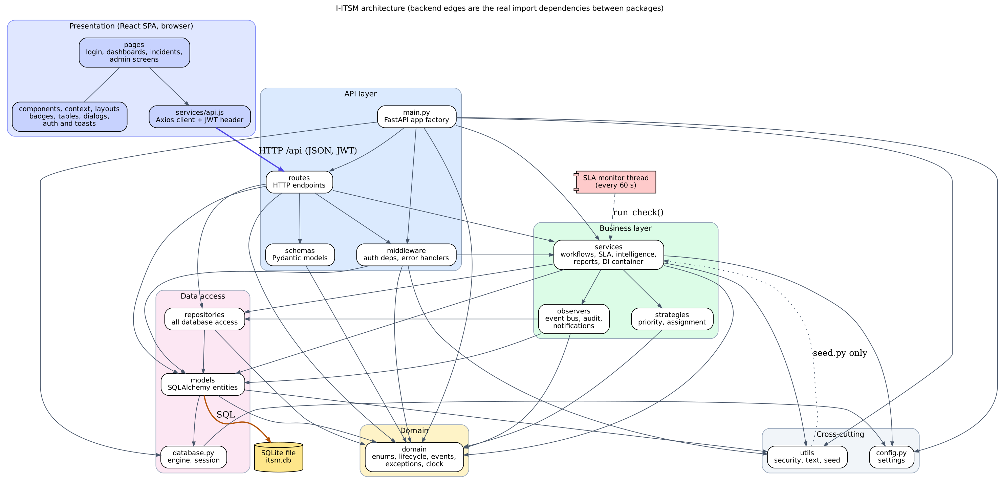{width=100%}

## 3.3 Technology stack and justification

**Table 3.2: Technologies, frameworks and libraries used**

| Area | Technology | Version used or required | Role |
|---------|--------------|------------------|----------------------------|
| Language (back end) | Python | 3.11 or later required, 3.13 used in the verification runs | All business logic |
| Web framework | FastAPI | 0.110 or later, 0.165.0 resolved in the clean install | REST API, validation, dependency injection, OpenAPI documentation |
| Server | Uvicorn | 0.27 or later, 0.54.0 resolved | Runs the application |
| ORM | SQLAlchemy | 2.x, 2.1.9 resolved | Entity mapping, relationships, event hooks |
| Validation and settings | Pydantic, pydantic-settings | 2.x | Request and response models, configuration |
| Authentication | PyJWT, bcrypt | PyJWT 2.15.1, bcrypt 5.0.0 resolved | Signed tokens, password hashing |
| Other back-end libraries | email-validator, python-multipart | as in `requirements.txt` | E-mail address validation, form parsing |
| Database | SQLite | Bundled with Python | Persistent storage, foreign keys and constraints |
| Language (front end) | JavaScript (ES2022, JSX) | Node 18 or later, Node 22 used | User interface |
| UI library | React and React DOM | 18.3 | Component-based screens |
| Build tool | Vite and its React plugin | 5.4 | Development server with `/api` proxy, production build |
| Routing | React Router | 6.28 | Role-guarded pages |
| HTTP client | Axios | 1.7 | API calls, token header, error translation |
| Charts and icons | Recharts, lucide-react | 2.13 and 0.460 | Dashboards and reports, icons |
| Testing | pytest, httpx, pytest-cov | pytest 9.2.0, httpx 0.28.1 | Automated tests with the FastAPI test client, coverage (`pytest-cov` is installed separately) |
| Documentation tooling | Graphviz, Mermaid CLI, Pandoc, XeLaTeX | Used only to produce diagrams and this report | Not needed to run the application |

The assignment asks for answers to nine specific questions about technology selection. They are answered here in the order of the brief.

**1. Why this programming language?** Python reads close to plain English, so the business rules (priority bands, lifecycle, SLA arithmetic) can be reviewed against the specification line by line. It has first-class classes, abstract base classes, properties and decorators, so the required patterns are expressed directly instead of being worked around. The standard library covers threading, time and logging, which is all the SLA monitor and the simulated e-mail need. JavaScript is the practical choice for the browser.

**2. Why this front-end technology?** React's component model suits an interface made of many small repeated pieces (badges, tables, dialogs, cards). State stays local to a screen, and two small contexts (authentication and notifications) cover everything shared. Vite starts in seconds and proxies `/api` to the back end, which avoids cross-origin problems in development. Recharts draws the dashboard charts from database data with little code.

**3. Why this back-end technology?** FastAPI gives typed validation and an automatic OpenAPI description at `/docs`, which doubles as a live API specification. Pydantic rejects bad input before it reaches the business layer. Its dependency-injection system matches the layered design: authentication and the per-request container are plain dependencies. SQLAlchemy supplies the object-relational mapping and the event hooks used to guard the audit table.

**4. Why this database?** SQLite is a real relational database with foreign keys, unique and check constraints, held in a single file. Nothing has to be installed, so the project runs unchanged on any of the team's computers and on the evaluator's. It is persistent, transactional and adequate for one service desk with tens of concurrent users. All SQL sits behind repositories and SQLAlchemy, so a move to PostgreSQL is mainly a connection-string change plus a migration tool.

**5. Why this architecture?** A layered architecture (routes, services, domain, repositories, models) with design patterns placed where change is expected: Strategy where algorithms must be swappable, State where behaviour depends on status, Observer where side effects must not tangle with the workflow, Repository to isolate persistence, and dependency injection with a unit of work to keep each request transactional. A single deployable application was chosen over microservices because the team and the load are small and the domain is one cohesive workflow.

**6. What alternatives were considered?**

**Table 3.3: Alternatives considered and why they were not chosen**

| Choice | Alternatives | Reason for not choosing them |
|--------|----------------------|-------------------------------------------|
| FastAPI | Django REST Framework, Flask, Spring Boot, Node.js with Express | Django brings an admin and an ORM that would be partly bypassed. Flask has no built-in validation. Spring Boot and Node.js add a second language or heavier set-up for a team of this size |
| React | Angular, Vue, Flutter web | Angular is heavier for this scope. Vue is comparable, React has the larger ecosystem for charts and routing |
| SQLite | PostgreSQL, MySQL, MongoDB | PostgreSQL is the right production target but needs an installer. A document database fits poorly with relational data such as incidents, skills and SLA policies |
| Signed tokens (JWT) | Server sessions, OAuth | Stateless tokens suit a separate single-page application. OAuth needs an identity provider, which is out of scope |
| Rule-based intelligence | A machine-learning model, an external AI service | Rules are explainable (every suggestion shows its reason), need no training data and work offline |

**7. Advantages and limitations.** Advantages: one language per tier, little boilerplate, automatic API documentation, strong validation, a zero-install database, an extensive automated test suite and explainable intelligent features. Limitations: SQLite allows one writer at a time. The SLA monitor is an in-process thread, so running several server processes would run several monitors (harmless, because violations are unique, but wasteful). Simulated e-mail sends nothing. There is no automated front-end test suite. Category and duplicate intelligence is keyword based and cannot understand vocabulary it does not have.

**8. How does the technology support object-oriented design?** Python provides abstract base classes, inheritance, properties and duck typing, so `PriorityStrategy`, `AssignmentStrategy`, `NotificationChannel`, `IncidentState`, `EventObserver` and `Clock` are real abstractions with several concrete subclasses. SQLAlchemy maps classes to tables with relationships. A custom exception hierarchy rooted in `AppError` carries an HTTP status and a stable error code. FastAPI's dependency injection composes these objects per request without global state. Chapter 4 gives the exact classes.

**9. How would the system evolve with many more users?** First, move from SQLite to PostgreSQL (the same models), add a migration tool and indexes on the filter columns. Second, run several API processes behind a load balancer. Tokens are stateless, so no session store is needed. Third, move the SLA monitor into one scheduled worker so exactly one instance runs the checks. Fourth, move notification delivery to a queue and add real channels (the `NotificationChannel` abstraction already isolates this). Fifth, cache read-heavy reports. Sixth, containerise the application, add continuous integration, central logging and metrics. Only if team size demands it, split into services, and then notifications and reporting are the natural first candidates because they are already event driven.

## 3.4 Database design

The schema has 15 tables, defined in `backend/app/models` and exported to `database/schema.sql` by `docs/tools/export_schema.py`. A column-by-column listing is in `docs/DATA_DICTIONARY.md`, which is generated from the models.

**Table 3.4: Database tables**

| Table | Purpose | Important columns |
|--------------------|--------------------------------|-----------------------------------|
| `users` | Every account | `email` (unique), `employee_code` (unique), password hash, `role`, `is_active` |
| `technician_profiles` | Extra data for technicians | `user_id` (unique), `team_id`, `experience_years`, `is_available`, `workload_limit` |
| `technician_skills` | Skill proficiency per category | Composite key (`technician_id`, `category_id`), `proficiency` 1 to 5 |
| `support_teams` | Support teams | `name` (unique), `lead_id` referring to a user |
| `incident_categories` | Configurable categories | `name` (unique), `keywords` used for suggestions |
| `services` | IT services | `name` (unique), `business_criticality` 1 to 5 |
| `sla_policies` | Response and resolution targets | `priority`, optional `service_id`, `response_minutes`, `resolution_minutes`, `warning_percent` |
| `incidents` | The incident record | `number` (unique), reporter, category, service, `impact`, `effective_impact`, `urgency`, `business_criticality`, `priority_score`, `priority`, `status`, assigned technician, SLA policy and deadlines, `escalation_level`, `duplicate_of_id` |
| `investigation_notes` | Notes, comments and information requests | `incident_id`, `author_id`, `note_type`, `is_internal` |
| `resolutions` | How an incident was resolved | `incident_id` (unique), `technician_id`, `summary`, `root_cause` |
| `employee_feedback` | Rating after resolution | `incident_id` (unique), `rating` 1 to 5 |
| `sla_violations` | Recorded breaches | `incident_id`, `sla_type`, unique together |
| `notifications` | In-app and simulated e-mail messages | `recipient_id`, `channel`, `delivery_status`, `is_read` |
| `audit_logs` | Append-only history | `actor_id`, `incident_id`, `action`, `previous_state`, `new_state`, `description` |
| `system_settings` | Administrator-set configuration | `key` (primary key), `value` |

Figure 3.2 is the entity relationship diagram. It is generated from the SQLAlchemy metadata, one relationship line per foreign key, and checked against a real SQLite database created from the models.

<!-- landscape -->
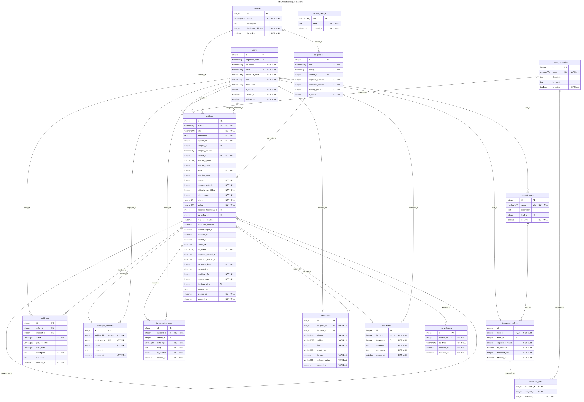{width=100%}
<!-- /landscape -->

**Important relationships.**

* `incidents` is the hub. Each incident belongs to exactly one service and one reporter (both required). It may have a category, an assigned technician, an SLA policy and a link to the incident it duplicates (a self-reference).
* An incident owns its notes, at most one resolution, at most one feedback record and its SLA violations. These child rows cannot exist without the incident.
* `users` to `technician_profiles` is one to at most one. A profile owns its skill rows, and each skill refers to a category.
* A team has one lead (a user) and many technician profiles.
* A violation row is unique per incident and SLA type, which is how the rule "one violation per type" (BR-08) is enforced inside the database as well as in code.
* `audit_logs` and `notifications` refer to incidents and users but nothing refers to them, so they can only grow.

**Key constraints.** Unique e-mail and employee code, unique incident number, unique resolution and feedback per incident, unique skill per technician and category, unique violation per incident and type, check constraints that keep impact, urgency, criticality and rating between 1 and 5, and enforced foreign keys. The audit table is additionally guarded by ORM event listeners that refuse any update or delete. `database/schema.sql` also contains two optional SQLite triggers that enforce the same rule inside the database. The running application does not create those triggers itself, it relies on the ORM listeners.

**Sample data.** On first start with demonstration data enabled, the system creates ten users, eight services, nine categories, five SLA policies, two teams and twelve incidents through the real services with a moving clock, so the audit rows, notifications and the SLA violation in the data are genuine and not hand-inserted. Appendix C lists them.

All timestamps are timezone-aware UTC. A custom column type guarantees that SQLite returns aware values, and an injectable clock lets tests move time.

## 3.5 Use case diagram

Figure 3.3 gives the overview of all 32 use cases and four actors. Because a single picture with every line is dense, Figures 3.4 to 3.6 show the same use cases one human actor at a time. The use case list is stored in a data file that is also executed as a test (Section 2.4), so the diagram and the enforced permissions cannot drift apart.

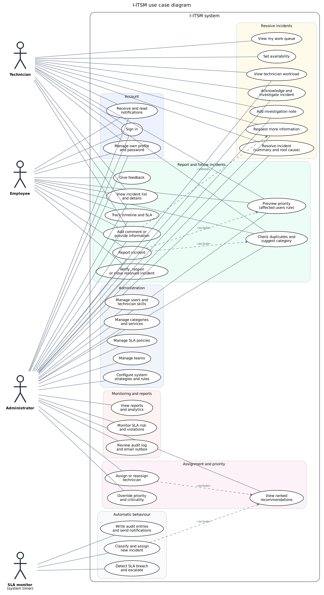{height=21cm}

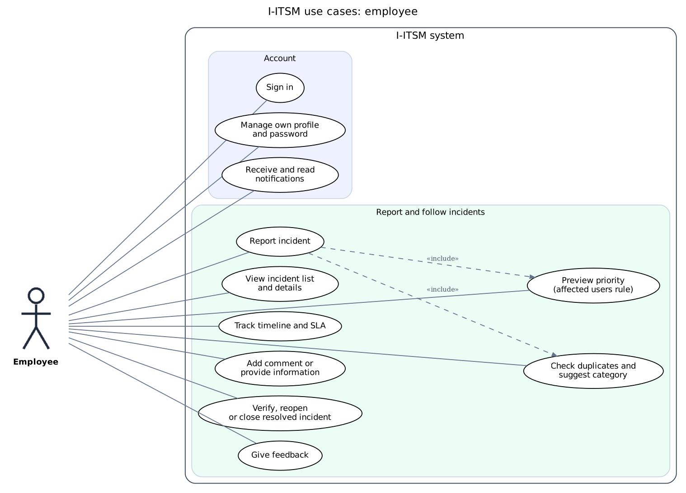{width=90%}

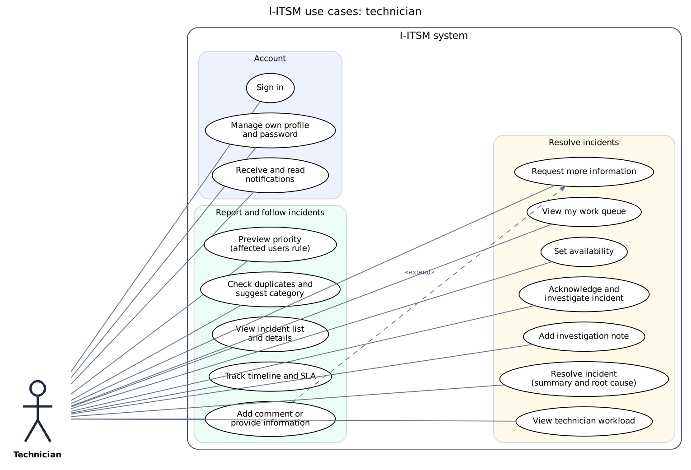{width=90%}

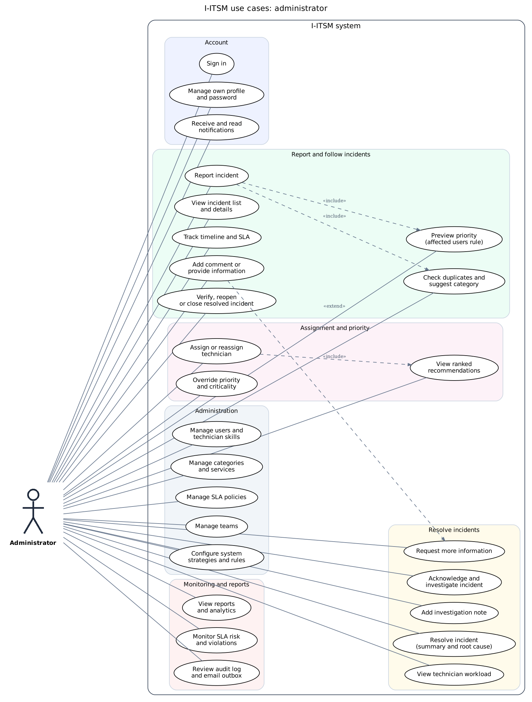{height=17cm}

**Table 3.5: Use case catalogue**

| ID | Use case | Actors | Relationships | Permission check |
|----|------------------------|--------------------|----------------|----------|
| UC01 | Sign in | Employee, Technician, Administrator |  | API probe |
| UC02 | Manage own profile and password | Employee, Technician, Administrator |  | API probe |
| UC03 | Receive and read notifications | Employee, Technician, Administrator |  | API probe |
| UC04 | Report incident | Employee, Administrator | includes UC05, UC06 | API probe |
| UC05 | Preview priority (affected users rule) | Employee, Technician, Administrator |  | API probe |
| UC06 | Check duplicates and suggest category | Employee, Technician, Administrator |  | API probe |
| UC07 | View incident list and details | Employee, Technician, Administrator |  | API probe |
| UC08 | Track timeline and SLA | Employee, Technician, Administrator |  | API probe |
| UC09 | Add comment or provide information | Employee, Technician, Administrator |  | not probed |
| UC10 | Verify, reopen or close resolved incident | Employee, Administrator |  | not probed |
| UC11 | Give feedback | Employee |  | API probe |
| UC12 | View my work queue | Technician |  | API probe |
| UC13 | Set availability | Technician |  | API probe |
| UC14 | Acknowledge and investigate incident | Technician, Administrator |  | not probed |
| UC15 | Add investigation note | Technician, Administrator |  | not probed |
| UC16 | Request more information | Technician, Administrator | extends UC09 | not probed |
| UC17 | Resolve incident (summary and root cause) | Technician, Administrator |  | not probed |
| UC18 | View technician workload | Technician, Administrator |  | API probe |
| UC19 | Assign or reassign technician | Administrator | includes UC20 | API probe |
| UC20 | View ranked recommendations | Administrator |  | API probe |
| UC21 | Override priority and criticality | Administrator |  | API probe |
| UC22 | Manage users and technician skills | Administrator |  | API probe |
| UC23 | Manage categories and services | Administrator |  | API probe |
| UC24 | Manage SLA policies | Administrator |  | API probe |
| UC25 | Manage teams | Administrator |  | API probe |
| UC26 | Configure system strategies and rules | Administrator |  | API probe |
| UC27 | View reports and analytics | Administrator |  | API probe |
| UC28 | Monitor SLA risk and violations | Administrator |  | API probe |
| UC29 | Review audit log and email outbox | Administrator |  | API probe |
| UC30 | Classify and assign new incident | SLA monitor | includes UC20 | not probed |
| UC31 | Detect SLA breach and escalate | SLA monitor |  | not probed |
| UC32 | Write audit entries and send notifications | SLA monitor |  | not probed |
"API probe" means the permission test calls the real endpoint behind the use case as every role. Use cases that need a particular incident state (for example acknowledging, investigating and resolving) are verified by the lifecycle tests instead (Chapter 6).

## 3.6 UML class diagrams

The class diagrams are split into seven views, one per pattern or layer, because a single diagram of the 154 classes of the code base would be unreadable. Each view is generated from the code: class names, stereotypes, attributes, public methods with parameter and return types, base classes and entity columns are read from the source. The two views that describe the structure of the whole application appear here. The five pattern views appear in Chapter 4 next to the explanation of each pattern.

**Table 3.6: Class diagram views and where each is shown**

| View | Content | Figure |
|----------|---------------------------------------------|---------|
| 1 | Incident lifecycle (State pattern) | Figure 4.4 |
| 2 | Priority and assignment (Strategy pattern) | Figure 4.1 |
| 3 | Events, observers and notification channels (Observer pattern) | Figure 4.2 |
| 4 | Data access (Repository pattern) | Figure 4.3 |
| 5 | Service layer and dependency injection | Figure 3.8 |
| 6 | Persistent entities | Figure 3.7 |
| 7 | Exceptions and the clock abstraction | Figure 4.5 |

Legend: a hollow triangle with a solid line is inheritance, with a dashed line it is realisation of an interface, a filled diamond is composition, a hollow diamond is aggregation, a plain arrow is association and a dashed arrow is dependency. A trailing `*` after a method marks it as abstract.

<!-- landscape -->
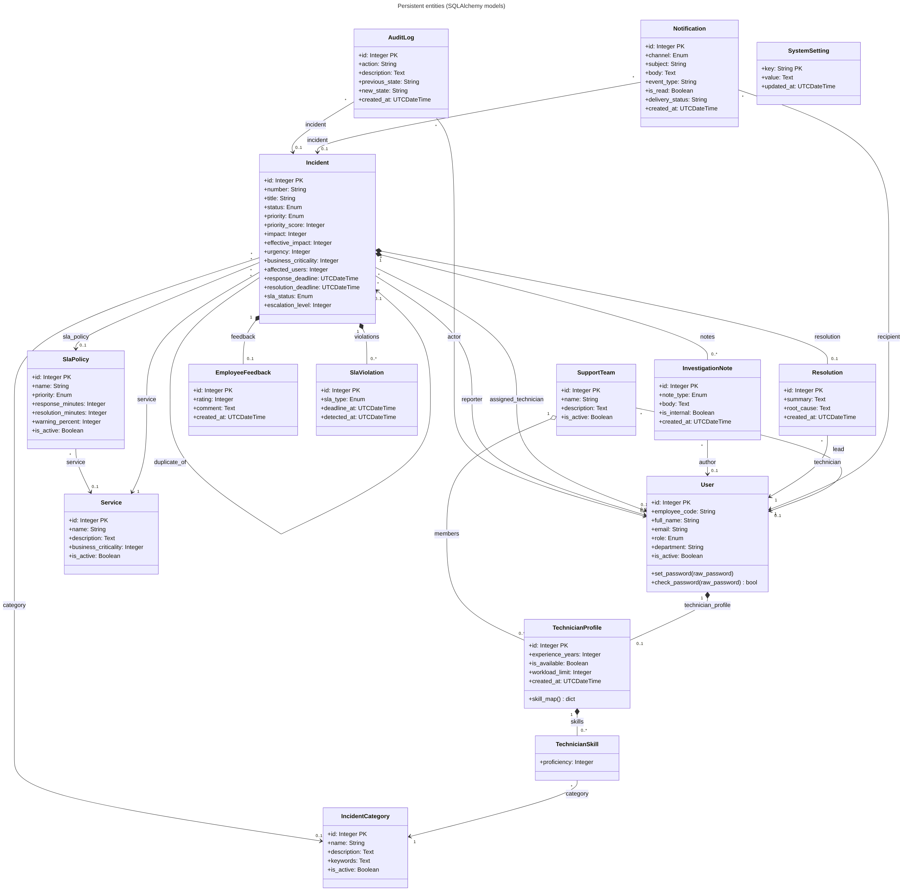{height=15cm}
<!-- /landscape -->

<!-- landscape -->
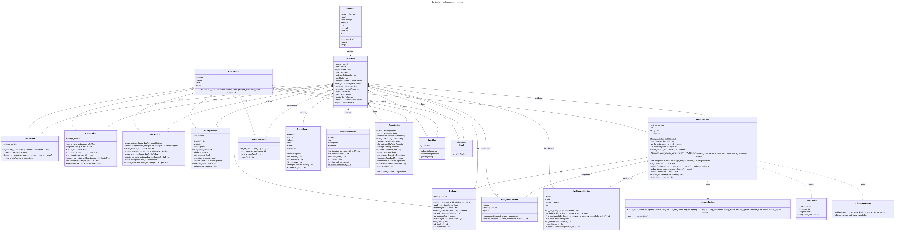{width=100%}
<!-- /landscape -->

## 3.7 Relationships between the classes

The diagrams use five kinds of relationship. Each is used where the code actually has it.

**Table 3.7: Relationship types and examples from the code**

| Relationship | Meaning in this code | Examples |
|------------|-------------------------------|-----------------------------------------|
| Inheritance (is-a) | A subclass can be used wherever its base is expected | The eight concrete states extend `IncidentState`. `SkillBasedStrategy`, `LoadBasedStrategy` and `SkillThenLoadStrategy` extend `AssignmentStrategy`. `InAppChannel` and `SimulatedEmailChannel` extend `NotificationChannel`. `AuditObserver` and `NotificationObserver` extend `EventObserver`. Seven services (authentication, users, configuration, settings, SLA, incidents and notifications) extend `BaseService`. All application exceptions extend `AppError` |
| Realisation | A class fulfils a pure contract | `SystemClock` and `MutableClock` fulfil `Clock` |
| Composition (owns, cannot exist without) | The part is created and lives and dies with the whole | A `Container` builds and owns every service, the `EventBus` and the `Repositories` bundle for one request. `Repositories` constructs all 14 repositories. `AssignmentService` constructs its `EligibilityPolicy`. In the entity model an `Incident` owns its notes, resolution, feedback and violations, a `TechnicianProfile` owns its skills and a `User` owns an optional technician profile |
| Aggregation (has, but the part exists on its own) | The collaborator is handed in and may be shared | `BaseService` is given repositories, the bus and the clock. `IncidentService` is given the SLA, assignment and intelligence services. `EventBus` holds observers that it did not create. `NotificationObserver` holds channels that are passed in. A `SupportTeam` aggregates the technician profiles that belong to it |
| Association (knows about) | A reference between independent objects, often a foreign key | An incident refers to its reporter and its assigned technician (both users), its service, category and SLA policy. A skill refers to a category. A resolution refers to the technician who wrote it |
| Dependency (uses briefly) | A class creates, receives or returns another without keeping it | `StrategyFactory` creates strategies. `ChannelFactory` registers and creates channels. `PriorityStrategy.calculate` returns a `PriorityResult`. `IncidentService` uses `IncidentFactory` and `LifecycleManager` |

The choice of composition for the container and aggregation for the services it passes around is deliberate. The container decides which concrete objects exist for a request, which is ownership. A service, on the other hand, does not own the event bus or the clock, it merely uses them, which is why tests can substitute a movable clock without changing any service.

## 3.8 Design patterns used and why they were selected

**Table 3.8: Design patterns implemented, with rationale**

| Pattern | Where in the code | Why it was selected |
|----------|--------------------------------|--------------------------------------------|
| State | `domain/lifecycle.py`: `IncidentState`, eight state classes, `StateFactory`, `LifecycleManager`, `TransitionRule` | What may happen to an incident depends on its status and on who acts. Each state object knows its legal next states, who may perform each transition and which fields are required, so the service contains no large status conditionals and illegal jumps are impossible |
| Strategy | `strategies/priority.py` and `strategies/assignment.py`, `StrategyFactory` | The assignment brief requires that the algorithm can change without redesign. The administrator picks the strategy in Settings and the next request uses it |
| Observer | `observers/base.py`: `EventBus`, `EventObserver`, `AuditObserver`, `NotificationObserver` | Audit and notification are side effects of the same events. Observers keep them out of the workflow code, and a new reaction is a new subscriber |
| Repository | `repositories/`: `BaseRepository` and 14 subclasses | Isolates all SQL, so services speak in domain terms and the database can be replaced |
| Factory | `IncidentFactory`, `ChannelFactory`, `StrategyFactory`, `StateFactory` | Object creation with defaults and look-up by name is centralised. `ChannelFactory` and `StrategyFactory` are registries, so a new class is registered, not wired in by hand |
| Dependency injection | `services/container.py`, FastAPI dependencies | Services receive collaborators instead of building them, which makes them testable |
| Unit of work | `services/base.py`: `transactional` | One transaction per use case with automatic rollback |

Two honest clarifications. First, the assignment suggests the Adapter pattern for external services. The simulated e-mail channel is a stand-in for a gateway, but it wraps no external API, so this report does not claim an Adapter. Second, the factories are static or class-level helpers and registries, not an abstract factory hierarchy.

## 3.9 Verification of the diagrams against the code

A diagram that is drawn by hand can drift from the code without anyone noticing. For that reason the diagrams in this report are produced by `docs/tools/generate_diagrams.py` and then checked by a separate program, `docs/tools/verify_diagrams.py`, which parses the diagram sources as text and compares them with the live code. The last run reported 1,666 checks and 0 problems.

**Table 3.9: What the verifier checks**

| Diagram | Check |
|-----------|--------------------------------------------------------|
| Class diagrams | Every class exists. Stereotypes (interface, abstract, enumeration) match. Drawn attributes and methods equal the code. Every drawn inheritance edge is a direct base class, and every direct base inside a view is drawn. Every composition, aggregation and association label is a real attribute of the source class. Entity links are real mapper relationships, and their cardinality agrees with the mapper. A dependency requires the source class to mention the target |
| ER diagram | Tables, columns, primary and foreign keys, unique and not-null flags equal the metadata. A real SQLite database is created from the models and compared with `PRAGMA` queries |
| Architecture diagram | Arrows equal an independent scan of the `import` statements, layering rules hold, and front-end arrows match real imports |
| Use case diagrams | Actors per use case equal the data file, which is exercised against the live API |
| All | Each source has a rendered image that is not older than the source |

The first verification run found five inaccuracies in hand-chosen edges of the first draft. Examples: an edge claiming that `SettingsService` returns a `PriorityStrategy` (it goes through `StrategyFactory`), and a `ChannelFactory` that "creates" the abstract channel (it registers the concrete ones). All were corrected. The same review found errors in earlier prose documents, including a wrong class name (`ProductPriorityStrategy`, the code says `ScoreProductPriorityStrategy`), a wrong abstract base name (`Observer`, the code says `EventObserver`), wrong method names (`transitions()` and `send()` instead of `rules()` and `deliver()`), an "Adapter" claim and a claim that the application creates database triggers. These are fixed here. The verifier was itself tested by damaging diagram sources on purpose, and it reported every deliberate fault.

Limits of this check: it proves that a drawn element is not false, not that it is the most important relationship. Missing dependencies and associations are not detected, whereas missing inheritance edges are.

# Chapter 4: Object-Oriented Design and Implementation

This chapter explains how the object-oriented concepts are realised in the source code. Every class, method and relationship named here exists in the code. Where a concept is only partly applied, the text says so.

## 4.1 The main classes and modules

**Table 4.1: Principal classes by package**

| Package | Key classes | Role |
|--------------|-------------------------------------|-------------------------------------|
| `domain` | `IncidentStatus`, `Role`, `Priority`, `EventType` (enumerations), `DomainEvent`, `Clock`, `AppError` and subclasses | Vocabulary shared by every layer |
| `domain/lifecycle.py` | `IncidentState` and eight states, `TransitionRule`, `StateFactory`, `LifecycleManager` | The incident lifecycle |
| `models` | `User`, `TechnicianProfile`, `TechnicianSkill`, `SupportTeam`, `Service`, `IncidentCategory`, `SlaPolicy`, `Incident`, `InvestigationNote`, `Resolution`, `EmployeeFeedback`, `SlaViolation`, `Notification`, `AuditLog`, `SystemSetting` | Persistent entities |
| `repositories` | `BaseRepository`, 14 repositories, `IncidentFilters`, `Repositories` | All database access |
| `strategies` | `PriorityStrategy` with two implementations, `AffectedUsersPolicy`, `AssignmentStrategy` with three implementations, `EligibilityPolicy`, `StrategyFactory` | Interchangeable algorithms |
| `observers` | `EventBus`, `EventObserver`, `AuditObserver`, `NotificationObserver`, `NotificationChannel` with two implementations, `ChannelFactory` | Side effects of events |
| `services` | `IncidentService`, `AssignmentService`, `SlaService`, `IntelligenceService`, `SettingsService`, `UserService`, `AuthService`, `ConfigService`, `ReportService`, `NotificationService`, `IncidentPresenter`, `IncidentFactory`, `SlaMonitor`, `Container` | Workflows and wiring |
| `routes`, `middleware`, `schemas` | Routers, `get_current_user`, `require_roles`, exception handlers, Pydantic models | HTTP boundary |

## 4.2 Encapsulation

Encapsulation means that data is reachable only through the operations that keep it valid. Python has no enforced `private`, so the code uses the standard convention of a leading underscore together with methods and properties, and uses immutability where a value must not change.

* **`User`** keeps the password hash in `_password_hash`. The only ways to change or test it are `set_password`, which hashes with bcrypt, and `check_password`. No schema or route returns the hash. Role tests are exposed as read-only properties (`is_admin`, `is_technician`, `is_employee`) so callers do not compare role strings.
* **`PriorityResult`** and **`TransitionRule`** are frozen dataclasses. Once created they cannot be altered, so a rule cannot be modified by the code that reads it.
* **`EventBus`** keeps its subscribers in `_observers` and exposes `observers` as a copy, so outside code cannot corrupt the list.
* **State classes** hide their transition tables inside `rules()`. Callers ask `LifecycleManager` whether a move is legal and never read the tables.
* **Repositories** hide every SQL statement. A service asks for `incidents.get_by_number(...)` and never sees the query.
* **`@transactional`** hides commit and rollback. Service methods contain business steps only.
* **Settings** are read through typed accessors (`auto_assign()`, `escalation_enabled()`, `affected_users_adjustment()`), which hide the fact that values are stored as text in a table.

## 4.3 Inheritance

Inheritance is used only where there is a true is-a relationship and several variants share a contract. The hierarchies in the code are the following.

* **Eight concrete states** (`NewState` through `ClosedState`) extend `IncidentState`.
* **Priority strategies** `ScoreProductPriorityStrategy` and `WeightedPriorityStrategy` extend `PriorityStrategy`.
* **Assignment strategies** `SkillBasedStrategy`, `LoadBasedStrategy` and `SkillThenLoadStrategy` extend `AssignmentStrategy`.
* **Channels** `InAppChannel` and `SimulatedEmailChannel` extend `NotificationChannel`.
* **Observers** `AuditObserver` and `NotificationObserver` extend `EventObserver`.
* **Clocks** `SystemClock` and `MutableClock` extend `Clock`.
* **Exceptions** form a tree rooted in `AppError`: `AuthenticationError`, `PermissionDeniedError`, `NotFoundError` (with `IncidentNotFoundError` and `ServiceNotFoundError`) and `ConflictError` (with `DuplicateResourceError`, `InvalidTransitionError`, `TechnicianUnavailableError`, `WorkloadExceededError` and `MissingSkillError`), as well as `InvalidInputError`, `MissingSlaConfigurationError` and `DatabaseUnavailableError`. Each carries an HTTP status code and a stable error code, so a single handler can turn any of them into a safe response.
* **Shared base classes for code reuse:** `BaseRepository` (generic `add`, `get`, `list_all`) and `BaseService` (session, repositories, bus, clock and `emit`) are extended by 14 repositories and seven services respectively. This is inheritance for reuse. It is acceptable here because the subclasses really are repositories and services, but it is the weakest use of inheritance in the system, and composition is preferred elsewhere.

All 15 entities extend SQLAlchemy's declarative `Base`. That is framework inheritance, not part of the domain design.

## 4.4 Polymorphism

Polymorphism means that calling code works with the abstraction and the right behaviour is selected by the object's actual class. It is used wherever behaviour must vary without conditionals.

* `priority_strategy.calculate(impact, urgency, criticality)` returns a `PriorityResult` for whichever strategy the administrator selected. The incident service never tests which one it has.
* `assignment_strategy.rank(eligible, ctx)` is implemented once in the base class and calls the abstract `_score`, which each of the three strategies implements differently. This is also the Template Method pattern.
* `channel.deliver(...)` stores an in-app message or a simulated e-mail depending on the channel object. `NotificationObserver` loops over a list of channels without knowing their classes.
* `observer.handle(event)` lets the event bus treat the audit and notification observers uniformly.
* `state.rules()` returns the legal transitions of whichever state object `StateFactory` supplies for the incident's current status.
* `clock.now()` returns real time in production and a hand-moved time in tests. This is how the SLA tests move time forward by hours in a few milliseconds.
* The exception handler catches `AppError` and reads `status_code` and `code` from the concrete subclass.

## 4.5 Abstraction

Abstraction hides complexity behind a small contract. In this code base the abstractions are:

* **Business operations as service methods.** `IncidentService.create_incident`, `transition`, `assign` and `update_incident` each stand for a whole workflow (validation, priority, SLA, events, persistence). Routes call one method and know nothing of the steps.
* **`LifecycleManager.validate`** stands for the entire question "may this actor make this move with this data?".
* **`AssignmentService.recommend`** hides eligibility, scoring and explanation.
* **`SlaService`** answers "what is the SLA status of this incident now?" with `describe`, and `run_check` performs a whole monitoring sweep.
* **`Container`** hides how the object graph for a request is built.
* **`IncidentPresenter`** turns entities into the JSON shape the user interface needs, so entities do not leak into the API.

## 4.6 Interfaces and abstract classes

Python has no `interface` keyword. The code uses abstract base classes (`abc.ABC`) with abstract methods. Six exist, and the class diagrams classify them by what they contain: a class whose public methods are all abstract is drawn as an interface, otherwise as an abstract class.

**Table 4.2: Abstract base classes in the code**

| Class | Kind | Abstract method | Concrete members | Implementations |
|----------------------|----------|---------------|----------------------|-----------------------------|
| `EventObserver` | Interface | `handle(event)` | Class attribute `critical` | `AuditObserver`, `NotificationObserver` |
| `NotificationChannel` | Interface | `deliver(...)` | Class attribute `channel` | `InAppChannel`, `SimulatedEmailChannel` |
| `Clock` | Interface | `now()` | None | `SystemClock`, `MutableClock` |
| `PriorityStrategy` | Abstract class | `calculate(...)` | `validate` (shared input checks) | `ScoreProductPriorityStrategy`, `WeightedPriorityStrategy` |
| `AssignmentStrategy` | Abstract class | `_score(...)` | `rank` (shared ordering), `_base_reasons` | `SkillBasedStrategy`, `LoadBasedStrategy`, `SkillThenLoadStrategy` |
| `IncidentState` | Abstract class | `rules()` | `rule_for`, `next_statuses` | Eight lifecycle states |

The assignment lists interfaces and composition as required topics. The code satisfies this through these abstractions and through the composition described in Section 3.7. No design pattern in this report depends on a language feature that Python does not have.

## 4.7 The Strategy pattern

**Intent.** Make the priority and the assignment algorithms interchangeable at run time. The assignment brief asks that the assignment strategy can change without redesigning the application, and that the priority algorithm and its rationale are documented.

**Structure.** Figure 4.1 shows the two strategy families, the value objects they exchange and the factory.

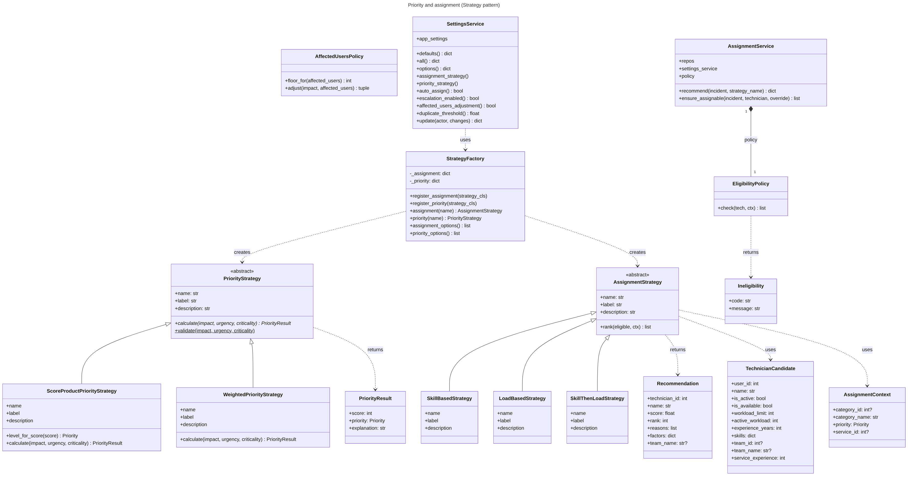{width=100%}

**Priority strategies.** `PriorityStrategy.calculate` receives impact, urgency and business criticality and returns a `PriorityResult` (score, level and a one-line explanation).

* `ScoreProductPriorityStrategy` (the default, registered as `product`) multiplies the three ratings and maps the product with the thresholds 40, 20, 8 and 1 to P1 to P4. A product such as 39 is mathematically impossible with ratings from 1 to 5 (it would need a factor of 13), and the mapping is tested separately at the boundaries.
* `WeightedPriorityStrategy` (registered as `weighted`) computes 0.40 x impact + 0.35 x urgency + 0.25 x criticality and maps the average to P1 at 4.0 or more, P2 at 3.0, P3 at 2.0. It exists to demonstrate interchangeability and is selectable in Settings.

**The affected-users rule.** The assignment lists the number of affected users as a priority factor. `AffectedUsersPolicy` turns the count into a minimum impact (`BANDS` of 1000, 250, 50 and 10 users map to impact 5, 4, 3 and 2). The service takes the larger of the reporter's rating and this floor as the *effective impact* and feeds that to the chosen priority strategy. The rule never lowers the reporter's value, so incidents without a count behave exactly as before. The reporter's value and the effective value are both stored, and the audit log carries a sentence such as "Impact raised from 2 to 4 because 300 users are affected". The policy is separate from the strategies on purpose: it adjusts an *input*, so it works the same with either strategy.

**Assignment strategies.** Eligibility is a hard filter implemented by `EligibilityPolicy.check`: the technician must be active, available, hold the category skill and be below the workload limit. Only eligible technicians are ranked. The three strategies score them as follows.

**Table 4.3: Assignment strategies and their scoring**

| Strategy | Score | Intent |
|----------------|------------------------------------------------|--------------------------------|
| Skill based (`skill_based`) | proficiency x 20 + min(experience, 10) x 2 + min(service experience, 5) x 2 - workload x 0.5 | Best qualified first, workload only breaks ties |
| Load based (`load_based`) | (1 - load ratio) x 100 + proficiency + min(experience, 10) x 0.1 | Spread work evenly, skill only breaks ties |
| Skill then load (`skill_then_load`, default) | proficiency x w1 + min(experience, 10) x w2 + min(service experience, 5) x 2 + (1 - load ratio) x 30, with w1 = 22 and w2 = 2 for P1 and P2 incidents, otherwise 18 and 1 | Balanced, and critical incidents lean more on skill and experience |

Each `Recommendation` carries the numeric score, a rank and a list of human-readable reasons (for example "Application skill proficiency 3/5", "Workload 0/5", "Critical priority: skill and experience weighted higher"), so the administrator can see why a technician was proposed.

**Selection and extension.** `StrategyFactory` keeps two registries (dictionaries keyed by strategy name). `SettingsService.assignment_strategy()` and `priority_strategy()` read the administrator's setting and ask the factory for an instance. Adding a fourth assignment strategy means writing one subclass and one `register_assignment` call. Nothing else changes, and the Settings page picks the new option up from `assignment_options()`.

```python
for _cls in (SkillBasedStrategy, LoadBasedStrategy, SkillThenLoadStrategy):
    StrategyFactory.register_assignment(_cls)
for _cls in (ScoreProductPriorityStrategy, WeightedPriorityStrategy):
    StrategyFactory.register_priority(_cls)
```

## 4.8 The Observer pattern

**Intent.** Let the workflow announce what happened without knowing who reacts. Audit logging and notifications are consequences of the same events, and keeping them out of the workflow code means a new reaction (a metrics collector, for example) is a new subscriber.

**Structure.** `EventBus` is the subject. `EventObserver` is the contract (`handle(event)`). Services call `emit`, which publishes a `DomainEvent` carrying the event type, description, time, actor, incident, previous and new state and extra metadata. The container subscribes `AuditObserver` and `NotificationObserver` for every request. Figure 4.2 shows the classes, including the notification channels.

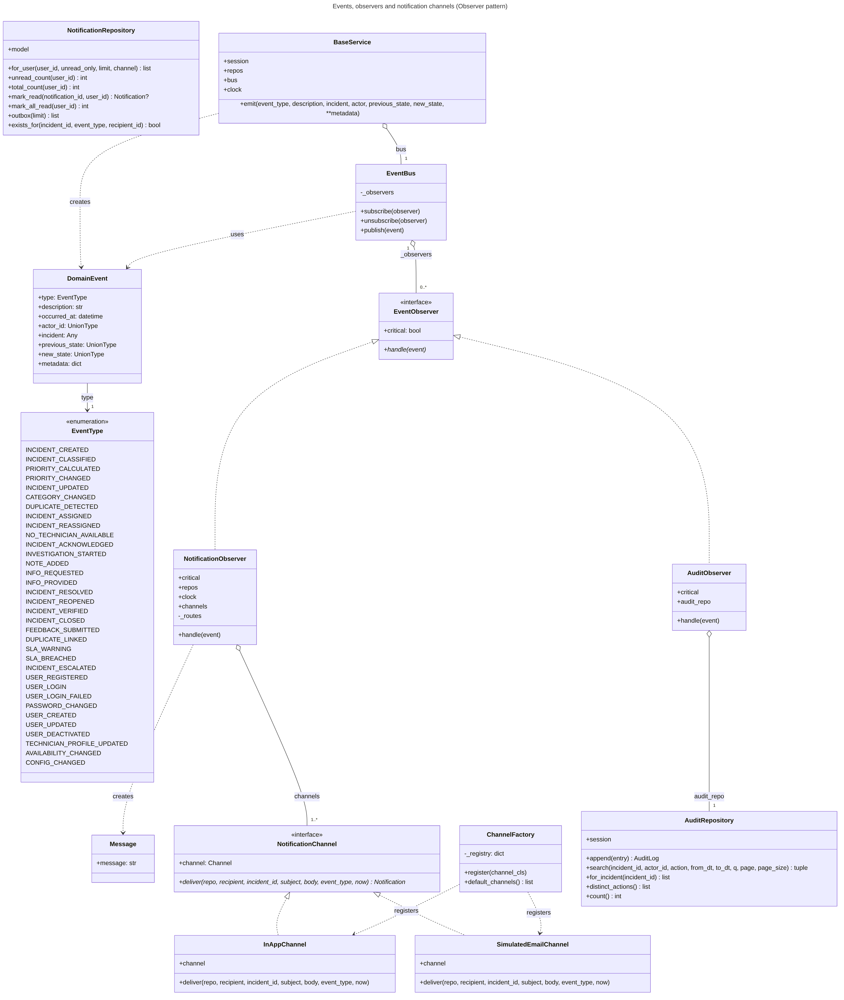{width=100%}

```python
def publish(self, event: DomainEvent) -> None:
    for observer in self._observers:
        try:
            observer.handle(event)
        except SQLAlchemyError:
            raise  # database trouble must never be swallowed
        except Exception:
            if observer.critical:
                raise
            logger.exception("Observer %s failed", type(observer).__name__)
```

**Critical and non-critical observers.** The `critical` flag is a design decision about failure. `AuditObserver` is critical: it runs inside the request's transaction, and if an audit row cannot be written the exception propagates, the transaction rolls back and the action does not happen. An action without a record is not acceptable. `NotificationObserver` is not critical: a failure is logged and the incident update proceeds, because a problem in message delivery must not block the work. Database errors are never swallowed by either.

**Audit.** `AuditObserver` writes one append-only row per event: actor, incident, action (the event type), previous and new state, description and time. There are 34 event types, covering incident events, SLA events and account and administration events such as sign-ins and configuration changes.

**Notification.** `NotificationObserver` holds a table `_routes` from event type to a builder method. Each builder returns a `Message` (recipients, subject, body). The observer removes duplicate recipients, skips the person who caused the event (except for the creation event), skips deactivated users and sends the message through every channel in its list. Section 5.7 lists who is told about what.

**Channels and Factory.** `NotificationChannel` is the interface and `ChannelFactory` is a registry of channel classes. `InAppChannel` stores a delivered, unread record. `SimulatedEmailChannel` writes a record marked as e-mail and logs "[SIMULATED EMAIL]". Both write to the same `notifications` table. A real SMTP, SMS or push channel is one more subclass registered with the factory. No observer or service changes.

## 4.9 The Repository pattern

**Intent.** Keep persistence out of the business code. Services express intent in domain terms (`incidents.open_for_service(...)`, `users.active_admins()`) and repositories translate that into queries.

**Structure.** `BaseRepository` is a generic class holding the session with `add`, `get` and `list_all`. Fourteen subclasses add the queries each aggregate needs. `Repositories` bundles them for one session, and `Repositories.for_session` is the only place that constructs them. `IncidentRepository` is the largest: it implements the combined search with `IncidentFilters` (filters, sorting and paging). Figure 4.3 shows the classes.

<!-- landscape -->
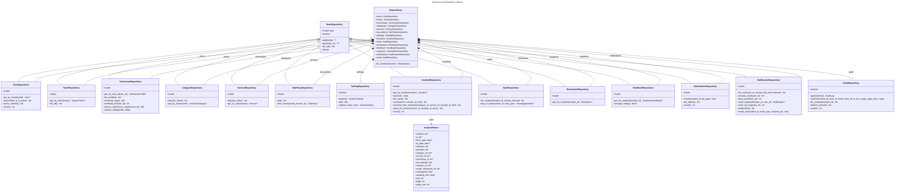{width=100%}
<!-- /landscape -->

A repository never commits. Commit and rollback belong to the `@transactional` decorator on the service method, so several repositories can take part in one transaction. This is the unit-of-work part of the design. A consequence is that changing database engine affects the engine set-up and, at most, a few queries inside repositories.

## 4.10 The incident lifecycle and the State pattern

**Intent.** What may happen to an incident depends on its status. Each status is a class that states which statuses may follow, who may cause each move, which event the move produces and which fields it requires. The service contains no chain of status conditions.

Figure 4.4 shows the state classes and their collaborators.

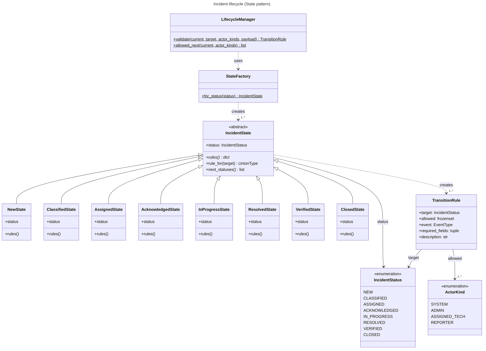{width=100%}

**Table 4.4: Lifecycle transitions as implemented**

| From | To | Who may do it | Required data | Event |
|----------|----------|----------------------|---------------|------------------|
| NEW | CLASSIFIED | System | | `INCIDENT_CLASSIFIED` |
| CLASSIFIED | ASSIGNED | System, administrator | | `INCIDENT_ASSIGNED` |
| ASSIGNED | ACKNOWLEDGED | Assigned technician, administrator | | `INCIDENT_ACKNOWLEDGED` |
| ASSIGNED, ACKNOWLEDGED, IN_PROGRESS | ASSIGNED | Administrator | | `INCIDENT_REASSIGNED` |
| ACKNOWLEDGED | IN_PROGRESS | Assigned technician, administrator | | `INVESTIGATION_STARTED` |
| IN_PROGRESS | RESOLVED | Assigned technician, administrator | resolution summary, root cause | `INCIDENT_RESOLVED` |
| RESOLVED | VERIFIED | Reporter, administrator | | `INCIDENT_VERIFIED` |
| RESOLVED | IN_PROGRESS (reopen) | Reporter, administrator | reason | `INCIDENT_REOPENED` |
| VERIFIED | CLOSED | Reporter, administrator | | `INCIDENT_CLOSED` |

**Validation.** `LifecycleManager.validate(current, target, actor_kinds, payload)` looks up the state object with `StateFactory.for_status`, asks it for the rule for the target, and applies three checks in order. If there is no rule the move is illegal and an `InvalidTransitionError` (HTTP 409) lists the moves that are allowed. If the actor is not among the allowed kinds, a `PermissionDeniedError` (403) is raised. If a required field is missing, an `InvalidInputError` (422) names it. The "actor kind" is computed per incident: an administrator, the assigned technician of this incident and the reporter of this incident are different kinds, and a person can be more than one. This is how "only the assigned technician acknowledges" and "only the reporter verifies" are enforced by data rather than by `if` statements. The user interface asks `allowed_next` and shows only the buttons that are legal for the signed-in user, but the server remains the authority.

**An honest note on the pattern.** In the textbook State pattern the context object holds a state object and delegates to it. Here the `Incident` entity stores its status as an enumeration (it has to, because it is a database row), and `StateFactory` maps that value to a stateless state object when a transition is needed. The behaviour is the same, and the state objects carry the transition knowledge, but the delegation is through a factory look-up rather than a held reference. This is a common adaptation when the context is a persisted entity.

**Reassignment and reopening.** The brief's lifecycle has no arrow back to ASSIGNED. Because a service desk must be able to move work, an administrator may reassign while the incident is ASSIGNED, ACKNOWLEDGED or IN_PROGRESS, and the status becomes ASSIGNED again. The reporter may reopen a resolved incident with a reason. Both are recorded as events. An attempt such as NEW to CLOSED is rejected with HTTP 409 and changes nothing, and the test suite checks every disallowed pair of statuses.

## 4.11 Exception handling and data structures

**Custom exceptions.** Figure 4.5 shows the exception tree and the clock abstraction. The assignment lists twelve situations that must be handled. Each has a class, a status code and a stable code.

<!-- landscape -->
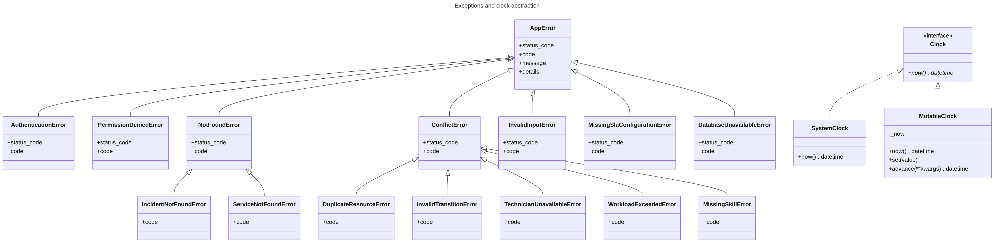{width=100%}
<!-- /landscape -->

**Table 4.5: Situations required by the assignment and how each is handled**

| Situation | Exception or handler | HTTP status | Code |
|---------------------------|-------------------------------------|------|------------------------|
| Invalid login | `AuthenticationError` | 401 | `AUTHENTICATION_FAILED` |
| Unauthorised operation | `PermissionDeniedError` | 403 | `PERMISSION_DENIED` |
| Invalid incident | `IncidentNotFoundError` | 404 | `INCIDENT_NOT_FOUND` |
| Invalid state transition | `InvalidTransitionError` | 409 | `INVALID_STATE_TRANSITION` |
| Technician unavailable | `TechnicianUnavailableError` | 409 | `TECHNICIAN_UNAVAILABLE` |
| Technician workload exceeded | `WorkloadExceededError` | 409 | `TECHNICIAN_WORKLOAD_EXCEEDED` |
| Service not found | `ServiceNotFoundError` | 404 | `SERVICE_NOT_FOUND` |
| Missing SLA configuration | `MissingSlaConfigurationError` | 422 | `MISSING_SLA_CONFIGURATION` |
| Duplicate account or configuration name | `DuplicateResourceError` | 409 | `DUPLICATE_RESOURCE` |
| Duplicate incident report | Not an error by design (business rule BR-14): the similarity check lists candidates and the incident is still created | 201 with a list of possible duplicates | event `DUPLICATE_DETECTED` |
| Database failure | Handler for SQLAlchemy errors (503 when the database cannot be reached, otherwise 500) | 503 or 500 | `DATABASE_ERROR` |
| Network failure | Handled in the browser: `errMsg` in the Axios client turns a missing response or a timeout into a readable message. When only the back end is stopped behind the development proxy, the proxy answers with HTTP 500 and the user sees "Request failed (500)." | none | n/a |
| Invalid user input | `InvalidInputError` and Pydantic validation | 422 | `INVALID_INPUT` or `VALIDATION_ERROR` |

Handlers in `middleware/errors.py` convert every `AppError` into JSON of the form `{detail, code}`. Unexpected errors return a generic 500 and never reveal a stack trace or SQL.

**Collections and data structures.** The data structures follow the shape of the data.

* **Dictionaries** as registries (`StrategyFactory._assignment`, `_priority`, `ChannelFactory._registry`), as a routing table from event type to builder (`NotificationObserver._routes`), as a state table (`_STATES`) and as a skill map from category to proficiency for each technician.
* **Lists** where order matters: the observer list, the ranked recommendations (sorted by score descending, then name, then identifier so the order is deterministic) and the escalation chain.
* **Sets and frozensets** where membership matters and duplicates must vanish: allowed actor kinds in a `TransitionRule`, the set of actor kinds computed for a person and an incident, and the token sets used for similarity.
* **Tuples** for fixed ordered tables: `BANDS`, `THRESHOLDS` and `ACTIVE_WORKLOAD_STATUSES`.
* **Dataclasses** for plain data carried between layers: `PriorityResult`, `TransitionRule`, `Recommendation`, `Ineligibility`, `AssignmentContext`, `TechnicianCandidate`, `Message`, `CreateResult`, `DomainEvent`.
* **A set-based similarity measure** (Jaccard similarity of token sets) for duplicate detection and suggested resolutions.

## 4.12 How the concepts appear in the code

**Table 4.6: Summary of object-oriented concepts and their evidence**

| Concept | Where it is realised | Evidence |
|-------------|--------------------------------------------|------------------------------|
| Encapsulation | `User._password_hash`, frozen dataclasses, `EventBus._observers`, repositories, `@transactional` | Section 4.2 |
| Abstraction | Six abstract base classes, service methods, `LifecycleManager`, `Container` | Sections 4.5 and 4.6 |
| Inheritance | Eight states, five strategies, two channels, two observers, two clocks, exception tree, base repository and base service | Section 4.3 |
| Polymorphism | `calculate`, `rank`, `deliver`, `handle`, `rules`, `now` called through the abstraction | Section 4.4 |
| Interfaces | `EventObserver`, `NotificationChannel`, `Clock` | Table 4.2 |
| Composition | `Container`, `Repositories`, `AssignmentService` and `EligibilityPolicy`, entity ownership | Section 3.7 |
| Aggregation and association | Services given collaborators, `EventBus` and observers, foreign-key associations | Section 3.7 |
| Exception handling | Custom hierarchy with codes, central handlers | Section 4.11 |
| Collections | Registries, ranked lists, sets, tuples, dataclasses | Section 4.11 |
| Strategy, Observer, Repository, State | As described | Sections 4.7 to 4.10 |
| Factory, dependency injection, unit of work | `IncidentFactory`, `ChannelFactory`, `StrategyFactory`, `StateFactory`, `Container`, `transactional` | Section 3.8 |

# Chapter 5: Implementation

This chapter describes what each function of the system does and how it is implemented, in the order in which a user meets it. The screenshots were captured from the running application on localhost with the demonstration data set described in Appendix C. They are real, not mock-ups. The team may replace them with its own captures (see the checklist in `MANUAL_TASKS.md`).

## 5.1 Authentication and authorisation

**Registration and sign-in.** `POST /api/auth/register` creates an account. The role is always `EMPLOYEE` and is never read from the request, so a visitor cannot register as an administrator. Passwords must be 8 to 128 characters with at least one letter and one number (`validate_password_strength`). `POST /api/auth/login` checks the e-mail and password with bcrypt and returns a signed JSON Web Token (HS256, 60 minutes by default) containing the user identifier, role and expiry. Wrong credentials and unknown e-mails give the same message so that account existence is not revealed. Each sign-in is recorded as a `USER_LOGIN` audit event. New administrators and technicians are created only by an administrator.

**Authorisation.** Two FastAPI dependencies enforce access. `get_current_user` decodes the token, loads the user and rejects deactivated accounts (401). `require_roles(...)` guards administrator-only routes (403). Beyond the role, the *record-level* rules are applied in the services: an employee sees only incidents they reported, a technician sees only incidents assigned to them, and an existing incident outside the caller's scope is refused with 403 and the response does not contain its content, while an incident number that does not exist returns 404. The same rule applies to notes and the timeline.

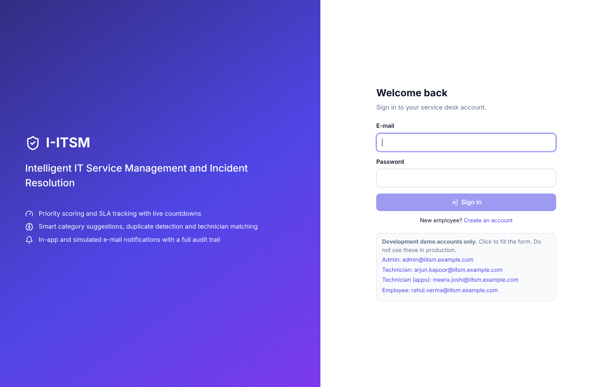{width=70%}

On the client, the token is kept in browser storage and attached by an Axios request interceptor. A 401 response clears it and returns the user to the sign-in page. Routes in React Router are wrapped by a role-aware guard, and the navigation menu shows only the entries allowed for the role. This is a convenience: the server enforces every rule independently.

## 5.2 Employee functions

An employee can report an incident, follow its progress, add information when asked, verify or reopen a resolution and give feedback.

**Reporting an incident.** The form (Figure 5.2) collects title, description, affected service, impact (1 to 5), urgency (1 to 5), the number of users affected and an optional category. While the employee types, the page calls three advisory endpoints: `suggest-category` proposes a category from the text, `check-duplicates` lists similar open incidents so that the employee can add to an existing report, and `preview-priority` shows the priority that would result, including any adjustment for the number of affected users. The server recomputes everything on submission and does not trust the preview.

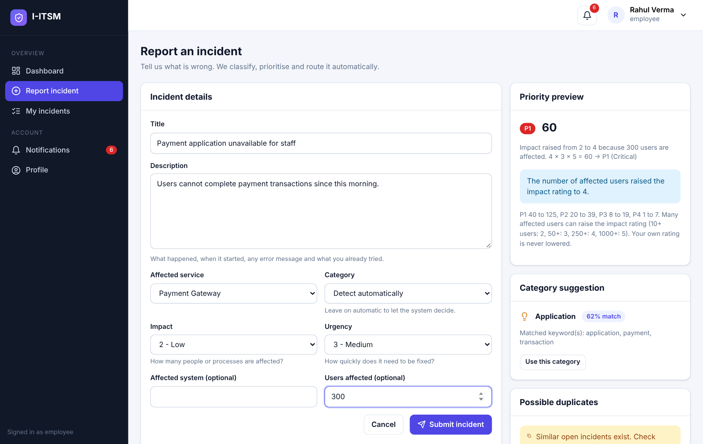{width=95%}

**Following progress.** The employee's dashboard (Figure 5.3) shows counts of their open and resolved incidents and recent notifications. The list (Figure 5.4) supports the filters described in Section 5.9. The detail page (Figure 5.5) shows the status, priority and SLA state, the assigned technician, the conversation with the technician, the full timeline of events and the actions currently allowed.

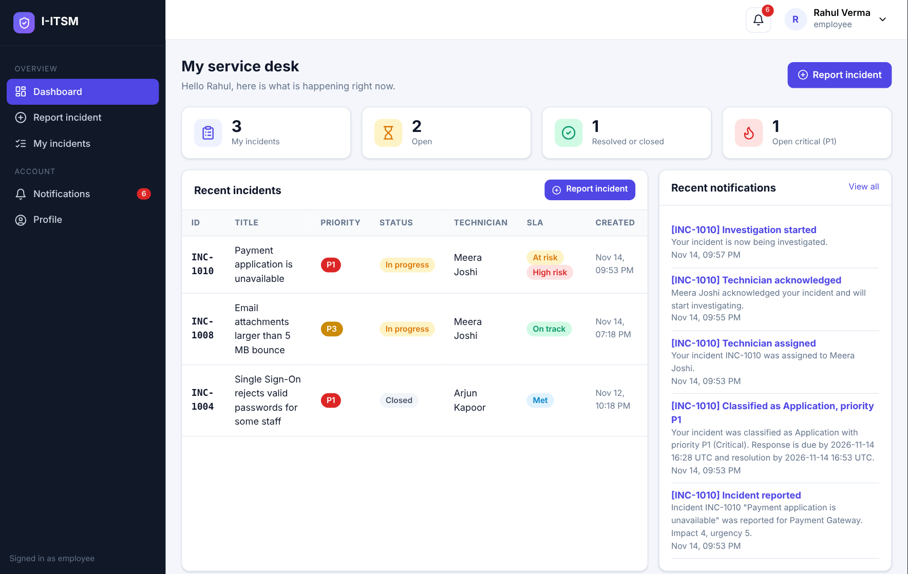{width=95%}

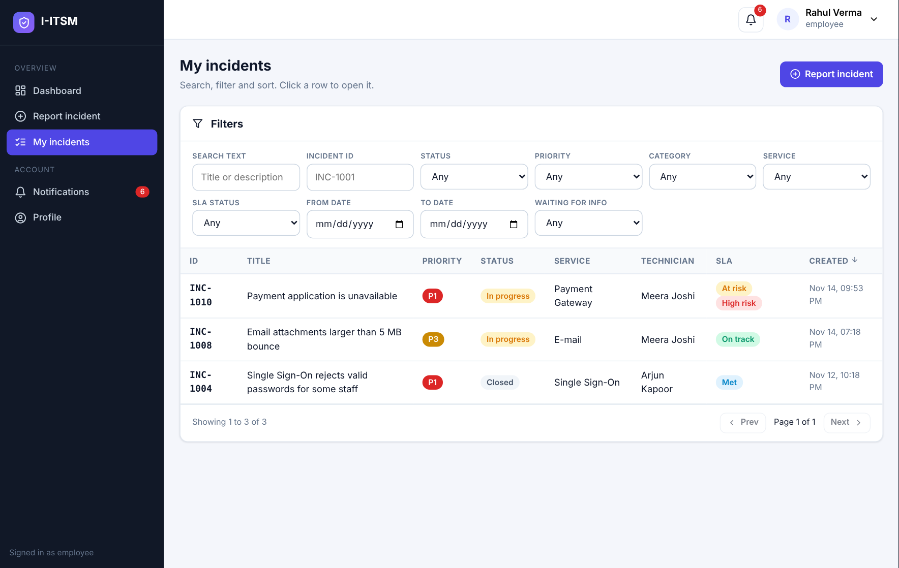{width=95%}

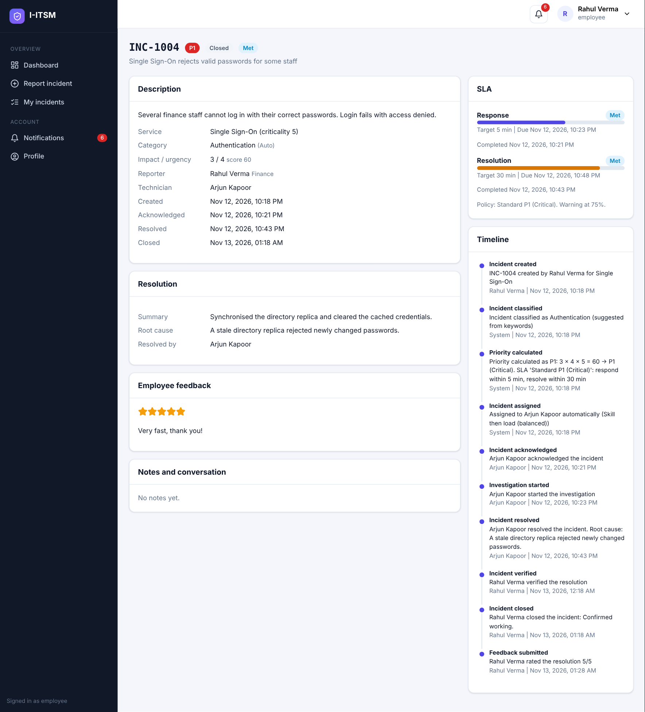{width=95%}

**Verification and feedback.** When the technician resolves an incident the reporter is notified and can verify it, which moves it towards closure, or reopen it with a reason. Once the incident is resolved (or later), the reporter may rate the fix from 1 to 5 with a comment. Only the reporter can do this, feedback is stored once per incident, and the technician is notified.

## 5.3 Technician functions

A technician sees a queue of assigned incidents ordered by urgency (Figure 5.6) and a dashboard with the nearest SLA deadlines. On an incident they can acknowledge it, start the investigation, add investigation notes, request information from the reporter (the incident then shows an "awaiting information" flag until the reporter replies) and record a resolution with a summary and root cause (Figure 5.7). The buttons shown come from the `allowed_next` list returned by the server, so a technician never sees an action that would be refused. A technician can also switch their own availability, which removes them from automatic assignment, and can edit nothing about incidents they do not hold.

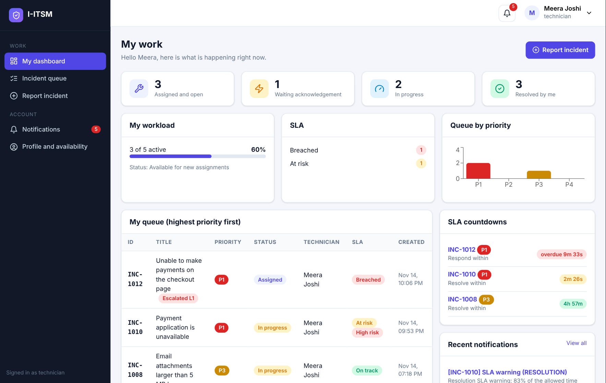{width=95%}

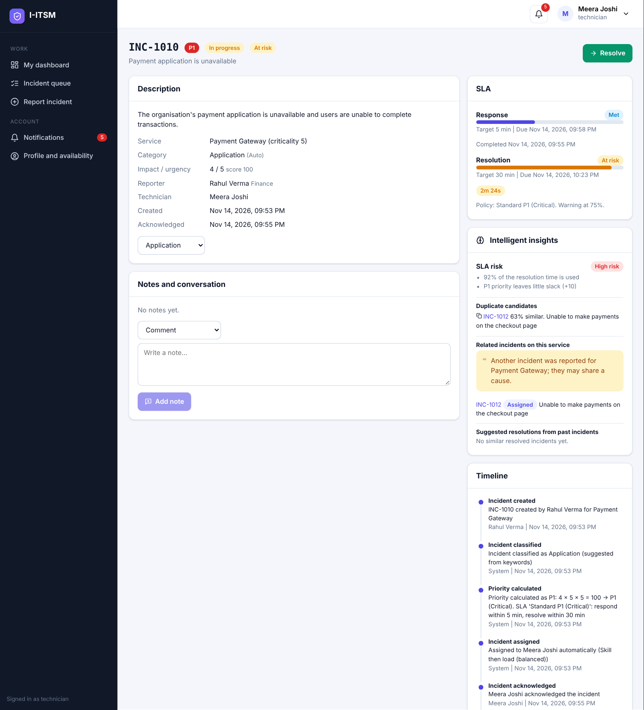{width=95%}

## 5.4 Administrator functions

The administrator manages the people and the rules. Through the interface they can:

* create, edit and deactivate users and give technicians a profile (team, skills with proficiency, years of experience, workload limit);
* manage support teams, services, incident categories and SLA policies, including per-service overrides;
* assign or reassign any incident, with a ranked recommendation list;
* view reports, the SLA monitor, the audit log and the simulated e-mail outbox;
* change system settings: the priority algorithm, the assignment strategy, automatic assignment, escalation, and the affected-users adjustment.

Deactivation, not deletion, is used for users, so history remains intact. Figure 5.8 shows the administrator's dashboard, Figure 5.10 the full incident list and Figure 5.15 the user management page.

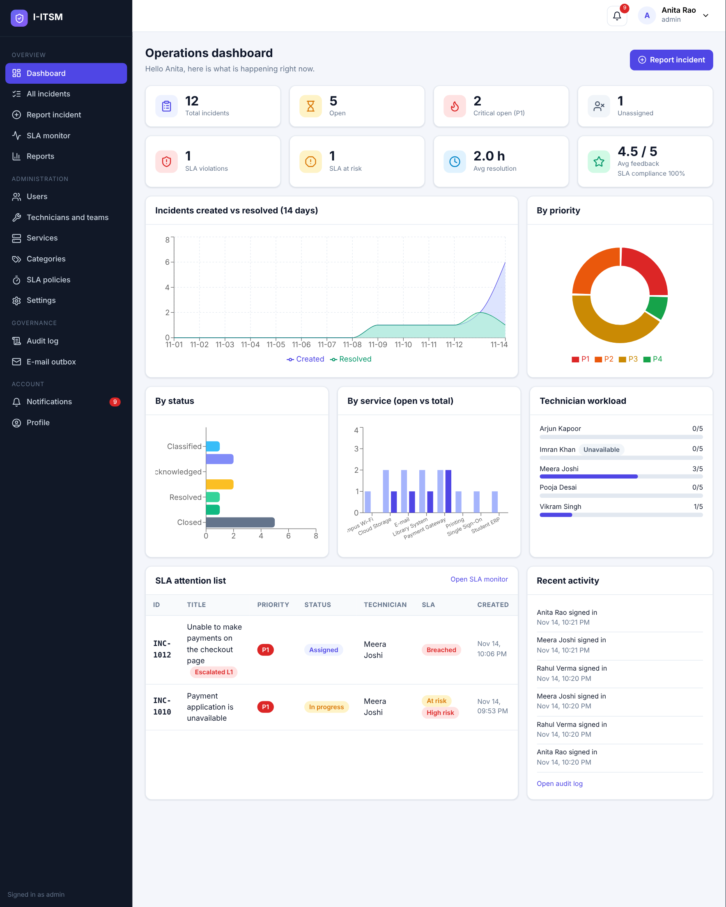{width=95%}

## 5.5 Incident creation, classification and prioritisation

`IncidentService.create_incident` performs the whole workflow in one transaction.

1. `IncidentFactory` validates the input, checks that the service exists and is active, and builds the entity with a sequential reference (`INC-1001`, `INC-1002` and so on).
2. The category is taken from the reporter, or, when absent, from the keyword classifier (Section 5.12), and the incident moves to `CLASSIFIED` through the lifecycle manager.
3. The effective impact is computed by `AffectedUsersPolicy` and the priority by the selected `PriorityStrategy` (Section 4.7).
4. `SlaService.select_policy` picks the policy for the service and priority, falling back to the general policy for that priority, and `apply_policy` stores the response and resolution deadlines. If no policy exists, a `MissingSlaConfigurationError` stops the operation before anything is saved.
5. If automatic assignment is enabled, the assignment service picks the top-ranked eligible technician and the incident moves to `ASSIGNED`. If nobody is eligible, a `NO_TECHNICIAN_AVAILABLE` event is emitted and administrators are notified, and the incident waits in `CLASSIFIED`.
6. Events for each step are emitted, so the audit log and notifications are written without further code in the service.

**Table 5.1: Priority bands and default SLA targets**

| Priority | Score (product strategy) | Response target | Resolution target | Warning at 75% |
|-----------|-----------|-----------|-----------|------------|
| P1 Critical | 40 to 125 | 5 minutes | 30 minutes | 3.75 min and 22.5 min |
| P2 High | 20 to 39 | 15 minutes | 2 hours | 11.25 min and 90 min |
| P3 Medium | 8 to 19 | 1 hour | 8 hours | 45 min and 6 h |
| P4 Low | 1 to 7 | 4 hours | 24 hours | 3 h and 18 h |

The effect of the affected-users rule is easiest to see with an example. A report with impact 2, urgency 3 and criticality 3 gives 18, which is P3. If 300 users are affected, the effective impact becomes 4 and the product 36, which is P2, and the audit log records why. A report whose own impact is already 5 is unchanged by any user count.

## 5.6 Assignment

Assignment follows Section 4.7. Automatic assignment uses the strategy selected in Settings. Manual assignment is done on the incident page (Figure 5.9), where the administrator sees the ranked list with reasons, and also sees *why* ineligible technicians were excluded (unavailable, missing skill or at the workload limit). A manual choice that violates eligibility is refused with the matching exception (`TECHNICIAN_UNAVAILABLE`, `TECHNICIAN_MISSING_SKILL` or `TECHNICIAN_WORKLOAD_EXCEEDED`), so the screen cannot be used to bypass the rules. Reassignment keeps the history: the previous technician is notified and the incident returns to `ASSIGNED`.

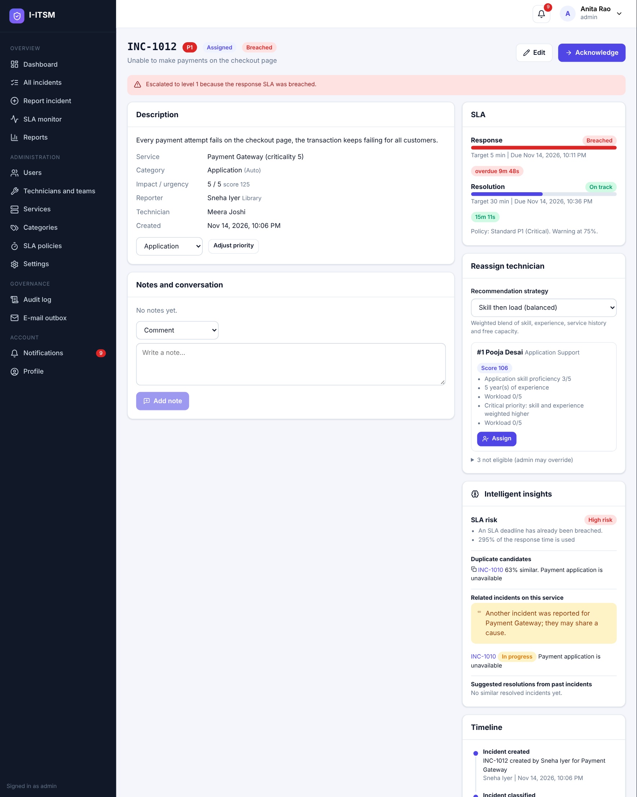{width=95%}

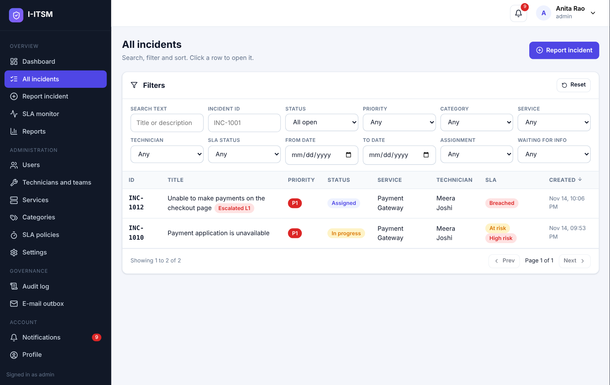{width=95%}

## 5.7 Notifications

Every notification is created by `NotificationObserver` (Section 4.8) and stored for each recipient, so the bell icon and the Notifications page read from the same table. Recipients never include the person who caused the event (except for the creation event) and never include deactivated users. The simulated e-mail channel writes a second copy marked as e-mail, which administrators can read on the outbox page (Figure 5.16). No e-mail leaves the machine.

**Table 5.2: Events and who is notified**

| Event | Recipients |
|----------------------------|------------------------------------------|
| Incident reported | Reporter and administrators |
| Classified | Reporter, with category, priority and deadlines |
| Priority changed | Reporter and assigned technician |
| Assigned | Reporter (technician's name) and the technician (acknowledge before the deadline) |
| Reassigned | Reporter, previous technician and new technician |
| No technician available | Administrators |
| Acknowledged, investigation started | Reporter |
| Information requested | Reporter |
| Information provided | Assigned technician |
| Resolved | Reporter, asked to verify or reopen |
| Reopened | Assigned technician and administrators |
| Verified | Assigned technician |
| Closed | Reporter and assigned technician |
| Feedback received | Assigned technician |
| SLA warning, SLA breached | Assigned technician and administrators |
| Escalated | Recipients named by the escalation chain |

## 5.8 SLA monitoring and escalation

`SlaMonitor` is a background thread started with the application. It wakes every 60 seconds (configurable), opens its own database session and calls `SlaService.run_check`, which evaluates every open incident through `evaluate`.

* **Two clocks per incident.** The response clock runs until acknowledgement and the resolution clock until resolution. Each has a deadline fixed when the policy was applied.
* **Status.** `describe` returns `ON_TRACK`, `AT_RISK` (75 percent or more of the allowed time used), `BREACHED` or `MET`, with the time remaining. The status is also recomputed when an incident is read, so the screen is correct even between monitor cycles.
* **Violations.** A breach creates one `SlaViolation` row per incident and clock type, and emits `SLA_BREACHED`. A warning is emitted once per clock when the risk threshold is crossed.
* **Escalation.** If a P1 or P2 incident is still unacknowledged after its response deadline, `_maybe_escalate` moves it up the chain Team Lead, System Administrator, IT Manager, increments `escalation_level`, records the event and notifies the named recipients, provided escalation is enabled in Settings.
* **Time control.** Because every service takes a `Clock`, tests move time forward with `MutableClock` and call `run_check` directly, so these rules are verified without waiting.

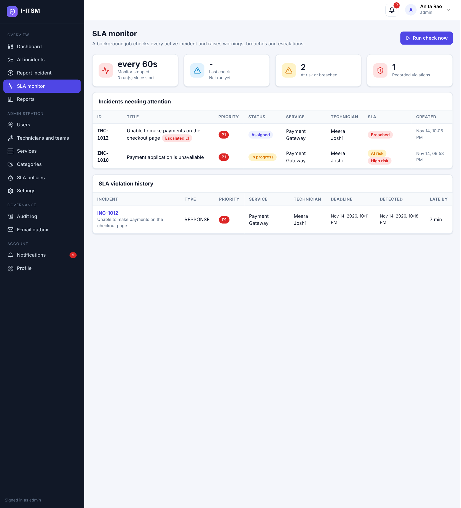{width=95%}

## 5.9 Search, filtering and sorting

The incident list endpoint accepts: incident number, free text over title and description, a created-date range, one or more statuses (with the shortcuts OPEN, DONE and ACTIVE), one or more priorities, category, service, technician, SLA status, an "unassigned only" switch and an "awaiting information" switch, together with a sort key and paging (`page`, `page_size` up to 100). `IncidentRepository` translates `IncidentFilters` into one query. The same endpoint serves all three roles, and `IncidentService.list_incidents` first narrows the result to the caller's scope (own, assigned or all), so a filter cannot widen access. Invalid input such as a start date after the end date returns a 422 with a clear message.

## 5.10 Dashboards and reports

`ReportService.dashboard` returns a role-specific payload (Sections 5.2 to 5.4). The administrator's reports page (Figure 5.12) draws, with Recharts, the overview counts and SLA compliance, incidents by service and by category, a 14-day trend, technician workload and a category-by-service matrix. All figures are computed by SQL aggregate queries, not in the browser. Four of the report tables (trend, by service, by category, technician workload) have a **CSV** button that downloads the table as a file; the file is built in the browser from the data already on screen.

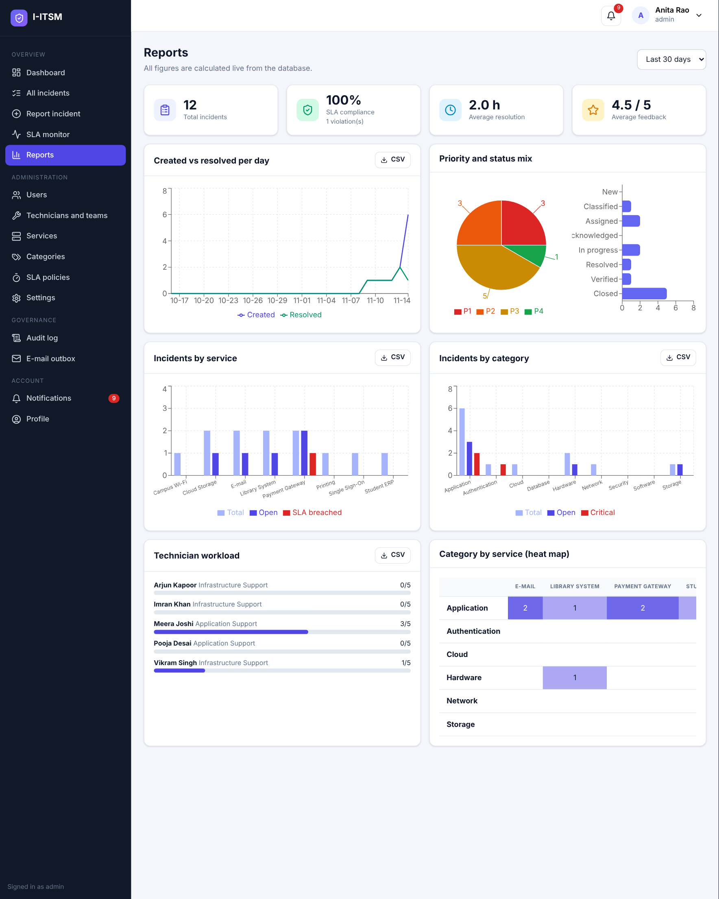{width=95%}

## 5.11 Audit logging

The audit log is append-only. `AuditObserver` writes a row for each of the 34 event types (Section 4.8), and the model rejects updates and deletes, raising `AuditImmutableError`. Administrators can search it by action, actor, incident and date (Figure 5.13). Because the observer is critical and runs inside the request transaction, a change and its audit record succeed or fail together.

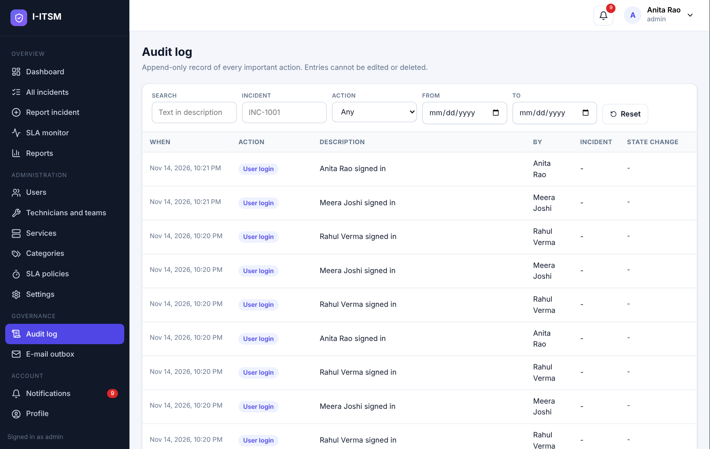{width=95%}

## 5.12 Intelligent features

The assignment asks for useful, explainable automation. `IntelligenceService` provides five features, and the assignment service adds technician recommendation. All are deterministic, with no external service and no model training, so every suggestion can be explained.

**Table 5.3: Intelligent features**

| Feature | Method | Output |
|---------------|--------------------------------------------|------------------------------|
| Category suggestion | Keyword scoring of title and description against weighted keyword lists for each category | Best category with the matching keywords |
| Duplicate detection | Jaccard similarity of word sets: 0.65 on the title and 0.35 on all text, multiplied by 0.75, plus 0.15 for the same service and 0.10 for the same category. Candidates scoring 0.45 or more among incidents of the last 7 days | List of likely duplicates with scores |
| Correlation | Open incidents on the same service within the previous 24 hours | A hint that several reports may share a cause |
| Suggested resolutions | Jaccard similarity (0.12 or more) between the new incident and the resolution summaries of closed incidents | Past fixes the technician may reuse |
| SLA risk | Points from priority, time used, assignment status and escalation | Ordering of the at-risk list |

These features advise. They never change data by themselves: the employee or technician decides.

## 5.13 Database integration and frontend-backend communication

SQLAlchemy 2.x maps the 15 entities to SQLite, with foreign keys enabled on every connection. The schema is created at start-up and demonstration data is loaded only when the database is empty and `SEED_DEMO_DATA` is true. Services run in one session per request, created in the dependency `get_container`, and committed by `@transactional`.

The React application talks to the backend only through the Axios client in `services/api.js` (base path `/api`, proxied by Vite during development, with CORS limited to the local front-end origin). All responses are JSON. Errors have the shape `{detail, code}`, which the client shows to the user. The OpenAPI description is served by FastAPI at `/docs`.

**Table 5.4: Principal API groups**

| Group | Representative endpoints | Who may call |
|--------------|----------------------------------------------|-----------------------|
| Authentication | `POST /auth/register`, `POST /auth/login`, `GET /auth/me`, `PATCH /auth/me`, `POST /auth/change-password` | Public (register, login), any signed-in user |
| Incidents | `POST` and `GET /incidents`, `GET` and `PATCH /incidents/{number}`, `POST /incidents/{number}/transition`, `/assign`, `/notes`, `/feedback`, `GET /incidents/{number}/timeline` | By role and record scope |
| Assistance | `GET /incidents/{number}/recommendations`, `/duplicates`, `/related`, `/suggested-resolutions`; `POST /intelligence/suggest-category`, `/preview-priority`, `/check-duplicates` | By role |
| Users | `GET` and `POST /users`, `PATCH /users/{id}`, `POST /users/{id}/deactivate`, `PUT /users/{id}/technician-profile`, `GET /technicians/workload`, `PATCH /technicians/me/availability`, `GET /technicians/me/queue` | Administrator, technician for own endpoints |
| Configuration | `/categories`, `/services`, `/sla-policies`, `/teams`, `/settings` (list, create, update) | Administrator for changes |
| Operations | `/notifications`, `/audit-logs`, `/reports/*`, `/dashboard`, `/sla/at-risk`, `/sla/violations`, `/sla/monitor`, `POST /sla/run-check`, `/admin/email-outbox` | By role |

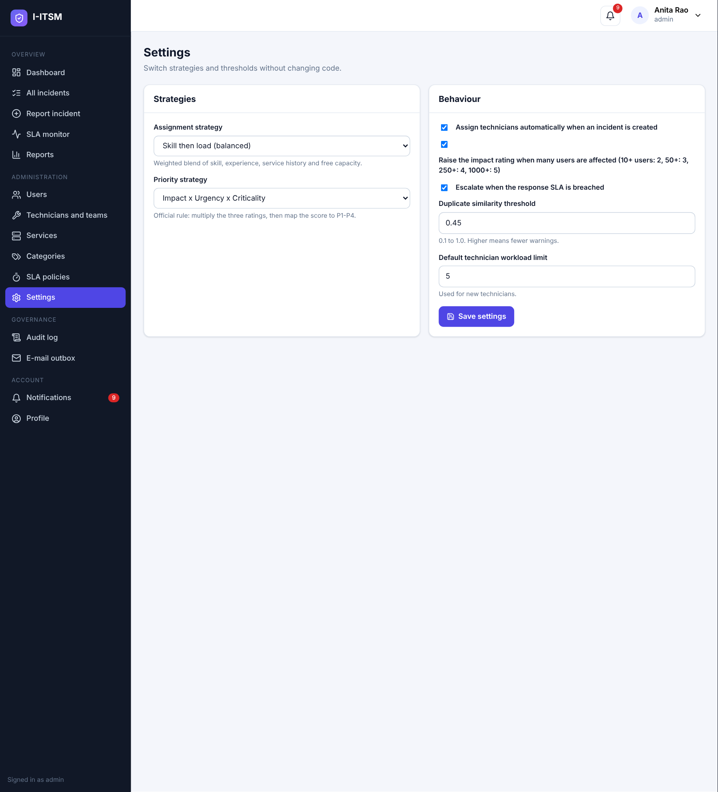{width=95%}

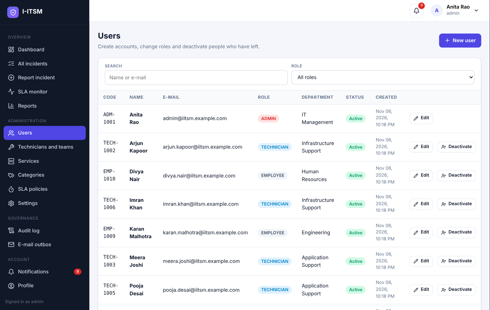{width=95%}

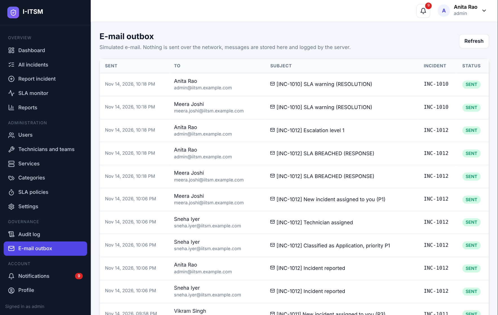{width=95%}

## 5.14 Screenshots and optional additions

All sixteen screenshots above are included, so no placeholder remains in this chapter. The team may still wish to add screenshots of mobile-width layout, of the interactive API documentation (`/docs`) and of an error state such as a refused transition, because the assignment's video and report are marked by what they demonstrate. These are listed as optional items in `MANUAL_TASKS.md`. They are not required for this report to be complete.

# Chapter 6: Test Cases and Validation

This chapter reports only results that were actually produced. The figures come from a real run recorded in `docs/evidence/TEST_RESULTS.md` (generated by `docs/tools/build_testing_report.py`, run on 2026-11-14 with Python 3.13 on Linux), which also lists every test case with its assertions. Nothing in this chapter is estimated.

## 6.1 Methodology

Testing is automated with pytest and FastAPI's test client (httpx). Each test builds an application against an in-memory SQLite database, so tests are isolated and fast. Three design decisions make the tests reliable:

* **Injectable clock.** `MutableClock` lets a test move time forward by minutes or days, so every SLA rule (warning, breach, escalation, duplicate window) is deterministic.
* **Low bcrypt cost in tests.** `BCRYPT_ROUNDS` is set to 4 inside the test run for speed. Hashing at the default cost of 12 was checked separately (Section 6.6).
* **Requirement-driven cases.** Thirty acceptance scenarios (T01 to T30, Appendix A) are written as named tests, and the remaining tests cover the rules around them.

The test pyramid has three levels. *Unit tests* call a class directly (priority strategies, eligibility policy, affected-users policy, tokenisation, similarity). *Integration tests* call several services with a real session (lifecycle with audit, SLA with escalation). *API tests* call HTTP endpoints through the test client with real tokens and check status codes, response bodies, error codes and the resulting database state. The bulk of the suite is at the API level, because that is where the roles, validation, services and persistence meet.

## 6.2 Backend results

**Table 6.1: Summary of the automated test run**

| Item | Result |
|---------------------------|------------------------------------------|
| Test cases executed | 264, from 14 test files (parametrised cases counted individually) |
| Passed, failed, skipped | 264 passed, 0 failed, 0 skipped |
| Run time | 49 seconds |
| Statement coverage of `backend/app` | 94.8 percent (3,477 of 3,669 statements) |
| Warnings | 6: one `StarletteDeprecationWarning` (the installed test client now prefers the `httpx2` package over `httpx`) and five `ResourceWarning` messages for in-memory SQLite connections released by garbage collection (test fixture noise, not application errors) |

**Table 6.2: Results by test file**

| File | Scope | Cases | Passed |
|------------------------------|-----------------------------------------|------|------|
| `test_affected_users.py` | Affected-users impact floor, preview endpoint, setting, automatic upgrade of an older database | 26 | 26 |
| `test_assignment.py` | Eligibility, strategies, override, workload, reassignment | 17 | 17 |
| `test_auth.py` | Registration, login, tokens, password rules, profile | 13 | 13 |
| `test_bootstrap.py` | Production start-up and first administrator | 3 | 3 |
| `test_documented_cases.py` | Maximum text lengths, missing mandatory fields, unassigned technician (TC-09, TC-11, TC-19) | 3 | 3 |
| `test_intelligence.py` | Category suggestion, duplicates, SLA risk, correlation, resolutions | 17 | 17 |
| `test_lifecycle.py` | Every legal and illegal transition, required fields, audit of transitions | 76 | 76 |
| `test_notes_feedback_config.py` | Notes visibility, feedback, administrator configuration | 11 | 11 |
| `test_notifications_audit.py` | Notifications, outbox, append-only audit | 9 | 9 |
| `test_priority.py` | Score, P1 to P4 bands, strategies, validation | 30 | 30 |
| `test_rbac.py` | Role-based and object-level access | 10 | 10 |
| `test_search_reports.py` | Filters, dashboards, reports, persistence after restart | 9 | 9 |
| `test_sla.py` | Deadlines, warnings, breaches, escalation, clock stopping | 15 | 15 |
| `test_use_case_matrix.py` | Use cases of the diagram allowed for their actors and denied to others | 25 | 25 |
| **Total** | | **264** | **264** |

## 6.3 Coverage

**Table 6.3: Statement coverage by package**

| Package | Statements | Covered | Percent |
|-----------------|-------|-------|-------|
| `config` | 34 | 34 | 100 |
| `database` | 58 | 57 | 98 |
| `domain` | 247 | 245 | 99 |
| `main` | 61 | 57 | 93 |
| `middleware` | 81 | 72 | 89 |
| `models` | 261 | 258 | 99 |
| `observers` | 186 | 173 | 93 |
| `repositories` | 339 | 327 | 96 |
| `routes` | 310 | 304 | 98 |
| `schemas` | 284 | 279 | 98 |
| `services` | 1,400 | 1,317 | 94 |
| `strategies` | 210 | 210 | 100 |
| `utils` | 198 | 144 | 73 |
| **Total** | **3,669** | **3,477** | **94.8** |

Five files are below 85 percent: `utils/seed.py` (59), `observers/base.py` (71), `services/config_service.py` (79), `middleware/errors.py` (83) and `services/user_service.py` (84). The seed module is demonstration-data generation and the start-up path. The others have update and error branches that the API tests reach only partly. Coverage measures which lines ran, not whether the assertions are sufficient, so it is reported as evidence of breadth and not as proof of correctness.

## 6.4 Documented test cases

The assignment requires documented test cases for normal operations, boundary conditions, invalid inputs, exceptions, authorisation and business rules. This section documents thirty cases, TC-01 to TC-30, in the required format. Each case says exactly what was run and what was observed.

**How the status is decided.** TC-01 to TC-27 are *automated*: each is tied to named pytest functions given in the last column of Table 6.4, and the Status column is the real outcome of running those functions (the table is regenerated by `docs/tools/build_test_cases.py`, which fails if a referenced test does not exist). TC-28 is a *manual* case that was run once with a scripted headless browser. TC-29 and TC-30 are *planned* and were **not executed**; they are marked NOT EXECUTED and are not counted as passed. Where a parametrised test is cited, the case passes only if every listed parameter passes.

<!-- testcases:start -->
<!-- landscape -->
**Table 6.4: Documented test cases with expected results, actual results, status and automated test reference**

| Test ID | Category | Test scenario | Preconditions | Test input or steps | Expected result | Actual result | Status | Automated test reference |
|----|------|-----------|----------|-------------|-----------|-------------|-----|---------------------|
| TC-01 | Normal | Successful login with valid credentials | Demo administrator account exists | POST `/api/auth/login` with the administrator e-mail (upper case) and the correct password | HTTP 200, bearer token and user with role ADMIN; the sign-in is audited | HTTP 200, token_type bearer, user role ADMIN, audit action `USER_LOGIN` present | PASS | Automated: `test_auth.py::test_login_success_returns_token_and_user_and_is_audited` |
| TC-02 | Normal | Employee creates an incident | Employee signed in; service Library System (criticality 2) exists | POST `/api/incidents`: title and description valid, impact 3, urgency 3 | Incident created; priority computed from the service criticality; score 18 and P3 | Created with score 18, priority P3, business_criticality 2, criticality not overridden | PASS | Automated: `test_priority.py::test_api_calculates_priority_and_takes_criticality_from_service` |
| TC-03 | Normal | Technician acknowledges an assigned incident | Incident created and automatically assigned to a technician; clock advanced 2 minutes | POST transition to ACKNOWLEDGED as the assigned technician | HTTP 200, status ACKNOWLEDGED, acknowledged_at set, response SLA marked MET | HTTP 200, status ACKNOWLEDGED, timestamp 2 minutes after creation, response SLA state MET | PASS | Automated: `test_lifecycle.py::test_t09_assigned_technician_acknowledges_and_timestamp_is_set` |
| TC-04 | Normal | Administrator assigns an incident to an eligible technician | Unassigned Storage incident; technician Imran Khan initially unavailable | POST `/api/incidents/{n}/assign` as administrator, first while unavailable, then after setting is_available true | Refused while unavailable; accepted once available; status ASSIGNED | First call HTTP 409 `TECHNICIAN_UNAVAILABLE`; second call HTTP 200, technician Imran Khan, status ASSIGNED | PASS | Automated: `test_assignment.py::test_admin_assigns_manually_after_making_technician_available` |
| TC-05 | Normal | Resolve an incident with the required resolution details | Incident assigned and in progress | Transition to RESOLVED with resolution_summary and root_cause, then verify and close | Incident reaches RESOLVED, then VERIFIED and CLOSED through the legal steps | Full lifecycle NEW to CLOSED completed with every step accepted | PASS | Automated: `test_lifecycle.py::test_full_lifecycle_to_closed` |
| TC-06 | Boundary | Priority with the minimum valid ratings | None | calculate(impact 1, urgency 1, criticality 1) | Score 1 and level P4 | Score 1 and level P4 (parametrised case ratings7) | PASS | Automated: `test_priority.py::test_documented_examples_and_boundaries[ratings7-1-P4]` |
| TC-07 | Boundary | Priority level at the lower and upper limit of every band | Default thresholds | level_for_score for 1, 7, 8, 19, 20, 39, 40 and 125 | 1 and 7 give P4; 8 and 19 give P3; 20 and 39 give P2; 40 and 125 give P1 | All eight boundary scores mapped to the expected level; also the products 8, 20 and 40 from ratings give P3, P2 and P1 | PASS | Automated: `test_priority.py::test_t06_t07_threshold_boundaries`; `test_priority.py::test_documented_examples_and_boundaries[ratings4-8-P3]`; `test_priority.py::test_documented_examples_and_boundaries[ratings5-20-P2]`; `test_priority.py::test_documented_examples_and_boundaries[ratings6-40-P1]` |
| TC-08 | Boundary | Priority with the maximum valid ratings | None | calculate(impact 5, urgency 5, criticality 5) | Score 125 and level P1 | Score 125 and level P1 (parametrised case ratings8) | PASS | Automated: `test_priority.py::test_documented_examples_and_boundaries[ratings8-125-P1]` |
| TC-09 | Boundary | Maximum permitted text lengths | Employee signed in; limits in the schema: title 200, description 5000, affected system 200 characters | Create with exactly 200, 5000 and 200 characters; then with 201, 5001 and 201 characters, one field at a time | Maximum lengths accepted with HTTP 201; one character more rejected with HTTP 422 naming the field | Creation with the maximum lengths returned 201 and stored a 200 character title; each over-length field returned 422 with that field named | PASS | Automated: `test_documented_cases.py::test_tc09_maximum_permitted_text_lengths_are_accepted_and_one_more_is_rejected` |
| TC-10 | Invalid input | Login with an incorrect password | Registered user exists | POST `/api/auth/login` with a wrong password | HTTP 401, no token, error code `AUTHENTICATION_FAILED` | HTTP 401 without a token in the response | PASS | Automated: `test_auth.py::test_t03_login_with_wrong_password_returns_401_without_token` |
| TC-11 | Invalid input | Incident creation with missing mandatory fields | Employee signed in | POST `/api/incidents` omitting in turn title, description, service_id, impact, urgency; and an empty body | HTTP 422 each time, with the missing field named | Every omission returned 422 and the response listed the omitted field; the empty body returned 422 | PASS | Automated: `test_documented_cases.py::test_tc11_missing_mandatory_fields_are_rejected_and_named` |
| TC-12 | Invalid input | Ratings outside the range 1 to 5 | None | calculate with (0,3,3), (6,3,3), (3,0,3), (3,3,6), (-1,1,1); API with impact 6 and urgency 0 | InvalidInputError in the strategy; HTTP 422 naming the field through the API | All five strategy calls raised InvalidInputError; API returned 422 with the field impact or urgency named | PASS | Automated: `test_priority.py::test_invalid_ratings_are_rejected`; `test_priority.py::test_incident_validation_errors_are_meaningful` |
| TC-13 | Invalid input | Resolve without the mandatory resolution details | Incident `IN_PROGRESS` | Transition to RESOLVED with nothing; with summary only; with a blank summary and a root cause | HTTP 422 each time; the message mentions the root cause; status stays `IN_PROGRESS` | All three requests returned 422, the message contained 'root cause', status remained `IN_PROGRESS` | PASS | Automated: `test_lifecycle.py::test_t10_resolve_without_summary_or_root_cause_is_rejected` |
| TC-14 | Exception | Invalid lifecycle transition, NEW directly to CLOSED | An incident exists; for the unit level every pair of statuses is tried | Request CLOSED from a new incident; and every disallowed pair of statuses at unit level | HTTP 409 `INVALID_STATE_TRANSITION` and the incident does not change; every disallowed pair raises InvalidTransitionError | HTTP 409, status and audit unchanged; all disallowed pairs were rejected | PASS | Automated: `test_lifecycle.py::test_t08_new_to_closed_is_rejected_with_409_and_no_mutation`; `test_lifecycle.py::test_every_disallowed_transition_is_rejected` |
| TC-15 | Exception | Assignment when no eligible technician exists | Storage is covered only by a technician on leave | Create a Cloud Storage incident in category Storage | Incident stays CLASSIFIED and unassigned; administrators are notified; the timeline records `NO_TECHNICIAN_AVAILABLE` | assigned false, status CLASSIFIED, administrator notification present, internal event hidden from the employee | PASS | Automated: `test_assignment.py::test_t15_no_eligible_technician_leaves_incident_unassigned_and_notifies_admin` |
| TC-16 | Exception | Manual assignment to a technician at the workload limit | Technician limit set to 1 and already holding one incident | Administrator assigns a second incident to that technician, then repeats with override true | Refused with HTTP 409 `TECHNICIAN_WORKLOAD_EXCEEDED`; with an explicit override accepted and audited | First request HTTP 409 `TECHNICIAN_WORKLOAD_EXCEEDED`; with override HTTP 200 and the timeline text mentions the override | PASS | Automated: `test_assignment.py::test_workload_limit_blocks_assignment_unless_admin_overrides` |
| TC-17 | Exception | Incident processing when the SLA policy is missing | The only P1 SLA policy is deactivated | Create a P1 incident | HTTP 422 `MISSING_SLA_CONFIGURATION` and no incident is saved | HTTP 422 with code `MISSING_SLA_CONFIGURATION`; incident list total 0 | PASS | Automated: `test_sla.py::test_missing_sla_policy_blocks_creation_without_side_effects` |
| TC-18 | Authorisation | Employee views another employee's incident | Two employees; one has reported an incident | Second employee requests the incident, its notes and its timeline | HTTP 403 for all three and no incident content in the response | HTTP 403 for incident, notes and timeline; the title was absent from the response | PASS | Automated: `test_rbac.py::test_t04_employee_cannot_read_another_employees_incident` |
| TC-19 | Authorisation | Technician changes an incident not assigned to them | Incident assigned to technician A; technician B signed in | B requests the incident, patches its category and tries to acknowledge it | HTTP 403 each time and the incident is unchanged | HTTP 403 for all three requests; status still ASSIGNED; acknowledgement by B refused | PASS | Automated: `test_documented_cases.py::test_tc19_technician_cannot_view_or_change_an_incident_not_assigned_to_them`; `test_lifecycle.py::test_only_assigned_technician_or_admin_can_acknowledge` |
| TC-20 | Authorisation | Employee or technician uses administrator-only functions | Employee, technician and administrator signed in | GET users, audit logs, reports, SLA policies, settings, teams, e-mail outbox and SLA lists | HTTP 403 for employee and technician, HTTP 200 for the administrator | Nine administrator endpoints returned 403 to both non-admin roles and 200 to the administrator | PASS | Automated: `test_rbac.py::test_admin_only_endpoints_reject_other_roles` |
| TC-21 | Authorisation | Unauthenticated access to protected endpoints | No token | GET `/api/auth/me` and `/api/incidents` without a token; with a malformed token; every probed use-case endpoint anonymously | HTTP 401 in all cases | HTTP 401 for both endpoints, for the malformed token and for every probed use-case endpoint | PASS | Automated: `test_auth.py::test_protected_routes_require_a_valid_token`; `test_use_case_matrix.py::test_anonymous_cannot_use_any_probed_endpoint` |
| TC-22 | Business rule | Priority equals impact x urgency x business criticality | Default product strategy | Ratings (4,5,5), (3,3,4), (3,3,2), (1,2,1) | Scores 100, 36, 18 and 2 giving P1, P2, P3 and P4 | All documented examples matched, including 100 for P1 and the criticality taken from the service | PASS | Automated: `test_priority.py::test_t05_impact4_urgency5_criticality5_is_score_100_p1`; `test_priority.py::test_documented_examples_and_boundaries` |
| TC-23 | Business rule | Correct SLA response and resolution deadlines for each priority | Standard SLA policies | Create one incident per priority (P1 to P4) and read the SLA targets | P1 5 and 30 min, P2 15 and 120, P3 60 and 480, P4 240 and 1440 minutes | All four priorities reported exactly those target minutes | PASS | Automated: `test_sla.py::test_all_priorities_use_the_specified_targets`; `test_sla.py::test_t16_p1_incident_gets_5_and_30_minute_deadlines` |
| TC-24 | Business rule | An accepted lifecycle transition creates an audit record | Incident taken to RESOLVED | Read the incident timeline as administrator | Audit rows with previous and new state for each step, in time order | NEW to CLASSIFIED, CLASSIFIED to ASSIGNED, ASSIGNED to ACKNOWLEDGED, ACKNOWLEDGED to `IN_PROGRESS` and `IN_PROGRESS` to RESOLVED present, times ascending; actor, action and time present | PASS | Automated: `test_lifecycle.py::test_every_accepted_transition_is_audited_with_states`; `test_notifications_audit.py::test_t21_transition_creates_audit_row_with_actor_action_states_and_time` |
| TC-25 | Business rule | Creation and assignment trigger the right notifications | Employee, technician and administrator accounts | Create an incident and move it to RESOLVED; read each inbox and the e-mail outbox | Reporter, technician and administrator receive their messages; each has an in-app record and a simulated e-mail record | Reporter saw reported, classified and assigned messages; technician saw the assignment; administrator saw the report; outbox entries all EMAIL and SENT | PASS | Automated: `test_notifications_audit.py::test_t20_creation_assignment_and_resolution_create_in_app_and_email_records` |
| TC-26 | Business rule | Duplicate detection warns but does not merge | A payment incident is open | Report two further, similarly worded payment incidents by other employees | Warning lists the earlier incident(s) with similarity of at least 0.45; all incidents are still created and open | Second report listed the first as a duplicate; third listed both; three separate open incidents; related incidents can be linked without merging | PASS | Automated: `test_intelligence.py::test_t24_similar_payment_incident_triggers_a_warning_but_is_not_blocked`; `test_intelligence.py::test_admin_can_link_related_incident_without_merging` |
| TC-27 | Business rule | Search and filtering return only matching incidents | Four incidents with different priorities, services and SLA states | Combine status, priority, service and SLA status filters; try the filters separately | Only incidents that match every selected criterion are returned; contradictory combinations return none | Each combination returned exactly the expected incident numbers and zero results for the contradictory combinations | PASS | Automated: `test_search_reports.py::test_t23_combined_filters_return_only_matching_incidents`; `test_search_reports.py::test_each_of_the_eight_filters_works_on_its_own` |
| TC-28 | Business rule | Live priority preview on the report form | Back end and front end running with demo data | In the browser enter impact 2 and 300 affected users on the report form and submit | Preview shows the raised priority and a note that impact was raised to 4; the created incident explains it | Preview showed P1 (score 60) with the note that impact was raised to 4; the detail page showed the explanation; no JavaScript errors were logged | PASS | Manual (scripted headless Chrome pass on 2026-11-14). No automated test. |
| TC-29 | Exception | Network failure shown as a readable message | Page open in the browser; the front-end server stopped so that no response can arrive | Click Sign in or any other action on the open page | A message such as 'Cannot reach the server' in an alert or toast and no blank page. With only the back end stopped behind the Vite proxy the message is 'Request failed (500).' | Not executed in this report | NOT EXECUTED | Planned, not executed (checklist in MANUAL_TASKS.md). No automated test. |
| TC-30 | Business rule | Full test suite on Windows | Windows computer with Python 3.11 or later and a virtual environment | pip install -r requirements.txt, then python -m pytest -q in the backend folder | All tests pass | 264 passed, 1 warning in 49.55 s in Windows PowerShell on 2026-11-20 (screenshot SS-31) | PASS | Manual (Windows PowerShell, 2026-11-20). No automated test. |
<!-- /landscape -->

**Table 6.5: Coverage of the six required categories**

| Category | Cases | Passed | Not executed |
|-------------|------|------|------|
| Normal | 5 | 5 | 0 |
| Boundary | 4 | 4 | 0 |
| Invalid input | 4 | 4 | 0 |
| Exception | 5 | 4 | 1 |
| Authorisation | 4 | 4 | 0 |
| Business rule | 8 | 8 | 0 |
| **Total** | **30** | **29** | **1** |
<!-- testcases:end -->

**Confirmation of coverage.** All six required categories are covered (Table 6.5): five normal-operation cases, four boundary cases, four invalid-input cases, four exception cases, four authorisation cases and six business-rule cases among the automated ones, which is far above the minimum of fifteen documented cases. Three cases were added to the automated suite (`test_documented_cases.py`: TC-09, TC-11, TC-19) because the maximum-length boundary, the missing-field check and the unassigned-technician check had no dedicated test before; no application code was changed.

**Use cases.** `test_use_case_matrix.py` drives the real API for 23 of the 32 use cases in the diagram and checks that each is allowed for its actors and refused for the others. The other nine are not probed by this matrix; see `docs/REQUIREMENTS_TRACEABILITY.md` for the tests and screens that cover them.

**Diagram verification.** `docs/tools/verify_diagrams.py` compares the class and ER diagrams with the code. In its last run it made 1,666 checks (class names, bases, attributes, relationships, tables, columns, foreign keys) and reported no mismatch.

## 6.5 Frontend validation

There is no automated test suite for the user interface, and this report does not claim one. Validation of the front end is as follows.

* **Production build.** `npm ci` and `npm run build` succeeded on a clean copy: 2,259 modules were transformed into one HTML file, one CSS file (10.8 kB) and one JavaScript file (792 kB, 225 kB compressed).
* **Scripted browser pass.** Headless Chrome (Puppeteer) was driven against the real back end and the Vite server. Typing 300 affected users with impact 2 showed the preview P1 (score 60) with the notice that impact was raised to 4. Submitting created the incident and the detail page showed the explanation. No JavaScript errors were logged. This was a single scripted pass, not a regression suite.
* **Scripted walkthrough of the full lifecycle** (sign in, report, assign, acknowledge, investigate, ask for information and reply, resolve, verify, feedback, close, override an assignment) and the capture of the sixteen screenshots in Chapter 5 were performed against the running application.
* **Manual checklist.** The group should still walk through the checklist in `MANUAL_TASKS.md` on its own machines and on Windows, because Linux and Chromium were the main platforms used for the evidence above.

## 6.6 Security and dependency considerations

* Passwords are hashed with bcrypt at cost 12. In a fresh installation the stored hashes began with `$2b$12$`, hashing took about 0.3 seconds, and passwords of 72, 73, 100 and 128 characters were hashed and verified without error. bcrypt reads only the first 72 bytes, so the code truncates explicitly and two passwords that differ only after byte 72 are treated as equal. This is a known property of bcrypt and is recorded in the requirements.
* Tokens expire (60 minutes by default). A deactivated user's existing token stops working at the next request (tested).
* Production mode refuses to start while `SECRET_KEY` has its default value (tested), and demo accounts are created only when `SEED_DEMO_DATA` is true.
* Audit records are append-only at the ORM level and have no write endpoint.
* The application has no public deployment. It binds to localhost, and CORS allows only the local front-end origin.
* **Dependency audit.** `npm audit` reported four findings (three moderate, one high) and none were fixed. Vite (direct, high) and esbuild (moderate) affect the development server only and are absent from the production bundle. `react-router` and `react-router-dom` (moderate) concern an open redirect through links with attacker-controlled targets and server-side-render hydration, which this application does not use. Fixing them needs major upgrades (Vite 8, react-router-dom 7), which were not applied because they would require a full regression run of the interface. `pip-audit` was **not** run, so no statement is made about Python package advisories.
* **Fresh-install check.** On a clean copy, `pip install -r requirements.txt` resolved bcrypt 5.0.0, FastAPI 0.165.0, SQLAlchemy 2.1.9, Pydantic 2.14.4, PyJWT 2.15.1, uvicorn 0.54.0, pytest 9.2.0 and httpx 0.28.1. All 264 tests passed in that environment (re-run on 2026-11-19), the server started, `/docs` answered, and the login endpoint gave 200 for the demo administrator and 401 for a wrong password.

## 6.7 Known limitations of the testing

The testing limitations (no automated front-end tests, no load or concurrency tests, simulated e-mail, Linux and Chromium as the main platforms, no `pip-audit` run, and the planned case TC-29 that was not executed) are listed together with the other limitations of the system in Section 7.4. One practical note belongs here: coverage tooling (`pytest-cov`) is not in `requirements.txt` and must be installed separately to reproduce the coverage figure.

**Why test counts differ between earlier documents.** The figure 210 (early README) is the suite before the affected-users rule and the use-case matrix were added. Adding `test_affected_users.py` (26 tests) and `test_use_case_matrix.py` (25 tests) gave 261, and the three gap-filling tests in `test_documented_cases.py` give the current 264. All three counts were verified by collecting the corresponding sets of test files on 2026-11-19. The warning count is not stable: 0 to 6 warnings were observed for identical code (garbage-collection timing of unclosed in-memory SQLite connections, and a deprecation notice that appears only when `httpx2` is not installed). Details are in `docs/evidence/TEST_RESULTS.md`, section 8.

# Chapter 7: Results and Discussion

## 7.1 Objectives against outcomes

**Table 7.1: Objectives of the project and the evidence that they are met**

| Objective (Section 1.4) | Outcome | Evidence |
|-----------------------------------|-------------------------------------|----------------------|
| Role-based access for employees, technicians and administrators | Met. Role guards, record-level scoping and role-specific screens | Sections 5.1 to 5.4, tests T02 to T04, 10 RBAC cases and the use-case matrix |
| Controlled incident lifecycle | Met. Eight states, tabulated transitions, required fields, reopen and reassign | Section 4.10, 76 lifecycle tests |
| Transparent prioritisation | Met. Score product and weighted strategy, affected-users floor, explanation stored | Sections 4.7 and 5.5, 56 priority and affected-user tests |
| Automatic and manual assignment with explanation | Met. Three strategies, eligibility filter, reasons shown | Sections 4.7 and 5.6, 17 assignment tests |
| SLA monitoring and escalation | Met. Deadlines, warning at 75 percent, one violation per type, escalation chain | Section 5.8, 15 SLA tests |
| Notifications and audit trail | Met. Observer-driven, append-only audit | Sections 5.7 and 5.11, 9 tests |
| Search, dashboards and reports | Met | Sections 5.9 and 5.10, 9 tests |
| Intelligent assistance | Met within the deterministic scope chosen | Section 5.12, 17 tests |
| Object-oriented design with named patterns | Met. Strategy, Observer, Repository, State, Factory, dependency injection | Chapter 4, verified diagrams |
| Testing | Met for the backend, partly for the interface | Chapter 6 |

## 7.2 Discussion

**What worked well.** Putting each varying rule behind a small abstraction paid off repeatedly. Switching the assignment strategy needed no change to any route or screen. Adding the affected-users rule, which came late in the project from a review against the assignment, was a new policy class, one new column and a few lines in the incident service, and no strategy had to change. Making the clock injectable meant that SLA behaviour, the hardest part to test, became ordinary test code. Treating audit as a critical observer inside the transaction gave a simple guarantee: no action without a record.

**Design trade-offs.** Three choices are worth stating plainly.

1. *State pattern with persisted entities.* The state objects are looked up from the stored status instead of being held by the incident. The behaviour is the same and the code is simpler for an object mapped to a table, but it is not the textbook form (Section 4.10).
2. *Deterministic intelligence.* Keyword scoring and set similarity are less powerful than a trained model, but they run offline, give identical answers for identical input, and can be explained to a user in one sentence. For a course project and a service desk that wants to trust its suggestions, this is a deliberate trade.
3. *SQLite and a single process.* This removes installation effort and suits a localhost demonstration. It limits concurrency. The repository layer confines the change needed to move to a server database.

**Departures from the assignment's lifecycle.** The assignment's lifecycle has no way back, but a service desk needs reassignment and reopening. These two transitions were added and are visible in Table 4.4. Any other transition is refused.

**Limitations.** The shortcomings found during verification are listed once, in Section 7.4.

## 7.3 Requirements compliance audit

This audit compares the assignment (the MVP list and the deliverables) with the code that exists, not with earlier documents. Each "implemented" entry was checked in the source or by running it: the roles, strategy registries, channel registry and the list of query parameters were read back from the running application, and the behaviour is exercised by the tests named in Table 6.4 and in `docs/REQUIREMENTS_TRACEABILITY.md`.

**Table 7.2: Mandatory MVP requirements checked against the implementation**

| Requirement | Status | Supporting code | Demonstrated or documented | Remaining limitation |
|--------------|----------|----------------------------|----------------------------|--------------------------|
| 1. Three roles (employee, technician, administrator) | Implemented | `domain/enums.py` (`Role`), `models/user.py`, `middleware/dependencies.py` (`require_roles`), `frontend/src/App.jsx` (role-aware routes) | Section 5.1 to 5.4, Figures 5.1 to 5.8, TC-18 to TC-21, use-case matrix test | Registration creates employees only, other roles are created by an administrator |
| 2. Incident create, view, update, assign, resolve, close | Implemented | `routes/incidents.py`, `services/incident_service.py` (`create_incident`, `update_incident`, `assign`, `transition`), `services/incident_factory.py` | Sections 5.2 to 5.6, TC-02 to TC-05 | Closed incidents are read-only by design |
| 3. Priority from impact, urgency and business criticality | Implemented | `strategies/priority.py` (`ScoreProductPriorityStrategy`, `WeightedPriorityStrategy`, `AffectedUsersPolicy`) | Sections 4.7 and 5.5, Table 5.1, TC-06 to TC-08, TC-22 | The affected-users adjustment is an extra rule beyond the formula and can be switched off in Settings |
| 4. At least two assignment strategies | Implemented (three) | `strategies/assignment.py` (`SkillBasedStrategy`, `LoadBasedStrategy`, `SkillThenLoadStrategy`), `strategies/factory.py` | Section 4.7, Table 4.3, Figure 5.9, TC-04, TC-15, TC-16 | Strategy weights are fixed in code, not editable in the interface |
| 5. SLA calculation, deadline tracking, violation detection | Implemented | `services/sla_service.py`, `services/sla_monitor.py`, `models/config_entities.py` (`SlaPolicy`, `SlaViolation`) | Section 5.8, Table 5.1, Figure 5.11, TC-17, TC-23 | Clocks run on calendar time, there are no business-hours calendars |
| 6. At least two notification mechanisms | Implemented (in-app and simulated e-mail) | `observers/channels.py`, `observers/notification_observer.py`, `services/notification_service.py` | Section 5.7, Table 5.2, Figure 5.16, TC-25 | The e-mail channel is simulated: it stores a record and writes a log line, and sends nothing outside the machine |
| 7. Complete incident audit history | Implemented | `models/audit.py` (append-only), `observers/audit_observer.py`, `routes/operations.py` | Section 5.11, Figure 5.13, TC-24 | Immutability is enforced in the application layer, optional database triggers exist only in `database/schema.sql` |
| 8. At least five search and filter criteria | Implemented (12) | `repositories/incident_repository.py` (`IncidentFilters`); query parameters `number`, `q`, `from_date`, `to_date`, `status`, `priority`, `category_id`, `service_id`, `technician_id`, `sla_status`, `unassigned`, `awaiting_info`, plus `sort`, `page`, `page_size` | Section 5.9, Figure 5.10, TC-27 | None found |
| 9. At least two intelligent or automated features | Implemented (category suggestion, duplicate detection, correlation, suggested resolutions and SLA risk, plus technician recommendation, automatic assignment and automatic escalation) | `services/intelligence_service.py`, `services/assignment_service.py`, `services/sla_service.py` | Section 5.12, Table 5.3, TC-26 | Rule based and deterministic, no machine learning |
| 10. Persistent database storage | Implemented | `database.py`, `models/`, SQLite file `itsm.db`, `database/schema.sql`, `database/sample_data.sql` | Section 5.13, `test_t28_data_persists_after_application_restart` | SQLite, single process, no concurrency testing |
| 11. Lifecycle and prevention of invalid transitions | Implemented | `domain/lifecycle.py` (`LifecycleManager`, `IncidentState` and eight states) | Section 4.10, Table 4.4, TC-13, TC-14, 76 lifecycle tests | Reassignment and reopening were added to the brief's lifecycle and are documented |
| 12. Security, authentication and role-based authorisation | Implemented | `utils/security.py` (bcrypt, JWT), `services/auth_service.py`, `middleware/dependencies.py`, `middleware/errors.py` | Sections 5.1 and 6.6, TC-01, TC-10, TC-18 to TC-21 | Local deployment only, no rate limiting, no refresh tokens, bcrypt truncates at 72 bytes |

**Table 7.3: Other deliverables checked**

| Deliverable | Status | Where | Remaining limitation |
|-------------------|----------|----------------------------|-------------------------------|
| Problem analysis | Complete | Chapters 1 and 2 | None |
| Functional and non-functional requirements, roles, business rules | Complete | Chapter 2, `docs/REQUIREMENTS_TRACEABILITY.md` | None |
| System architecture diagram | Complete | Figure 3.1 | None |
| Use case diagram | Complete | Figures 3.3 to 3.6 | Nine of the 32 use cases are not probed by the automated use-case matrix |
| ER diagram | Complete | Figure 3.2 | Small text in print, vector-quality PNG and SVG in `docs/diagrams/` |
| UML class diagrams | Complete (seven views) | Figures 3.7, 3.8, 4.1 to 4.5 | None |
| Technology selection | Complete | Section 3.3, Table 3.2 | None |
| Source code | Complete | `backend/`, `frontend/` | Repository link still has to be added by the team |
| Database schema and sample data | Complete | `database/schema.sql`, `database/sample_data.sql`, Appendices B and C | None |
| Testing, at least 15 test cases | Complete (30 documented, 27 automated) | Chapter 6, Table 6.4 | One case (TC-29) is planned and not executed, no automated front-end tests |
| Project demonstration, three workflows, 15 to 20 minute video | **Not done, team task** | The three workflows are described in `docs/MANUAL_TASKS.md` and each is supported by the screenshots and tests | The video must be recorded by the team with all members |

## 7.4 Limitations

* The front end has no automated tests. It was validated by a production build, one scripted browser pass and the screenshots in Chapter 5.
* There are no load, stress or concurrency tests. SQLite and a single process are assumed.
* E-mail notifications are simulated. No message leaves the computer.
* The intelligent features are rule based. They are explainable but less powerful than a trained model.
* Time is stored in UTC and shown as such, and SLA clocks have no business-hours calendar.
* Reports can be exported as CSV, one file per table, produced in the browser from the data on screen (Reports page, **CSV** buttons). There is no PDF export and no scheduled report.
* Chromium was the only browser used. The automated suite was run on Linux for the main evidence and once on Windows PowerShell on 20 November 2026 (TC-30, 264 passed, screenshot SS-31).
* `npm audit` reports four open advisories (Section 6.6). `pip-audit` was not run.
* The recommendation list on the incident detail page shows the line "Workload x/y" twice for each technician, because the page appends a line that the back end already supplies. It is a cosmetic fault in `frontend/src/pages/IncidentDetail.jsx`, reported here and left unchanged because the application code was not modified during the documentation consolidation.
* The warning count of the test suite varies between runs (Section 6.2).

# Chapter 8: Conclusion and Future Scope

## 8.1 Conclusion

The project delivers a working Intelligent IT Service Management and Incident Resolution System in which an employee can report a problem, the system classifies and prioritises it with an explanation, finds the best available technician, tracks the response and resolution against a service level, notifies the people concerned and keeps a tamper-resistant record of everything that happened. The design uses the object-oriented techniques that the course teaches where they solve a real problem: Strategy for the two families of algorithms that must be exchangeable, Observer for audit and notification, Repository for persistence, State for the lifecycle, Factories for construction and dependency injection for assembly. The backend is verified by 264 automated tests with 94.8 percent statement coverage, and the design diagrams were checked against the code by script.

## 8.2 Learning outcomes

Working on the project gave the team practice in the following (the team may adjust this list to reflect its own experience).

* Turning a written problem statement into requirements, use cases and a data model.
* Choosing abstractions by asking which rules will change, and checking that a pattern is actually used before naming it.
* Designing for testability, for example by injecting time and the database session.
* Handling errors consistently with a typed exception hierarchy and central handlers.
* Securing a web application: password hashing, token authentication, role and record-level authorisation and an audit trail.
* Building a single-page application against a documented JSON API.
* Writing documentation that matches the code, and verifying it with scripts.

## 8.3 Future scope

* Real e-mail, SMS or chat channels as new `NotificationChannel` subclasses (no change to existing code).
* A server database such as PostgreSQL, a migration tool and a shared job scheduler instead of the in-process monitor.
* Automated user-interface tests (for example Playwright) and a continuous-integration pipeline that runs the tests, the diagram verifier and a dependency audit.
* Attachments on incidents, a knowledge base built from resolved incidents and richer suggested resolutions.
* Statistical or learned classification and duplicate detection, kept behind the same interface so that the explainable version remains available.
* Business calendars, so SLA clocks pause outside working hours, and local time zones in the interface.
* PDF export of reports and scheduled summaries (CSV export of the report tables already exists).
* Upgrading Vite and React Router to supported versions once a regression suite exists.
* Fine-grained permissions and sign-in through the institution's directory service.

# References

The following libraries, tools and documents were used. Versions are those resolved in the fresh-install check of Section 6.6 or declared in the project files.

1. FastAPI. Web framework for the REST API. https://fastapi.tiangolo.com (version 0.165.0 in the fresh install).
2. Uvicorn. ASGI server. https://www.uvicorn.org (0.54.0).
3. SQLAlchemy. Object-relational mapper. https://www.sqlalchemy.org (2.1.9; the project requires 2.x).
4. Pydantic and pydantic-settings. Validation and configuration. https://docs.pydantic.dev (2.14.4).
5. PyJWT. JSON Web Token encoding. https://pyjwt.readthedocs.io (2.15.1).
6. bcrypt. Password hashing. https://pypi.org/project/bcrypt (5.0.0).
7. SQLite. Embedded database. https://www.sqlite.org
8. pytest, httpx and pytest-cov. Testing and coverage. https://docs.pytest.org (pytest 9.2.0, httpx 0.28.1).
9. React 18.3, React Router 6.28, Axios 1.7, Recharts 2.13 and lucide-react. User interface libraries. https://react.dev, https://reactrouter.com, https://axios-http.com, https://recharts.org, https://lucide.dev
10. Vite 5.4. Build tool and development server. https://vitejs.dev
11. Graphviz. Rendering of architecture and use case diagrams. https://graphviz.org
12. Mermaid and Mermaid CLI. Rendering of class and ER diagrams. https://mermaid.js.org
13. Pandoc and XeLaTeX. Generation of this report's PDF. https://pandoc.org, https://tug.org/xetex
14. Gamma, E., Helm, R., Johnson, R. and Vlissides, J. *Design Patterns: Elements of Reusable Object-Oriented Software*. Addison-Wesley, 1994. (Strategy, Observer, State, Factory and Template Method.)
15. Fowler, M. *Patterns of Enterprise Application Architecture*. Addison-Wesley, 2002. (Repository, Unit of Work.)
16. Course assignment brief: *Intelligent IT Service Management and Incident Resolution System (I-ITSM)*, CS F213 and MAC F212 Object Oriented Programming, Semester I, 2026-2027.

\newpage

# Appendix A: Acceptance scenarios T01 to T30

Each scenario is a named automated test. All thirty passed in the run reported in Chapter 6. The full mapping to implementation files is in `docs/REQUIREMENTS_TRACEABILITY.md`.

**Table A.1: Acceptance scenarios and their tests**

| ID | Scenario | Test file |
|-----|--------------------------------------------|-------------------------|
| T01 | Register valid employee, password hashed | `test_auth.py` |
| T02 | Public registration cannot create ADMIN | `test_auth.py` |
| T03 | Wrong password gives 401, no token | `test_auth.py` |
| T04 | Employee cannot read another's incident | `test_rbac.py` |
| T05 | Impact 4, urgency 5, criticality 5 gives 100, P1 | `test_priority.py` |
| T06 | Boundary 39 is P2 | `test_priority.py` |
| T07 | Boundary 8 is P3 | `test_priority.py` |
| T08 | NEW to CLOSED rejected 409, no mutation | `test_lifecycle.py` |
| T09 | Technician acknowledges, timestamp set | `test_lifecycle.py` |
| T10 | Resolve without summary or root cause rejected | `test_lifecycle.py` |
| T11 | Reopen with reason, audited | `test_lifecycle.py` |
| T12 | No skill means not eligible | `test_assignment.py` |
| T13 | Unavailable or full means not eligible | `test_assignment.py` |
| T14 | Skill and load strategies rank with reasons | `test_assignment.py` |
| T15 | No eligible technician, stays unassigned, admin notified | `test_assignment.py` |
| T16 | P1 deadlines +5 m and +30 m | `test_sla.py` |
| T17 | Warning once at 75 percent | `test_sla.py` |
| T18 | One RESPONSE violation | `test_sla.py` |
| T19 | No duplicate violation on repeat runs | `test_sla.py` |
| T20 | In-app and simulated e-mail records | `test_notifications_audit.py` |
| T21 | Audit row with actor, action, states, time | `test_notifications_audit.py` |
| T22 | Audit cannot be edited or deleted via API | `test_notifications_audit.py` |
| T23 | Combined filters | `test_search_reports.py` |
| T24 | Similar payment incident warns, not blocked | `test_intelligence.py` |
| T25 | Network keywords suggest Network with reason | `test_intelligence.py` |
| T26 | High priority near deadline gives HIGH risk with explanation | `test_intelligence.py` |
| T27 | Dashboard totals match database | `test_search_reports.py` |
| T28 | Data survives restart | `test_search_reports.py` |
| T29 | Employee rates own resolved incident, others blocked | `test_notes_feedback_config.py` |
| T30 | Admin changes strategy, recommendations follow | `test_assignment.py` |

# Appendix B: Data dictionary

The full dictionary (every table, column, type, nullability and key) is generated from the SQLAlchemy models by `docs/tools/generate_diagrams.py` and stored in `docs/DATA_DICTIONARY.md`. The SQL schema is `database/schema.sql`. The entity relationship diagram is Figure 3.2 (Section 3.4). A summary follows.

**Table B.1: Tables of the database**

| Table | Entity class | Purpose |
|--------------------|----------------------------|------------------------------------------|
| `users` | `User` | Every account with its role, status and password hash |
| `technician_profiles` | `TechnicianProfile` | Experience, availability, workload limit and team of a technician |
| `technician_skills` | `TechnicianSkill` | Proficiency of a technician in a category |
| `support_teams` | `SupportTeam` | Teams and their lead |
| `services` | `Service` | IT services and their business criticality |
| `incident_categories` | `IncidentCategory` | Categories with classification keywords |
| `sla_policies` | `SlaPolicy` | Response and resolution targets by priority and optional service |
| `incidents` | `Incident` | The central record with ratings, effective impact, priority, deadlines and links |
| `investigation_notes` | `InvestigationNote` | Technician notes and information requests and replies |
| `resolutions` | `Resolution` | Resolution summary and root cause |
| `employee_feedback` | `EmployeeFeedback` | Rating and comment, one per incident |
| `sla_violations` | `SlaViolation` | One row per incident and breached clock |
| `notifications` | `Notification` | In-app and simulated e-mail messages |
| `audit_logs` | `AuditLog` | Append-only record of every event |
| `system_settings` | `SystemSetting` | Administrator-controlled configuration |

# Appendix C: Demonstration data

On first start with an empty database and `SEED_DEMO_DATA=true`, `app/utils/seed.py` creates the data used for the screenshots and the manual tests. The accounts exist only for local use. Their e-mail addresses and passwords are listed in the "Demo accounts" section of `README.md` and must never be used in a real deployment.

**Table C.1: Demonstration data**

| Item | Content |
|---------------------|----------------------------------------------------------|
| Administrator | 1 account (Anita Rao) |
| Technicians | 5 accounts in two teams (Infrastructure Support and Application Support), each with skills in three or four categories, one of them unavailable |
| Employees | 4 accounts in different departments |
| Categories | 9 (Hardware, Software, Network, Database, Cloud, Security, Authentication, Application, Storage), each with classification keywords |
| Services | 8 (Payment Gateway, Single Sign-On, Student ERP, E-mail, Campus Wi-Fi, Cloud Storage, Library System, Printing) with business criticality from 1 to 5 |
| SLA policies | Four standard policies (P1 to P4) and one stricter policy for P2 incidents on Student ERP |
| Incidents | 12 scenarios in different states, created through the real services so that audit, notifications and SLA records are genuine |

To restore the demonstration data, stop the back end and run `python -m app.utils.seed --reset` inside the `backend` folder. The same rows are available as plain SQL in `database/sample_data.sql` (388 rows in 14 tables, generated by `docs/tools/export_sample_data.py` from the seeding code and loaded after `database/schema.sql`). The `audit_logs`, `notifications`, `incidents` and `users` tables hold most of them.

# Appendix D: How to reproduce the results

```text
# Back end (from the backend folder, with a virtual environment active)
pip install -r requirements.txt pytest-cov
python -m pytest -q --cov=app

# Diagrams, data dictionary and their verification (from the project root)
python docs/tools/generate_diagrams.py
python docs/tools/verify_diagrams.py

# Test evidence document and the documented test-case tables
python docs/tools/build_testing_report.py
python docs/tools/build_test_cases.py

# Schema and sample data SQL
python docs/tools/export_schema.py
python docs/tools/export_sample_data.py

# This report's PDF
python docs/tools/build_report.py
```

Installation and run instructions for Windows and macOS are in `README.md`.
