<!-- cover -->
# Intelligent IT Service Management and Incident Resolution System (I-ITSM)

**Project report**

Course: CS F213 / MAC F212 Object Oriented Programming, Semester I, 2026-2027, BITS Pilani Hyderabad Campus

| | |
|---|---|
| Group number | 93 |
| Instructor in charge | Subhrakanta Panda |
| Date of submission | November 2026 |
| Source code repository | [GITHUB REPOSITORY URL] |
| Demonstration video | [VIDEO URL] |

**Team members**

| Name | College ID |
|---|---|
| T Lakshanya | 2024B3A70338H |
| Shresta Namburi | 2024B4A70653H |
| Sai Keerthi Chitla | 2024B3A70597H |

<!-- /cover -->

<!-- frontmatter -->
## Declaration and abstract

**Declaration.** We declare that this report describes the project we submitted, that the system was built with the help of AI tooling as the assignment permits, and that we have read the code and can explain it. Every figure, test result and screenshot in this report was produced from the delivered system.

**Abstract.**

Organisations depend on IT services such as payment systems, authentication, networks and storage. When one of them fails, the speed and quality of the response depend on how the incident is reported, prioritised, assigned, tracked and recorded. Done by e-mail and telephone, this produces delayed responses, inconsistent priorities, uneven workload, missed service level agreements (SLAs), duplicate work and no reliable history.

This report describes I-ITSM, an Intelligent IT Service Management and Incident Resolution System that manages the complete incident lifecycle (report, classify, prioritise, assign, investigate, resolve, verify, close). It is a web application built as a layered, contract-driven monolith: a React 18 single-page application, a FastAPI service on an ASGI server, SQLAlchemy 2 as the object-relational mapper and SQLite as the embedded relational store. The design is deliberately object oriented. The State pattern governs the lifecycle, the Strategy pattern makes the priority and assignment algorithms interchangeable, the Observer pattern decouples audit logging and notifications from the workflow, the Repository pattern isolates persistence, and a transactional unit of work makes every workflow atomic. Six intelligent features (category suggestion, duplicate detection, correlation of related incidents, suggested resolutions, technician recommendation and SLA risk assessment) are rule based and explain every decision. A background monitor tracks SLA deadlines, records violations and escalates unacknowledged critical incidents.

The system was verified with 264 automated tests (all passing, 94.8 percent statement coverage of the back end), thirty documented test cases in the six categories required by the brief, fifteen screenshots of the running system, a clean-install check, the front-end production build, and a program that checks the class, ER, architecture and use case diagrams against the source code. The report also states what was not tested, which security mechanisms are only recommended, and which scalability measures are proposals and not implementation.

<!-- /frontmatter -->

# Chapter 1: Introduction

## 1.1 Project overview


I-ITSM is an incident management platform for the IT service desk of an organisation. Employees report problems through a web form. The system then classifies the incident, calculates its priority, selects the applicable SLA, recommends or selects a suitable technician, notifies the people involved, tracks the investigation, monitors the deadlines, records every important action in an audit trail and feeds dashboards and reports.

Three kinds of user work in the system. Employees report and follow incidents. Technicians investigate and resolve the incidents assigned to them. Administrators configure the service desk, assign work, monitor service levels and review the audit trail. A fourth, non-human actor, the SLA monitor, runs in the background.

The system is a full-stack application of about 6,000 lines of Python for the back end (65 modules), about 2,000 lines of JavaScript and CSS for the front end, and about 2,100 lines of automated tests. It exposes 63 operations on 52 REST paths and stores its data in 15 relational tables.


## 1.2 Problem statement


Large organisations may receive hundreds or thousands of incident reports a day. Handled manually this leads to delayed response, incorrect prioritisation, inefficient technician allocation, SLA violations, poor visibility into service health, duplicate reports, incomplete history and difficulty in identifying recurring problems. The problem addressed by this project is:

> To design and build an integrated system that takes an incident from first report to closure, applies consistent and explainable rules for classification, priority, SLA and assignment, informs the right people at the right time, keeps an unalterable record of what happened, and gives managers the visibility they need, using object-oriented design that remains easy to maintain and extend.


## 1.3 Objectives


1. Implement the full incident lifecycle (report, classify, prioritise, assign, investigate, resolve, verify, close) and make illegal transitions impossible.
2. Provide separate, role-appropriate functions for employees, technicians and administrators, enforced on the server.
3. Calculate priority from impact, urgency, business criticality and the number of affected users, with the algorithm and its rationale documented.
4. Offer at least two interchangeable technician assignment strategies, selectable at run time without redesign.
5. Determine the applicable SLA, compute deadlines, warn before they pass, detect and record violations and escalate overdue critical incidents.
6. Notify relevant users through at least two mechanisms, with a design that accepts new ones easily.
7. Keep a complete, append-only audit trail.
8. Support searching and filtering on more than five criteria, dashboards and reports.
9. Provide at least two intelligent features. This project provides four, plus correlation of related incidents and suggested resolutions.
10. Apply and be able to justify encapsulation, abstraction, inheritance, polymorphism, interfaces, composition, association and aggregation, exception handling and at least two design patterns.
11. Verify the result with documented tests and verify the design documents against the code.


## 1.4 Scope of the project


**In scope.** Everything in the minimum viable product of the assignment: user management for three roles, incident management (create, view, update, assign, resolve, close), priority management, at least two assignment strategies, SLA calculation, deadline tracking and violation detection, notifications through two mechanisms, a complete incident history, search with more than five criteria, reporting, intelligent features, and persistent storage. Additionally: automatic escalation, a background SLA monitor, a configuration console for administrators, an explainable affected-users rule for priority, and diagrams that are generated from and checked against the code.

**Out of scope.** The following were deliberately not built, and the report does not claim them:

* Real e-mail, SMS or push delivery. E-mail is simulated: messages are stored in an outbox table and written to the server log.
* Multi-organisation (multi-tenant) operation.
* Machine-learning models. All intelligence is rule based.
* Mobile applications, attachment uploads, password reset by e-mail, login lockout and rate limiting.
* Cloud deployment, containers and continuous integration.
* An automated front-end test suite.


## 1.5 Evaluation rubric and where it is answered

The course brief evaluates the project on seven criteria worth 120 marks. Table 1.1 states where this report answers each of them, so that an evaluator can go straight to the evidence. The mapping is the team's own reading of the brief, not a self-assessment of marks.

**Table 1.1: The evaluation rubric of the brief and where this report addresses each criterion**

| Criterion (marks) | What the brief asks for | Where it is answered |
|---------------------|-------------------------------|------------------------------------------|
| System design and architecture (10) | Problem understanding and a clear development of the prototype | Chapter 2 (problem analysis, roles, requirements, business rules), Chapter 4 (architecture, use cases, class diagrams), Chapter 5 (object-oriented design), Chapter 9 (data model) |
| Functionality implementation (60) | Working implementation of the mandatory modules | Chapter 6 (every module with its code location), Chapter 11 (requirement-by-requirement compliance audit), Chapter 10 (test results and screenshots that show the modules working) |
| User experience (10) | Value-added features: SLA, security, new and intelligent features | Chapter 6 (role-specific interfaces, live priority preview, SLA countdowns, notifications), Chapter 8 (security), screenshots in Chapter 10 |
| Technical depth (15) | Code quality, use of APIs and third-party services, scalability of the design | Chapter 3 (technology selection, stack internals, scalability), Chapters 5, 7 and 8 (design patterns, exception handling, security) |
| Testing and validation (5) | Unit and integration tests, bug resolution, edge cases and exception handling | Chapter 7 (twelve error scenarios), Chapter 10 (264 automated tests, 30 documented cases, screenshots) |
| Innovation (10) | Capabilities beyond the basic requirements | Chapter 6, intelligent features: category suggestion, duplicate detection, correlation, suggested resolutions, technician recommendation, SLA risk assessment, automatic escalation |
| Documentation and presentation (10) | Completeness and clarity of the report and the recorded demo | This report, the README, the generated diagrams and data dictionary, and the demonstration video (link on the cover) |


# Chapter 2: Problem Analysis and Requirements

## 2.1 Detailed problem analysis


An incident passes through several hands. The reporter describes a symptom, someone must understand what it affects, decide how urgent it is, find a person who can fix it and has time, make sure the fix happens before a promised deadline, tell everyone concerned, and record what was done. Each of these steps goes wrong in a predictable way when it depends on individual judgement and on informal channels.

**Table 2.1: Challenges named in the assignment and the design response**

| Challenge | Consequence | Design response in I-ITSM |
|-------------|------------------|--------------------------------------|
| Delayed response | Users wait, deadlines pass unnoticed | SLA policy per priority or service, deadlines fixed at creation, warning at 75 percent, violation recorded once, escalation of unacknowledged P1 and P2 incidents |
| Incorrect prioritisation | Wrong order of work | Priority score = impact x urgency x business criticality with P1 to P4 bands. A large number of affected users raises the counted impact (Section 6.5) |
| Inefficient technician allocation | Slow or failed resolution, overloaded staff | Eligibility policy (active, available, holds the skill, below the workload limit) plus three ranking strategies chosen by the administrator |
| SLA violations | Penalties, unhappy users | Background monitor every 60 seconds, risk assessment, escalation chain |
| Poor visibility into service health | Managers cannot see problems forming | Role-specific dashboards, reports by service, category and technician, SLA monitor screen |
| Duplicate incident reports | Wasted effort | Similarity check warns while the employee types, and never blocks |
| Incomplete incident history | No accountability or learning | Append-only audit log of every event, notes, timeline, resolution record |
| Difficulty identifying recurring problems | The same fault returns | Correlation of open incidents on one service, suggested resolutions from similar resolved incidents, category-by-service matrix |


## 2.2 User roles and permissions


There are three human roles and one system actor.

**Table 2.2: Roles and what each may do**

| Capability | Employee | Technician | Administrator |
|----------------------------|:---:|:---:|:---:|
| Register, sign in, edit own profile and password | Yes | Yes | Yes |
| Report an incident | Yes | No | Yes |
| Preview priority, check duplicates, see category suggestion | Yes | Yes | Yes |
| See incidents | Own only | Assigned to them only | All |
| Add comment or reply to information request | Own incidents | Assigned incidents | Any |
| Verify, reopen or close a resolved incident | Own incidents | No | Yes |
| Give feedback on a resolution | Own incidents, once | No | No |
| Set own availability, see own queue | No | Yes | No |
| Acknowledge, investigate, add investigation notes, request information, resolve | No | Assigned incidents | Yes |
| View technician workload overview | No | Yes | Yes |
| Assign or reassign, view recommendations, override | No | No | Yes |
| Change impact, urgency, criticality or service after creation | No | No | Yes |
| Manage users, skills, teams, categories, services, SLA policies, settings | No | No | Yes |
| Reports, SLA monitor, audit log, e-mail outbox | No | No | Yes |

The role matrix is not only documented but tested. The test file `test_use_case_matrix.py` calls the real API as each role for 23 of the 32 use cases (those that can be exercised with a single request) and requires that exactly the listed roles are accepted and every other role is refused with HTTP 403 (anonymous callers receive 401).


## 2.3 Functional requirements


**Table 2.3: Functional requirements**

| ID | Requirement |
|-----|---------------------------------------------------------|
| FR-01 | A person can register (always as an employee) and sign in with e-mail and password. Three roles exist. Deactivated accounts cannot sign in or use an old token |
| FR-02 | An administrator can create, edit and deactivate users and set role, department and technician profile (team, skills with proficiency, experience, workload limit). A technician with active incidents cannot be deactivated |
| FR-03 | An employee can report an incident with title (5 to 200 characters), description (10 to 5000), service, impact 1 to 5, urgency 1 to 5, optional affected system, optional number of affected users (0 to 1,000,000) and optional category. The incident receives a unique number (`INC-1001` upward) |
| FR-04 | The system suggests a category from keywords and shows why. Administrators maintain categories and keywords |
| FR-05 | The system calculates the priority score and level P1 to P4 and shows a preview before submission |
| FR-06 | The system selects an SLA policy (service-specific first, then the standard policy for the priority) and sets response and resolution deadlines |
| FR-07 | The system assigns automatically with a configurable strategy when a technician is eligible, otherwise leaves the incident unassigned and notifies administrators. An administrator can assign or reassign manually, with an explicit audited override for ineligible technicians |
| FR-08 | The lifecycle NEW, CLASSIFIED, ASSIGNED, ACKNOWLEDGED, IN_PROGRESS, RESOLVED, VERIFIED, CLOSED is enforced. Illegal transitions are rejected and change nothing |
| FR-09 | The assigned technician can acknowledge, start investigation, add notes, request information from the reporter and resolve with a summary and root cause |
| FR-10 | The reporter can follow status and timeline, reply to information requests, verify or reopen (with reason) a resolved incident, close a verified one and rate the resolution once |
| FR-11 | An SLA monitor evaluates open incidents every 60 seconds (and on demand by an administrator): warning at 75 percent, one violation per incident per type, escalation of unacknowledged P1 and P2 incidents |
| FR-12 | Notifications are produced for relevant events as in-app messages and simulated e-mail. An administrator can read the e-mail outbox |
| FR-13 | Every state change, assignment, override, priority change, sign-in and configuration change is written to an append-only audit log with actor, action, previous and new state, description and time |
| FR-14 | Users can search incidents by free text, number, date range, status, priority, category, service, technician, SLA status, unassigned and awaiting information. Employees see only their own incidents |
| FR-15 | Each role has a dashboard. Administrators have reports: overview, by service, by category, technician workload, trends and the category-by-service matrix |
| FR-16 | Intelligent features: category suggestion, duplicate detection, technician recommendation with reasons, SLA risk assessment, correlation of related incidents and suggested resolutions |
| FR-17 | Administrators configure categories, services (with business criticality), SLA policies, teams and global settings without restarting |
| FR-18 | Data is stored persistently and survives a restart |
| FR-19 | Users can edit their own profile and change their password, giving the current password |


## 2.4 Non-functional requirements


**Table 2.4: Non-functional requirements and how each is met**

| ID | Category | Requirement | How it is met |
|-------|----------|-------------------------------|--------------------------|
| NFR-01 | Authentication | Signed tokens with expiry (60 minutes by default), checked on every request | PyJWT, HS256, expiry claim |
| NFR-02 | Password storage | Passwords hashed with bcrypt (cost 12 by default), never returned. 8 to 128 characters with at least one letter and one digit. bcrypt reads only the first 72 bytes | `utils/security.py` truncates explicitly |
| NFR-03 | Authorisation | Role checks on the server for every endpoint and object-level checks on incidents | Dependencies and `incident_service` |
| NFR-04 | Input validation | All input validated, database access only through bound parameters | Pydantic schemas and SQLAlchemy |
| NFR-05 | Error safety | Errors return JSON with `detail` and `code`. Stack traces and SQL are never shown | `middleware/errors.py` |
| NFR-06 | Configuration | Production mode refuses the default secret key and can start with no demo accounts | `config.py`, `seed.py` |
| NFR-07 | Auditability | Audit rows cannot be edited or deleted through the API or the ORM | ORM listeners, no write route |
| NFR-08 | Atomicity | One transaction per use case, rolled back on failure | `@transactional` |
| NFR-09 | Resilience | A failing notification never blocks an incident update, a failing audit write aborts it | Observer `critical` flag |
| NFR-10 | Determinism | Time comes from an injectable clock so SLA behaviour is testable | `Clock` abstraction |
| NFR-11 | Usability | Role-specific navigation, loading, error and empty states on every data screen, readable messages | Shared `Async` component, role-based menu |
| NFR-12 | Maintainability | A new strategy, channel or lifecycle state means adding one class | Patterns of Chapter 5 |
| NFR-13 | Testability | Automated tests with coverage reported | Chapter 10 |
| NFR-14 | Portability | Runs on Windows, macOS and Linux with Python 3.11 or later and Node 18 or later | Checked on Linux and Windows (Chapter 10) |
| NFR-15 | Data compatibility | An existing database gains new nullable columns automatically on start | `_add_missing_nullable_columns` |
| NFR-16 | Scalability limit | One process and SQLite. Not designed for many concurrent writers | Chapter 4 |

Performance was observed to be comfortable on a laptop with the demonstration data, but no load test was run, so no figure is claimed.


## 2.5 Business rules


**Table 2.5: Business rules**

| ID | Rule |
|------|---------------------------------------------------------|
| BR-01 | Priority score = impact x urgency x business criticality, each from 1 to 5 |
| BR-02 | P1 is 40 to 125, P2 is 20 to 39, P3 is 8 to 19, P4 is 1 to 7 |
| BR-03 | Business criticality defaults from the service. Only an administrator may override it |
| BR-04 | Standard SLA targets (response, resolution): P1 5 min and 30 min, P2 15 min and 2 h, P3 1 h and 8 h, P4 4 h and 24 h |
| BR-05 | Deadlines are creation time plus the target in calendar minutes |
| BR-06 | The response clock stops at acknowledgement and the resolution clock when the incident becomes RESOLVED |
| BR-07 | A warning is raised once when 75 percent of an interval has elapsed (configurable per policy) |
| BR-08 | At most one violation is recorded per incident and SLA type |
| BR-09 | A technician's active workload counts incidents in ASSIGNED, ACKNOWLEDGED and IN_PROGRESS. The default limit is 5 |
| BR-10 | A technician is eligible only if active, available, holding the category skill and below the workload limit |
| BR-11 | The system never silently assigns a technician without the required skill. An administrator may override and the override is audited |
| BR-12 | Only transitions defined by the lifecycle are allowed and every accepted transition is audited |
| BR-13 | Resolving requires a resolution summary and a root cause. Reopening requires a reason |
| BR-14 | Duplicate detection only warns. It never blocks, merges or closes |
| BR-15 | Audit records are append-only |
| BR-16 | If 10 or more users are affected the counted impact is at least 2, for 50 or more at least 3, for 250 or more at least 4, for 1000 or more 5. The counted impact is the larger of the reporter's value and this floor, so it is never lowered. Both values are stored and any raise is explained in the audit log. An administrator can disable the rule |
| BR-17 | Only the reporter can give feedback, once, and only when the incident is RESOLVED, VERIFIED or CLOSED |
| BR-18 | Only an administrator can change impact, urgency, business criticality or service after creation. Only the reporter or an administrator can edit the text fields, including the affected-user count. Only the assigned technician or an administrator can change the category |
| BR-19 | Technicians cannot report incidents |
| BR-20 | Escalation applies to unacknowledged P1 and P2 incidents and steps up once per response interval after the deadline through Team Lead, System Administrator and IT Manager |
| BR-21 | Closed incidents are read-only |


# Chapter 3: Technology Selection and Justification

## 3.1 Where the nine technology questions are answered


**Table 3.1: The questions of the brief and the sections that answer them**

| Question of the brief | Where answered |
|--------------------------------------------|----------------------------------|
| 1. Why this programming language? | Section 3.4 |
| 2. Why this front-end technology? | Section 3.5 |
| 3. Why this back-end technology? | Section 3.6 |
| 4. Why this database? | Section 3.7, Chapter 9 |
| 5. Why this architecture? | Section 3.8 |
| 6. What alternatives were considered? | Sections 3.4 to 3.8, Tables 3.3 and 3.4 |
| 7. Advantages and limitations of the stack | The Advantages and Limitations paragraphs of Sections 3.4 to 3.8, Table 3.3 |
| 8. How does the technology support object-oriented design? | Section 3.8, Table 3.2 and Chapter 5 |
| 9. How would the system evolve with many more users? | Section 3.10, Table 3.5 |


## 3.2 The stack as one system


Figure 3.1 shows the layers and Figure 3.2 follows a single request through them. The browser runs a React single-page application. Axios sends JSON to `/api`, and during development the Vite server forwards those calls to Uvicorn on port 8000. FastAPI validates the request with Pydantic, resolves its dependencies (database session, service container, current user, role check) and passes control to a service. The service applies the business rules, uses repositories (SQLAlchemy) to read and write SQLite, and publishes domain events that observers turn into audit rows and notifications. All of this happens in one transaction. Errors raised anywhere become one JSON shape, `{detail, code}`, which the Axios client turns into a message for the user.

<!-- landscape -->
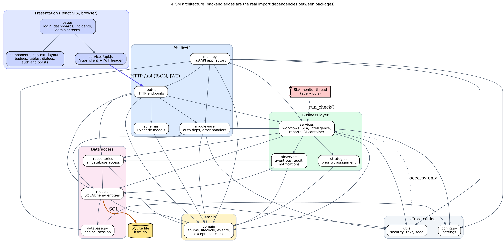{width=100%}
<!-- /landscape -->

<!-- landscape -->
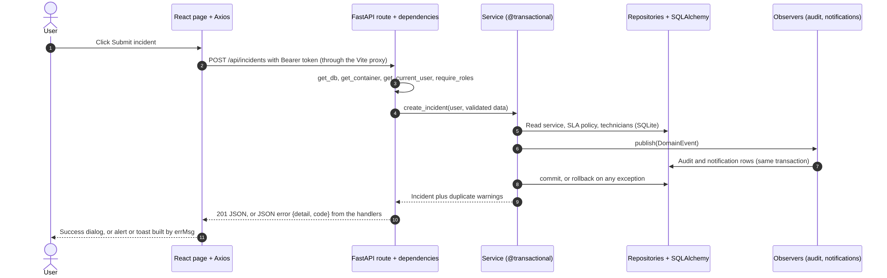{width=100%}
<!-- /landscape -->

The choice of each technology was driven by how well it fitted this flow. The five criteria below were used for every layer. They are the team's own judgement, not a benchmark.

* **Fit with the requirements:** typed validation, role-based access, a strict lifecycle, SLA arithmetic, audit.
* **Support for object-oriented design:** real abstract classes, inheritance, polymorphism and composition, because the course assesses OOP.
* **Testability:** the whole back end must be testable without a browser or a running server.
* **Zero-install on student computers:** the evaluator must be able to run it on Windows with only Python and Node.
* **A believable growth path:** each choice must have a documented way to scale (Section 3.10).


## 3.3 The technology stack in depth: runtime, contract, persistence and rendering internals

This section describes how the selected technologies behave at run time. It complements the per-layer justifications of the other sections of this chapter and is the part of the report that explains *why the pieces compose*, not only *what each piece is*.

**Process and concurrency model.** The back end is a single operating-system process. Uvicorn runs an ASGI event loop; Starlette, the toolkit beneath FastAPI, performs routing and middleware composition (CORS, exception translation). Route handlers are declared as ordinary synchronous functions, so FastAPI dispatches each of them to a worker thread of the AnyIO thread pool. A blocking SQLAlchemy call therefore occupies one worker and never stalls the event loop, which keeps request handling responsive without the code having to be written in the `async` style. The SLA monitor is a second concurrency domain: a daemon `threading.Thread` started from the application's lifespan handler, woken every 60 seconds by a `threading.Event`, so that shutdown is prompt and deterministic. Request threads and the monitor thread therefore contend for one SQLite writer, a constraint that is named, analysed and used in the scalability argument of Section 3.10.

**Contract-first request pipeline.** Every inbound payload crosses a validation membrane before any business code runs. Pydantic v2 compiles each schema into a validator whose core is implemented in Rust (`pydantic-core`), so constraints such as `Field(min_length=5)` or `ge=1, le=5` are enforced with negligible cost and produce structured errors. FastAPI derives an OpenAPI 3.1 description from the same annotated signatures, which is why the interactive documentation at `/docs` is never out of date and why that page was used as a test client for the screenshots of Chapter 10. The resulting contract is symmetric: the type annotation is simultaneously the validation rule, the serialisation schema and the documentation.

**Inversion of control.** Dependencies are not constructed where they are used. `Depends` resolves a per-request chain (database session, service container, authenticated principal, role guard), and `build_container` wires repositories, services and observers into one object graph per session. This is constructor-style dependency injection achieved without a framework container, and it is the reason the same services can be exercised by a unit test, by the HTTP test client or by the live server without modification. Time itself is an injected dependency (`Clock`), which lets the tests move the SLA clock forward deterministically instead of sleeping.

**Persistence internals.** SQLAlchemy 2 supplies a typed declarative mapping (`Mapped[...]`), an identity map, change tracking and a unit of work that flushes pending changes in dependency order. The project adds a `@transactional` decorator so that a service method is an atomic boundary: the state change, the audit row and the notifications either all commit or all roll back. The engine runs on SQLite, an embedded, serverless, transactional SQL engine with a B-tree storage format, enforcing foreign keys because `PRAGMA foreign_keys=ON` is issued on every new connection through a connection event. A custom `UTCDateTime` column type normalises every timestamp to timezone-aware UTC on read, which removes a whole class of offset defects from the SLA arithmetic. The audit table is made append-only by ORM event listeners that veto updates and deletes.

**Event-driven decoupling.** The workflow does not know who reacts to it. Services publish immutable domain events on an in-process `EventBus`; the `AuditObserver` is registered as a critical subscriber, so its failure aborts the transaction and an unaudited change is impossible, while the `NotificationObserver` is non-critical, so a failed notification cannot undo a legitimate state change. Observers are therefore classified by the consistency guarantee they must give, which is a more precise statement than "the Observer pattern was used".

**Identity and credential handling.** Authentication is stateless. The server issues an HS256 JSON Web Token (an HMAC-SHA-256 signature over base64url-encoded header and claims) with a 60-minute lifetime, and every request is authorised by verifying the signature and re-loading the principal. Passwords are never stored: bcrypt, an adaptive hash based on the Blowfish key schedule, is applied with a per-password salt and a cost factor of 12, which means 2^12 key-expansion rounds per hash and makes offline guessing deliberately expensive. Authorisation is layered: a route-level role guard, a service-level ownership check, and a repository-level filter, so that no single missed check exposes data.

**Rendering and delivery on the client.** The interface is a React 18 single-page application mounted with the concurrent root API (`createRoot`) inside `StrictMode`, which deliberately double-invokes render and effect logic in development to expose impurities. React reconciles a virtual component tree against the DOM, so only the changed nodes are touched. Vite serves source files as native ES modules during development, pre-bundles third-party dependencies with esbuild and applies hot module replacement; the production build is a Rollup bundle with tree shaking, minification and content-hashed assets. React Router 6 performs client-side routing over the History API, and a Vite development proxy forwards `/api` to the back end, so the browser sees a single origin and no CORS pre-flight is needed in development. Axios interceptors form a cross-cutting layer: one attaches the bearer token to every request, the other converts every failure mode (validation error, authorisation failure, timeout, no response) into one human-readable message. Recharts renders the dashboards as SVG.

**Server-authoritative computation.** The priority preview, the category suggestion and the duplicate warnings that the employee sees while typing are computed by the server and merely displayed by the client, with the typing debounced to limit traffic. A business rule is therefore written once, in one language, behind one contract, so the number on the screen cannot disagree with the number that is stored.


## 3.4 Programming languages: Python and JavaScript


**Role.** Python 3.11 or later (3.13 in the verification runs) holds all business logic. JavaScript (ES2022 with JSX) runs in the browser.

**Why Python suits I-ITSM.** The domain is rule heavy: priority bands, a lifecycle with eight states, SLA deadlines, eligibility rules for technicians. Python lets these rules be written close to the wording of the specification, which makes them reviewable by people who are not Python experts. It has the object model the course asks for without ceremony: abstract base classes (`abc.ABC`) for `PriorityStrategy`, `AssignmentStrategy`, `IncidentState`, `NotificationChannel`, `EventObserver` and `Clock`; `dataclass` (some frozen) for values that travel between layers such as `PriorityResult`, `TransitionRule` and `Recommendation`; `Enum` for statuses, priorities and roles; properties for controlled access; and decorators, used for the `@transactional` unit-of-work wrapper. Type hints are used throughout (`Mapped[...]`, `Optional[...]`) and are consumed by SQLAlchemy and FastAPI at run time, so they are more than documentation.

**How it is used with the other layers.** Python type hints on route parameters and Pydantic models become validation rules and the OpenAPI document at `/docs`. The same models and services are imported directly by the tests, so a unit test and an HTTP test exercise identical code.

**Advantages.** One language for every server-side concern, a very short path from specification to code, a rich standard library (`threading` for the SLA monitor, `datetime`, `logging`), and a mature test tool (pytest).

**Limitations.** Python is dynamically typed, so a wrong type is found at run time unless a test or a validator catches it. No static type checker is part of the delivered tooling, so the type hints are not checked by a tool, and the 264 tests carry that responsibility. The global interpreter lock means that CPU-bound work does not use several cores in one process. I-ITSM has no CPU-bound work (its heaviest operations are SQL queries and short loops over candidates), so this does not matter at the present scale.

**Alternatives.** Java with Spring Boot offers static typing and a strong OOP tradition, but it needs a JDK and a build tool, more boilerplate for the same rules and a second language for tooling. C# with ASP.NET offers similar strengths but binds the team to the .NET toolchain. Node.js with TypeScript would give one language on both sides, but TypeScript classes and the Node validation ecosystem were less familiar to the team than Python's `abc` and dataclasses for a course that grades classical OOP. Go was rejected because it has no classes or inheritance, which would work against the assessed concepts.

JavaScript is the only language that runs natively in a browser. TypeScript was not used because it adds a compile step and typing effort that the screen logic of this project did not need. This is a trade-off: it means mistakes in props and API shapes are not caught by a compiler on the front end.


## 3.5 Front end: React, Vite, React Router, Axios, Recharts


**Role.** The front end is a single-page application with role-specific navigation: employees report and follow incidents, technicians work their queue, administrators configure and monitor.

**Why React.** The interface is made of many small, repeated pieces: badges for priority, status and SLA state, tables, cards, modal dialogs, form fields. React's component model expresses this directly. The shared pieces live in `components/ui.jsx` (`Card`, `Field`, `Alert`, `Modal`, `ConfirmDialog`, `Async`, `PriorityBadge`, `StatusBadge`, `SlaBadge`) and are reused by the 18 page files in `pages/`. A component is a unit with its own state and public properties, which is the same encapsulation idea as in the back end.

**Frontend architecture.** `main.jsx` mounts `App.jsx`, which declares the routes. `layouts/AppLayout.jsx` draws the sidebar, whose links depend on the role. `components/ProtectedRoute.jsx` redirects an unauthenticated visitor to `/login` and a visitor with the wrong role to the dashboard. Pages fetch their data through a small hook `useAsync` (in `utils.js`) and render it through `Async`, which shows a spinner, an error state with a retry button, or the content. `useDebounced` delays the live calls made while the employee types.

**State management.** The application deliberately has no global store such as Redux. State has three levels. Server data is fetched per page and held in the page. Form state is local (`useState`). Only two things are truly global and each has a React context: `AuthContext` (current user, login, logout) and `ToastContext` (notifications). This is enough because no screen needs another screen's data in memory, and every page re-reads the server, which is the single source of truth. A global store would add concepts without removing any code. The trade-off is that data is fetched again on navigation, which is acceptable for this size.

**API communication.** `services/api.js` creates one Axios instance with the base URL `/api` and a 20 second timeout. A request interceptor adds the `Authorization: Bearer` header from `localStorage`. A response interceptor calls the logout handler on any 401 except from the login call itself. The function `errMsg` turns every failure into one readable sentence (Section 7.5). The pages never build URLs or headers themselves.

**Server-authoritative calculation.** The priority shown while the employee fills in the form is not computed in JavaScript. The page calls `POST /api/intelligence/preview-priority` and displays what the server returns, so the preview cannot disagree with the value that is stored. The same applies to category suggestion and duplicate checks. This avoids a classic defect, the same rule written twice in two languages.

**Vite.** Vite serves the application during development with fast reloads and proxies `/api` to the back end (`vite.config.js`), which removes cross-origin problems while developing. `npm run build` produces static files.

**Recharts and lucide-react.** Recharts draws the dashboard and report charts from live data. lucide-react supplies icons.

**Advantages.** Small bundle of concepts, a large ecosystem, reusable components, and no duplicated business rules.

**Limitations.** There are no automated front-end tests. Types are not checked (plain JavaScript). The token is kept in `localStorage`, which is readable by any script running on the page, so a cross-site scripting flaw would expose it (Section 8.6). The application was exercised in Chromium only. Four `npm audit` advisories remain open because fixing them needs major version upgrades.

**Alternatives.** Angular is a complete framework with built-in dependency injection and TypeScript, but its learning curve and boilerplate are larger than this scope needs. Vue is comparable and would also have worked, React was chosen for the larger ecosystem for charts and routing. Server-rendered pages (for example Jinja2 templates) would remove the front-end build but would make the live priority preview, duplicate warnings and countdowns clumsy. Flutter for the web has a heavy runtime and weaker document semantics.


## 3.6 Back end: FastAPI, Uvicorn, Pydantic, SQLAlchemy, PyJWT, bcrypt


**Role.** The back end exposes a REST API (63 operations on 52 paths under `/api`, plus `/health`), enforces every rule, persists data and runs the background SLA monitor.

**Why FastAPI.** FastAPI turns type-annotated Python into validated endpoints and publishes a live OpenAPI description at `/docs`, which was also used to check the API by hand. Three of its features fit I-ITSM's design directly:

* *Dependency injection with `Depends`.* In `middleware/dependencies.py`, `get_db` opens and closes a session per request, `get_container` builds the service container for that session, `get_current_user` authenticates, and `require_roles(*roles)` is a dependency factory that returns a role check. A route is secured by naming one dependency, for example `Depends(require_admin)`.
* *Pydantic models for input.* The schemas in `schemas/` (for example `title: str = Field(min_length=5, max_length=200)`, `impact: int = Field(ge=1, le=5)`) reject bad input with HTTP 422 before any service runs.
* *Exception handlers.* `middleware/errors.py` registers handlers so that every failure leaves the API in one JSON shape.

**Request handling and separation of business logic.** Routes in `routes/` are thin: they declare the contract, receive the validated data and call one service method. Services in `services/` (for example `IncidentService`, `AssignmentService`, `SlaService`, `AuthService`) hold all rules and know nothing about HTTP. Repositories in `repositories/` hold all queries and know nothing about rules. The domain package (`domain/`) holds the lifecycle, enums, events, the clock and the exceptions, and imports nothing from the web layer. Because of this, the tests call services directly as well as through HTTP, and the front end could be replaced without touching a rule.

**Dependency management.** `build_container` (in `services/container.py`) wires one set of repositories, services and observers per database session. Nothing is a global singleton except the settings object and the engine. The application is created by a factory, `create_app(settings, session_factory, clock, ...)`, so the tests build an application with an in-memory database, a controllable clock and the monitor switched off. `requirements.txt` lists libraries with minimum versions (for example `fastapi>=0.110`), so a fresh install resolves newer versions. This was tested with the versions resolved on 19 November 2026 (FastAPI 0.165.0, SQLAlchemy 2.1.9, Pydantic 2.x, PyJWT 2.15.1, bcrypt 5.0.0). The limitation is that versions are not pinned, so a future install may differ. Pinning with a lock file is a recommended improvement.

**Uvicorn.** An ASGI server that runs the application. In the course setting it runs as one process.

**SQLAlchemy 2.x.** Object-relational mapping with typed `Mapped[...]` columns, relationships and cascade rules. It also supplies the event hooks used to make the audit table append-only, and parameterised queries for every access.

**PyJWT and bcrypt.** PyJWT signs and verifies the access tokens (HS256). bcrypt hashes passwords with a per-password salt and a configurable cost (12 rounds by default).

**The background SLA monitor.** `services/sla_monitor.py` starts a daemon thread from the application's lifespan handler. It evaluates every open incident once at start and then every 60 seconds (configurable), and it never dies on an error. A single process is assumed (Section 3.10).

**Advantages.** Strong validation with little code, automatic API documentation, injection that matches the layering, and easy testing with the FastAPI test client.

**Limitations.** The ecosystem is younger than Django's, and there is no built-in admin site, migration tool or user management (the project wrote what it needed). The synchronous SQLAlchemy sessions are used inside ordinary functions, which FastAPI runs in a thread pool, so the code does not use `async` database access. Unpinned dependency versions are noted above.

**Alternatives.** Django REST Framework brings an admin site and an ORM that the project would partly bypass, because the domain model is deliberately independent of the framework, and its ORM is less explicit than SQLAlchemy's for the repository pattern. Flask is minimal but has no built-in validation or dependency injection, so the team would have had to assemble both. Spring Boot is excellent but adds a second toolchain. Express or NestJS on Node would be a reasonable alternative that was not chosen for the language reasons in Section 3.4.


## 3.7 Database: SQLite through SQLAlchemy


**Role.** SQLite stores the fifteen tables of the system in one file (`backend/itsm.db`, created on first start and excluded from version control).

**Why SQLite for I-ITSM.** It is a real relational database. The project uses its foreign keys (enforced by `PRAGMA foreign_keys=ON`, switched on for every connection in `database.py`), unique constraints, check constraints (for example `impact BETWEEN 1 AND 5`), composite keys and indexes. Nothing has to be installed, so the evaluator can run the system on any computer, and the test suite can create a fresh in-memory database for every test (using `StaticPool`). The data is relational by nature (incidents, users, services, skills, SLA policies, audit records), which fits SQL much better than documents. The expected load for the course, one service desk with tens of concurrent users, is within what SQLite can serve.

**How it interacts with the other layers.** Only repositories talk to the session. A custom column type, `UTCDateTime` (in `database.py`), stores naive UTC and always returns timezone-aware values, which removes a common class of time-zone errors from the SLA arithmetic. `init_db` creates the tables and runs a small additive migration (`_add_missing_nullable_columns`) so that an older database file gets new nullable columns after an upgrade. A test covers this.

**Advantages.** Zero installation, one file to back up or reset, a fast test cycle, full SQL integrity features.

**Limitations.** SQLite allows one writer at a time. Request threads and the SLA monitor thread write to the same file, so under heavy write load a "database is locked" error is possible, which the application would report as `DATABASE_ERROR` (Section 7.2). Write-ahead logging is not enabled in the delivered code. There are no database users or roles, no encryption at rest, and no migration tool such as Alembic, only the additive migration above. These limits are the reason PostgreSQL is the first scaling step.

**Alternatives.** PostgreSQL is the right production target (concurrent writers, roles, rich types, replication) but requires an installer and a running server on every student computer. MySQL has similar properties. MongoDB would fit the incident's free text well but fits relational integrity, joins for reports and foreign keys poorly. An in-memory store would lose data on restart, which the brief does not allow.


## 3.8 Architecture: a layered monolith with patterns at the points of change


**Choice.** One deployable application with five layers: routes, services, domain, repositories, models. Patterns are placed where change is expected, not everywhere.

**Table 3.2: Design patterns and the change each one isolates**

| Change that is expected | Pattern used | Where |
|------------------------------|---------------------|----------------------------|
| A different priority formula or assignment rule | Strategy | `strategies/priority.py`, `strategies/assignment.py`, `StrategyFactory` |
| Behaviour that depends on the incident's status | State | `domain/lifecycle.py` (`IncidentState`, eight state classes, `StateFactory`, `LifecycleManager`) |
| New reactions to events (audit, notifications, later others) | Observer | `observers/` (`EventBus`, `AuditObserver`, `NotificationObserver`) |
| A new notification channel | Strategy with a factory | `observers/channels.py` (`NotificationChannel`, `InAppChannel`, `SimulatedEmailChannel`, `ChannelFactory`) |
| A different database or query | Repository | `repositories/` (`BaseRepository`) |
| How objects are built and connected | Factory and dependency injection | `IncidentFactory`, `new_user`, `build_container`, FastAPI `Depends` |
| All-or-nothing workflows | Unit of work (decorator) | `@transactional` in `services/base.py` |

**Why a monolith, not microservices.** The domain is one cohesive workflow (report, classify, assign, work, resolve, verify) with strong consistency needs: the audit row, the state change and the notifications must commit together. Splitting it would introduce distributed transactions to solve a scaling problem the system does not have, with a team of three and a course deadline. Alternatives considered were a server-rendered MVC application (simplest, but a weaker fit for live previews), a hexagonal architecture with ports and adapters (close to what was built, but with more interfaces than the size justifies), and event sourcing (powerful for audit but heavy). The layered design keeps clean seams, so any of them remains possible later.


<!-- landscape -->
## 3.9 Comparison of the selected technologies with realistic alternatives


**Table 3.3: Selected technologies against realistic alternatives, with the selection criteria and the justification**

| Layer | Selected | Realistic alternatives | Deciding criteria | Justification |
|--------|---------|-----------------|--------------------|-----------------------------|
| Language (server) | Python 3.11+ | Java, C#, Node.js with TypeScript, Go | OOP support, readability of rules, testability, installation effort | ABCs, dataclasses, enums and decorators express the required patterns directly. Rules read like the specification. pytest is fast. Go has no inheritance. Java and C# need heavier toolchains |
| Web framework | FastAPI | Django REST Framework, Flask, Spring Boot, Express | Validation, dependency injection, API documentation, fit with a framework-independent domain | Typed validation, `Depends` matching the layered design, live OpenAPI. Django's ORM and admin would be partly bypassed. Flask lacks validation and injection |
| ORM | SQLAlchemy 2 | Django ORM, raw SQL, Peewee | Explicit mapping, repository fit, event hooks, database portability | Typed mappings, explicit sessions for the unit of work, events used to protect the audit table, portable to PostgreSQL |
| Database | SQLite | PostgreSQL, MySQL, MongoDB | Relational integrity, zero install, test speed, growth path | Real SQL with foreign and check constraints and no installation. PostgreSQL is the planned next step. A document store does not fit the relational data |
| Front end | React 18 with Vite | Angular, Vue, server-rendered pages, Flutter web | Component reuse, ecosystem for charts and routing, build speed, live server previews | Many small repeated components, large ecosystem, fast development server, simple API calls |
| State management | Local state plus two contexts | Redux, Zustand, a query library | Amount of shared state, simplicity | Almost no cross-screen state, the server is the source of truth. A store would add concepts without removing code |
| Authentication | JWT bearer tokens (HS256), bcrypt | Server sessions, OAuth 2 or OpenID Connect, Argon2 | Single-page application fit, no external provider, simplicity | Stateless tokens suit a separate front end. OAuth needs an identity provider which is out of scope. bcrypt is established and available as a wheel |
| Intelligence | Rule-based scoring and token similarity | Machine learning, an external AI service | Explainability, no training data, offline operation | Every suggestion shows its reason, results are deterministic and testable |
| Architecture | Layered monolith with patterns | Microservices, hexagonal, event sourcing | Consistency, team size, risk | One transaction covers state, audit and notification. Seams allow later splitting |
<!-- /landscape -->

**Table 3.4: Qualitative suitability of the main alternatives (team judgement against the criteria of Section 2.1, not a measurement)**

| Option | Requirement fit | OOP support | Testability | Zero install | Growth path |
|---------------------|--------|--------|--------|--------|--------|
| FastAPI with SQLAlchemy | High | High | High | High | Medium to high |
| Django REST Framework | High | Medium | High | High | High |
| Flask with extensions | Medium | Medium | Medium | High | Medium |
| Spring Boot | High | High | High | Low | High |
| Express with a Node ORM | Medium | Low to medium | Medium | High | Medium |


<!-- landscape -->
## 3.10 How the system would evolve with many more users


The proposals are in three tiers. **None is implemented.** The first tier needs no new component. The second changes the deployment. The third changes the architecture and should only be done when the measurements justify it. The triggers are indicators to measure, not thresholds that were tested.

**Table 3.5: Scalability proposals, grouped by the size of the change**

| Tier | Change | Problem it addresses | Effort and risk | Indicator that it is needed |
|----|------------------------------------|-------------------------------|------------------------|------------------------------|
| 1. Within the current architecture | Enable SQLite write-ahead logging and a busy timeout in the connection hook | Readers blocked by the writer, "database is locked" under mixed load | A few lines in `database.py`, low risk | `DATABASE_ERROR` responses or slow lists while the monitor runs |
| 1 | Add indexes after inspecting query plans for the filters used by the incident search (12 criteria). The audit and notification tables already have composite indexes | Slow search and report queries as rows grow | Low risk, needs measurement | Search or report requests slower than the team's target |
| 1 | Keep paginating every list (already done for incidents and audit) and add limits to the report queries | Large responses | Low | Response size or time growing with data |
| 1 | Cache rarely changing reference data (categories, services, settings) inside the process and invalidate it on an administrator change | Repeated identical reads | Low to medium, must invalidate correctly | High read volume on reference data |
| 1 | Serve the built front end as static files from a web server or CDN instead of the Vite server | The development server is not for production | No code change | Any real deployment |
| 2. Deployment changes | Move to PostgreSQL with Alembic migrations. The models and repositories stay, the connection string changes and the database-specific hook is removed | One writer, no roles, no replication | Medium: data migration and testing of date and enum handling | Sustained concurrent writes, or the need for backups and roles |
| 2 | Run several stateless API instances behind a load balancer. Tokens carry no server state, so no session store is needed | CPU and connection limits of one process | Medium: needs PostgreSQL first, because several processes make SQLite write contention worse | One process saturated |
| 2 | Run the SLA monitor as one scheduled worker (or with a leader lock) instead of one thread per process | Duplicate monitors, wasted queries | Medium | More than one API process |
| 2 | Put notification delivery behind a queue and add real SMTP, SMS or push adapters behind `NotificationChannel` | Slow or failing external delivery blocking requests, e-mail is only simulated today | Medium: the channel abstraction already isolates this | The first real e-mail integration |
| 2 | Add token refresh and a revocation list, rate limiting and HTTPS termination at a gateway | Stolen tokens, brute force (Chapter 8) | Medium | Any internet-facing deployment |
| 2 | Central logging, metrics and health checks beyond the existing `/health` | Operating several instances blind | Medium | Several instances |
| 3. Architectural change | Split reporting into a read replica or a separate analytical store | Heavy reports competing with transactions | High | Reports slow down incident handling |
| 3 | Split notifications and the SLA engine into services driven by an event stream. They are already event driven through `EventBus` | Independent scaling and failure isolation | High: gives up the single transaction for audit and state | Teams or load that justify the complexity |
| 3 | Use a search engine or learned similarity for duplicate and category suggestions | Keyword matching does not understand unseen vocabulary | High, accuracy must be measured | Poor suggestion quality at scale |
| 3 | Multi-tenancy and high-availability database | Several organisations on one deployment | High | A product rather than a project |
<!-- /landscape -->

What does not need to change: the layering, the repositories, the stateless token design, the strategy and observer seams, and the test suite, which would be the safety net for every step above.


# Chapter 4: System Design and Architecture

## 4.1 Overall system architecture


I-ITSM is a layered web application. The browser runs a React single-page application. It talks to a FastAPI back end over HTTP and JSON, authenticating each request with a bearer token. The back end is organised so that every layer depends only on layers below it and no business rule lives in the HTTP layer or in the user interface.

**Table 4.1: Back-end layers and their responsibilities**

| Layer | Package | Responsibility | Deliberately does not |
|-------|---------------|--------------------------------|--------------------------|
| API | `routes/`, `middleware/` | HTTP, validation, authentication and role checks, one call into one service method | Contain business rules or SQL |
| Schemas | `schemas/` | Pydantic request and response models | Touch the database |
| Services | `services/` | Workflows, SLA, intelligence, reports, the per-request container | Know about HTTP |
| Strategies | `strategies/` | Interchangeable algorithms for priority and assignment | Know about the UI or HTTP |
| Observers | `observers/` | Audit logging and notifications, reacting to events | Drive the workflow |
| Domain | `domain/` | Enumerations, the incident lifecycle (State), events, exceptions, the clock | Access the database |
| Data access | `repositories/` | Every database read and write | Make business decisions |
| Persistence | `models/`, `database.py` | Tables, relationships, engine and session | Import the web framework |

Three mechanisms tie the layers together.

* **Per-request container.** Each request builds a `Container` that creates the repositories, the event bus with its two observers, and every service around one database session. Nothing is global, so each request is isolated and tests can build the same container with a fake clock.
* **Unit of work.** A `@transactional` decorator on service methods commits when the outermost call succeeds and rolls everything back when anything fails. A rejected action therefore never leaves half-written data.
* **Event bus.** Services publish domain events. The audit observer and the notification observer subscribe to the bus. The workflow code never mentions either.

A typical request, such as an employee reporting an incident, flows as follows. The route validates the JSON body and resolves the signed-in user. It calls `IncidentService.create_incident`. The service validates the service and category, computes the effective impact and the priority through the configured strategy, selects the SLA policy, builds the incident through `IncidentFactory`, applies the SLA deadlines, publishes `INCIDENT_CREATED`, `PRIORITY_CALCULATED` and `INCIDENT_CLASSIFIED` events, asks the assignment service for a technician and, when one is eligible, publishes `INCIDENT_ASSIGNED`. For each event the audit observer writes a row and the notification observer sends messages through every channel. The transaction commits and the route returns the incident together with any duplicate warnings.

A background thread, the SLA monitor, runs alongside the web server. Every 60 seconds it builds its own container, evaluates every open incident and commits the warnings, violations and escalations it produces.


## 4.2 Use case diagram


Figure 4.1 gives the overview of all 32 use cases and four actors. Because a single picture with every line is dense, Figures 4.1 to 4.1 show the same use cases one human actor at a time. The use case list is stored in a data file that is also executed as a test (Section 2.2), so the diagram and the enforced permissions cannot drift apart.

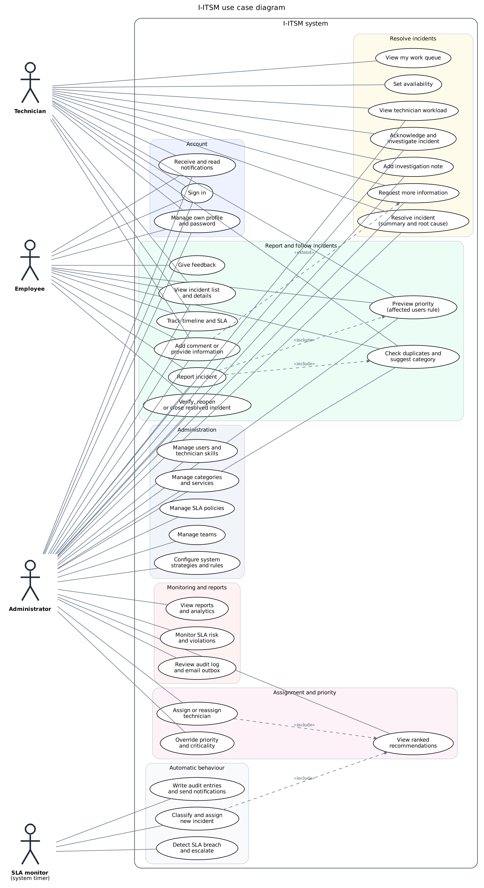{height=21cm}


**Table 4.2: Use case catalogue**

| ID | Use case | Actors | Relationships | Permission check |
|----|------------------------|--------------------|----------------|----------|
| UC01 | Sign in | Employee, Technician, Administrator |  | API probe |
| UC02 | Manage own profile and password | Employee, Technician, Administrator |  | API probe |
| UC03 | Receive and read notifications | Employee, Technician, Administrator |  | API probe |
| UC04 | Report incident | Employee, Administrator | includes UC05, UC06 | API probe |
| UC05 | Preview priority (affected users rule) | Employee, Technician, Administrator |  | API probe |
| UC06 | Check duplicates and suggest category | Employee, Technician, Administrator |  | API probe |
| UC07 | View incident list and details | Employee, Technician, Administrator |  | API probe |
| UC08 | Track timeline and SLA | Employee, Technician, Administrator |  | API probe |
| UC09 | Add comment or provide information | Employee, Technician, Administrator |  | not probed |
| UC10 | Verify, reopen or close resolved incident | Employee, Administrator |  | not probed |
| UC11 | Give feedback | Employee |  | API probe |
| UC12 | View my work queue | Technician |  | API probe |
| UC13 | Set availability | Technician |  | API probe |
| UC14 | Acknowledge and investigate incident | Technician, Administrator |  | not probed |
| UC15 | Add investigation note | Technician, Administrator |  | not probed |
| UC16 | Request more information | Technician, Administrator | extends UC09 | not probed |
| UC17 | Resolve incident (summary and root cause) | Technician, Administrator |  | not probed |
| UC18 | View technician workload | Technician, Administrator |  | API probe |
| UC19 | Assign or reassign technician | Administrator | includes UC20 | API probe |
| UC20 | View ranked recommendations | Administrator |  | API probe |
| UC21 | Override priority and criticality | Administrator |  | API probe |
| UC22 | Manage users and technician skills | Administrator |  | API probe |
| UC23 | Manage categories and services | Administrator |  | API probe |
| UC24 | Manage SLA policies | Administrator |  | API probe |
| UC25 | Manage teams | Administrator |  | API probe |
| UC26 | Configure system strategies and rules | Administrator |  | API probe |
| UC27 | View reports and analytics | Administrator |  | API probe |
| UC28 | Monitor SLA risk and violations | Administrator |  | API probe |
| UC29 | Review audit log and email outbox | Administrator |  | API probe |
| UC30 | Classify and assign new incident | SLA monitor | includes UC20 | not probed |
| UC31 | Detect SLA breach and escalate | SLA monitor |  | not probed |
| UC32 | Write audit entries and send notifications | SLA monitor |  | not probed |
"API probe" means the permission test calls the real endpoint behind the use case as every role. Use cases that need a particular incident state (for example acknowledging, investigating and resolving) are verified by the lifecycle tests instead (Chapter 10).


## 4.3 UML class diagrams


The class diagrams are split into six views, one per pattern or layer, because a single diagram of the 154 classes of the code base would be unreadable. Each view is generated from the code: class names, stereotypes, attributes, public methods with parameter and return types, base classes and entity columns are read from the source. The two views that describe the structure of the whole application appear here. The five pattern views appear in Chapter 5 next to the explanation of each pattern.

**Table 4.3: Class diagram views and where each is shown**

| View | Content | Figure |
|----------|---------------------------------------------|---------|
| 1 | Incident lifecycle (State pattern) | Figure 5.3 |
| 2 | Priority and assignment (Strategy pattern) | Figure 5.1 |
| 3 | Events, observers and notification channels (Observer pattern) | Figure 5.2 |
| 4 | Data access (Repository pattern) | Figure 4.4 |
| 5 | Service layer and dependency injection | Figure 4.3 |
| 6 | Persistent entities | Figure 4.2 |

Legend: a hollow triangle with a solid line is inheritance, with a dashed line it is realisation of an interface, a filled diamond is composition, a hollow diamond is aggregation, a plain arrow is association and a dashed arrow is dependency. A trailing `*` after a method marks it as abstract.

<!-- landscape -->
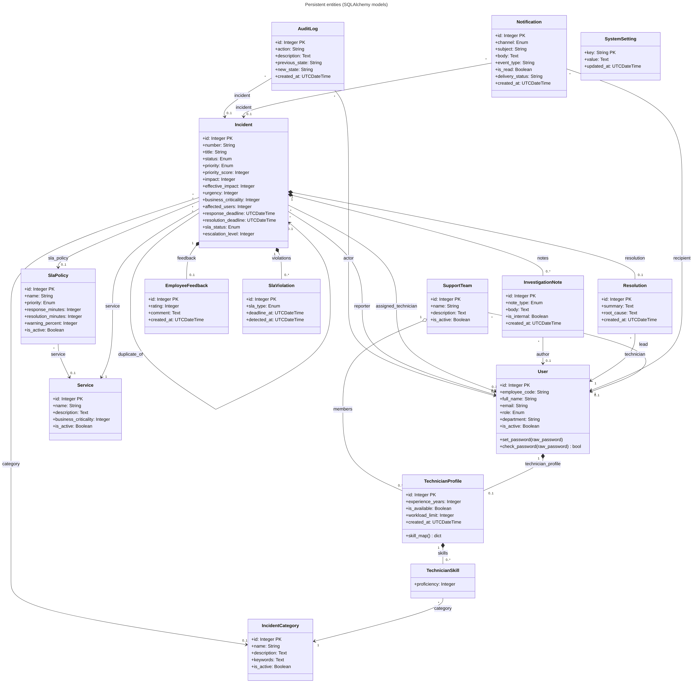{height=15cm}
<!-- /landscape -->

<!-- landscape -->
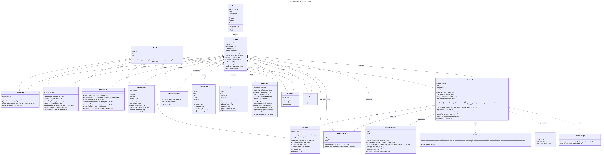{width=100%}
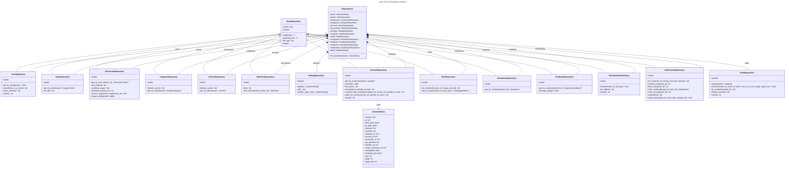{width=100%}
<!-- /landscape -->


# Chapter 5: Object-Oriented Design

## 5.1 Encapsulation


Encapsulation means that data is reachable only through the operations that keep it valid. Python has no enforced `private`, so the code uses the standard convention of a leading underscore together with methods and properties, and uses immutability where a value must not change.

* **`User`** keeps the password hash in `_password_hash`. The only ways to change or test it are `set_password`, which hashes with bcrypt, and `check_password`. No schema or route returns the hash. Role tests are exposed as read-only properties (`is_admin`, `is_technician`, `is_employee`) so callers do not compare role strings.
* **`PriorityResult`** and **`TransitionRule`** are frozen dataclasses. Once created they cannot be altered, so a rule cannot be modified by the code that reads it.
* **`EventBus`** keeps its subscribers in `_observers` and exposes `observers` as a copy, so outside code cannot corrupt the list.
* **State classes** hide their transition tables inside `rules()`. Callers ask `LifecycleManager` whether a move is legal and never read the tables.
* **Repositories** hide every SQL statement. A service asks for `incidents.get_by_number(...)` and never sees the query.
* **`@transactional`** hides commit and rollback. Service methods contain business steps only.
* **Settings** are read through typed accessors (`auto_assign()`, `escalation_enabled()`, `affected_users_adjustment()`), which hide the fact that values are stored as text in a table.


## 5.2 Inheritance


Inheritance is used only where there is a true is-a relationship and several variants share a contract. The hierarchies in the code are the following.

* **Eight concrete states** (`NewState` through `ClosedState`) extend `IncidentState`.
* **Priority strategies** `ScoreProductPriorityStrategy` and `WeightedPriorityStrategy` extend `PriorityStrategy`.
* **Assignment strategies** `SkillBasedStrategy`, `LoadBasedStrategy` and `SkillThenLoadStrategy` extend `AssignmentStrategy`.
* **Channels** `InAppChannel` and `SimulatedEmailChannel` extend `NotificationChannel`.
* **Observers** `AuditObserver` and `NotificationObserver` extend `EventObserver`.
* **Clocks** `SystemClock` and `MutableClock` extend `Clock`.
* **Exceptions** form a tree rooted in `AppError`: `AuthenticationError`, `PermissionDeniedError`, `NotFoundError` (with `IncidentNotFoundError` and `ServiceNotFoundError`) and `ConflictError` (with `DuplicateResourceError`, `InvalidTransitionError`, `TechnicianUnavailableError`, `WorkloadExceededError` and `MissingSkillError`), as well as `InvalidInputError`, `MissingSlaConfigurationError` and `DatabaseUnavailableError`. Each carries an HTTP status code and a stable error code, so a single handler can turn any of them into a safe response.
* **Shared base classes for code reuse:** `BaseRepository` (generic `add`, `get`, `list_all`) and `BaseService` (session, repositories, bus, clock and `emit`) are extended by 14 repositories and seven services respectively. This is inheritance for reuse. It is acceptable here because the subclasses really are repositories and services, but it is the weakest use of inheritance in the system, and composition is preferred elsewhere.

All 15 entities extend SQLAlchemy's declarative `Base`. That is framework inheritance, not part of the domain design.


## 5.3 Polymorphism


Polymorphism means that calling code works with the abstraction and the right behaviour is selected by the object's actual class. It is used wherever behaviour must vary without conditionals.

* `priority_strategy.calculate(impact, urgency, criticality)` returns a `PriorityResult` for whichever strategy the administrator selected. The incident service never tests which one it has.
* `assignment_strategy.rank(eligible, ctx)` is implemented once in the base class and calls the abstract `_score`, which each of the three strategies implements differently. This is also the Template Method pattern.
* `channel.deliver(...)` stores an in-app message or a simulated e-mail depending on the channel object. `NotificationObserver` loops over a list of channels without knowing their classes.
* `observer.handle(event)` lets the event bus treat the audit and notification observers uniformly.
* `state.rules()` returns the legal transitions of whichever state object `StateFactory` supplies for the incident's current status.
* `clock.now()` returns real time in production and a hand-moved time in tests. This is how the SLA tests move time forward by hours in a few milliseconds.
* The exception handler catches `AppError` and reads `status_code` and `code` from the concrete subclass.


## 5.4 Abstraction


Abstraction hides complexity behind a small contract. In this code base the abstractions are:

* **Business operations as service methods.** `IncidentService.create_incident`, `transition`, `assign` and `update_incident` each stand for a whole workflow (validation, priority, SLA, events, persistence). Routes call one method and know nothing of the steps.
* **`LifecycleManager.validate`** stands for the entire question "may this actor make this move with this data?".
* **`AssignmentService.recommend`** hides eligibility, scoring and explanation.
* **`SlaService`** answers "what is the SLA status of this incident now?" with `describe`, and `run_check` performs a whole monitoring sweep.
* **`Container`** hides how the object graph for a request is built.
* **`IncidentPresenter`** turns entities into the JSON shape the user interface needs, so entities do not leak into the API.


## 5.5 Interfaces and abstract classes


Python has no `interface` keyword. The code uses abstract base classes (`abc.ABC`) with abstract methods. Six exist, and the class diagrams classify them by what they contain: a class whose public methods are all abstract is drawn as an interface, otherwise as an abstract class.

**Table 5.1: Abstract base classes in the code**

| Class | Kind | Abstract method | Concrete members | Implementations |
|----------------------|----------|---------------|----------------------|-----------------------------|
| `EventObserver` | Interface | `handle(event)` | Class attribute `critical` | `AuditObserver`, `NotificationObserver` |
| `NotificationChannel` | Interface | `deliver(...)` | Class attribute `channel` | `InAppChannel`, `SimulatedEmailChannel` |
| `Clock` | Interface | `now()` | None | `SystemClock`, `MutableClock` |
| `PriorityStrategy` | Abstract class | `calculate(...)` | `validate` (shared input checks) | `ScoreProductPriorityStrategy`, `WeightedPriorityStrategy` |
| `AssignmentStrategy` | Abstract class | `_score(...)` | `rank` (shared ordering), `_base_reasons` | `SkillBasedStrategy`, `LoadBasedStrategy`, `SkillThenLoadStrategy` |
| `IncidentState` | Abstract class | `rules()` | `rule_for`, `next_statuses` | Eight lifecycle states |

The assignment lists interfaces and composition as required topics. The code satisfies this through these abstractions and through the composition described in Chapter 5. No design pattern in this report depends on a language feature that Python does not have.


## 5.6 The Strategy pattern


**Intent.** Make the priority and the assignment algorithms interchangeable at run time. The assignment brief asks that the assignment strategy can change without redesigning the application, and that the priority algorithm and its rationale are documented.

**Structure.** Figure 5.1 shows the two strategy families, the value objects they exchange and the factory.

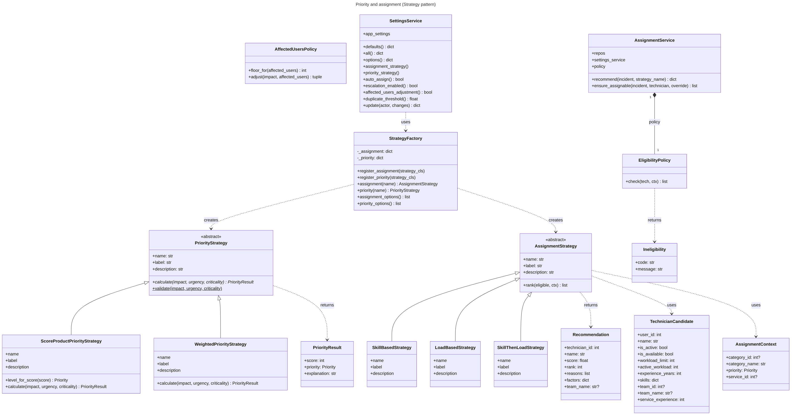{width=100%}

**Priority strategies.** `PriorityStrategy.calculate` receives impact, urgency and business criticality and returns a `PriorityResult` (score, level and a one-line explanation).

* `ScoreProductPriorityStrategy` (the default, registered as `product`) multiplies the three ratings and maps the product with the thresholds 40, 20, 8 and 1 to P1 to P4. A product such as 39 is mathematically impossible with ratings from 1 to 5 (it would need a factor of 13), and the mapping is tested separately at the boundaries.
* `WeightedPriorityStrategy` (registered as `weighted`) computes 0.40 x impact + 0.35 x urgency + 0.25 x criticality and maps the average to P1 at 4.0 or more, P2 at 3.0, P3 at 2.0. It exists to demonstrate interchangeability and is selectable in Settings.

**The affected-users rule.** The assignment lists the number of affected users as a priority factor. `AffectedUsersPolicy` turns the count into a minimum impact (`BANDS` of 1000, 250, 50 and 10 users map to impact 5, 4, 3 and 2). The service takes the larger of the reporter's rating and this floor as the *effective impact* and feeds that to the chosen priority strategy. The rule never lowers the reporter's value, so incidents without a count behave exactly as before. The reporter's value and the effective value are both stored, and the audit log carries a sentence such as "Impact raised from 2 to 4 because 300 users are affected". The policy is separate from the strategies on purpose: it adjusts an *input*, so it works the same with either strategy.

**Assignment strategies.** Eligibility is a hard filter implemented by `EligibilityPolicy.check`: the technician must be active, available, hold the category skill and be below the workload limit. Only eligible technicians are ranked. The three strategies score them as follows.

**Table 5.2: Assignment strategies and their scoring**

| Strategy | Score | Intent |
|----------------|------------------------------------------------|--------------------------------|
| Skill based (`skill_based`) | proficiency x 20 + min(experience, 10) x 2 + min(service experience, 5) x 2 - workload x 0.5 | Best qualified first, workload only breaks ties |
| Load based (`load_based`) | (1 - load ratio) x 100 + proficiency + min(experience, 10) x 0.1 | Spread work evenly, skill only breaks ties |
| Skill then load (`skill_then_load`, default) | proficiency x w1 + min(experience, 10) x w2 + min(service experience, 5) x 2 + (1 - load ratio) x 30, with w1 = 22 and w2 = 2 for P1 and P2 incidents, otherwise 18 and 1 | Balanced, and critical incidents lean more on skill and experience |

Each `Recommendation` carries the numeric score, a rank and a list of human-readable reasons (for example "Application skill proficiency 3/5", "Workload 0/5", "Critical priority: skill and experience weighted higher"), so the administrator can see why a technician was proposed.

**Selection and extension.** `StrategyFactory` keeps two registries (dictionaries keyed by strategy name). `SettingsService.assignment_strategy()` and `priority_strategy()` read the administrator's setting and ask the factory for an instance. Adding a fourth assignment strategy means writing one subclass and one `register_assignment` call. Nothing else changes, and the Settings page picks the new option up from `assignment_options()`.

```python
for _cls in (SkillBasedStrategy, LoadBasedStrategy, SkillThenLoadStrategy):
    StrategyFactory.register_assignment(_cls)
for _cls in (ScoreProductPriorityStrategy, WeightedPriorityStrategy):
    StrategyFactory.register_priority(_cls)
```


## 5.7 The Observer pattern


**Intent.** Let the workflow announce what happened without knowing who reacts. Audit logging and notifications are consequences of the same events, and keeping them out of the workflow code means a new reaction (a metrics collector, for example) is a new subscriber.

**Structure.** `EventBus` is the subject. `EventObserver` is the contract (`handle(event)`). Services call `emit`, which publishes a `DomainEvent` carrying the event type, description, time, actor, incident, previous and new state and extra metadata. The container subscribes `AuditObserver` and `NotificationObserver` for every request. Figure 5.2 shows the classes, including the notification channels.

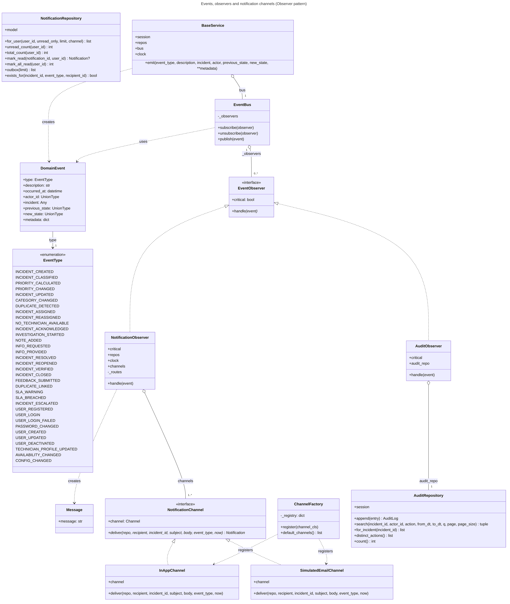{width=100%}

```python
def publish(self, event: DomainEvent) -> None:
    for observer in self._observers:
        try:
            observer.handle(event)
        except SQLAlchemyError:
            raise  # database trouble must never be swallowed
        except Exception:
            if observer.critical:
                raise
            logger.exception("Observer %s failed", type(observer).__name__)
```

**Critical and non-critical observers.** The `critical` flag is a design decision about failure. `AuditObserver` is critical: it runs inside the request's transaction, and if an audit row cannot be written the exception propagates, the transaction rolls back and the action does not happen. An action without a record is not acceptable. `NotificationObserver` is not critical: a failure is logged and the incident update proceeds, because a problem in message delivery must not block the work. Database errors are never swallowed by either.

**Audit.** `AuditObserver` writes one append-only row per event: actor, incident, action (the event type), previous and new state, description and time. There are 34 event types, covering incident events, SLA events and account and administration events such as sign-ins and configuration changes.

**Notification.** `NotificationObserver` holds a table `_routes` from event type to a builder method. Each builder returns a `Message` (recipients, subject, body). The observer removes duplicate recipients, skips the person who caused the event (except for the creation event), skips deactivated users and sends the message through every channel in its list. Section 6.7 lists who is told about what.

**Channels and Factory.** `NotificationChannel` is the interface and `ChannelFactory` is a registry of channel classes. `InAppChannel` stores a delivered, unread record. `SimulatedEmailChannel` writes a record marked as e-mail and logs "[SIMULATED EMAIL]". Both write to the same `notifications` table. A real SMTP, SMS or push channel is one more subclass registered with the factory. No observer or service changes.


## 5.8 The Repository pattern


**Intent.** Keep persistence out of the business code. Services express intent in domain terms (`incidents.open_for_service(...)`, `users.active_admins()`) and repositories translate that into queries.

**Structure.** `BaseRepository` is a generic class holding the session with `add`, `get` and `list_all`. Fourteen subclasses add the queries each aggregate needs. `Repositories` bundles them for one session, and `Repositories.for_session` is the only place that constructs them. `IncidentRepository` is the largest: it implements the combined search with `IncidentFilters` (filters, sorting and paging). Figure 4.4 shows the classes.


A repository never commits. Commit and rollback belong to the `@transactional` decorator on the service method, so several repositories can take part in one transaction. This is the unit-of-work part of the design. A consequence is that changing database engine affects the engine set-up and, at most, a few queries inside repositories.


## 5.9 The incident lifecycle and the State pattern


**Intent.** What may happen to an incident depends on its status. Each status is a class that states which statuses may follow, who may cause each move, which event the move produces and which fields it requires. The service contains no chain of status conditions.

Figure 5.3 shows the state classes and their collaborators.

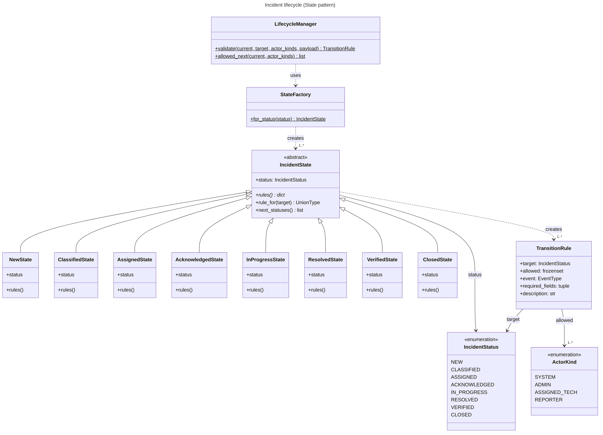{width=100%}

**Table 5.3: Lifecycle transitions as implemented**

| From | To | Who may do it | Required data | Event |
|----------|----------|----------------------|---------------|------------------|
| NEW | CLASSIFIED | System | | `INCIDENT_CLASSIFIED` |
| CLASSIFIED | ASSIGNED | System, administrator | | `INCIDENT_ASSIGNED` |
| ASSIGNED | ACKNOWLEDGED | Assigned technician, administrator | | `INCIDENT_ACKNOWLEDGED` |
| ASSIGNED, ACKNOWLEDGED, IN_PROGRESS | ASSIGNED | Administrator | | `INCIDENT_REASSIGNED` |
| ACKNOWLEDGED | IN_PROGRESS | Assigned technician, administrator | | `INVESTIGATION_STARTED` |
| IN_PROGRESS | RESOLVED | Assigned technician, administrator | resolution summary, root cause | `INCIDENT_RESOLVED` |
| RESOLVED | VERIFIED | Reporter, administrator | | `INCIDENT_VERIFIED` |
| RESOLVED | IN_PROGRESS (reopen) | Reporter, administrator | reason | `INCIDENT_REOPENED` |
| VERIFIED | CLOSED | Reporter, administrator | | `INCIDENT_CLOSED` |

**Validation.** `LifecycleManager.validate(current, target, actor_kinds, payload)` looks up the state object with `StateFactory.for_status`, asks it for the rule for the target, and applies three checks in order. If there is no rule the move is illegal and an `InvalidTransitionError` (HTTP 409) lists the moves that are allowed. If the actor is not among the allowed kinds, a `PermissionDeniedError` (403) is raised. If a required field is missing, an `InvalidInputError` (422) names it. The "actor kind" is computed per incident: an administrator, the assigned technician of this incident and the reporter of this incident are different kinds, and a person can be more than one. This is how "only the assigned technician acknowledges" and "only the reporter verifies" are enforced by data rather than by `if` statements. The user interface asks `allowed_next` and shows only the buttons that are legal for the signed-in user, but the server remains the authority.

**An honest note on the pattern.** In the textbook State pattern the context object holds a state object and delegates to it. Here the `Incident` entity stores its status as an enumeration (it has to, because it is a database row), and `StateFactory` maps that value to a stateless state object when a transition is needed. The behaviour is the same, and the state objects carry the transition knowledge, but the delegation is through a factory look-up rather than a held reference. This is a common adaptation when the context is a persisted entity.

**Reassignment and reopening.** The brief's lifecycle has no arrow back to ASSIGNED. Because a service desk must be able to move work, an administrator may reassign while the incident is ASSIGNED, ACKNOWLEDGED or IN_PROGRESS, and the status becomes ASSIGNED again. The reporter may reopen a resolved incident with a reason. Both are recorded as events. An attempt such as NEW to CLOSED is rejected with HTTP 409 and changes nothing, and the test suite checks every disallowed pair of statuses.


## 5.10 Exception handling and data structures


**Custom exceptions.** The exception tree and the clock abstraction are summarised below. The assignment lists twelve situations that must be handled. Each has a class, a status code and a stable code.


**Table 5.4: Situations required by the assignment and how each is handled**

| Situation | Exception or handler | HTTP status | Code |
|---------------------------|-------------------------------------|------|------------------------|
| Invalid login | `AuthenticationError` | 401 | `AUTHENTICATION_FAILED` |
| Unauthorised operation | `PermissionDeniedError` | 403 | `PERMISSION_DENIED` |
| Invalid incident | `IncidentNotFoundError` | 404 | `INCIDENT_NOT_FOUND` |
| Invalid state transition | `InvalidTransitionError` | 409 | `INVALID_STATE_TRANSITION` |
| Technician unavailable | `TechnicianUnavailableError` | 409 | `TECHNICIAN_UNAVAILABLE` |
| Technician workload exceeded | `WorkloadExceededError` | 409 | `TECHNICIAN_WORKLOAD_EXCEEDED` |
| Service not found | `ServiceNotFoundError` | 404 | `SERVICE_NOT_FOUND` |
| Missing SLA configuration | `MissingSlaConfigurationError` | 422 | `MISSING_SLA_CONFIGURATION` |
| Duplicate account or configuration name | `DuplicateResourceError` | 409 | `DUPLICATE_RESOURCE` |
| Duplicate incident report | Not an error by design (business rule BR-14): the similarity check lists candidates and the incident is still created | 201 with a list of possible duplicates | event `DUPLICATE_DETECTED` |
| Database failure | Handler for SQLAlchemy errors (503 when the database cannot be reached, otherwise 500) | 503 or 500 | `DATABASE_ERROR` |
| Network failure | Handled in the browser: `errMsg` in the Axios client turns a missing response or a timeout into a readable message. When only the back end is stopped behind the development proxy, the proxy answers with HTTP 500 and the user sees "Request failed (500)." | none | n/a |
| Invalid user input | `InvalidInputError` and Pydantic validation | 422 | `INVALID_INPUT` or `VALIDATION_ERROR` |

Handlers in `middleware/errors.py` convert every `AppError` into JSON of the form `{detail, code}`. Unexpected errors return a generic 500 and never reveal a stack trace or SQL.

**Collections and data structures.** The data structures follow the shape of the data.

* **Dictionaries** as registries (`StrategyFactory._assignment`, `_priority`, `ChannelFactory._registry`), as a routing table from event type to builder (`NotificationObserver._routes`), as a state table (`_STATES`) and as a skill map from category to proficiency for each technician.
* **Lists** where order matters: the observer list, the ranked recommendations (sorted by score descending, then name, then identifier so the order is deterministic) and the escalation chain.
* **Sets and frozensets** where membership matters and duplicates must vanish: allowed actor kinds in a `TransitionRule`, the set of actor kinds computed for a person and an incident, and the token sets used for similarity.
* **Tuples** for fixed ordered tables: `BANDS`, `THRESHOLDS` and `ACTIVE_WORKLOAD_STATUSES`.
* **Dataclasses** for plain data carried between layers: `PriorityResult`, `TransitionRule`, `Recommendation`, `Ineligibility`, `AssignmentContext`, `TechnicianCandidate`, `Message`, `CreateResult`, `DomainEvent`.
* **A set-based similarity measure** (Jaccard similarity of token sets) for duplicate detection and suggested resolutions.


# Chapter 6: Implementation

## 6.1 Authentication and authorisation


**Registration and sign-in.** `POST /api/auth/register` creates an account. The role is always `EMPLOYEE` and is never read from the request, so a visitor cannot register as an administrator. Passwords must be 8 to 128 characters with at least one letter and one number (`validate_password_strength`). `POST /api/auth/login` checks the e-mail and password with bcrypt and returns a signed JSON Web Token (HS256, 60 minutes by default) containing the user identifier, role and expiry. Wrong credentials and unknown e-mails give the same message so that account existence is not revealed. Each sign-in is recorded as a `USER_LOGIN` audit event. New administrators and technicians are created only by an administrator.

**Authorisation.** Two FastAPI dependencies enforce access. `get_current_user` decodes the token, loads the user and rejects deactivated accounts (401). `require_roles(...)` guards administrator-only routes (403). Beyond the role, the *record-level* rules are applied in the services: an employee sees only incidents they reported, a technician sees only incidents assigned to them, and an existing incident outside the caller's scope is refused with 403 and the response does not contain its content, while an incident number that does not exist returns 404. The same rule applies to notes and the timeline.


On the client, the token is kept in browser storage and attached by an Axios request interceptor. A 401 response clears it and returns the user to the sign-in page. Routes in React Router are wrapped by a role-aware guard, and the navigation menu shows only the entries allowed for the role. This is a convenience: the server enforces every rule independently.


## 6.2 Employee functions


An employee can report an incident, follow its progress, add information when asked, verify or reopen a resolution and give feedback.

**Reporting an incident.** The form (Figure 10.5) collects title, description, affected service, impact (1 to 5), urgency (1 to 5), the number of users affected and an optional category. While the employee types, the page calls three advisory endpoints: `suggest-category` proposes a category from the text, `check-duplicates` lists similar open incidents so that the employee can add to an existing report, and `preview-priority` shows the priority that would result, including any adjustment for the number of affected users. The server recomputes everything on submission and does not trust the preview.


**Following progress.** The employee's dashboard shows counts of their open and resolved incidents and recent notifications. The list supports the filters described in Section 6.9. The detail page (Figure 10.7) shows the status, priority and SLA state, the assigned technician, the conversation with the technician, the full timeline of events and the actions currently allowed.


**Verification and feedback.** When the technician resolves an incident the reporter is notified and can verify it, which moves it towards closure, or reopen it with a reason. Once the incident is resolved (or later), the reporter may rate the fix from 1 to 5 with a comment. Only the reporter can do this, feedback is stored once per incident, and the technician is notified.


## 6.3 Technician functions


A technician sees a queue of assigned incidents ordered by urgency (Figure 6.1) and a dashboard with the nearest SLA deadlines. On an incident they can acknowledge it, start the investigation, add investigation notes, request information from the reporter (the incident then shows an "awaiting information" flag until the reporter replies) and record a resolution with a summary and root cause (Figure 10.10). The buttons shown come from the `allowed_next` list returned by the server, so a technician never sees an action that would be refused. A technician can also switch their own availability, which removes them from automatic assignment, and can edit nothing about incidents they do not hold.

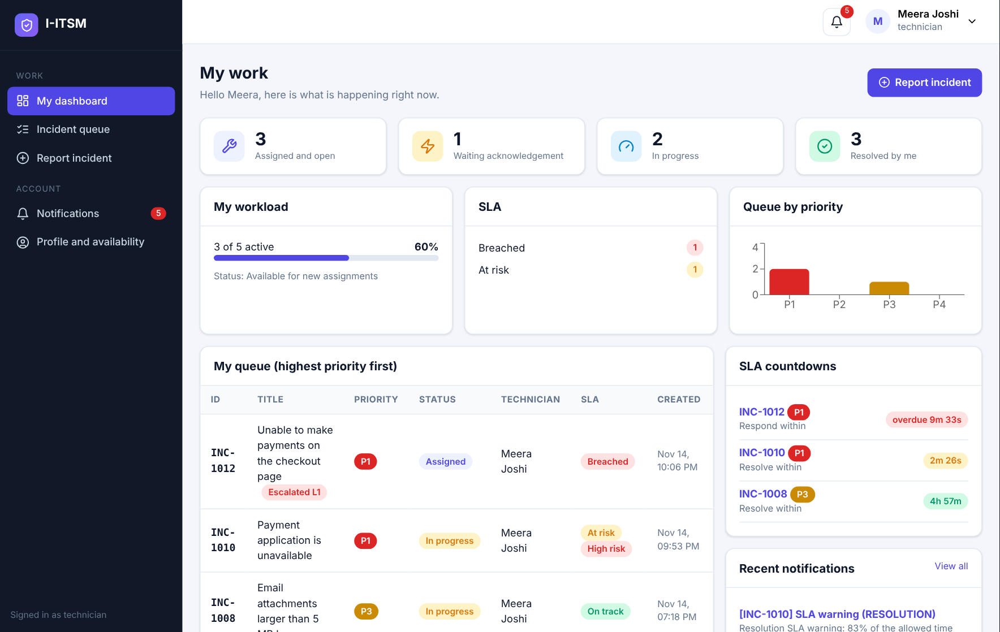{width=62%}


## 6.4 Administrator functions


The administrator manages the people and the rules. Through the interface they can:

* create, edit and deactivate users and give technicians a profile (team, skills with proficiency, years of experience, workload limit);
* manage support teams, services, incident categories and SLA policies, including per-service overrides;
* assign or reassign any incident, with a ranked recommendation list;
* view reports, the SLA monitor, the audit log and the simulated e-mail outbox;
* change system settings: the priority algorithm, the assignment strategy, automatic assignment, escalation, and the affected-users adjustment.

Deactivation, not deletion, is used for users, so history remains intact. Figure 10.1 shows the administrator's dashboard and Figure 6.2 the full incident list.


## 6.5 Incident creation, classification and prioritisation


`IncidentService.create_incident` performs the whole workflow in one transaction.

1. `IncidentFactory` validates the input, checks that the service exists and is active, and builds the entity with a sequential reference (`INC-1001`, `INC-1002` and so on).
2. The category is taken from the reporter, or, when absent, from the keyword classifier (Section 6.12), and the incident moves to `CLASSIFIED` through the lifecycle manager.
3. The effective impact is computed by `AffectedUsersPolicy` and the priority by the selected `PriorityStrategy` (Section 5.6).
4. `SlaService.select_policy` picks the policy for the service and priority, falling back to the general policy for that priority, and `apply_policy` stores the response and resolution deadlines. If no policy exists, a `MissingSlaConfigurationError` stops the operation before anything is saved.
5. If automatic assignment is enabled, the assignment service picks the top-ranked eligible technician and the incident moves to `ASSIGNED`. If nobody is eligible, a `NO_TECHNICIAN_AVAILABLE` event is emitted and administrators are notified, and the incident waits in `CLASSIFIED`.
6. Events for each step are emitted, so the audit log and notifications are written without further code in the service.

**Table 6.1: Priority bands and default SLA targets**

| Priority | Score (product strategy) | Response target | Resolution target | Warning at 75% |
|-----------|-----------|-----------|-----------|------------|
| P1 Critical | 40 to 125 | 5 minutes | 30 minutes | 3.75 min and 22.5 min |
| P2 High | 20 to 39 | 15 minutes | 2 hours | 11.25 min and 90 min |
| P3 Medium | 8 to 19 | 1 hour | 8 hours | 45 min and 6 h |
| P4 Low | 1 to 7 | 4 hours | 24 hours | 3 h and 18 h |

The effect of the affected-users rule is easiest to see with an example. A report with impact 2, urgency 3 and criticality 3 gives 18, which is P3. If 300 users are affected, the effective impact becomes 4 and the product 36, which is P2, and the audit log records why. A report whose own impact is already 5 is unchanged by any user count.


## 6.6 Assignment


Assignment follows Section 5.6. Automatic assignment uses the strategy selected in Settings. Manual assignment is done on the incident page (Figure 10.8), where the administrator sees the ranked list with reasons, and also sees *why* ineligible technicians were excluded (unavailable, missing skill or at the workload limit). A manual choice that violates eligibility is refused with the matching exception (`TECHNICIAN_UNAVAILABLE`, `TECHNICIAN_MISSING_SKILL` or `TECHNICIAN_WORKLOAD_EXCEEDED`), so the screen cannot be used to bypass the rules. Reassignment keeps the history: the previous technician is notified and the incident returns to `ASSIGNED`.


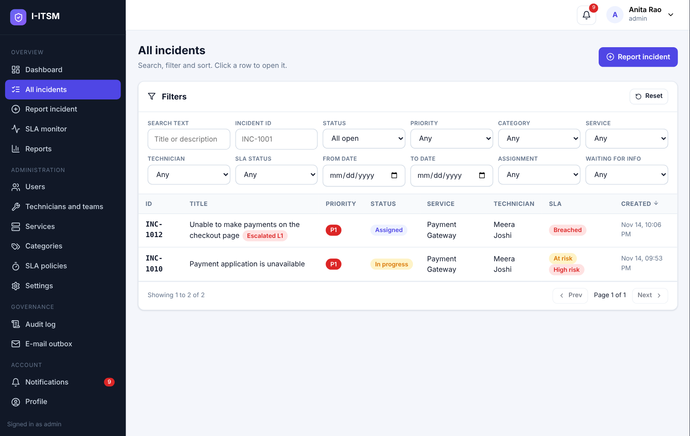{width=62%}


## 6.7 Notifications


Every notification is created by `NotificationObserver` (Section 5.7) and stored for each recipient, so the bell icon and the Notifications page read from the same table. Recipients never include the person who caused the event (except for the creation event) and never include deactivated users. The simulated e-mail channel writes a second copy marked as e-mail, which administrators can read on the outbox page (Figure 6.6). No e-mail leaves the machine.

**Table 6.2: Events and who is notified**

| Event | Recipients |
|----------------------------|------------------------------------------|
| Incident reported | Reporter and administrators |
| Classified | Reporter, with category, priority and deadlines |
| Priority changed | Reporter and assigned technician |
| Assigned | Reporter (technician's name) and the technician (acknowledge before the deadline) |
| Reassigned | Reporter, previous technician and new technician |
| No technician available | Administrators |
| Acknowledged, investigation started | Reporter |
| Information requested | Reporter |
| Information provided | Assigned technician |
| Resolved | Reporter, asked to verify or reopen |
| Reopened | Assigned technician and administrators |
| Verified | Assigned technician |
| Closed | Reporter and assigned technician |
| Feedback received | Assigned technician |
| SLA warning, SLA breached | Assigned technician and administrators |
| Escalated | Recipients named by the escalation chain |


## 6.8 SLA monitoring and escalation


`SlaMonitor` is a background thread started with the application. It wakes every 60 seconds (configurable), opens its own database session and calls `SlaService.run_check`, which evaluates every open incident through `evaluate`.

* **Two clocks per incident.** The response clock runs until acknowledgement and the resolution clock until resolution. Each has a deadline fixed when the policy was applied.
* **Status.** `describe` returns `ON_TRACK`, `AT_RISK` (75 percent or more of the allowed time used), `BREACHED` or `MET`, with the time remaining. The status is also recomputed when an incident is read, so the screen is correct even between monitor cycles.
* **Violations.** A breach creates one `SlaViolation` row per incident and clock type, and emits `SLA_BREACHED`. A warning is emitted once per clock when the risk threshold is crossed.
* **Escalation.** If a P1 or P2 incident is still unacknowledged after its response deadline, `_maybe_escalate` moves it up the chain Team Lead, System Administrator, IT Manager, increments `escalation_level`, records the event and notifies the named recipients, provided escalation is enabled in Settings.
* **Time control.** Because every service takes a `Clock`, tests move time forward with `MutableClock` and call `run_check` directly, so these rules are verified without waiting.

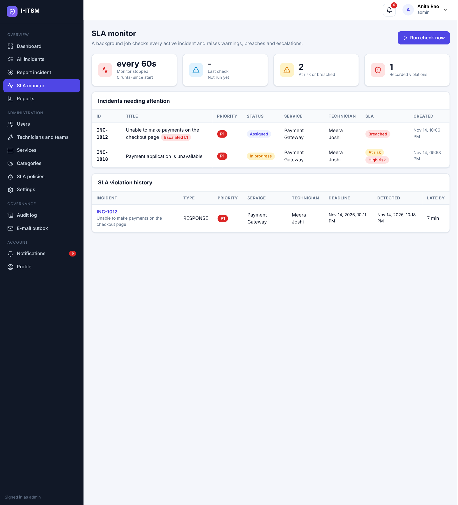{width=62%}


## 6.9 Search, filtering and sorting


The incident list endpoint accepts: incident number, free text over title and description, a created-date range, one or more statuses (with the shortcuts OPEN, DONE and ACTIVE), one or more priorities, category, service, technician, SLA status, an "unassigned only" switch and an "awaiting information" switch, together with a sort key and paging (`page`, `page_size` up to 100). `IncidentRepository` translates `IncidentFilters` into one query. The same endpoint serves all three roles, and `IncidentService.list_incidents` first narrows the result to the caller's scope (own, assigned or all), so a filter cannot widen access. Invalid input such as a start date after the end date returns a 422 with a clear message.


## 6.10 Dashboards and reports


`ReportService.dashboard` returns a role-specific payload (Sections 6.2 to 6.4). The administrator's reports page (Figure 6.4) draws, with Recharts, the overview counts and SLA compliance, incidents by service and by category, a 14-day trend, technician workload and a category-by-service matrix. All figures are computed by SQL aggregate queries, not in the browser. Four of the report tables (trend, by service, by category, technician workload) have a **CSV** button that downloads the table as a file; the file is built in the browser from the data already on screen.

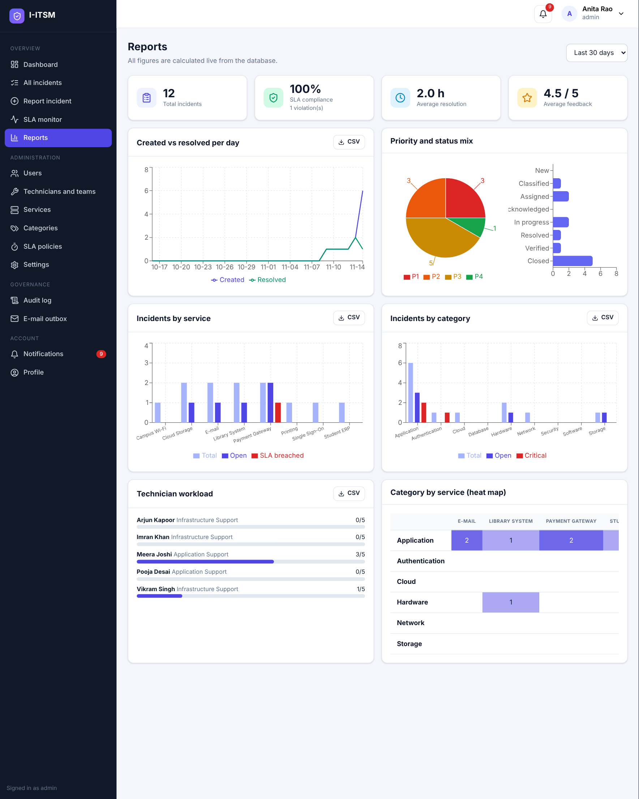{width=62%}


## 6.11 Audit logging


The audit log is append-only. `AuditObserver` writes a row for each of the 34 event types (Section 5.7), and the model rejects updates and deletes, raising `AuditImmutableError`. Administrators can search it by action, actor, incident and date (Figure 6.5). Because the observer is critical and runs inside the request transaction, a change and its audit record succeed or fail together.

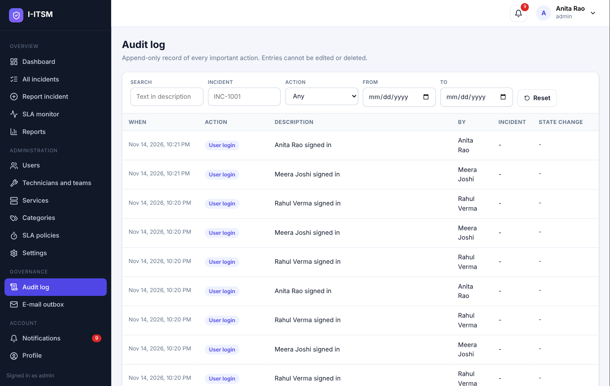{width=62%}


## 6.12 Intelligent features


The assignment asks for useful, explainable automation. `IntelligenceService` provides five features, and the assignment service adds technician recommendation. All are deterministic, with no external service and no model training, so every suggestion can be explained.

**Table 6.3: Intelligent features**

| Feature | Method | Output |
|---------------|--------------------------------------------|------------------------------|
| Category suggestion | Keyword scoring of title and description against weighted keyword lists for each category | Best category with the matching keywords |
| Duplicate detection | Jaccard similarity of word sets: 0.65 on the title and 0.35 on all text, multiplied by 0.75, plus 0.15 for the same service and 0.10 for the same category. Candidates scoring 0.45 or more among incidents of the last 7 days | List of likely duplicates with scores |
| Correlation | Open incidents on the same service within the previous 24 hours | A hint that several reports may share a cause |
| Suggested resolutions | Jaccard similarity (0.12 or more) between the new incident and the resolution summaries of closed incidents | Past fixes the technician may reuse |
| SLA risk | Points from priority, time used, assignment status and escalation | Ordering of the at-risk list |

These features advise. They never change data by themselves: the employee or technician decides.


## 6.13 Database integration and frontend-backend communication


SQLAlchemy 2.x maps the 15 entities to SQLite, with foreign keys enabled on every connection. The schema is created at start-up and demonstration data is loaded only when the database is empty and `SEED_DEMO_DATA` is true. Services run in one session per request, created in the dependency `get_container`, and committed by `@transactional`.

The React application talks to the backend only through the Axios client in `services/api.js` (base path `/api`, proxied by Vite during development, with CORS limited to the local front-end origin). All responses are JSON. Errors have the shape `{detail, code}`, which the client shows to the user. The OpenAPI description is served by FastAPI at `/docs`.

**Table 6.4: Principal API groups**

| Group | Representative endpoints | Who may call |
|--------------|----------------------------------------------|-----------------------|
| Authentication | `POST /auth/register`, `POST /auth/login`, `GET /auth/me`, `PATCH /auth/me`, `POST /auth/change-password` | Public (register, login), any signed-in user |
| Incidents | `POST` and `GET /incidents`, `GET` and `PATCH /incidents/{number}`, `POST /incidents/{number}/transition`, `/assign`, `/notes`, `/feedback`, `GET /incidents/{number}/timeline` | By role and record scope |
| Assistance | `GET /incidents/{number}/recommendations`, `/duplicates`, `/related`, `/suggested-resolutions`; `POST /intelligence/suggest-category`, `/preview-priority`, `/check-duplicates` | By role |
| Users | `GET` and `POST /users`, `PATCH /users/{id}`, `POST /users/{id}/deactivate`, `PUT /users/{id}/technician-profile`, `GET /technicians/workload`, `PATCH /technicians/me/availability`, `GET /technicians/me/queue` | Administrator, technician for own endpoints |
| Configuration | `/categories`, `/services`, `/sla-policies`, `/teams`, `/settings` (list, create, update) | Administrator for changes |
| Operations | `/notifications`, `/audit-logs`, `/reports/*`, `/dashboard`, `/sla/at-risk`, `/sla/violations`, `/sla/monitor`, `POST /sla/run-check`, `/admin/email-outbox` | By role |


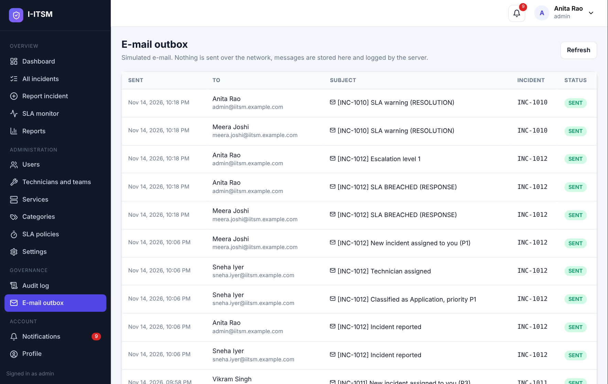{width=62%}


# Chapter 7: Exception and Error Handling

## 7.1 The mechanism


Errors are handled in four places, each with one job.

1. **Validation at the edge.** Pydantic schemas reject malformed input with HTTP 422 before a service runs. Custom `field_validator` functions add rules such as trimming text and requiring a letter and a digit in a password.
2. **Domain exceptions.** Services raise exceptions from one hierarchy rooted in `AppError` (`domain/exceptions.py`). Every class carries an HTTP `status_code` and a stable machine-readable `code`, so the web layer never needs a long chain of `if` statements. Messages are written for people and never contain internals.
3. **Central handlers.** `middleware/errors.py` registers handlers that convert every exception into the same JSON body `{"detail": "...", "code": "..."}`. There are separate handlers for `AppError`, request validation errors (which add a per-field `errors` list), framework HTTP errors, SQLAlchemy `IntegrityError` (409 `CONFLICT`), other `SQLAlchemyError` (503 `DATABASE_ERROR` when the database cannot be reached, otherwise 500) and a last-resort handler for any other exception (500 `INTERNAL_ERROR`, with the stack trace written to the log only).
4. **Transactions.** `@transactional` (in `services/base.py`) commits a multi-step operation only when it finishes, and rolls everything back when any exception escapes. A rejected request therefore leaves no half-written data. Test TC-14 and TC-17 check that the incident and the audit trail are unchanged after a refusal.


<!-- landscape -->
## 7.2 The twelve scenarios of the brief


**Table 7.1: The error scenarios required by the course brief and how each is handled**

| Error scenario | Where it is handled | Mechanism | Expected system behaviour | Status |
|-------------|-----------------------|----------------------------|-----------------------------|---------------------|
| Invalid login | `AuthService.login` in `services/auth_service.py`, route `POST /api/auth/login`, `pages/Login.jsx` | `AuthenticationError`, status 401, code `AUTHENTICATION_FAILED`. The same message is given for an unknown e-mail and a wrong password, so accounts cannot be probed. A deactivated account is refused with its own message. Every failure is audited as `USER_LOGIN_FAILED` | HTTP 401 with no token. The login page shows the message in a red alert. The failed attempt appears in the audit log | **Implemented.** Automated: TC-10, and `test_failed_login_is_audited` |
| Unauthorized operation | `require_roles` in `middleware/dependencies.py` on the routes. Record-level checks inside services (for example `IncidentService` access check, `UserService` own-account checks). Front end: `ProtectedRoute.jsx` | `PermissionDeniedError`, 403, `PERMISSION_DENIED`. A missing, malformed or expired token raises `AuthenticationError` (401) | The operation is refused and nothing changes. Hiding a menu item is only a convenience, the server decides | **Implemented.** Automated: TC-18, TC-19, TC-20, TC-21 and the use-case matrix |
| Invalid incident | `IncidentService` lookup by incident number | `IncidentNotFoundError`, 404, `INCIDENT_NOT_FOUND`. An incident that exists but is outside the caller's scope returns 403, which confirms that the number exists but reveals nothing else | HTTP 404 with a message. The detail page shows an error state with a retry button | **Implemented.** Automated: `test_unknown_incident_returns_404` |
| Invalid state transition | `LifecycleManager.transition` in `domain/lifecycle.py`, called by `IncidentService.transition` | `InvalidTransitionError`, 409, `INVALID_STATE_TRANSITION`. Allowed moves are a table of `TransitionRule` objects with the actor kinds permitted | HTTP 409, incident and audit trail unchanged. The detail page only offers the moves that are allowed, so the interface cannot normally send an illegal one | **Implemented.** Automated: TC-14 (every disallowed pair of states is tried) |
| Technician unavailable | `AssignmentService.ensure_assignable` in `services/assignment_service.py` | `TechnicianUnavailableError`, 409, `TECHNICIAN_UNAVAILABLE`, for an inactive, unavailable or non-technician user. An administrator override does not bypass this check | HTTP 409. In automatic assignment the technician is simply not among the eligible candidates and the reason is listed | **Implemented.** Automated: TC-04, TC-15 |
| Technician workload exceeded | `AssignmentService.ensure_assignable` and `EligibilityPolicy` | `WorkloadExceededError`, 409, `TECHNICIAN_WORKLOAD_EXCEEDED`. A related `MissingSkillError` (`TECHNICIAN_MISSING_SKILL`) covers a missing skill. An administrator can override both explicitly and the override is audited | HTTP 409 without the override. With it, HTTP 200 and an audit entry that names the override | **Implemented.** Automated: TC-16 |
| Service not found | `IncidentService` when creating or editing an incident | `ServiceNotFoundError`, 404, `SERVICE_NOT_FOUND`. An inactive service is treated as not found | HTTP 404. The report form only lists active services, so the case arises only from a direct API call | **Implemented.** Automated: `test_priority.py` (service 999), TC-02 setup |
| Missing SLA configuration | `SlaService.select_policy` in `services/sla_service.py` | `MissingSlaConfigurationError`, 422, `MISSING_SLA_CONFIGURATION` | HTTP 422 with a message telling the user to ask an administrator. The incident is not saved, so none exists without deadlines | **Implemented.** Automated: TC-17 |
| Duplicate incident | `IntelligenceService.find_duplicates` (Jaccard similarity of words, threshold 0.45) called from `IncidentService.create`. Other duplicates (e-mail address, category, service or team name) are rejected by services | For incidents: a **warning**, not an error. The event `DUPLICATE_DETECTED` is audited and the response lists candidates. For names and e-mail addresses: `DuplicateResourceError`, 409, `DUPLICATE_RESOURCE` | Business rule BR-14 says detection must only warn, never block, merge or close. The employee sees a "Possible duplicates" panel and may continue. A new incident is still created. A duplicate account or configuration name is refused with HTTP 409 | **Implemented as designed, but by warning.** If the evaluators expect a refusal of a duplicate incident, this is a deliberate difference. Automated: TC-26 and `test_registration_rejects_duplicate_email_and_weak_password` |
| Database failure | Handlers in `middleware/errors.py`. `@transactional` rolls back. `/health` reports `database` true or false | `OperationalError` gives 503 `DATABASE_ERROR`. `IntegrityError` gives 409 `CONFLICT`. Any other `SQLAlchemyError` gives 500 `DATABASE_ERROR`. Details are logged, not returned | A generic message that asks the user to try again, no SQL or path in the response, no partial data. Observed in a probe run on 19 November 2026 with the `incidents` table renamed: HTTP 503 with code `DATABASE_ERROR` | **Implemented.** No test in the suite exercises it, the probe was a one-off check and is not counted as a test case |
| Network failure | Browser side only: the Axios client (`services/api.js`, timeout 20 seconds) and `errMsg`. Server side there is no external network call (e-mail is simulated) | `errMsg` returns "Cannot reach the server" when no response arrives and "The server took too long to respond" on timeout. Pages show the text in an `Alert`, a toast or the `ErrorState` panel | The user sees a sentence and the page stays usable. Nothing is retried automatically and no work is queued offline | **Partially implemented.** See the finding below. TC-29 is documented but not executed |
| Invalid user input | Pydantic schemas in `schemas/`, validators in `schemas/common.py`, `InvalidInputError` in services, inline checks in `CreateIncident.jsx` and the other forms | HTTP 422 with code `VALIDATION_ERROR` (with a list of fields) or `INVALID_INPUT` | The response names each offending field. The form shows the message under the field and does not send the request when the rule is checkable in the browser | **Implemented.** Automated: TC-09, TC-11, TC-12, TC-13 |
<!-- /landscape -->

**Finding on network failure.** During development the browser talks to the Vite server, which forwards `/api` to the back end. When only the back end is stopped, the Vite proxy itself answers with HTTP 500 and an empty plain-text body (observed on 19 November 2026). `errMsg` then has a response but no JSON, so it shows "Request failed (500)." and not the clearer "Cannot reach the server" sentence. That sentence appears only when the browser receives no response at all, for example when the front-end server is also stopped while the page is still open, or in a deployment without the proxy. The behaviour is acceptable (an error is shown, no blank page) but it is less helpful than intended, and the delivered code was not changed for this report. A one-line improvement would be to treat a non-JSON 5xx answer as "cannot reach the server". The screenshot checklist (SS-28 and SS-29) shows both cases.

**Finding on duplicates.** The brief lists "duplicate incident" among the error scenarios. The design decision of the team, written as business rule BR-14 and tested in TC-26, is that an incident that looks like a duplicate is accepted and flagged, because a wrong refusal could silence a real outage. The detection is keyword based, so it can miss duplicates written with different words.


## 7.3 HTTP status codes used


**Table 7.2: Status codes and their meaning in I-ITSM**

| Code | Meaning in this system | Typical `code` values |
|------|------------------------------------|--------------------------------|
| 200, 201 | Success, and creation of a resource (incident, note, feedback, user, configuration item) | none |
| 401 | Missing, invalid or expired token, wrong credentials, deactivated account | `AUTHENTICATION_FAILED` |
| 403 | Authenticated, but not allowed for this role or this record | `PERMISSION_DENIED` |
| 404 | The incident, service, user or policy does not exist | `INCIDENT_NOT_FOUND`, `SERVICE_NOT_FOUND`, `NOT_FOUND` |
| 409 | The request conflicts with the current state or data: illegal transition, technician unavailable or full, duplicate name, database constraint | `INVALID_STATE_TRANSITION`, `TECHNICIAN_UNAVAILABLE`, `TECHNICIAN_WORKLOAD_EXCEEDED`, `TECHNICIAN_MISSING_SKILL`, `DUPLICATE_RESOURCE`, `CONFLICT` |
| 422 | Input fails validation, or the system is not configured for the request | `VALIDATION_ERROR`, `INVALID_INPUT`, `MISSING_SLA_CONFIGURATION` |
| 500 | Unexpected failure (generic message, details only in the log) | `INTERNAL_ERROR`, `DATABASE_ERROR` |
| 503 | The database cannot be reached | `DATABASE_ERROR` |


## 7.4 Front-end error handling


* `errMsg(error)` in `services/api.js` is the single translator. It reads `detail`, appends the per-field messages when present, and falls back to "Request failed (status)." when the body is not JSON.
* Forms keep an `error` state shown by `Alert` and per-field `errors` shown under the field. The report form checks title length (5 to 200), description length (10 to 5000) and the service before sending.
* `Async` and `ErrorState` display a failed load with a retry button instead of a blank page. Action failures use toasts from `ToastContext`.
* A 401 from any call except login runs the logout handler, which clears the token and returns the user to the sign-in page.
* There is no React error boundary, so an unexpected rendering exception would blank the page. This is a limitation. It has not been observed in the manual checks.


## 7.5 Limitations of error handling


* The database failure and network failure paths are not covered by automated tests (the first was checked once by a probe, the second by TC-29 which is not executed).
* There is no automatic retry, circuit breaker or offline queue.
* Errors are logged to the console through the standard `logging` module, with no central log store or alerting.
* The generic `INTERNAL_ERROR` page gives the user no reference number to quote to support.


<!-- landscape -->
# Chapter 8: Security Analysis

## 8.1 Summary


Table 8.1 lists each mechanism, where it lives and what it does not do. Section 8.7 separates what exists from what is only recommended.

**Table 8.1: Security mechanisms in the delivered code**

| Area | What is implemented | Where | Limitations |
|----------|------------------------------------------|---------------------------|------------------------------------|
| Authentication | E-mail and password login. A successful login returns a signed JSON Web Token. Every protected endpoint requires `Authorization: Bearer <token>`. Unknown e-mail and wrong password give the same message. Failed and successful logins are audited | `services/auth_service.py`, `routes/auth.py`, `middleware/dependencies.py` (`get_current_user`) | No multi-factor authentication, no password reset by e-mail, no account lockout or rate limiting, so repeated guessing is not slowed |
| Token handling | HS256 signature with a secret from configuration, claims `sub` (user id), `role` and `exp`. Lifetime 60 minutes by default. Expired and tampered tokens give 401. The user is re-read from the database on every request and the role used for authorisation is the database role, not the claim, so a deactivated user is refused at once even with a valid token | `utils/security.py`, `config.py` | No refresh token and no revocation list. Logout only deletes the token in the browser, an already issued token stays valid until it expires |
| Password protection | bcrypt with a random salt per password and cost 12 (configurable). Passwords are limited to the first 72 bytes (a bcrypt property) cut explicitly. Rule: 8 to 128 characters with at least one letter and one number. The hash is stored in a private attribute and never appears in any response schema (`UserOut` has no password field) | `utils/security.py`, `schemas/common.py`, `models/user.py` | No check against lists of breached passwords. No password expiry or history |
| Role-based authorisation | Three roles (employee, technician, administrator). `require_roles` protects routes. Services add record-level rules: an employee sees only their incidents, a technician only the ones assigned to them or in the queue, the administrator everything. Public registration always creates an employee. The role cannot be sent by the client at registration. The matrix of use cases and roles is tested | `middleware/dependencies.py`, `services/incident_service.py`, `services/user_service.py`, `tests/test_use_case_matrix.py` | Roles are fixed in code, there are no custom permissions. The front-end route guard is cosmetic and is not security |
| Input validation | Length, range and format limits on every body (for example title 5 to 200, description 10 to 5000, ratings 1 to 5, users up to 1,000,000), e-mail format checked by `email-validator`, text trimmed, unknown enumeration values refused. Query parameters for filters are parsed and validated | `schemas/*.py` | Validation is structural. There is no malware or content scanning (no file upload exists) |
| Injection protection | All database access uses SQLAlchemy constructs with bound parameters. The only raw SQL strings are `SELECT 1` for the health check and a start-up statement built from table and column names taken from the models, never from a request. React escapes text when rendering, and the code base does not use `dangerouslySetInnerHTML` | `repositories/`, `services/report_service.py`, `database.py` | Not verified by a penetration test or a static scanner |
| Secure API access | CORS allows only the configured front-end origin (and the two local development origins). Error responses never include stack traces or SQL. In production mode the server refuses to start while `SECRET_KEY` has its default value. The administrator account for a live system is created from environment variables, not from the demo data | `main.py`, `config.py`, `middleware/errors.py`, `utils/seed.py` | HTTPS and security headers are not provided by the application and must come from the web server or gateway. CORS allows all methods and headers for the allowed origins. `/docs` is public in the development setup |
| Protection against unauthorised operations | Every state-changing endpoint is guarded by a role dependency or a service check. The lifecycle table lists which actor kinds may make each move. Priority-driving fields can be changed only by an administrator. Closed incidents are read-only. Only the reporter may rate the resolution | `domain/lifecycle.py`, `services/incident_service.py` | Authorisation logic is spread over routes and services, so a new endpoint must remember to call the check. The use-case matrix test reduces that risk for 23 of the 32 use cases |
| Audit and accountability | An append-only audit table records the actor, action, previous and new state, description and time. ORM events raise an error on any attempt to update or delete a row, and the API offers no route to change it | `models/audit.py`, `observers/audit_observer.py` | The guard works through the ORM. Someone with direct access to the database file could still alter rows. There is no hash chain or off-site copy |
| Database security | Foreign keys on, unique and check constraints, a unique incident number, a unique violation per incident and type, a single database file kept out of version control, secrets only in `.env` (ignored by Git, with a placeholder-only `.env.example`) | `database.py`, `models/`, `.gitignore`, `backend/.env.example` | SQLite has no users or roles and no encryption at rest. Protection is the operating system's file permissions. There are no automated backups |
<!-- /landscape -->


## 8.2 Authentication and token handling in more detail


The login call checks the e-mail and the bcrypt hash. On success, `create_access_token` signs a payload with `sub`, `role` and `exp`. On every later request `get_current_user` verifies the signature and the expiry, loads the user and rejects an inactive account. Because the user is loaded each time, changing a role or deactivating an account takes effect immediately, which compensates for the lack of token revocation. The role claim inside the token is informational: `require_roles` compares the role stored in the database.

The front end stores the token in `localStorage` under the key `iitsm_token` and attaches it with an Axios interceptor. This is simple and survives a page refresh, but any script that runs on the page can read it. React's escaping and the absence of raw HTML injection reduce the chance of such a script, they do not remove the risk. Storing the token in an `HttpOnly` cookie, with CSRF protection, is the usual stronger choice and is listed in Section 8.7.


## 8.3 Authorisation in layers


Authorisation is checked at three levels. The route dependency decides whether the role may call the endpoint at all. The service decides whether this user may touch this record (for example `IncidentService` raises `PermissionDeniedError` for an incident outside the caller's scope). The lifecycle decides whether this actor kind may make this particular status change. The test `test_use_case_matrix.py` calls the real API as each role for 23 of the 32 use cases and requires that exactly the allowed roles succeed.


## 8.4 Input validation


Validation happens twice on purpose. The browser checks the cheap rules so that the user gets instant feedback. The server checks everything again because the browser cannot be trusted. Server rules are in Pydantic (types, lengths, ranges, patterns) and in the services (rules that need data, such as an active service). A rejected request returns 422 with the field name.


## 8.5 Session considerations


A session is a token with a 60 minute lifetime. There is no idle timeout and no sliding renewal. When a token expires, the next call returns 401 and the front end sends the user to the sign-in page. A shared computer that is not logged out keeps a usable token in `localStorage` until it expires.


## 8.6 Known weaknesses


* The token in `localStorage` (above).
* No rate limiting or lockout, so password guessing is only slowed by bcrypt's cost.
* No HTTPS in the development setup, so a token sent over a shared network would be readable. A real deployment must terminate TLS.
* Four open `npm audit` advisories in front-end development dependencies. They concern the development toolchain and were not fixed because the fix needs major upgrades.
* No `pip-audit` run on the Python dependencies, and the Python versions are not pinned.
* The demo accounts and their passwords are published in the README and on the login page for development. They must not exist in a real deployment, and the production start path does not create them.


## 8.7 Implemented mechanisms and recommended improvements


**Table 8.2: Implemented against recommended (not implemented)**

| Implemented now | Recommended for a real deployment (not implemented) |
|-----------------------------------|-------------------------------------------------|
| bcrypt password hashing with salt | Breached-password check, password reset flow, optional multi-factor authentication |
| Signed, expiring bearer tokens | Refresh tokens, a revocation list, `HttpOnly` cookie storage with CSRF protection |
| Server-side role and record checks | Central policy layer so that a new endpoint cannot skip a check |
| Validation at the edge and in services | Rate limiting and lockout for login, a web application firewall |
| Parameterised queries and output escaping | Static analysis and a penetration test |
| Append-only audit through the ORM | A hash chain or write-once storage for the audit log |
| Secret from configuration, refusal of the default secret in production | A secrets manager, key rotation |
| Restricted CORS | HTTPS everywhere, security headers (content security policy, strict transport security) |
| Database constraints and a file outside version control | A database server with roles, encryption at rest, automated backups |


# Chapter 9: Persistence and Database Design

## 9.1 Database selection and ORM


SQLite was selected for the reasons in Section 3.7, and SQLAlchemy 2 maps the Python classes to it. Each entity class in `backend/app/models/` extends one declarative `Base`. Columns are typed (`Mapped[int]`, `Mapped[Optional[str]]`), relationships are declared with `relationship(...)`, and cascade rules say what happens to dependants (a technician's skills are deleted with the technician profile). Repositories (`repositories/`) are the only code that builds queries. The complete schema is exported to `database/schema.sql` and described column by column in `docs/DATA_DICTIONARY.md`. Both are generated from the models, so they cannot drift from the code.


## 9.2 What is stored and where


**Table 9.1: How the entities named in the brief are persisted**

| Information | Table or tables | Notes |
|--------------------|-------------------------|-----------------------------------------------|
| Users | `users` | Name, unique e-mail, bcrypt hash, role, department, active flag, unique employee code. All three roles share the table |
| Technicians | `technician_profiles`, `technician_skills`, `support_teams` | One profile per technician user (unique `user_id`), availability, workload limit, years of experience, team. Skills are a many-to-many link between a technician and a category with a proficiency |
| Services | `services` | Name, description, business criticality 1 to 5, active flag |
| Categories | `incident_categories` | Name, description, keywords used by the suggestion feature |
| Incidents | `incidents` | Unique number (`INC-1001` onwards), text, reporter, category, service, ratings, computed score and priority, status, assigned technician, SLA deadlines and warning and escalation markers, optional link to a duplicate |
| SLA policies | `sla_policies` | Priority, optional service, response and resolution minutes, warning percentage, active flag |
| SLA violations | `sla_violations` | One row per incident and kind (response or resolution), unique together |
| Audit records | `audit_logs` | Actor, incident, action, previous and new state, description, JSON metadata, time |
| Resolution information | `resolutions` | One per incident: summary, root cause, technician, time |
| Employee feedback | `employee_feedback` | One per incident: rating 1 to 5, comment |
| Investigation notes | `investigation_notes` | Notes, information requests and replies, with an internal flag |
| Notifications | `notifications` | In-app and simulated e-mail messages share the table, distinguished by `channel`, with a delivery status |
| Settings | `system_settings` | Key and value pairs for the strategies and thresholds an administrator can change |

That is fifteen tables. No entity outside this list exists.


## 9.3 Entity relationships


Figure 9.1 is the entity-relationship diagram generated from the models.

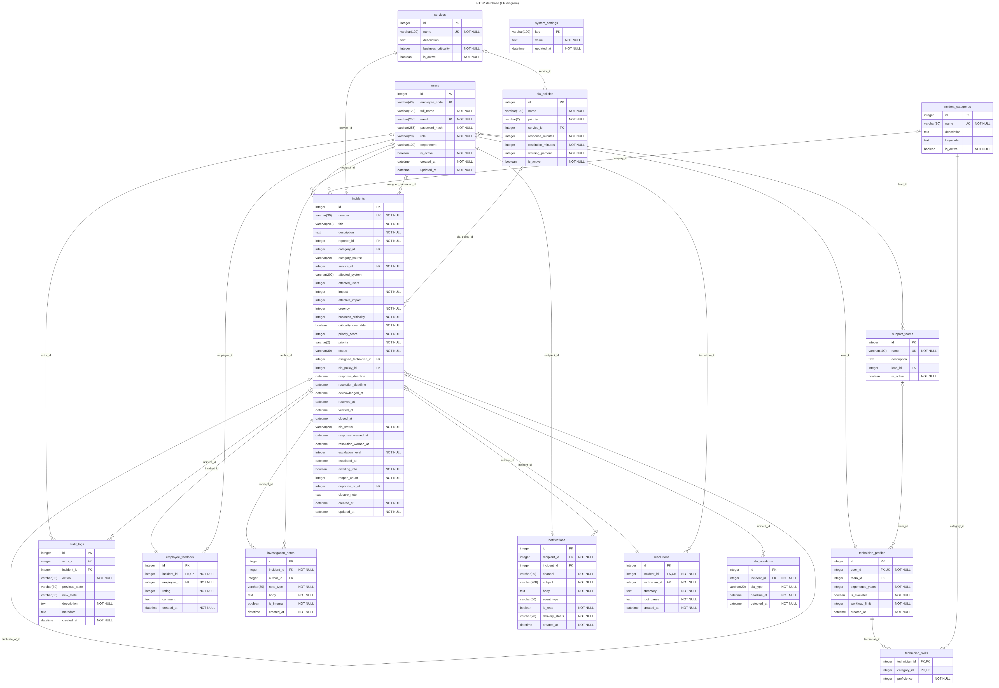{height=18cm}

**Table 9.2: Foreign keys, as defined in `database/schema.sql`**

| Child table and column | Parent table | Meaning |
|--------------------------------|---------------------|-----------------------------------|
| `incidents.reporter_id` | `users` | The employee who reported the incident |
| `incidents.assigned_technician_id` | `users` | The technician currently responsible |
| `incidents.category_id` | `incident_categories` | Classification |
| `incidents.service_id` | `services` | The affected service |
| `incidents.sla_policy_id` | `sla_policies` | The policy that produced the deadlines |
| `incidents.duplicate_of_id` | `incidents` | Optional link to a related incident (self reference) |
| `sla_policies.service_id` | `services` | Optional service-specific policy |
| `technician_profiles.user_id` | `users` | Unique, one profile per technician |
| `technician_profiles.team_id` | `support_teams` | Team membership |
| `support_teams.lead_id` | `users` | Team lead |
| `technician_skills.technician_id` and `.category_id` | `technician_profiles`, `incident_categories` | Composite primary key |
| `resolutions.incident_id` and `.technician_id` | `incidents`, `users` | Unique per incident |
| `employee_feedback.incident_id` and `.employee_id` | `incidents`, `users` | Unique per incident |
| `investigation_notes.incident_id` and `.author_id` | `incidents`, `users` | Notes of an incident |
| `notifications.recipient_id` and `.incident_id` | `users`, `incidents` | Who received what and about which incident |
| `audit_logs.actor_id` and `.incident_id` | `users`, `incidents` | Who did what to which incident |
| `sla_violations.incident_id` | `incidents` | Violations of an incident |


## 9.4 Keys and data integrity


**Primary keys.** Every table has an integer `id` except `technician_skills` (composite key of technician and category) and `system_settings` (the setting key).

**Integrity rules enforced by the database.** Foreign keys are on for every SQLite connection. Unique constraints cover the user e-mail and employee code, incident number, category, service and team names, one profile per technician, one resolution and one feedback per incident, and one violation per incident and kind. Check constraints keep impact, urgency, business criticality and the feedback rating between 1 and 5.

**Integrity rules enforced by the application.** Enumerated values (status, priority, role, channel) are stored as text and validated by Python enums and by the schemas, they are not database check constraints. The lifecycle table decides legal status changes. The audit table is made append-only by ORM events.

**Transactions.** One request uses one database session. `@transactional` commits once at the end of a multi-step operation, and rolls back on any exception. Publishing an event to the audit observer happens inside the same transaction, so an incident cannot change state without its audit row. If the audit observer fails, the transaction is aborted. A failure of the notification observer is logged and does not abort the workflow, because a missing notification is less harmful than a lost state change.


## 9.5 Persistence across restarts


Data is written to `backend/itsm.db` and survives stopping and starting the server. Automated test `test_t28_data_persists_after_application_restart` creates data in a file database, builds a new application on the same file and reads it back. A database file from an older version is upgraded at start by adding missing nullable columns (`test_old_database_without_the_new_column_is_upgraded_automatically`). Only additive changes are handled, a renamed or removed column needs a real migration tool.


## 9.6 Sample and seed data


When the database is empty at start and `SEED_DEMO_DATA` is true (the default), `utils/seed.py` creates 10 users (one administrator, five technicians in two teams, four employees), 8 services, the incident categories, 5 SLA policies (one per priority and a stricter policy for the Student ERP service at P2) and 12 incidents whose ages and histories are replayed through the real services, so they have audit trails, notifications, resolutions and feedback. The demo accounts are listed in the README. `python -m app.utils.seed --reset` wipes and re-seeds. For a real start (`SEED_DEMO_DATA=false`), `bootstrap_if_empty` creates only the first administrator from environment variables plus the standard categories, services and SLA policies. For review without Python, `database/schema.sql` and `database/sample_data.sql` (388 rows in 14 tables, exported by `docs/tools/export_sample_data.py`) can be loaded into SQLite directly. Both were loaded into an empty database and checked for foreign-key violations on 19 November 2026 (none).


## 9.7 Limitations of persistence


* One writer at a time, and no write-ahead logging enabled.
* No migration tool beyond the additive upgrade, so structural changes need a manual or new mechanism.
* No encryption at rest, no automated backup, no database roles.
* Seed incident ages are relative to the first start, so the SLA states shown by the demo data (for example which P1 incident is breached) depend on how long ago the database was created.


# Chapter 10: Testing and Validation

## 10.1 Strategy


The brief asks for at least fifteen meaningful documented test cases covering normal operations, boundary conditions, invalid inputs, exceptions, authorisation and business rules. The project meets this with a layered strategy.

* **Unit tests** call domain and strategy classes directly: the priority strategies with boundary ratings, the lifecycle table with every pair of statuses, the assignment strategies and eligibility rules, the similarity measure.
* **API integration tests** drive the real FastAPI application through the test client with a real service container, real repositories and a real (in-memory) database. They check status codes, error codes, stored data, the audit trail and notifications. This is where most of the business rules are tested.
* **Time-dependent tests** use an injectable clock (`MutableClock`), so SLA warnings, breaches and escalations are tested by moving time forward rather than by waiting.
* **Manual tests** are used where a browser is needed. Two manual cases were run: a scripted headless Chrome pass on 14 November 2026 (TC-28) and the full suite in Windows PowerShell on 20 November 2026 (TC-30). One further case, TC-29, is documented but was **not executed**.
* **Role matrix.** `test_use_case_matrix.py` calls the API as each role for 23 of the 32 use cases and requires that exactly the permitted roles succeed.

The suite was written against thirty numbered acceptance scenarios (T01 to T30), whose numbers appear in the test function names. The thirty documented cases below are a different, requirement-oriented selection, organised by the six categories of the brief and tied to the named tests.


## 10.2 Framework and environment


**Table 10.1: Test environment**

| Item | Value |
|-----------------|---------------------------------------------------|
| Framework | pytest 9.2.0 with httpx 0.28.1 (the FastAPI test client) and pytest-cov for coverage |
| Language and platform | Python 3.13 on Linux. The code supports Python 3.11 or later |
| Database | A fresh in-memory SQLite database for every test, created with `StaticPool` |
| Clock | `MutableClock` starting at 15 January 2026 09:00 UTC, advanced by the tests |
| Configuration | Environment set in `tests/conftest.py`: bcrypt cost 4 (for speed), a test secret key, the SLA monitor thread disabled |
| Data | `conftest.py` builds the same reference data as the real start-up (categories, services, SLA policies, technicians, employees) |
| Not covered | Windows, macOS, browsers other than the one used for the manual case, load, concurrency, real e-mail |


## 10.3 Execution


From the `backend` folder with the virtual environment active (PowerShell on Windows):

```
python -m pytest -q
python -m pytest --cov=app --cov-report=term-missing
python ..\docs\tools\build_tech_report.py
```

The first command runs the suite. The second adds the coverage report (`pytest-cov` is installed separately with `pip install pytest-cov`). The third runs the tests behind the documented cases and rewrites Tables 10.4 and 10.5 of this report from the real outcomes. The Windows commands are documented in the README but were not run on Windows by the authors.


## 10.4 Results


On 19 November 2026 the full suite gave **264 tests collected, 264 passed, 0 failed, 0 skipped**, in 14 test files, with **94.8 percent line coverage** of the back end (3,669 statements, 192 not executed). Running the same suite from the delivered ZIP in a fresh virtual environment gave the same pass count.

**Reconciliation of earlier numbers.** Earlier documents quoted 210, 261 and 264 tests. All three are correct for a different set of files. 210 is the suite without the files `test_affected_users.py` (26 tests), `test_use_case_matrix.py` (25) and `test_documented_cases.py` (3). 261 adds the first two. 264 is the complete suite. Every document in the project now states 264.

**Warnings.** The number of warnings reported by pytest varies between 0 and 6 from run to run. They come from the garbage collector closing unclosed in-memory SQLite connections at different moments (a `ResourceWarning`), and from a Starlette deprecation notice when an optional library is missing. They do not affect any result. Earlier documents quoted 5 or 6 for this reason.

<!-- testsummary:start -->
**Table 10.2: Result of the complete automated suite (run of 2026-11-19)**

| Measure | Value |
|----------------|----------------|
| Tests collected and run | 264 |
| Passed | 264 |
| Failed | 0 |
| Skipped | 0 |
| Test files | 14 |
| Duration of the run | 35 seconds |

**Table 10.3: Number of tests in each test file**

| Test file | Tests | Passed |
|----------------------------|------|------|
| `test_affected_users.py` | 26 | 26 |
| `test_assignment.py` | 17 | 17 |
| `test_auth.py` | 13 | 13 |
| `test_bootstrap.py` | 3 | 3 |
| `test_documented_cases.py` | 3 | 3 |
| `test_intelligence.py` | 17 | 17 |
| `test_lifecycle.py` | 76 | 76 |
| `test_notes_feedback_config.py` | 11 | 11 |
| `test_notifications_audit.py` | 9 | 9 |
| `test_priority.py` | 30 | 30 |
| `test_rbac.py` | 10 | 10 |
| `test_search_reports.py` | 9 | 9 |
| `test_sla.py` | 15 | 15 |
| `test_use_case_matrix.py` | 25 | 25 |
| **Total** | **264** | **264** |
<!-- testsummary:end -->


## 10.5 The documented test cases


Table 10.4 documents thirty cases in twelve columns: the ten required ones (test ID, category, scenario, objective, preconditions, steps, input data, expected result, actual result, status) plus the type of test and the pytest functions that implement the case. **Status** and **Actual result** for an automated case come from running the named pytest functions, and the status is PASS only if every named function passed. The actual result describes what the assertions of those tests observed. Manual and planned cases are marked as such and carry a fixed status. Nothing was marked PASS because a feature exists.

* TC-01 to TC-27 are **automated**. Each lists the exact test functions in the last column. "Automated, unit" means pytest calls the classes directly. "Automated, API" means pytest sends HTTP requests to the real application through the FastAPI test client, with a real service container and an in-memory database.
* TC-28 is a **manual** case that was executed (PASS) and has no automated test.
* TC-29 is **NOT EXECUTED**. It needs a browser and a stopped front-end server. It stays in the table because the brief asks for the case. TC-30 was executed by the team on Windows on 20 November 2026 (264 passed, 1 warning, 49.55 seconds, screenshot SS-31).

<!-- testcases:start -->
<!-- landscape tiny -->
**Table 10.4: Documented test cases (Test ID, category, scenario, objective, preconditions, steps, input data, expected result, actual result, status, type of testing, automated test reference)**

| Test ID | Category | Test scenario | Objective | Preconditions | Test steps | Input or test data | Expected result | Actual result | Status | Type of testing | Automated test reference |
|----|-------|------------|--------------|------------|----------------|------------|--------------|--------------|-----|----------|----------------|
| TC-01 | Normal | Successful login with valid credentials | Show that a registered user can sign in and receives a token that carries the role | Demo administrator account exists | 1. Send the login request. 2. Read the status, token and user in the response. 3. Read the audit records. | Administrator demo e-mail in upper case, correct demo password | HTTP 200, bearer token and user with role ADMIN; the sign-in is audited | HTTP 200, token_type bearer, user role ADMIN, audit action `USER_LOGIN` present | PASS | Automated, API | `test_auth.py::test_login_success_returns_token_and_user_and_is_audited` |
| TC-02 | Normal | Employee creates an incident | Show that an employee can report an incident and that the priority is calculated from the service criticality | Employee signed in; service Library System (criticality 2) exists | 1. Sign in as an employee. 2. Create the incident. 3. Read the stored score and priority. | Title and description of valid length, impact 3, urgency 3, service Library System | Incident created; priority computed from the service criticality; score 18 and P3 | Created with score 18, priority P3, business_criticality 2, criticality not overridden | PASS | Automated, API | `test_priority.py::test_api_calculates_priority_and_takes_criticality_from_service` |
| TC-03 | Normal | Technician acknowledges an assigned incident | Show that the assigned technician can acknowledge and that the response SLA is met | Incident created and automatically assigned to a technician; clock advanced 2 minutes | 1. Create an incident that is assigned automatically. 2. Advance the clock 2 minutes. 3. Acknowledge as the technician. | Incident for an assigned technician, transition to ACKNOWLEDGED | HTTP 200, status ACKNOWLEDGED, acknowledged_at set, response SLA marked MET | HTTP 200, status ACKNOWLEDGED, timestamp 2 minutes after creation, response SLA state MET | PASS | Automated, API | `test_lifecycle.py::test_t09_assigned_technician_acknowledges_and_timestamp_is_set` |
| TC-04 | Normal | Administrator assigns an incident to an eligible technician | Show that an administrator can assign an incident, and that an unavailable technician is refused first | Unassigned Storage incident; technician Imran Khan initially unavailable | 1. Try to assign while the technician is unavailable. 2. Make the technician available. 3. Assign again. | Unassigned Storage incident, technician Imran Khan | Refused while unavailable; accepted once available; status ASSIGNED | First call HTTP 409 `TECHNICIAN_UNAVAILABLE`; second call HTTP 200, technician Imran Khan, status ASSIGNED | PASS | Automated, API | `test_assignment.py::test_admin_assigns_manually_after_making_technician_available` |
| TC-05 | Normal | Resolve an incident with the required resolution details | Show that an incident can be taken through the whole lifecycle to closure with the required resolution data | Incident assigned and in progress | 1. Create and assign. 2. Acknowledge and start work. 3. Resolve with summary and root cause. 4. Verify. 5. Close. | Resolution summary and root cause text, closure by the reporter | Incident reaches RESOLVED, then VERIFIED and CLOSED through the legal steps | Full lifecycle NEW to CLOSED completed with every step accepted | PASS | Automated, API | `test_lifecycle.py::test_full_lifecycle_to_closed` |
| TC-06 | Boundary | Priority with the minimum valid ratings | Check the lowest valid combination of ratings | None | 1. Call the priority strategy with the minimum ratings. 2. Compare score and level. | Impact 1, urgency 1, criticality 1 | Score 1 and level P4 | Score 1 and level P4 (parametrised case ratings7) | PASS | Automated, unit | `test_priority.py::test_documented_examples_and_boundaries[ratings7-1-P4]` |
| TC-07 | Boundary | Priority level at the lower and upper limit of every band | Check the first and last score of every priority band | Default thresholds | 1. Map each boundary score to a level. 2. Map the ratings that produce 8, 20 and 40. | Scores 1, 7, 8, 19, 20, 39, 40 and 125 | 1 and 7 give P4; 8 and 19 give P3; 20 and 39 give P2; 40 and 125 give P1 | All eight boundary scores mapped to the expected level; also the products 8, 20 and 40 from ratings give P3, P2 and P1 | PASS | Automated, unit | `test_priority.py::test_t06_t07_threshold_boundaries`; `test_priority.py::test_documented_examples_and_boundaries[ratings4-8-P3]`; `test_priority.py::test_documented_examples_and_boundaries[ratings5-20-P2]`; `test_priority.py::test_documented_examples_and_boundaries[ratings6-40-P1]` |
| TC-08 | Boundary | Priority with the maximum valid ratings | Check the highest valid combination of ratings | None | 1. Call the priority strategy with the maximum ratings. 2. Compare score and level. | Impact 5, urgency 5, criticality 5 | Score 125 and level P1 | Score 125 and level P1 (parametrised case ratings8) | PASS | Automated, unit | `test_priority.py::test_documented_examples_and_boundaries[ratings8-125-P1]` |
| TC-09 | Boundary | Maximum permitted text lengths | Check the exact text length limits of the incident form on the server | Employee signed in; limits in the schema: title 200, description 5000, affected system 200 characters | 1. Create with the maximum lengths. 2. Create again with one extra character in one field at a time. | Title 200 and 201, description 5000 and 5001, affected system 200 and 201 characters | Maximum lengths accepted with HTTP 201; one character more rejected with HTTP 422 naming the field | Creation with the maximum lengths returned 201 and stored a 200 character title; each over-length field returned 422 with that field named | PASS | Automated, API | `test_documented_cases.py::test_tc09_maximum_permitted_text_lengths_are_accepted_and_one_more_is_rejected` |
| TC-10 | Invalid input | Login with an incorrect password | Show that a wrong password is refused without a token | Registered user exists | 1. Send the login request with a wrong password. 2. Read the status and body. | Existing e-mail, wrong password | HTTP 401, no token, error code `AUTHENTICATION_FAILED` | HTTP 401 without a token in the response | PASS | Automated, API | `test_auth.py::test_t03_login_with_wrong_password_returns_401_without_token` |
| TC-11 | Invalid input | Incident creation with missing mandatory fields | Show that every missing mandatory field is rejected and named | Employee signed in | 1. Create an incident with one field removed at a time. 2. Create with an empty body. | Title, description, service, impact or urgency omitted | HTTP 422 each time, with the missing field named | Every omission returned 422 and the response listed the omitted field; the empty body returned 422 | PASS | Automated, API | `test_documented_cases.py::test_tc11_missing_mandatory_fields_are_rejected_and_named` |
| TC-12 | Invalid input | Ratings outside the range 1 to 5 | Show that ratings outside 1 to 5 are rejected by the strategy and by the API | None | 1. Call the strategy with out-of-range ratings. 2. Send the same through the API. | Ratings 0, 6 and -1 in different positions; API impact 6 and urgency 0 | InvalidInputError in the strategy; HTTP 422 naming the field through the API | All five strategy calls raised InvalidInputError; API returned 422 with the field impact or urgency named | PASS | Automated, unit and API | `test_priority.py::test_invalid_ratings_are_rejected`; `test_priority.py::test_incident_validation_errors_are_meaningful` |
| TC-13 | Invalid input | Resolve without the mandatory resolution details | Show that an incident cannot be resolved without a resolution summary and a root cause | Incident `IN_PROGRESS` | 1. Request RESOLVED with no details. 2. With only a summary. 3. With a blank summary and a root cause. | Empty, partial and blank resolution fields | HTTP 422 each time; the message mentions the root cause; status stays `IN_PROGRESS` | All three requests returned 422, the message contained 'root cause', status remained `IN_PROGRESS` | PASS | Automated, API | `test_lifecycle.py::test_t10_resolve_without_summary_or_root_cause_is_rejected` |
| TC-14 | Exception | Invalid lifecycle transition, NEW directly to CLOSED | Show that an illegal status change is refused and changes nothing | An incident exists; for the unit level every pair of statuses is tried | 1. Request CLOSED for a new incident. 2. Try every disallowed pair of statuses at unit level. | Transition NEW to CLOSED, and all other illegal pairs | HTTP 409 `INVALID_STATE_TRANSITION` and the incident does not change; every disallowed pair raises InvalidTransitionError | HTTP 409, status and audit unchanged; all disallowed pairs were rejected | PASS | Automated, unit and API | `test_lifecycle.py::test_t08_new_to_closed_is_rejected_with_409_and_no_mutation`; `test_lifecycle.py::test_every_disallowed_transition_is_rejected` |
| TC-15 | Exception | Assignment when no eligible technician exists | Show the behaviour when no technician is eligible | Storage is covered only by a technician on leave | 1. Make the only Storage technician unavailable. 2. Create a Storage incident. 3. Read the status, notifications and timeline. | Cloud Storage incident, category Storage | Incident stays CLASSIFIED and unassigned; administrators are notified; the timeline records `NO_TECHNICIAN_AVAILABLE` | assigned false, status CLASSIFIED, administrator notification present, internal event hidden from the employee | PASS | Automated, API | `test_assignment.py::test_t15_no_eligible_technician_leaves_incident_unassigned_and_notifies_admin` |
| TC-16 | Exception | Manual assignment to a technician at the workload limit | Show that the workload limit blocks assignment unless an administrator overrides | Technician limit set to 1 and already holding one incident | 1. Set the limit to 1 and fill it. 2. Assign a second incident. 3. Repeat with the override. | Technician limit 1, second incident, override false then true | Refused with HTTP 409 `TECHNICIAN_WORKLOAD_EXCEEDED`; with an explicit override accepted and audited | First request HTTP 409 `TECHNICIAN_WORKLOAD_EXCEEDED`; with override HTTP 200 and the timeline text mentions the override | PASS | Automated, API | `test_assignment.py::test_workload_limit_blocks_assignment_unless_admin_overrides` |
| TC-17 | Exception | Incident processing when the SLA policy is missing | Show that an incident is not created when no SLA policy exists for its priority | The only P1 SLA policy is deactivated | 1. Deactivate the only P1 policy. 2. Create a P1 incident. 3. Count the incidents. | Payment incident with impact 4, urgency 5 | HTTP 422 `MISSING_SLA_CONFIGURATION` and no incident is saved | HTTP 422 with code `MISSING_SLA_CONFIGURATION`; incident list total 0 | PASS | Automated, API | `test_sla.py::test_missing_sla_policy_blocks_creation_without_side_effects` |
| TC-18 | Authorisation | Employee views another employee's incident | Show that an employee cannot read another employee's incident | Two employees; one has reported an incident | 1. Employee A reports an incident. 2. Employee B requests it, its notes and its timeline. | Incident number of employee A | HTTP 403 for all three and no incident content in the response | HTTP 403 for incident, notes and timeline; the title was absent from the response | PASS | Automated, API | `test_rbac.py::test_t04_employee_cannot_read_another_employees_incident` |
| TC-19 | Authorisation | Technician changes an incident not assigned to them | Show that a technician cannot read or change an incident assigned to someone else | Incident assigned to technician A; technician B signed in | 1. Assign an incident to technician A. 2. Technician B reads it, patches its category and tries to acknowledge. | Incident number, category change, acknowledge request | HTTP 403 each time and the incident is unchanged | HTTP 403 for all three requests; status still ASSIGNED; acknowledgement by B refused | PASS | Automated, API | `test_documented_cases.py::test_tc19_technician_cannot_view_or_change_an_incident_not_assigned_to_them`; `test_lifecycle.py::test_only_assigned_technician_or_admin_can_acknowledge` |
| TC-20 | Authorisation | Employee or technician uses administrator-only functions | Show that administrator-only endpoints refuse employees and technicians | Employee, technician and administrator signed in | 1. Call each administrator endpoint as an employee, a technician and the administrator. | Users, audit logs, reports, SLA policies, settings, teams, e-mail outbox and SLA lists | HTTP 403 for employee and technician, HTTP 200 for the administrator | Nine administrator endpoints returned 403 to both non-admin roles and 200 to the administrator | PASS | Automated, API | `test_rbac.py::test_admin_only_endpoints_reject_other_roles` |
| TC-21 | Authorisation | Unauthenticated access to protected endpoints | Show that protected endpoints require a valid token | No token | 1. Call endpoints without a token. 2. With a malformed token. 3. Probe every use-case endpoint anonymously. | No token, malformed token | HTTP 401 in all cases | HTTP 401 for both endpoints, for the malformed token and for every probed use-case endpoint | PASS | Automated, API | `test_auth.py::test_protected_routes_require_a_valid_token`; `test_use_case_matrix.py::test_anonymous_cannot_use_any_probed_endpoint` |
| TC-22 | Business rule | Priority equals impact x urgency x business criticality | Check that priority equals impact x urgency x business criticality | Default product strategy | 1. Calculate the documented examples. 2. Create incidents through the API and read the score. | Ratings (4,5,5), (3,3,4), (3,3,2), (1,2,1) | Scores 100, 36, 18 and 2 giving P1, P2, P3 and P4 | All documented examples matched, including 100 for P1 and the criticality taken from the service | PASS | Automated, unit and API | `test_priority.py::test_t05_impact4_urgency5_criticality5_is_score_100_p1`; `test_priority.py::test_documented_examples_and_boundaries` |
| TC-23 | Business rule | Correct SLA response and resolution deadlines for each priority | Check the response and resolution targets of every priority | Standard SLA policies | 1. Create one incident per priority. 2. Read the SLA target minutes. | Priorities P1 to P4 with the standard policies | P1 5 and 30 min, P2 15 and 120, P3 60 and 480, P4 240 and 1440 minutes | All four priorities reported exactly those target minutes | PASS | Automated, API | `test_sla.py::test_all_priorities_use_the_specified_targets`; `test_sla.py::test_t16_p1_incident_gets_5_and_30_minute_deadlines` |
| TC-24 | Business rule | An accepted lifecycle transition creates an audit record | Show that every accepted status change is audited with both states | Incident taken to RESOLVED | 1. Take an incident to RESOLVED. 2. Read the timeline as administrator. | Incident moved through five transitions | Audit rows with previous and new state for each step, in time order | NEW to CLASSIFIED, CLASSIFIED to ASSIGNED, ASSIGNED to ACKNOWLEDGED, ACKNOWLEDGED to `IN_PROGRESS` and `IN_PROGRESS` to RESOLVED present, times ascending; actor, action and time present | PASS | Automated, API | `test_lifecycle.py::test_every_accepted_transition_is_audited_with_states`; `test_notifications_audit.py::test_t21_transition_creates_audit_row_with_actor_action_states_and_time` |
| TC-25 | Business rule | Creation and assignment trigger the right notifications | Show that creation, assignment and resolution notify the right people on both channels | Employee, technician and administrator accounts | 1. Create an incident and resolve it. 2. Read the inbox of each user and the e-mail outbox. | Employee, technician and administrator accounts | Reporter, technician and administrator receive their messages; each has an in-app record and a simulated e-mail record | Reporter saw reported, classified and assigned messages; technician saw the assignment; administrator saw the report; outbox entries all EMAIL and SENT | PASS | Automated, API | `test_notifications_audit.py::test_t20_creation_assignment_and_resolution_create_in_app_and_email_records` |
| TC-26 | Business rule | Duplicate detection warns but does not merge | Show that similar incidents are flagged but never blocked or merged | A payment incident is open | 1. Report a payment incident. 2. Report two similar ones from other employees. 3. Read the warnings and the incident list. | Three similarly worded payment incidents, similarity threshold 0.45 | Warning lists the earlier incident(s) with similarity of at least 0.45; all incidents are still created and open | Second report listed the first as a duplicate; third listed both; three separate open incidents; related incidents can be linked without merging | PASS | Automated, API | `test_intelligence.py::test_t24_similar_payment_incident_triggers_a_warning_but_is_not_blocked`; `test_intelligence.py::test_admin_can_link_related_incident_without_merging` |
| TC-27 | Business rule | Search and filtering return only matching incidents | Show that combined search filters return only matching incidents | Four incidents with different priorities, services and SLA states | 1. Create four different incidents. 2. Apply the filters alone and in combination. | Status, priority, service and SLA status filters | Only incidents that match every selected criterion are returned; contradictory combinations return none | Each combination returned exactly the expected incident numbers and zero results for the contradictory combinations | PASS | Automated, API | `test_search_reports.py::test_t23_combined_filters_return_only_matching_incidents`; `test_search_reports.py::test_each_of_the_eight_filters_works_on_its_own` |
| TC-28 | Business rule | Live priority preview on the report form | Check the live priority preview in the browser | Back end and front end running with demo data | 1. Open the report form. 2. Enter impact 2 and 300 affected users. 3. Read the preview. 4. Submit and open the incident. | Impact 2, 300 affected users | Preview shows the raised priority and a note that impact was raised to 4; the created incident explains it | Preview showed P1 (score 60) with the note that impact was raised to 4; the detail page showed the explanation; no JavaScript errors were logged | PASS | Manual (headless Chrome, 14 Nov 2026) | None. Not part of the automated suite. |
| TC-29 | Exception | Network failure shown as a readable message | Check that a lost connection is shown as a readable message | Page open in the browser; the front-end server stopped so that no response can arrive | 1. Open the page. 2. Stop the front-end server. 3. Click Sign in or another action. | No response from the server | A message such as 'Cannot reach the server' in an alert or toast and no blank page. With only the back end stopped behind the Vite proxy the message is 'Request failed (500).' | Not executed in this report | NOT EXECUTED | Planned, not executed | None. Not executed. |
| TC-30 | Business rule | Full test suite on Windows | Check that the whole suite passes on Windows | Windows computer with Python 3.11 or later and a virtual environment | 1. Install the requirements. 2. Run python -m pytest -q in the backend folder. | Windows computer with Python 3.11 or later | All tests pass | 264 passed, 1 warning in 49.55 s in Windows PowerShell on 2026-11-20 (screenshot SS-31) | PASS | Manual (Windows, 20 Nov 2026) | None. Not part of the automated suite. |
<!-- /landscape -->

**Table 10.5: Coverage of the six required categories**

| Category | Cases | Passed | Not executed | Automated | Manual or planned |
|----------|-----|-----|-----|-----|-----|
| Normal | 5 | 5 | 0 | 5 | 0 |
| Boundary | 4 | 4 | 0 | 4 | 0 |
| Invalid input | 4 | 4 | 0 | 4 | 0 |
| Exception | 5 | 4 | 1 | 4 | 1 |
| Authorisation | 4 | 4 | 0 | 4 | 0 |
| Business rule | 8 | 8 | 0 | 6 | 2 |
| **Total** | **30** | **29** | **1** | **27** | **3** |
<!-- testcases:end -->


## 10.6 What the tests do not show


* **Use cases.** The role matrix covers 23 of the 32 use cases. The other nine (for example those that need several requests in sequence) are covered by individual tests of the underlying rules, but they are not probed by the matrix. The report therefore does not claim that all 32 use cases were independently tested.
* **Front end.** There are no automated tests for the React application. The only front-end evidence is TC-28 and the screenshots.
* **Performance and concurrency.** No load or concurrency test was run.
* **E-mail.** The e-mail channel is simulated. Tests prove that the records are created with status SENT, not that any mail was delivered.
* **Platforms.** The main evidence comes from Linux. The suite was run once on Windows PowerShell (TC-30) and the application was started on Windows by the team. macOS was not tested.
* **Security.** No penetration test, static analysis or `pip-audit` was run.


## 10.7 Screenshot evidence from the running system

The fifteen screenshots below were taken from the running system on 20 November 2026 by the team, with the demonstration data of Appendix A. Each one is tied to the documented test cases it supports. The accounts shown are the demonstration accounts and contain no personal data. Where a screenshot shows less than the test case needs, the text says so.

![Figure 10.1: **SS-01, Administrator dashboard and role-specific navigation.** A successful administrator login lands on the operations dashboard of Anita Rao. The tiles show 13 incidents, 5 open, 2 critical, 1 unassigned, 6 SLA violations, 1 at risk, a 1.7 hour average resolution and a 4.5 out of 5 feedback score, and the charts show incidents created against resolved and the split by priority. The sidebar lists the administration and governance pages (Users, Technicians and teams, Services, Categories, SLA policies, Settings, Audit log, E-mail outbox) that employees and technicians do not receive. *Supports TC-01, TC-20.*](screenshots/evidence/SS-01.png){width=64%}

{width=64%}

{width=64%}

{width=64%}

![Figure 10.5: **SS-07, Report form with live category suggestion and duplicate detection.** Employee Karan Malhotra types the title and description of a Wi-Fi problem. Before any service is chosen the server has already suggested the category **Network** with a 57 percent match and the matched keywords (network, wifi, router), and the duplicate panel warns that the open incident INC-1015 is 75 percent similar. The priority preview card waits with the text *Select a service to preview the priority*, because the score needs the criticality of the service (it is shown filled in SS-09). *Supports TC-02, TC-22.*](screenshots/evidence/SS-07.png){width=64%}

![Figure 10.6: **SS-09, Priority preview and duplicate warning for a payment outage.** For a payment incident with service Payment Gateway, impact 4 and urgency 5, the preview shows a score of **100**, priority **P1 (Critical)** and the formula 4 x 5 x 5 = 100. The category suggestion is Application (50 percent match). The yellow panel lists INC-1012 (68 percent similar) and INC-1010 (51 percent similar) with the shared terms. It only warns, and the employee may still submit, which is business rule BR-14. *Supports TC-02, TC-26.*](screenshots/evidence/SS-09.png){width=64%}

![Figure 10.7: **SS-11, Incident detail with priority, SLA deadlines and timeline.** The incident INC-1015 created for Campus Wi-Fi is classified as Network, scored 27 and given priority P2. The SLA card shows a response target of 15 minutes and a resolution target of 2 hours with their due times and both clocks on track. The timeline records, in order, creation, classification from keywords, the priority calculation with its formula, and the automatic assignment to Arjun Kapoor using the strategy *Skill then load (balanced)*. *Supports TC-02, TC-23, TC-24.*](screenshots/evidence/SS-11.png){width=64%}

![Figure 10.8: **SS-12, Technician recommendations with reasons.** The administrator opens the same incident and sees the Reassign technician card. The strategy selector reads *Skill then load (balanced)* and the first candidate, Arjun Kapoor, has a score of 158 with its reasons listed: network skill proficiency 5 of 5, 8 years of experience, one earlier incident resolved on this service, skill and experience weighted higher for a critical priority, and workload 0 of 5. Three technicians are listed as not eligible, and the green toast confirms *Technician assigned*. The recommendation is explainable, not a black box. *Supports TC-04.*](screenshots/evidence/SS-12.png){width=64%}

![Figure 10.9: **SS-13, No eligible technician.** Incident INC-1009 (Cloud Storage, priority P3) has no technician who satisfies the skill, availability and workload rules. The assignment card shows the amber notice *No technician is eligible. Use an override below* and the count of five ineligible technicians, and the incident remains Classified and unassigned. The SLA card shows the response deadline already breached, and the insight panel rates the SLA risk as high. This is the exception path of the assignment algorithm, handled without an error. *Supports TC-15, TC-16.*](screenshots/evidence/SS-13.png){width=64%}

![Figure 10.10: **SS-16, Incident resolved with resolution details and escalation.** Technician Meera Joshi has resolved incident INC-1014. The page shows the mandatory resolution summary and root cause (*Payment service ran out of connections*), the resolver, and the SLA card with a breached response and a met resolution. A red banner states that the incident was escalated to level 1 because the response SLA was breached. The insight panel lists duplicate candidates and notes that four payment incidents were reported within 24 hours, which may be a single underlying outage. *Supports TC-05.*](screenshots/evidence/SS-16.png){width=64%}

![Figure 10.11: **SS-18, Closed incident with feedback and complete timeline.** The reporter, Rahul Verma, has verified and closed incident INC-1013. The page shows the resolution, the employee feedback of four stars with a comment, and the SLA card with both targets met. The timeline lists every step from creation through classification, priority calculation, assignment, acknowledgement, investigation, resolution, verification and closure to the feedback. Only the reporter sees the verify and close actions. *Supports TC-05, TC-24.*](screenshots/evidence/SS-18.png){width=64%}

![Figure 10.12: **SS-20, Audit log filtered by one incident.** The administrator filters the append-only audit log by INC-1010. Eleven entries appear, each with time, action, description, actor and the state change, covering creation, classification, priority calculation, automatic assignment, acknowledgement, the start of the investigation, the SLA warning at 83 percent of the allowed time, the SLA breach and the reassignment by the administrator. System actions are attributed to *System*. The page states that entries cannot be edited or deleted. *Supports TC-24.*](screenshots/evidence/SS-20.png){width=64%}

{width=64%}

{width=64%}

![Figure 10.15: **SS-31, Full automated test run on Windows.** In Windows PowerShell, inside the project's virtual environment, `python -m pytest -q` finishes with **264 passed, 1 warning in 49.55 seconds**. The warning is a deprecation notice from a third-party test client and does not affect the result. The run above it shows the live server logging the 409 and 422 responses of the previous two screenshots, and the SLA monitor and the simulated e-mails firing as designed. This run is the evidence for TC-30 and confirms that the system installs and tests cleanly on the platform used for the demonstration. *Supports TC-30.*](screenshots/evidence/SS-31.png){width=64%}


# Chapter 11: Results, Discussion and Requirement Compliance

## 11.1 Objectives against outcomes


**Table 11.1: Objectives of the project and the evidence that they are met**

| Objective (Section 1.3) | Outcome | Evidence |
|-----------------------------------|-------------------------------------|----------------------|
| Role-based access for employees, technicians and administrators | Met. Role guards, record-level scoping and role-specific screens | Sections 6.1 to 6.4, tests T02 to T04, 10 RBAC cases and the use-case matrix |
| Controlled incident lifecycle | Met. Eight states, tabulated transitions, required fields, reopen and reassign | Section 5.9, 76 lifecycle tests |
| Transparent prioritisation | Met. Score product and weighted strategy, affected-users floor, explanation stored | Sections 5.6 and 6.5, 56 priority and affected-user tests |
| Automatic and manual assignment with explanation | Met. Three strategies, eligibility filter, reasons shown | Sections 5.6 and 6.6, 17 assignment tests |
| SLA monitoring and escalation | Met. Deadlines, warning at 75 percent, one violation per type, escalation chain | Section 6.8, 15 SLA tests |
| Notifications and audit trail | Met. Observer-driven, append-only audit | Sections 6.7 and 6.11, 9 tests |
| Search, dashboards and reports | Met | Sections 6.9 and 6.10, 9 tests |
| Intelligent assistance | Met within the deterministic scope chosen | Section 6.12, 17 tests |
| Object-oriented design with named patterns | Met. Strategy, Observer, Repository, State, Factory, dependency injection | Chapter 5, verified diagrams |
| Testing | Met for the backend, partly for the interface | Chapter 10 |


## 11.2 Discussion


**What worked well.** Putting each varying rule behind a small abstraction paid off repeatedly. Switching the assignment strategy needed no change to any route or screen. Adding the affected-users rule, which came late in the project from a review against the assignment, was a new policy class, one new column and a few lines in the incident service, and no strategy had to change. Making the clock injectable meant that SLA behaviour, the hardest part to test, became ordinary test code. Treating audit as a critical observer inside the transaction gave a simple guarantee: no action without a record.

**Design trade-offs.** Three choices are worth stating plainly.

1. *State pattern with persisted entities.* The state objects are looked up from the stored status instead of being held by the incident. The behaviour is the same and the code is simpler for an object mapped to a table, but it is not the textbook form (Section 5.9).
2. *Deterministic intelligence.* Keyword scoring and set similarity are less powerful than a trained model, but they run offline, give identical answers for identical input, and can be explained to a user in one sentence. For a course project and a service desk that wants to trust its suggestions, this is a deliberate trade.
3. *SQLite and a single process.* This removes installation effort and suits a localhost demonstration. It limits concurrency. The repository layer confines the change needed to move to a server database.

**Departures from the assignment's lifecycle.** The assignment's lifecycle has no way back, but a service desk needs reassignment and reopening. These two transitions were added and are visible in Table 5.3. Any other transition is refused.

**Limitations.** The shortcomings found during verification are listed once, in Section 11.4.


## 11.3 Requirements compliance audit


This audit compares the assignment (the MVP list and the deliverables) with the code that exists, not with earlier documents. Each "implemented" entry was checked in the source or by running it: the roles, strategy registries, channel registry and the list of query parameters were read back from the running application, and the behaviour is exercised by the tests named in Table 10.4 and in `docs/REQUIREMENTS_TRACEABILITY.md`.

**Table 11.2: Mandatory MVP requirements checked against the implementation**

| Requirement | Status | Supporting code | Demonstrated or documented | Remaining limitation |
|--------------|----------|----------------------------|----------------------------|--------------------------|
| 1. Three roles (employee, technician, administrator) | Implemented | `domain/enums.py` (`Role`), `models/user.py`, `middleware/dependencies.py` (`require_roles`), `frontend/src/App.jsx` (role-aware routes) | Section 6.1 to 6.4, Figures 10.2 to 10.1, TC-18 to TC-21, use-case matrix test | Registration creates employees only, other roles are created by an administrator |
| 2. Incident create, view, update, assign, resolve, close | Implemented | `routes/incidents.py`, `services/incident_service.py` (`create_incident`, `update_incident`, `assign`, `transition`), `services/incident_factory.py` | Sections 6.2 to 6.6, TC-02 to TC-05 | Closed incidents are read-only by design |
| 3. Priority from impact, urgency and business criticality | Implemented | `strategies/priority.py` (`ScoreProductPriorityStrategy`, `WeightedPriorityStrategy`, `AffectedUsersPolicy`) | Sections 5.6 and 6.5, Table 6.1, TC-06 to TC-08, TC-22 | The affected-users adjustment is an extra rule beyond the formula and can be switched off in Settings |
| 4. At least two assignment strategies | Implemented (three) | `strategies/assignment.py` (`SkillBasedStrategy`, `LoadBasedStrategy`, `SkillThenLoadStrategy`), `strategies/factory.py` | Section 5.6, Table 5.2, Figure 10.8, TC-04, TC-15, TC-16 | Strategy weights are fixed in code, not editable in the interface |
| 5. SLA calculation, deadline tracking, violation detection | Implemented | `services/sla_service.py`, `services/sla_monitor.py`, `models/config_entities.py` (`SlaPolicy`, `SlaViolation`) | Section 6.8, Table 6.1, Figure 6.3, TC-17, TC-23 | Clocks run on calendar time, there are no business-hours calendars |
| 6. At least two notification mechanisms | Implemented (in-app and simulated e-mail) | `observers/channels.py`, `observers/notification_observer.py`, `services/notification_service.py` | Section 6.7, Table 6.2, Figure 6.6, TC-25 | The e-mail channel is simulated: it stores a record and writes a log line, and sends nothing outside the machine |
| 7. Complete incident audit history | Implemented | `models/audit.py` (append-only), `observers/audit_observer.py`, `routes/operations.py` | Section 6.11, Figure 6.5, TC-24 | Immutability is enforced in the application layer, optional database triggers exist only in `database/schema.sql` |
| 8. At least five search and filter criteria | Implemented (12) | `repositories/incident_repository.py` (`IncidentFilters`); query parameters `number`, `q`, `from_date`, `to_date`, `status`, `priority`, `category_id`, `service_id`, `technician_id`, `sla_status`, `unassigned`, `awaiting_info`, plus `sort`, `page`, `page_size` | Section 6.9, Figure 6.2, TC-27 | None found |
| 9. At least two intelligent or automated features | Implemented (category suggestion, duplicate detection, correlation, suggested resolutions and SLA risk, plus technician recommendation, automatic assignment and automatic escalation) | `services/intelligence_service.py`, `services/assignment_service.py`, `services/sla_service.py` | Section 6.12, Table 6.3, TC-26 | Rule based and deterministic, no machine learning |
| 10. Persistent database storage | Implemented | `database.py`, `models/`, SQLite file `itsm.db`, `database/schema.sql`, `database/sample_data.sql` | Section 6.13, `test_t28_data_persists_after_application_restart` | SQLite, single process, no concurrency testing |
| 11. Lifecycle and prevention of invalid transitions | Implemented | `domain/lifecycle.py` (`LifecycleManager`, `IncidentState` and eight states) | Section 5.9, Table 5.3, TC-13, TC-14, 76 lifecycle tests | Reassignment and reopening were added to the brief's lifecycle and are documented |
| 12. Security, authentication and role-based authorisation | Implemented | `utils/security.py` (bcrypt, JWT), `services/auth_service.py`, `middleware/dependencies.py`, `middleware/errors.py` | Sections 6.1 and 6.6, TC-01, TC-10, TC-18 to TC-21 | Local deployment only, no rate limiting, no refresh tokens, bcrypt truncates at 72 bytes |

**Table 11.3: Other deliverables checked**

| Deliverable | Status | Where | Remaining limitation |
|-------------------|----------|----------------------------|-------------------------------|
| Problem analysis | Complete | Chapters 1 and 2 | None |
| Functional and non-functional requirements, roles, business rules | Complete | Chapter 2, `docs/REQUIREMENTS_TRACEABILITY.md` | None |
| System architecture diagram | Complete | Figure 3.1 | None |
| Use case diagram | Complete | Figures 4.1 to 4.1 | Nine of the 32 use cases are not probed by the automated use-case matrix |
| ER diagram | Complete | Figure 9.1 | Small text in print, vector-quality PNG and SVG in `docs/diagrams/` |
| UML class diagrams | Complete (six views) | Figures 4.2, 4.3, 5.1 to 5.3 | None |
| Technology selection | Complete | Chapter 4, Table 3.3 | None |
| Source code | Complete | `backend/`, `frontend/` | Repository link on the cover page |
| Database schema and sample data | Complete | `database/schema.sql`, `database/sample_data.sql`, Appendix A | None |
| Testing, at least 15 test cases | Complete (30 documented, 27 automated) | Chapter 10, Table 10.4 | One case (TC-29) is planned and not executed, no automated front-end tests |
| Project demonstration, three workflows, 15 to 20 minute video | Recorded by the team, link on the cover page | The three workflows are supported by the screenshots and tests of the Testing chapter | None |


## 11.4 Limitations


* The front end has no automated tests. It was validated by a production build, one scripted browser pass and the screenshots in Chapter 6.
* There are no load, stress or concurrency tests. SQLite and a single process are assumed.
* E-mail notifications are simulated. No message leaves the computer.
* The intelligent features are rule based. They are explainable but less powerful than a trained model.
* Time is stored in UTC and shown as such, and SLA clocks have no business-hours calendar.
* Reports can be exported as CSV, one file per table, produced in the browser from the data on screen (Reports page, **CSV** buttons). There is no PDF export and no scheduled report.
* Chromium was the only browser used. The automated suite was run on Linux for the main evidence and once on Windows PowerShell on 20 November 2026 (TC-30, 264 passed, screenshot SS-31).
* `npm audit` reports four open advisories (Chapter 12). `pip-audit` was not run.
* The recommendation list on the incident detail page shows the line "Workload x/y" twice for each technician, because the page appends a line that the back end already supplies. It is a cosmetic fault in `frontend/src/pages/IncidentDetail.jsx`, reported here and left unchanged because the application code was not modified during the documentation consolidation.
* The warning count of the test suite varies between runs (Chapter 10).


# Chapter 12: Conclusion and Future Scope

## 12.1 Conclusion


The project delivers a working Intelligent IT Service Management and Incident Resolution System in which an employee can report a problem, the system classifies and prioritises it with an explanation, finds the best available technician, tracks the response and resolution against a service level, notifies the people concerned and keeps a tamper-resistant record of everything that happened. The design uses the object-oriented techniques that the course teaches where they solve a real problem: Strategy for the two families of algorithms that must be exchangeable, Observer for audit and notification, Repository for persistence, State for the lifecycle, Factories for construction and dependency injection for assembly. The backend is verified by 264 automated tests with 94.8 percent statement coverage, and the design diagrams were checked against the code by script.


## 12.2 Learning outcomes


Working on the project gave the team practice in the following.

* Turning a written problem statement into requirements, use cases and a data model.
* Choosing abstractions by asking which rules will change, and checking that a pattern is actually used before naming it.
* Designing for testability, for example by injecting time and the database session.
* Handling errors consistently with a typed exception hierarchy and central handlers.
* Securing a web application: password hashing, token authentication, role and record-level authorisation and an audit trail.
* Building a single-page application against a documented JSON API.
* Writing documentation that matches the code, and verifying it with scripts.


## 12.3 Future scope


* Real e-mail, SMS or chat channels as new `NotificationChannel` subclasses (no change to existing code).
* A server database such as PostgreSQL, a migration tool and a shared job scheduler instead of the in-process monitor.
* Automated user-interface tests (for example Playwright) and a continuous-integration pipeline that runs the tests, the diagram verifier and a dependency audit.
* Attachments on incidents, a knowledge base built from resolved incidents and richer suggested resolutions.
* Statistical or learned classification and duplicate detection, kept behind the same interface so that the explainable version remains available.
* Business calendars, so SLA clocks pause outside working hours, and local time zones in the interface.
* PDF export of reports and scheduled summaries (CSV export of the report tables already exists).
* Upgrading Vite and React Router to supported versions once a regression suite exists.
* Fine-grained permissions and sign-in through the institution's directory service.


# References

The libraries, standards and documents below were used. Versions are those resolved in the fresh-install check of 19 November 2026 or declared in the project files.

1. FastAPI documentation, https://fastapi.tiangolo.com (0.165.0 in the fresh install), and Starlette, https://www.starlette.io.
2. Uvicorn, an ASGI server, https://www.uvicorn.org (0.54.0).
3. SQLAlchemy 2.0 documentation, https://docs.sqlalchemy.org/en/20/ (2.1.9 in the fresh install).
4. Pydantic and pydantic-settings, https://docs.pydantic.dev (2.14.4).
5. PyJWT, https://pyjwt.readthedocs.io (2.15.1), and bcrypt, https://pypi.org/project/bcrypt (5.0.0).
6. SQLite documentation, "Appropriate uses for SQLite" and "File locking and concurrency", https://sqlite.org/whentouse.html and https://sqlite.org/lockingv3.html.
7. React 18.3, https://react.dev; React Router 6.28, https://reactrouter.com; Axios 1.7, https://axios-http.com; Recharts 2.13, https://recharts.org; lucide-react, https://lucide.dev.
8. Vite 5.4 documentation, https://vite.dev.
9. pytest, httpx and pytest-cov, https://docs.pytest.org (pytest 9.2.0, httpx 0.28.1).
10. M. Jones, J. Bradley, N. Sakimura, "JSON Web Token (JWT)", RFC 7519, https://datatracker.ietf.org/doc/html/rfc7519.
11. N. Provos, D. Mazieres, "A Future-Adaptable Password Scheme", USENIX Annual Technical Conference, 1999 (the bcrypt design).
12. OWASP Top Ten, https://owasp.org/www-project-top-ten/.
13. E. Gamma, R. Helm, R. Johnson, J. Vlissides, *Design Patterns: Elements of Reusable Object-Oriented Software*, Addison-Wesley, 1994 (Strategy, Observer, State, Factory, Template Method).
14. M. Fowler, *Patterns of Enterprise Application Architecture*, Addison-Wesley, 2002 (Repository, Unit of Work).
15. Graphviz, https://graphviz.org, and Mermaid with Mermaid CLI, https://mermaid.js.org (diagram rendering); Pandoc and XeLaTeX (this report).
16. Course project brief, *Intelligent IT Service Management and Incident Resolution System (I-ITSM)*, CS F213 and MAC F212 Object Oriented Programming, Semester I, 2026-2027, BITS Pilani.

# Appendix A: Data dictionary, demonstration data and reproduction steps

## Data dictionary


The full dictionary (every table, column, type, nullability and key) is generated from the SQLAlchemy models by `docs/tools/generate_diagrams.py` and stored in `docs/DATA_DICTIONARY.md`. The SQL schema is `database/schema.sql`. The entity relationship diagram is Figure 3.2 (Section 3.4). A summary follows.

**Table A.1: Tables of the database**

| Table | Entity class | Purpose |
|--------------------|----------------------------|------------------------------------------|
| `users` | `User` | Every account with its role, status and password hash |
| `technician_profiles` | `TechnicianProfile` | Experience, availability, workload limit and team of a technician |
| `technician_skills` | `TechnicianSkill` | Proficiency of a technician in a category |
| `support_teams` | `SupportTeam` | Teams and their lead |
| `services` | `Service` | IT services and their business criticality |
| `incident_categories` | `IncidentCategory` | Categories with classification keywords |
| `sla_policies` | `SlaPolicy` | Response and resolution targets by priority and optional service |
| `incidents` | `Incident` | The central record with ratings, effective impact, priority, deadlines and links |
| `investigation_notes` | `InvestigationNote` | Technician notes and information requests and replies |
| `resolutions` | `Resolution` | Resolution summary and root cause |
| `employee_feedback` | `EmployeeFeedback` | Rating and comment, one per incident |
| `sla_violations` | `SlaViolation` | One row per incident and breached clock |
| `notifications` | `Notification` | In-app and simulated e-mail messages |
| `audit_logs` | `AuditLog` | Append-only record of every event |
| `system_settings` | `SystemSetting` | Administrator-controlled configuration |


## Demonstration data and accounts


On first start with an empty database and `SEED_DEMO_DATA=true`, `app/utils/seed.py` creates the data used for the screenshots and the manual tests. The accounts exist only for local use. Their e-mail addresses and passwords are listed in the "Demo accounts" section of `README.md` and must never be used in a real deployment.

**Table A.2: Demonstration data**

| Item | Content |
|---------------------|----------------------------------------------------------|
| Administrator | 1 account (Anita Rao) |
| Technicians | 5 accounts in two teams (Infrastructure Support and Application Support), each with skills in three or four categories, one of them unavailable |
| Employees | 4 accounts in different departments |
| Categories | 9 (Hardware, Software, Network, Database, Cloud, Security, Authentication, Application, Storage), each with classification keywords |
| Services | 8 (Payment Gateway, Single Sign-On, Student ERP, E-mail, Campus Wi-Fi, Cloud Storage, Library System, Printing) with business criticality from 1 to 5 |
| SLA policies | Four standard policies (P1 to P4) and one stricter policy for P2 incidents on Student ERP |
| Incidents | 12 scenarios in different states, created through the real services so that audit, notifications and SLA records are genuine |

To restore the demonstration data, stop the back end and run `python -m app.utils.seed --reset` inside the `backend` folder. The same rows are available as plain SQL in `database/sample_data.sql` (388 rows in 14 tables, generated by `docs/tools/export_sample_data.py` from the seeding code and loaded after `database/schema.sql`). The `audit_logs`, `notifications`, `incidents` and `users` tables hold most of them.


## How to reproduce the results


```text
# Back end (from the backend folder, with a virtual environment active)
pip install -r requirements.txt pytest-cov
python -m pytest -q --cov=app

# Diagrams, data dictionary and their verification (from the project root)
python docs/tools/generate_diagrams.py
python docs/tools/verify_diagrams.py

# Test evidence document and the documented test-case tables
python docs/tools/build_testing_report.py
python docs/tools/build_test_cases.py

# Schema and sample data SQL
python docs/tools/export_schema.py
python docs/tools/export_sample_data.py

# This report's PDF
python docs/tools/build_tech_report.py
python docs/tools/build_master.py
```

Installation and run instructions for Windows and macOS are in `README.md`.

