<!-- cover -->
# I-ITSM: Technology Selection Report

**Technology selection, error handling, security, persistence and test evidence**

Course: CS F213 / MAC F212 Object Oriented Programming, Semester I, 2026-2027, BITS Pilani Hyderabad Campus

Project: Intelligent IT Service Management and Incident Resolution System (I-ITSM)

| | |
|---|---|
| Group number | [GROUP NO.] |
| Faculty guide | [FACULTY GUIDE NAME] |
| Date of submission | [SUBMISSION DATE] |
| Source code repository | [GITHUB REPOSITORY URL] |

**Team members**

| Name | College ID |
|---|---|
| [MEMBER 1 NAME] | [COLLEGE ID] |
| [MEMBER 2 NAME] | [COLLEGE ID] |
| [MEMBER 3 NAME] | [COLLEGE ID] |

<!-- /cover -->

<!-- frontmatter -->
## Summary

This report justifies the technology choices made for I-ITSM and documents, against the delivered source code, how the system handles errors, how it is secured, how it stores its data and how it was tested. It answers the nine technology questions of the course brief, lists the twelve error scenarios of the brief with the exact place in the code that handles each, separates the security mechanisms that exist from those that are only recommended, explains the fifteen database tables and their relationships, and documents thirty test cases that cover the six required categories.

Every statement about the implementation was checked in the source or by running it on 19 November 2026. Where a feature is partial, simulated or untested, the report says so. The most important limits are: e-mail is simulated, the front end has no automated tests, no load test was run, the automated tests were run on Linux and once on Windows, and one documented test case (TC-29) was not executed. Scalability improvements in Section 2.12 are proposals, none of them is implemented.

The companion document `docs/FINAL_PROJECT_REPORT.md` describes the whole project. This report goes deeper on the technology stack and is written so that it can be submitted as a separate section or read next to it. The screenshot evidence is collected with the separate checklist `docs/SCREENSHOT_CHECKLIST.md`.
<!-- /frontmatter -->

# Chapter 1: Introduction and Method

## 1.1 Purpose and scope

The course brief states that technology selection is part of the project and must be justified, not chosen because it is familiar. This report therefore concentrates on the reasons behind the stack (Python, FastAPI, SQLAlchemy, SQLite, React, Vite) and on how the parts work together in one running system. It also covers three topics the brief requires as separate evidence: exception and error handling, persistence, and at least fifteen documented test cases.

## 1.2 How the claims were verified

No technology, library or pattern is claimed unless it was found in the delivered project. Table 1.1 lists what was inspected.

**Table 1.1: Sources inspected and how claims were verified**

| Source | What was checked |
|-----------------|-------------------------------------------------|
| `backend/app/` (65 Python files, about 6,000 lines) | Class and function names, exception handling, security helpers, configuration, models, services, strategies, observers |
| `backend/tests/` (14 test files) | Test names, assertions and the real pytest outcome, re-run on 19 November 2026: 264 passed, 0 failed, 0 skipped |
| `database/schema.sql`, `docs/DATA_DICTIONARY.md`, `docs/diagrams/er_diagram.png` | Tables, keys, constraints, relationships (all three are generated from the SQLAlchemy models) |
| `frontend/src/` and `frontend/package.json` | Components, routing, API client, error display, library versions |
| Probe runs on a throw-away database | The exact messages, status codes and scores quoted in this report and in the screenshot checklist |
| Course brief (`OOP_S1_2026-2027_Project.pdf`) | The nine technology questions, the twelve error scenarios, the six test categories and the minimum of fifteen test cases |

**Status words.** *Implemented* means the code exists and the behaviour was seen in a test or probe. *Partially implemented* means part of the behaviour exists, and the gap is stated. *Not implemented* means no evidence was found. *Recommended* means a proposal that is not in the code.

# Chapter 2: Technology Selection

## 2.1 The stack as one system

Figure 2.1 shows the layers and Figure 2.2 follows a single request through them. The browser runs a React single-page application. Axios sends JSON to `/api`, and during development the Vite server forwards those calls to Uvicorn on port 8000. FastAPI validates the request with Pydantic, resolves its dependencies (database session, service container, current user, role check) and passes control to a service. The service applies the business rules, uses repositories (SQLAlchemy) to read and write SQLite, and publishes domain events that observers turn into audit rows and notifications. All of this happens in one transaction. Errors raised anywhere become one JSON shape, `{detail, code}`, which the Axios client turns into a message for the user.

<!-- landscape -->
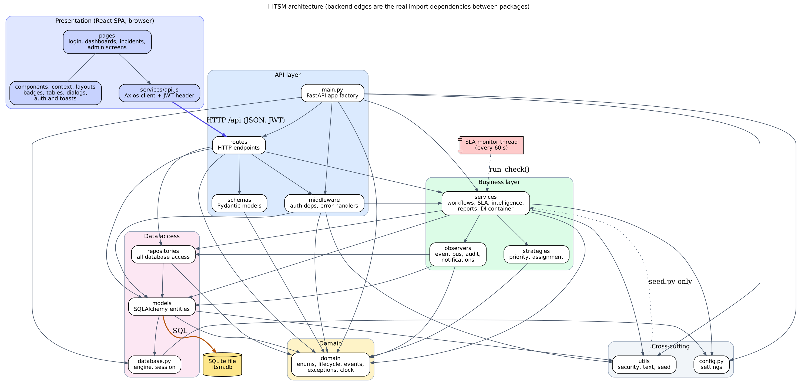{width=100%}
<!-- /landscape -->

<!-- landscape -->
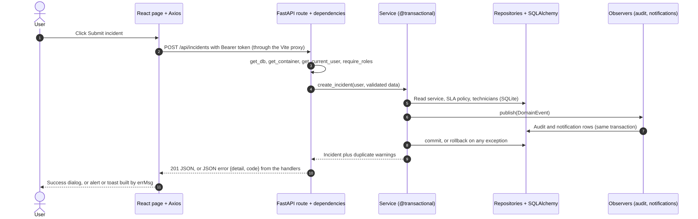{width=100%}
<!-- /landscape -->

The choice of each technology was driven by how well it fitted this flow. The five criteria below were used for every layer. They are the team's own judgement, not a benchmark.

* **Fit with the requirements:** typed validation, role-based access, a strict lifecycle, SLA arithmetic, audit.
* **Support for object-oriented design:** real abstract classes, inheritance, polymorphism and composition, because the course assesses OOP.
* **Testability:** the whole back end must be testable without a browser or a running server.
* **Zero-install on student computers:** the evaluator must be able to run it on Windows with only Python and Node.
* **A believable growth path:** each choice must have a documented way to scale (Section 2.12).

## 2.2 Programming languages: Python and JavaScript

**Role.** Python 3.11 or later (3.13 in the verification runs) holds all business logic. JavaScript (ES2022 with JSX) runs in the browser.

**Why Python suits I-ITSM.** The domain is rule heavy: priority bands, a lifecycle with eight states, SLA deadlines, eligibility rules for technicians. Python lets these rules be written close to the wording of the specification, which makes them reviewable by people who are not Python experts. It has the object model the course asks for without ceremony: abstract base classes (`abc.ABC`) for `PriorityStrategy`, `AssignmentStrategy`, `IncidentState`, `NotificationChannel`, `EventObserver` and `Clock`; `dataclass` (some frozen) for values that travel between layers such as `PriorityResult`, `TransitionRule` and `Recommendation`; `Enum` for statuses, priorities and roles; properties for controlled access; and decorators, used for the `@transactional` unit-of-work wrapper. Type hints are used throughout (`Mapped[...]`, `Optional[...]`) and are consumed by SQLAlchemy and FastAPI at run time, so they are more than documentation.

**How it is used with the other layers.** Python type hints on route parameters and Pydantic models become validation rules and the OpenAPI document at `/docs`. The same models and services are imported directly by the tests, so a unit test and an HTTP test exercise identical code.

**Advantages.** One language for every server-side concern, a very short path from specification to code, a rich standard library (`threading` for the SLA monitor, `datetime`, `logging`), and a mature test tool (pytest).

**Limitations.** Python is dynamically typed, so a wrong type is found at run time unless a test or a validator catches it. No static type checker is part of the delivered tooling, so the type hints are not checked by a tool, and the 264 tests carry that responsibility. The global interpreter lock means that CPU-bound work does not use several cores in one process. I-ITSM has no CPU-bound work (its heaviest operations are SQL queries and short loops over candidates), so this does not matter at the present scale.

**Alternatives.** Java with Spring Boot offers static typing and a strong OOP tradition, but it needs a JDK and a build tool, more boilerplate for the same rules and a second language for tooling. C# with ASP.NET offers similar strengths but binds the team to the .NET toolchain. Node.js with TypeScript would give one language on both sides, but TypeScript classes and the Node validation ecosystem were less familiar to the team than Python's `abc` and dataclasses for a course that grades classical OOP. Go was rejected because it has no classes or inheritance, which would work against the assessed concepts.

JavaScript is the only language that runs natively in a browser. TypeScript was not used because it adds a compile step and typing effort that the screen logic of this project did not need. This is a trade-off: it means mistakes in props and API shapes are not caught by a compiler on the front end.

## 2.3 Front end: React, Vite, React Router, Axios, Recharts

**Role.** The front end is a single-page application with role-specific navigation: employees report and follow incidents, technicians work their queue, administrators configure and monitor.

**Why React.** The interface is made of many small, repeated pieces: badges for priority, status and SLA state, tables, cards, modal dialogs, form fields. React's component model expresses this directly. The shared pieces live in `components/ui.jsx` (`Card`, `Field`, `Alert`, `Modal`, `ConfirmDialog`, `Async`, `PriorityBadge`, `StatusBadge`, `SlaBadge`) and are reused by the 18 page files in `pages/`. A component is a unit with its own state and public properties, which is the same encapsulation idea as in the back end.

**Frontend architecture.** `main.jsx` mounts `App.jsx`, which declares the routes. `layouts/AppLayout.jsx` draws the sidebar, whose links depend on the role. `components/ProtectedRoute.jsx` redirects an unauthenticated visitor to `/login` and a visitor with the wrong role to the dashboard. Pages fetch their data through a small hook `useAsync` (in `utils.js`) and render it through `Async`, which shows a spinner, an error state with a retry button, or the content. `useDebounced` delays the live calls made while the employee types.

**State management.** The application deliberately has no global store such as Redux. State has three levels. Server data is fetched per page and held in the page. Form state is local (`useState`). Only two things are truly global and each has a React context: `AuthContext` (current user, login, logout) and `ToastContext` (notifications). This is enough because no screen needs another screen's data in memory, and every page re-reads the server, which is the single source of truth. A global store would add concepts without removing any code. The trade-off is that data is fetched again on navigation, which is acceptable for this size.

**API communication.** `services/api.js` creates one Axios instance with the base URL `/api` and a 20 second timeout. A request interceptor adds the `Authorization: Bearer` header from `localStorage`. A response interceptor calls the logout handler on any 401 except from the login call itself. The function `errMsg` turns every failure into one readable sentence (Section 3.5). The pages never build URLs or headers themselves.

**Server-authoritative calculation.** The priority shown while the employee fills in the form is not computed in JavaScript. The page calls `POST /api/intelligence/preview-priority` and displays what the server returns, so the preview cannot disagree with the value that is stored. The same applies to category suggestion and duplicate checks. This avoids a classic defect, the same rule written twice in two languages.

**Vite.** Vite serves the application during development with fast reloads and proxies `/api` to the back end (`vite.config.js`), which removes cross-origin problems while developing. `npm run build` produces static files.

**Recharts and lucide-react.** Recharts draws the dashboard and report charts from live data. lucide-react supplies icons.

**Advantages.** Small bundle of concepts, a large ecosystem, reusable components, and no duplicated business rules.

**Limitations.** There are no automated front-end tests. Types are not checked (plain JavaScript). The token is kept in `localStorage`, which is readable by any script running on the page, so a cross-site scripting flaw would expose it (Section 4.6). The application was exercised in Chromium only. Four `npm audit` advisories remain open because fixing them needs major version upgrades.

**Alternatives.** Angular is a complete framework with built-in dependency injection and TypeScript, but its learning curve and boilerplate are larger than this scope needs. Vue is comparable and would also have worked, React was chosen for the larger ecosystem for charts and routing. Server-rendered pages (for example Jinja2 templates) would remove the front-end build but would make the live priority preview, duplicate warnings and countdowns clumsy. Flutter for the web has a heavy runtime and weaker document semantics.

## 2.4 Back end: FastAPI, Uvicorn, Pydantic, SQLAlchemy, PyJWT, bcrypt

**Role.** The back end exposes a REST API (63 operations on 52 paths under `/api`, plus `/health`), enforces every rule, persists data and runs the background SLA monitor.

**Why FastAPI.** FastAPI turns type-annotated Python into validated endpoints and publishes a live OpenAPI description at `/docs`, which was also used to check the API by hand. Three of its features fit I-ITSM's design directly:

* *Dependency injection with `Depends`.* In `middleware/dependencies.py`, `get_db` opens and closes a session per request, `get_container` builds the service container for that session, `get_current_user` authenticates, and `require_roles(*roles)` is a dependency factory that returns a role check. A route is secured by naming one dependency, for example `Depends(require_admin)`.
* *Pydantic models for input.* The schemas in `schemas/` (for example `title: str = Field(min_length=5, max_length=200)`, `impact: int = Field(ge=1, le=5)`) reject bad input with HTTP 422 before any service runs.
* *Exception handlers.* `middleware/errors.py` registers handlers so that every failure leaves the API in one JSON shape.

**Request handling and separation of business logic.** Routes in `routes/` are thin: they declare the contract, receive the validated data and call one service method. Services in `services/` (for example `IncidentService`, `AssignmentService`, `SlaService`, `AuthService`) hold all rules and know nothing about HTTP. Repositories in `repositories/` hold all queries and know nothing about rules. The domain package (`domain/`) holds the lifecycle, enums, events, the clock and the exceptions, and imports nothing from the web layer. Because of this, the tests call services directly as well as through HTTP, and the front end could be replaced without touching a rule.

**Dependency management.** `build_container` (in `services/container.py`) wires one set of repositories, services and observers per database session. Nothing is a global singleton except the settings object and the engine. The application is created by a factory, `create_app(settings, session_factory, clock, ...)`, so the tests build an application with an in-memory database, a controllable clock and the monitor switched off. `requirements.txt` lists libraries with minimum versions (for example `fastapi>=0.110`), so a fresh install resolves newer versions. This was tested with the versions resolved on 19 November 2026 (FastAPI 0.165.0, SQLAlchemy 2.1.9, Pydantic 2.x, PyJWT 2.15.1, bcrypt 5.0.0). The limitation is that versions are not pinned, so a future install may differ. Pinning with a lock file is a recommended improvement.

**Uvicorn.** An ASGI server that runs the application. In the course setting it runs as one process.

**SQLAlchemy 2.x.** Object-relational mapping with typed `Mapped[...]` columns, relationships and cascade rules. It also supplies the event hooks used to make the audit table append-only, and parameterised queries for every access.

**PyJWT and bcrypt.** PyJWT signs and verifies the access tokens (HS256). bcrypt hashes passwords with a per-password salt and a configurable cost (12 rounds by default).

**The background SLA monitor.** `services/sla_monitor.py` starts a daemon thread from the application's lifespan handler. It evaluates every open incident once at start and then every 60 seconds (configurable), and it never dies on an error. A single process is assumed (Section 2.12).

**Advantages.** Strong validation with little code, automatic API documentation, injection that matches the layering, and easy testing with the FastAPI test client.

**Limitations.** The ecosystem is younger than Django's, and there is no built-in admin site, migration tool or user management (the project wrote what it needed). The synchronous SQLAlchemy sessions are used inside ordinary functions, which FastAPI runs in a thread pool, so the code does not use `async` database access. Unpinned dependency versions are noted above.

**Alternatives.** Django REST Framework brings an admin site and an ORM that the project would partly bypass, because the domain model is deliberately independent of the framework, and its ORM is less explicit than SQLAlchemy's for the repository pattern. Flask is minimal but has no built-in validation or dependency injection, so the team would have had to assemble both. Spring Boot is excellent but adds a second toolchain. Express or NestJS on Node would be a reasonable alternative that was not chosen for the language reasons in Section 2.2.

## 2.5 Database: SQLite through SQLAlchemy

**Role.** SQLite stores the fifteen tables of the system in one file (`backend/itsm.db`, created on first start and excluded from version control).

**Why SQLite for I-ITSM.** It is a real relational database. The project uses its foreign keys (enforced by `PRAGMA foreign_keys=ON`, switched on for every connection in `database.py`), unique constraints, check constraints (for example `impact BETWEEN 1 AND 5`), composite keys and indexes. Nothing has to be installed, so the evaluator can run the system on any computer, and the test suite can create a fresh in-memory database for every test (using `StaticPool`). The data is relational by nature (incidents, users, services, skills, SLA policies, audit records), which fits SQL much better than documents. The expected load for the course, one service desk with tens of concurrent users, is within what SQLite can serve.

**How it interacts with the other layers.** Only repositories talk to the session. A custom column type, `UTCDateTime` (in `database.py`), stores naive UTC and always returns timezone-aware values, which removes a common class of time-zone errors from the SLA arithmetic. `init_db` creates the tables and runs a small additive migration (`_add_missing_nullable_columns`) so that an older database file gets new nullable columns after an upgrade. A test covers this.

**Advantages.** Zero installation, one file to back up or reset, a fast test cycle, full SQL integrity features.

**Limitations.** SQLite allows one writer at a time. Request threads and the SLA monitor thread write to the same file, so under heavy write load a "database is locked" error is possible, which the application would report as `DATABASE_ERROR` (Section 3.2). Write-ahead logging is not enabled in the delivered code. There are no database users or roles, no encryption at rest, and no migration tool such as Alembic, only the additive migration above. These limits are the reason PostgreSQL is the first scaling step.

**Alternatives.** PostgreSQL is the right production target (concurrent writers, roles, rich types, replication) but requires an installer and a running server on every student computer. MySQL has similar properties. MongoDB would fit the incident's free text well but fits relational integrity, joins for reports and foreign keys poorly. An in-memory store would lose data on restart, which the brief does not allow.

## 2.6 Architecture: a layered monolith with patterns at the points of change

**Choice.** One deployable application with five layers: routes, services, domain, repositories, models. Patterns are placed where change is expected, not everywhere.

**Table 2.1: Design patterns and the change each one isolates**

| Change that is expected | Pattern used | Where |
|------------------------------|---------------------|----------------------------|
| A different priority formula or assignment rule | Strategy | `strategies/priority.py`, `strategies/assignment.py`, `StrategyFactory` |
| Behaviour that depends on the incident's status | State | `domain/lifecycle.py` (`IncidentState`, eight state classes, `StateFactory`, `LifecycleManager`) |
| New reactions to events (audit, notifications, later others) | Observer | `observers/` (`EventBus`, `AuditObserver`, `NotificationObserver`) |
| A new notification channel | Strategy with a factory | `observers/channels.py` (`NotificationChannel`, `InAppChannel`, `SimulatedEmailChannel`, `ChannelFactory`) |
| A different database or query | Repository | `repositories/` (`BaseRepository`) |
| How objects are built and connected | Factory and dependency injection | `IncidentFactory`, `new_user`, `build_container`, FastAPI `Depends` |
| All-or-nothing workflows | Unit of work (decorator) | `@transactional` in `services/base.py` |

**Why a monolith, not microservices.** The domain is one cohesive workflow (report, classify, assign, work, resolve, verify) with strong consistency needs: the audit row, the state change and the notifications must commit together. Splitting it would introduce distributed transactions to solve a scaling problem the system does not have, with a team of three and a course deadline. Alternatives considered were a server-rendered MVC application (simplest, but a weaker fit for live previews), a hexagonal architecture with ports and adapters (close to what was built, but with more interfaces than the size justifies), and event sourcing (powerful for audit but heavy). The layered design keeps clean seams, so any of them remains possible later.

## 2.7 Comparison of the selected technologies with realistic alternatives

<!-- landscape -->
**Table 2.2: Selected technologies against realistic alternatives, with the selection criteria and the justification**

| Layer | Selected | Realistic alternatives | Deciding criteria | Justification |
|--------|---------|-----------------|--------------------|-----------------------------|
| Language (server) | Python 3.11+ | Java, C#, Node.js with TypeScript, Go | OOP support, readability of rules, testability, installation effort | ABCs, dataclasses, enums and decorators express the required patterns directly. Rules read like the specification. pytest is fast. Go has no inheritance. Java and C# need heavier toolchains |
| Web framework | FastAPI | Django REST Framework, Flask, Spring Boot, Express | Validation, dependency injection, API documentation, fit with a framework-independent domain | Typed validation, `Depends` matching the layered design, live OpenAPI. Django's ORM and admin would be partly bypassed. Flask lacks validation and injection |
| ORM | SQLAlchemy 2 | Django ORM, raw SQL, Peewee | Explicit mapping, repository fit, event hooks, database portability | Typed mappings, explicit sessions for the unit of work, events used to protect the audit table, portable to PostgreSQL |
| Database | SQLite | PostgreSQL, MySQL, MongoDB | Relational integrity, zero install, test speed, growth path | Real SQL with foreign and check constraints and no installation. PostgreSQL is the planned next step. A document store does not fit the relational data |
| Front end | React 18 with Vite | Angular, Vue, server-rendered pages, Flutter web | Component reuse, ecosystem for charts and routing, build speed, live server previews | Many small repeated components, large ecosystem, fast development server, simple API calls |
| State management | Local state plus two contexts | Redux, Zustand, a query library | Amount of shared state, simplicity | Almost no cross-screen state, the server is the source of truth. A store would add concepts without removing code |
| Authentication | JWT bearer tokens (HS256), bcrypt | Server sessions, OAuth 2 or OpenID Connect, Argon2 | Single-page application fit, no external provider, simplicity | Stateless tokens suit a separate front end. OAuth needs an identity provider which is out of scope. bcrypt is established and available as a wheel |
| Intelligence | Rule-based scoring and token similarity | Machine learning, an external AI service | Explainability, no training data, offline operation | Every suggestion shows its reason, results are deterministic and testable |
| Architecture | Layered monolith with patterns | Microservices, hexagonal, event sourcing | Consistency, team size, risk | One transaction covers state, audit and notification. Seams allow later splitting |
<!-- /landscape -->

**Table 2.3: Qualitative suitability of the main alternatives (team judgement against the criteria of Section 2.1, not a measurement)**

| Option | Requirement fit | OOP support | Testability | Zero install | Growth path |
|---------------------|--------|--------|--------|--------|--------|
| FastAPI with SQLAlchemy | High | High | High | High | Medium to high |
| Django REST Framework | High | Medium | High | High | High |
| Flask with extensions | Medium | Medium | Medium | High | Medium |
| Spring Boot | High | High | High | Low | High |
| Express with a Node ORM | Medium | Low to medium | Medium | High | Medium |

## 2.8 Advantages and limitations of the chosen stack

**Table 2.4: Advantages and limitations of the stack as a whole**

| Aspect | Advantage in I-ITSM | Limitation, and how far it matters |
|--------------|----------------------------|----------------------------------------|
| Productivity | One language per tier, little boilerplate, automatic API documentation | None for this size |
| Correctness | Input validated at the edge, a database that enforces keys and ranges, 264 automated tests, 94.8 percent line coverage of the back end | Python is dynamically typed, no static type checker is run. No front-end tests |
| Portability | Runs on Windows, macOS and Linux with Python and Node only | Verified on Linux, and the automated suite was run once on Windows (TC-30, 20 November 2026). macOS was not tested |
| Operations | One process, one database file, easy to reset and seed | A single process, a single writer, and an in-process SLA monitor |
| Security | Server-side checks, hashed passwords, signed tokens, an append-only audit table | Token in `localStorage`, no rate limiting, no HTTPS in the development setup (Chapter 4) |
| Maintainability | Business rules only in services and domain, patterns at the points of change | Dependency versions are not pinned |
| Scalability | Stateless tokens, repository seam, event-driven side effects | Needs the changes in Section 2.12 before substantial growth |

## 2.9 How the technology supports object-oriented design

Python and SQLAlchemy do not only permit OOP, the delivered code relies on it. Table 2.5 ties each principle to classes that exist in the source.

**Table 2.5: Object-oriented principles and where they appear in the code**

| Principle | Where it appears | How the technology supports it |
|------------|------------------------------------------|----------------------------|
| Encapsulation | `User` keeps its hash in the private-by-convention attribute `_password_hash` (column `password_hash`) and exposes only `set_password` and `check_password`. `EventBus` keeps `_observers` private and exposes `subscribe`, `unsubscribe` and a read-only copy through a property. `SlaMonitor` hides its thread and stop event behind `start`, `stop` and `is_running` | Python properties and naming conventions, SQLAlchemy `mapped_column` with a different column name, Pydantic response models that never include the hash |
| Abstraction | `PriorityStrategy`, `AssignmentStrategy`, `IncidentState`, `NotificationChannel`, `EventObserver` and `Clock` are abstract base classes that define a contract and hide the algorithm | `abc.ABC` and `@abstractmethod`: a subclass that omits a method cannot be created |
| Inheritance | `AppError` is the root of a tree: `AuthenticationError`, `PermissionDeniedError`, `NotFoundError` (with `IncidentNotFoundError`, `ServiceNotFoundError`), `ConflictError` (with `DuplicateResourceError`, `InvalidTransitionError`, `TechnicianUnavailableError`, `WorkloadExceededError`, `MissingSkillError`), `InvalidInputError`, `MissingSlaConfigurationError` and `DatabaseUnavailableError` (defined, but the 503 response is produced by the SQLAlchemy handler, not by raising this class). The eight state classes extend `IncidentState`. Services extend `BaseService`. Repositories extend `BaseRepository` | Class inheritance with class attributes (`status_code`, `code`) overridden per subclass, so one handler serves the whole tree |
| Polymorphism | The lifecycle manager calls the same methods on whichever state object the incident has. The incident service calls `strategy.calculate(...)` or `strategy.rank(...)` without knowing which concrete strategy is configured. The notification observer sends through `NotificationChannel.send` whether the channel is in-app or simulated e-mail | Duck typing and abstract methods. The concrete class is chosen at run time by a factory using a setting stored in the database |
| Composition | `Container` is composed of the repositories, an event bus and eleven services and helper objects. `IncidentService` is composed of `SlaService`, `AssignmentService`, `IntelligenceService` and `SettingsService`. `EventBus` holds a list of observers. `Incident` owns a `Resolution` and a feedback record through relationships | Constructor injection, dataclasses, and SQLAlchemy relationships with cascade rules |
| Interfaces | The abstract base classes above act as interfaces. `EligibilityPolicy` and `AffectedUsersPolicy` are small collaborating objects with one job each | `abc` contracts and duck typing (Python has no `interface` keyword, so the abstract classes are the interfaces) |
| Single responsibility | Routes translate HTTP, services apply rules, repositories query, observers react, schemas validate | Package structure and FastAPI's separation of routing from dependency resolution |

**Design patterns implemented.** State, Strategy, Observer, Repository, Factory (`StateFactory`, `StrategyFactory`, `ChannelFactory`, `IncidentFactory`, `new_user`), dependency injection (`Container` and `Depends`), and a unit-of-work decorator (`@transactional`). No pattern is claimed that was not found in the code. The class diagrams in `docs/diagrams/` are generated from the same source and checked automatically (1,666 checks, no problems).

## 2.10 Authentication, validation and access control as technology choices

The security technologies are chosen to be small and standard: FastAPI's `HTTPBearer` scheme extracts the token, PyJWT verifies it, bcrypt checks passwords, Pydantic validates input and SQLAlchemy's parameter binding protects queries. Chapter 4 documents what each one does, where, and what it does not do.

## 2.11 Concurrency and the background monitor

A server request runs in one thread with its own database session. The SLA monitor runs in a separate daemon thread with its own session, and both go through the same engine. Each unit of work commits or rolls back as a whole. A uniqueness constraint (`uq_violation_once` on `incident_id` and `sla_type`) guarantees that a violation is recorded only once even if the monitor runs again or several monitors run. This is the reason the single-monitor limitation is harmless to correctness but wasteful.

## 2.12 How the system would evolve with many more users

The proposals are in three tiers. **None is implemented.** The first tier needs no new component. The second changes the deployment. The third changes the architecture and should only be done when the measurements justify it. The triggers are indicators to measure, not thresholds that were tested.

<!-- landscape -->
**Table 2.6: Scalability proposals, grouped by the size of the change**

| Tier | Change | Problem it addresses | Effort and risk | Indicator that it is needed |
|----|------------------------------------|-------------------------------|------------------------|------------------------------|
| 1. Within the current architecture | Enable SQLite write-ahead logging and a busy timeout in the connection hook | Readers blocked by the writer, "database is locked" under mixed load | A few lines in `database.py`, low risk | `DATABASE_ERROR` responses or slow lists while the monitor runs |
| 1 | Add indexes after inspecting query plans for the filters used by the incident search (12 criteria). The audit and notification tables already have composite indexes | Slow search and report queries as rows grow | Low risk, needs measurement | Search or report requests slower than the team's target |
| 1 | Keep paginating every list (already done for incidents and audit) and add limits to the report queries | Large responses | Low | Response size or time growing with data |
| 1 | Cache rarely changing reference data (categories, services, settings) inside the process and invalidate it on an administrator change | Repeated identical reads | Low to medium, must invalidate correctly | High read volume on reference data |
| 1 | Serve the built front end as static files from a web server or CDN instead of the Vite server | The development server is not for production | No code change | Any real deployment |
| 2. Deployment changes | Move to PostgreSQL with Alembic migrations. The models and repositories stay, the connection string changes and the database-specific hook is removed | One writer, no roles, no replication | Medium: data migration and testing of date and enum handling | Sustained concurrent writes, or the need for backups and roles |
| 2 | Run several stateless API instances behind a load balancer. Tokens carry no server state, so no session store is needed | CPU and connection limits of one process | Medium: needs PostgreSQL first, because several processes make SQLite write contention worse | One process saturated |
| 2 | Run the SLA monitor as one scheduled worker (or with a leader lock) instead of one thread per process | Duplicate monitors, wasted queries | Medium | More than one API process |
| 2 | Put notification delivery behind a queue and add real SMTP, SMS or push adapters behind `NotificationChannel` | Slow or failing external delivery blocking requests, e-mail is only simulated today | Medium: the channel abstraction already isolates this | The first real e-mail integration |
| 2 | Add token refresh and a revocation list, rate limiting and HTTPS termination at a gateway | Stolen tokens, brute force (Chapter 4) | Medium | Any internet-facing deployment |
| 2 | Central logging, metrics and health checks beyond the existing `/health` | Operating several instances blind | Medium | Several instances |
| 3. Architectural change | Split reporting into a read replica or a separate analytical store | Heavy reports competing with transactions | High | Reports slow down incident handling |
| 3 | Split notifications and the SLA engine into services driven by an event stream. They are already event driven through `EventBus` | Independent scaling and failure isolation | High: gives up the single transaction for audit and state | Teams or load that justify the complexity |
| 3 | Use a search engine or learned similarity for duplicate and category suggestions | Keyword matching does not understand unseen vocabulary | High, accuracy must be measured | Poor suggestion quality at scale |
| 3 | Multi-tenancy and high-availability database | Several organisations on one deployment | High | A product rather than a project |
<!-- /landscape -->

What does not need to change: the layering, the repositories, the stateless token design, the strategy and observer seams, and the test suite, which would be the safety net for every step above.


# Chapter 3: Exception and Error Handling

## 3.1 The mechanism

Errors are handled in four places, each with one job.

1. **Validation at the edge.** Pydantic schemas reject malformed input with HTTP 422 before a service runs. Custom `field_validator` functions add rules such as trimming text and requiring a letter and a digit in a password.
2. **Domain exceptions.** Services raise exceptions from one hierarchy rooted in `AppError` (`domain/exceptions.py`). Every class carries an HTTP `status_code` and a stable machine-readable `code`, so the web layer never needs a long chain of `if` statements. Messages are written for people and never contain internals.
3. **Central handlers.** `middleware/errors.py` registers handlers that convert every exception into the same JSON body `{"detail": "...", "code": "..."}`. There are separate handlers for `AppError`, request validation errors (which add a per-field `errors` list), framework HTTP errors, SQLAlchemy `IntegrityError` (409 `CONFLICT`), other `SQLAlchemyError` (503 `DATABASE_ERROR` when the database cannot be reached, otherwise 500) and a last-resort handler for any other exception (500 `INTERNAL_ERROR`, with the stack trace written to the log only).
4. **Transactions.** `@transactional` (in `services/base.py`) commits a multi-step operation only when it finishes, and rolls everything back when any exception escapes. A rejected request therefore leaves no half-written data. Test TC-14 and TC-17 check that the incident and the audit trail are unchanged after a refusal.

## 3.2 The twelve scenarios of the brief

<!-- landscape -->
**Table 3.1: The error scenarios required by the course brief and how each is handled**

| Error scenario | Where it is handled | Mechanism | Expected system behaviour | Status |
|-------------|-----------------------|----------------------------|-----------------------------|---------------------|
| Invalid login | `AuthService.login` in `services/auth_service.py`, route `POST /api/auth/login`, `pages/Login.jsx` | `AuthenticationError`, status 401, code `AUTHENTICATION_FAILED`. The same message is given for an unknown e-mail and a wrong password, so accounts cannot be probed. A deactivated account is refused with its own message. Every failure is audited as `USER_LOGIN_FAILED` | HTTP 401 with no token. The login page shows the message in a red alert. The failed attempt appears in the audit log | **Implemented.** Automated: TC-10, and `test_failed_login_is_audited` |
| Unauthorized operation | `require_roles` in `middleware/dependencies.py` on the routes. Record-level checks inside services (for example `IncidentService` access check, `UserService` own-account checks). Front end: `ProtectedRoute.jsx` | `PermissionDeniedError`, 403, `PERMISSION_DENIED`. A missing, malformed or expired token raises `AuthenticationError` (401) | The operation is refused and nothing changes. Hiding a menu item is only a convenience, the server decides | **Implemented.** Automated: TC-18, TC-19, TC-20, TC-21 and the use-case matrix |
| Invalid incident | `IncidentService` lookup by incident number | `IncidentNotFoundError`, 404, `INCIDENT_NOT_FOUND`. An incident that exists but is outside the caller's scope returns 403, which confirms that the number exists but reveals nothing else | HTTP 404 with a message. The detail page shows an error state with a retry button | **Implemented.** Automated: `test_unknown_incident_returns_404` |
| Invalid state transition | `LifecycleManager.transition` in `domain/lifecycle.py`, called by `IncidentService.transition` | `InvalidTransitionError`, 409, `INVALID_STATE_TRANSITION`. Allowed moves are a table of `TransitionRule` objects with the actor kinds permitted | HTTP 409, incident and audit trail unchanged. The detail page only offers the moves that are allowed, so the interface cannot normally send an illegal one | **Implemented.** Automated: TC-14 (every disallowed pair of states is tried) |
| Technician unavailable | `AssignmentService.ensure_assignable` in `services/assignment_service.py` | `TechnicianUnavailableError`, 409, `TECHNICIAN_UNAVAILABLE`, for an inactive, unavailable or non-technician user. An administrator override does not bypass this check | HTTP 409. In automatic assignment the technician is simply not among the eligible candidates and the reason is listed | **Implemented.** Automated: TC-04, TC-15 |
| Technician workload exceeded | `AssignmentService.ensure_assignable` and `EligibilityPolicy` | `WorkloadExceededError`, 409, `TECHNICIAN_WORKLOAD_EXCEEDED`. A related `MissingSkillError` (`TECHNICIAN_MISSING_SKILL`) covers a missing skill. An administrator can override both explicitly and the override is audited | HTTP 409 without the override. With it, HTTP 200 and an audit entry that names the override | **Implemented.** Automated: TC-16 |
| Service not found | `IncidentService` when creating or editing an incident | `ServiceNotFoundError`, 404, `SERVICE_NOT_FOUND`. An inactive service is treated as not found | HTTP 404. The report form only lists active services, so the case arises only from a direct API call | **Implemented.** Automated: `test_priority.py` (service 999), TC-02 setup |
| Missing SLA configuration | `SlaService.select_policy` in `services/sla_service.py` | `MissingSlaConfigurationError`, 422, `MISSING_SLA_CONFIGURATION` | HTTP 422 with a message telling the user to ask an administrator. The incident is not saved, so none exists without deadlines | **Implemented.** Automated: TC-17 |
| Duplicate incident | `IntelligenceService.find_duplicates` (Jaccard similarity of words, threshold 0.45) called from `IncidentService.create`. Other duplicates (e-mail address, category, service or team name) are rejected by services | For incidents: a **warning**, not an error. The event `DUPLICATE_DETECTED` is audited and the response lists candidates. For names and e-mail addresses: `DuplicateResourceError`, 409, `DUPLICATE_RESOURCE` | Business rule BR-14 says detection must only warn, never block, merge or close. The employee sees a "Possible duplicates" panel and may continue. A new incident is still created. A duplicate account or configuration name is refused with HTTP 409 | **Implemented as designed, but by warning.** If the evaluators expect a refusal of a duplicate incident, this is a deliberate difference. Automated: TC-26 and `test_registration_rejects_duplicate_email_and_weak_password` |
| Database failure | Handlers in `middleware/errors.py`. `@transactional` rolls back. `/health` reports `database` true or false | `OperationalError` gives 503 `DATABASE_ERROR`. `IntegrityError` gives 409 `CONFLICT`. Any other `SQLAlchemyError` gives 500 `DATABASE_ERROR`. Details are logged, not returned | A generic message that asks the user to try again, no SQL or path in the response, no partial data. Observed in a probe run on 19 November 2026 with the `incidents` table renamed: HTTP 503 with code `DATABASE_ERROR` | **Implemented.** No test in the suite exercises it, the probe was a one-off check and is not counted as a test case |
| Network failure | Browser side only: the Axios client (`services/api.js`, timeout 20 seconds) and `errMsg`. Server side there is no external network call (e-mail is simulated) | `errMsg` returns "Cannot reach the server" when no response arrives and "The server took too long to respond" on timeout. Pages show the text in an `Alert`, a toast or the `ErrorState` panel | The user sees a sentence and the page stays usable. Nothing is retried automatically and no work is queued offline | **Partially implemented.** See the finding below. TC-29 is documented but not executed |
| Invalid user input | Pydantic schemas in `schemas/`, validators in `schemas/common.py`, `InvalidInputError` in services, inline checks in `CreateIncident.jsx` and the other forms | HTTP 422 with code `VALIDATION_ERROR` (with a list of fields) or `INVALID_INPUT` | The response names each offending field. The form shows the message under the field and does not send the request when the rule is checkable in the browser | **Implemented.** Automated: TC-09, TC-11, TC-12, TC-13 |
<!-- /landscape -->

**Finding on network failure.** During development the browser talks to the Vite server, which forwards `/api` to the back end. When only the back end is stopped, the Vite proxy itself answers with HTTP 500 and an empty plain-text body (observed on 19 November 2026). `errMsg` then has a response but no JSON, so it shows "Request failed (500)." and not the clearer "Cannot reach the server" sentence. That sentence appears only when the browser receives no response at all, for example when the front-end server is also stopped while the page is still open, or in a deployment without the proxy. The behaviour is acceptable (an error is shown, no blank page) but it is less helpful than intended, and the delivered code was not changed for this report. A one-line improvement would be to treat a non-JSON 5xx answer as "cannot reach the server". The screenshot checklist (SS-28 and SS-29) shows both cases.

**Finding on duplicates.** The brief lists "duplicate incident" among the error scenarios. The design decision of the team, written as business rule BR-14 and tested in TC-26, is that an incident that looks like a duplicate is accepted and flagged, because a wrong refusal could silence a real outage. The detection is keyword based, so it can miss duplicates written with different words.

## 3.3 HTTP status codes used

**Table 3.2: Status codes and their meaning in I-ITSM**

| Code | Meaning in this system | Typical `code` values |
|------|------------------------------------|--------------------------------|
| 200, 201 | Success, and creation of a resource (incident, note, feedback, user, configuration item) | none |
| 401 | Missing, invalid or expired token, wrong credentials, deactivated account | `AUTHENTICATION_FAILED` |
| 403 | Authenticated, but not allowed for this role or this record | `PERMISSION_DENIED` |
| 404 | The incident, service, user or policy does not exist | `INCIDENT_NOT_FOUND`, `SERVICE_NOT_FOUND`, `NOT_FOUND` |
| 409 | The request conflicts with the current state or data: illegal transition, technician unavailable or full, duplicate name, database constraint | `INVALID_STATE_TRANSITION`, `TECHNICIAN_UNAVAILABLE`, `TECHNICIAN_WORKLOAD_EXCEEDED`, `TECHNICIAN_MISSING_SKILL`, `DUPLICATE_RESOURCE`, `CONFLICT` |
| 422 | Input fails validation, or the system is not configured for the request | `VALIDATION_ERROR`, `INVALID_INPUT`, `MISSING_SLA_CONFIGURATION` |
| 500 | Unexpected failure (generic message, details only in the log) | `INTERNAL_ERROR`, `DATABASE_ERROR` |
| 503 | The database cannot be reached | `DATABASE_ERROR` |

## 3.4 Front-end error handling

* `errMsg(error)` in `services/api.js` is the single translator. It reads `detail`, appends the per-field messages when present, and falls back to "Request failed (status)." when the body is not JSON.
* Forms keep an `error` state shown by `Alert` and per-field `errors` shown under the field. The report form checks title length (5 to 200), description length (10 to 5000) and the service before sending.
* `Async` and `ErrorState` display a failed load with a retry button instead of a blank page. Action failures use toasts from `ToastContext`.
* A 401 from any call except login runs the logout handler, which clears the token and returns the user to the sign-in page.
* There is no React error boundary, so an unexpected rendering exception would blank the page. This is a limitation. It has not been observed in the manual checks.

## 3.5 Limitations of error handling

* The database failure and network failure paths are not covered by automated tests (the first was checked once by a probe, the second by TC-29 which is not executed).
* There is no automatic retry, circuit breaker or offline queue.
* Errors are logged to the console through the standard `logging` module, with no central log store or alerting.
* The generic `INTERNAL_ERROR` page gives the user no reference number to quote to support.

# Chapter 4: Security Analysis

## 4.1 Summary

Table 4.1 lists each mechanism, where it lives and what it does not do. Section 4.7 separates what exists from what is only recommended.

<!-- landscape -->
**Table 4.1: Security mechanisms in the delivered code**

| Area | What is implemented | Where | Limitations |
|----------|------------------------------------------|---------------------------|------------------------------------|
| Authentication | E-mail and password login. A successful login returns a signed JSON Web Token. Every protected endpoint requires `Authorization: Bearer <token>`. Unknown e-mail and wrong password give the same message. Failed and successful logins are audited | `services/auth_service.py`, `routes/auth.py`, `middleware/dependencies.py` (`get_current_user`) | No multi-factor authentication, no password reset by e-mail, no account lockout or rate limiting, so repeated guessing is not slowed |
| Token handling | HS256 signature with a secret from configuration, claims `sub` (user id), `role` and `exp`. Lifetime 60 minutes by default. Expired and tampered tokens give 401. The user is re-read from the database on every request and the role used for authorisation is the database role, not the claim, so a deactivated user is refused at once even with a valid token | `utils/security.py`, `config.py` | No refresh token and no revocation list. Logout only deletes the token in the browser, an already issued token stays valid until it expires |
| Password protection | bcrypt with a random salt per password and cost 12 (configurable). Passwords are limited to the first 72 bytes (a bcrypt property) cut explicitly. Rule: 8 to 128 characters with at least one letter and one number. The hash is stored in a private attribute and never appears in any response schema (`UserOut` has no password field) | `utils/security.py`, `schemas/common.py`, `models/user.py` | No check against lists of breached passwords. No password expiry or history |
| Role-based authorisation | Three roles (employee, technician, administrator). `require_roles` protects routes. Services add record-level rules: an employee sees only their incidents, a technician only the ones assigned to them or in the queue, the administrator everything. Public registration always creates an employee. The role cannot be sent by the client at registration. The matrix of use cases and roles is tested | `middleware/dependencies.py`, `services/incident_service.py`, `services/user_service.py`, `tests/test_use_case_matrix.py` | Roles are fixed in code, there are no custom permissions. The front-end route guard is cosmetic and is not security |
| Input validation | Length, range and format limits on every body (for example title 5 to 200, description 10 to 5000, ratings 1 to 5, users up to 1,000,000), e-mail format checked by `email-validator`, text trimmed, unknown enumeration values refused. Query parameters for filters are parsed and validated | `schemas/*.py` | Validation is structural. There is no malware or content scanning (no file upload exists) |
| Injection protection | All database access uses SQLAlchemy constructs with bound parameters. The only raw SQL strings are `SELECT 1` for the health check and a start-up statement built from table and column names taken from the models, never from a request. React escapes text when rendering, and the code base does not use `dangerouslySetInnerHTML` | `repositories/`, `services/report_service.py`, `database.py` | Not verified by a penetration test or a static scanner |
| Secure API access | CORS allows only the configured front-end origin (and the two local development origins). Error responses never include stack traces or SQL. In production mode the server refuses to start while `SECRET_KEY` has its default value. The administrator account for a live system is created from environment variables, not from the demo data | `main.py`, `config.py`, `middleware/errors.py`, `utils/seed.py` | HTTPS and security headers are not provided by the application and must come from the web server or gateway. CORS allows all methods and headers for the allowed origins. `/docs` is public in the development setup |
| Protection against unauthorised operations | Every state-changing endpoint is guarded by a role dependency or a service check. The lifecycle table lists which actor kinds may make each move. Priority-driving fields can be changed only by an administrator. Closed incidents are read-only. Only the reporter may rate the resolution | `domain/lifecycle.py`, `services/incident_service.py` | Authorisation logic is spread over routes and services, so a new endpoint must remember to call the check. The use-case matrix test reduces that risk for 23 of the 32 use cases |
| Audit and accountability | An append-only audit table records the actor, action, previous and new state, description and time. ORM events raise an error on any attempt to update or delete a row, and the API offers no route to change it | `models/audit.py`, `observers/audit_observer.py` | The guard works through the ORM. Someone with direct access to the database file could still alter rows. There is no hash chain or off-site copy |
| Database security | Foreign keys on, unique and check constraints, a unique incident number, a unique violation per incident and type, a single database file kept out of version control, secrets only in `.env` (ignored by Git, with a placeholder-only `.env.example`) | `database.py`, `models/`, `.gitignore`, `backend/.env.example` | SQLite has no users or roles and no encryption at rest. Protection is the operating system's file permissions. There are no automated backups |
<!-- /landscape -->

## 4.2 Authentication and token handling in more detail

The login call checks the e-mail and the bcrypt hash. On success, `create_access_token` signs a payload with `sub`, `role` and `exp`. On every later request `get_current_user` verifies the signature and the expiry, loads the user and rejects an inactive account. Because the user is loaded each time, changing a role or deactivating an account takes effect immediately, which compensates for the lack of token revocation. The role claim inside the token is informational: `require_roles` compares the role stored in the database.

The front end stores the token in `localStorage` under the key `iitsm_token` and attaches it with an Axios interceptor. This is simple and survives a page refresh, but any script that runs on the page can read it. React's escaping and the absence of raw HTML injection reduce the chance of such a script, they do not remove the risk. Storing the token in an `HttpOnly` cookie, with CSRF protection, is the usual stronger choice and is listed in Section 4.7.

## 4.3 Authorisation in layers

Authorisation is checked at three levels. The route dependency decides whether the role may call the endpoint at all. The service decides whether this user may touch this record (for example `IncidentService` raises `PermissionDeniedError` for an incident outside the caller's scope). The lifecycle decides whether this actor kind may make this particular status change. The test `test_use_case_matrix.py` calls the real API as each role for 23 of the 32 use cases and requires that exactly the allowed roles succeed.

## 4.4 Input validation

Validation happens twice on purpose. The browser checks the cheap rules so that the user gets instant feedback. The server checks everything again because the browser cannot be trusted. Server rules are in Pydantic (types, lengths, ranges, patterns) and in the services (rules that need data, such as an active service). A rejected request returns 422 with the field name.

## 4.5 Session considerations

A session is a token with a 60 minute lifetime. There is no idle timeout and no sliding renewal. When a token expires, the next call returns 401 and the front end sends the user to the sign-in page. A shared computer that is not logged out keeps a usable token in `localStorage` until it expires.

## 4.6 Known weaknesses

* The token in `localStorage` (above).
* No rate limiting or lockout, so password guessing is only slowed by bcrypt's cost.
* No HTTPS in the development setup, so a token sent over a shared network would be readable. A real deployment must terminate TLS.
* Four open `npm audit` advisories in front-end development dependencies. They concern the development toolchain and were not fixed because the fix needs major upgrades.
* No `pip-audit` run on the Python dependencies, and the Python versions are not pinned.
* The demo accounts and their passwords are published in the README and on the login page for development. They must not exist in a real deployment, and the production start path does not create them.

## 4.7 Implemented mechanisms and recommended improvements

**Table 4.2: Implemented against recommended (not implemented)**

| Implemented now | Recommended for a real deployment (not implemented) |
|-----------------------------------|-------------------------------------------------|
| bcrypt password hashing with salt | Breached-password check, password reset flow, optional multi-factor authentication |
| Signed, expiring bearer tokens | Refresh tokens, a revocation list, `HttpOnly` cookie storage with CSRF protection |
| Server-side role and record checks | Central policy layer so that a new endpoint cannot skip a check |
| Validation at the edge and in services | Rate limiting and lockout for login, a web application firewall |
| Parameterised queries and output escaping | Static analysis and a penetration test |
| Append-only audit through the ORM | A hash chain or write-once storage for the audit log |
| Secret from configuration, refusal of the default secret in production | A secrets manager, key rotation |
| Restricted CORS | HTTPS everywhere, security headers (content security policy, strict transport security) |
| Database constraints and a file outside version control | A database server with roles, encryption at rest, automated backups |

# Chapter 5: Persistence and Database Design

## 5.1 Database selection and ORM

SQLite was selected for the reasons in Section 2.5, and SQLAlchemy 2 maps the Python classes to it. Each entity class in `backend/app/models/` extends one declarative `Base`. Columns are typed (`Mapped[int]`, `Mapped[Optional[str]]`), relationships are declared with `relationship(...)`, and cascade rules say what happens to dependants (a technician's skills are deleted with the technician profile). Repositories (`repositories/`) are the only code that builds queries. The complete schema is exported to `database/schema.sql` and described column by column in `docs/DATA_DICTIONARY.md`. Both are generated from the models, so they cannot drift from the code.

## 5.2 What is stored and where

**Table 5.1: How the entities named in the brief are persisted**

| Information | Table or tables | Notes |
|--------------------|-------------------------|-----------------------------------------------|
| Users | `users` | Name, unique e-mail, bcrypt hash, role, department, active flag, unique employee code. All three roles share the table |
| Technicians | `technician_profiles`, `technician_skills`, `support_teams` | One profile per technician user (unique `user_id`), availability, workload limit, years of experience, team. Skills are a many-to-many link between a technician and a category with a proficiency |
| Services | `services` | Name, description, business criticality 1 to 5, active flag |
| Categories | `incident_categories` | Name, description, keywords used by the suggestion feature |
| Incidents | `incidents` | Unique number (`INC-1001` onwards), text, reporter, category, service, ratings, computed score and priority, status, assigned technician, SLA deadlines and warning and escalation markers, optional link to a duplicate |
| SLA policies | `sla_policies` | Priority, optional service, response and resolution minutes, warning percentage, active flag |
| SLA violations | `sla_violations` | One row per incident and kind (response or resolution), unique together |
| Audit records | `audit_logs` | Actor, incident, action, previous and new state, description, JSON metadata, time |
| Resolution information | `resolutions` | One per incident: summary, root cause, technician, time |
| Employee feedback | `employee_feedback` | One per incident: rating 1 to 5, comment |
| Investigation notes | `investigation_notes` | Notes, information requests and replies, with an internal flag |
| Notifications | `notifications` | In-app and simulated e-mail messages share the table, distinguished by `channel`, with a delivery status |
| Settings | `system_settings` | Key and value pairs for the strategies and thresholds an administrator can change |

That is fifteen tables. No entity outside this list exists.

## 5.3 Entity relationships

Figure 5.1 is the entity-relationship diagram generated from the models.

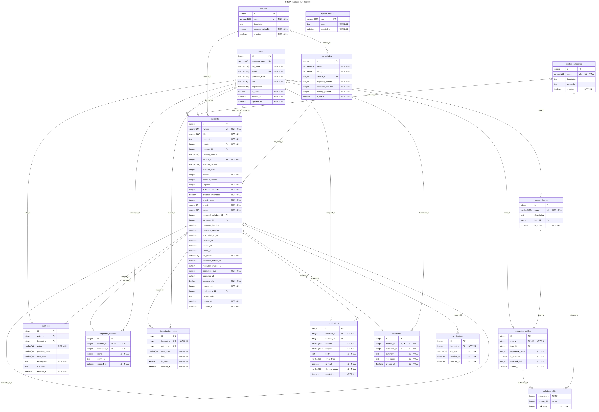{height=18cm}

**Table 5.2: Foreign keys, as defined in `database/schema.sql`**

| Child table and column | Parent table | Meaning |
|--------------------------------|---------------------|-----------------------------------|
| `incidents.reporter_id` | `users` | The employee who reported the incident |
| `incidents.assigned_technician_id` | `users` | The technician currently responsible |
| `incidents.category_id` | `incident_categories` | Classification |
| `incidents.service_id` | `services` | The affected service |
| `incidents.sla_policy_id` | `sla_policies` | The policy that produced the deadlines |
| `incidents.duplicate_of_id` | `incidents` | Optional link to a related incident (self reference) |
| `sla_policies.service_id` | `services` | Optional service-specific policy |
| `technician_profiles.user_id` | `users` | Unique, one profile per technician |
| `technician_profiles.team_id` | `support_teams` | Team membership |
| `support_teams.lead_id` | `users` | Team lead |
| `technician_skills.technician_id` and `.category_id` | `technician_profiles`, `incident_categories` | Composite primary key |
| `resolutions.incident_id` and `.technician_id` | `incidents`, `users` | Unique per incident |
| `employee_feedback.incident_id` and `.employee_id` | `incidents`, `users` | Unique per incident |
| `investigation_notes.incident_id` and `.author_id` | `incidents`, `users` | Notes of an incident |
| `notifications.recipient_id` and `.incident_id` | `users`, `incidents` | Who received what and about which incident |
| `audit_logs.actor_id` and `.incident_id` | `users`, `incidents` | Who did what to which incident |
| `sla_violations.incident_id` | `incidents` | Violations of an incident |

## 5.4 Keys and data integrity

**Primary keys.** Every table has an integer `id` except `technician_skills` (composite key of technician and category) and `system_settings` (the setting key).

**Integrity rules enforced by the database.** Foreign keys are on for every SQLite connection. Unique constraints cover the user e-mail and employee code, incident number, category, service and team names, one profile per technician, one resolution and one feedback per incident, and one violation per incident and kind. Check constraints keep impact, urgency, business criticality and the feedback rating between 1 and 5.

**Integrity rules enforced by the application.** Enumerated values (status, priority, role, channel) are stored as text and validated by Python enums and by the schemas, they are not database check constraints. The lifecycle table decides legal status changes. The audit table is made append-only by ORM events.

**Transactions.** One request uses one database session. `@transactional` commits once at the end of a multi-step operation, and rolls back on any exception. Publishing an event to the audit observer happens inside the same transaction, so an incident cannot change state without its audit row. If the audit observer fails, the transaction is aborted. A failure of the notification observer is logged and does not abort the workflow, because a missing notification is less harmful than a lost state change.

## 5.5 Persistence across restarts

Data is written to `backend/itsm.db` and survives stopping and starting the server. Automated test `test_t28_data_persists_after_application_restart` creates data in a file database, builds a new application on the same file and reads it back (scenario T28 of Appendix A in the main report). A database file from an older version is upgraded at start by adding missing nullable columns (`test_old_database_without_the_new_column_is_upgraded_automatically`). Only additive changes are handled, a renamed or removed column needs a real migration tool.

## 5.6 Sample and seed data

When the database is empty at start and `SEED_DEMO_DATA` is true (the default), `utils/seed.py` creates 10 users (one administrator, five technicians in two teams, four employees), 8 services, the incident categories, 5 SLA policies (one per priority and a stricter policy for the Student ERP service at P2) and 12 incidents whose ages and histories are replayed through the real services, so they have audit trails, notifications, resolutions and feedback. The demo accounts are listed in the README. `python -m app.utils.seed --reset` wipes and re-seeds. For a real start (`SEED_DEMO_DATA=false`), `bootstrap_if_empty` creates only the first administrator from environment variables plus the standard categories, services and SLA policies. For review without Python, `database/schema.sql` and `database/sample_data.sql` (388 rows in 14 tables, exported by `docs/tools/export_sample_data.py`) can be loaded into SQLite directly. Both were loaded into an empty database and checked for foreign-key violations on 19 November 2026 (none).

## 5.7 Limitations of persistence

* One writer at a time, and no write-ahead logging enabled.
* No migration tool beyond the additive upgrade, so structural changes need a manual or new mechanism.
* No encryption at rest, no automated backup, no database roles.
* Seed incident ages are relative to the first start, so the SLA states shown by the demo data (for example which P1 incident is breached) depend on how long ago the database was created.


# Chapter 6: Testing Documentation

## 6.1 Strategy

The brief asks for at least fifteen meaningful documented test cases covering normal operations, boundary conditions, invalid inputs, exceptions, authorisation and business rules. The project meets this with a layered strategy.

* **Unit tests** call domain and strategy classes directly: the priority strategies with boundary ratings, the lifecycle table with every pair of statuses, the assignment strategies and eligibility rules, the similarity measure.
* **API integration tests** drive the real FastAPI application through the test client with a real service container, real repositories and a real (in-memory) database. They check status codes, error codes, stored data, the audit trail and notifications. This is where most of the business rules are tested.
* **Time-dependent tests** use an injectable clock (`MutableClock`), so SLA warnings, breaches and escalations are tested by moving time forward rather than by waiting.
* **Manual tests** are used where a browser is needed. Two manual cases were run: a scripted headless Chrome pass on 14 November 2026 (TC-28) and the full suite in Windows PowerShell on 20 November 2026 (TC-30). One further case, TC-29, is documented but was **not executed**.
* **Role matrix.** `test_use_case_matrix.py` calls the API as each role for 23 of the 32 use cases and requires that exactly the permitted roles succeed.

The suite was written against the numbered acceptance scenarios T01 to T30 of the main report (Appendix A there). The thirty documented cases below are a different, requirement-oriented selection, organised by the six categories of the brief and tied to the named tests.

## 6.2 Framework and environment

**Table 6.1: Test environment**

| Item | Value |
|-----------------|---------------------------------------------------|
| Framework | pytest 9.2.0 with httpx 0.28.1 (the FastAPI test client) and pytest-cov for coverage |
| Language and platform | Python 3.13 on Linux. The code supports Python 3.11 or later |
| Database | A fresh in-memory SQLite database for every test, created with `StaticPool` |
| Clock | `MutableClock` starting at 15 January 2026 09:00 UTC, advanced by the tests |
| Configuration | Environment set in `tests/conftest.py`: bcrypt cost 4 (for speed), a test secret key, the SLA monitor thread disabled |
| Data | `conftest.py` builds the same reference data as the real start-up (categories, services, SLA policies, technicians, employees) |
| Not covered | Windows, macOS, browsers other than the one used for the manual case, load, concurrency, real e-mail |

## 6.3 Execution

From the `backend` folder with the virtual environment active (PowerShell on Windows):

```
python -m pytest -q
python -m pytest --cov=app --cov-report=term-missing
python ..\docs\tools\build_tech_report.py
```

The first command runs the suite. The second adds the coverage report (`pytest-cov` is installed separately with `pip install pytest-cov`). The third runs the tests behind the documented cases and rewrites Tables 6.4 and 6.5 of this report from the real outcomes. The Windows commands are documented in the README but were not run on Windows by the authors.

## 6.4 Results

On 19 November 2026 the full suite gave **264 tests collected, 264 passed, 0 failed, 0 skipped**, in 14 test files, with **94.8 percent line coverage** of the back end (3,669 statements, 192 not executed). Running the same suite from the delivered ZIP in a fresh virtual environment gave the same pass count.

**Reconciliation of earlier numbers.** Earlier documents quoted 210, 261 and 264 tests. All three are correct for a different set of files. 210 is the suite without the files `test_affected_users.py` (26 tests), `test_use_case_matrix.py` (25) and `test_documented_cases.py` (3). 261 adds the first two. 264 is the complete suite. Every document in the project now states 264.

**Warnings.** The number of warnings reported by pytest varies between 0 and 6 from run to run. They come from the garbage collector closing unclosed in-memory SQLite connections at different moments (a `ResourceWarning`), and from a Starlette deprecation notice when an optional library is missing. They do not affect any result. Earlier documents quoted 5 or 6 for this reason.

<!-- testsummary:start -->
**Table 6.2: Result of the complete automated suite (run of 2026-11-19)**

| Measure | Value |
|----------------|----------------|
| Tests collected and run | 264 |
| Passed | 264 |
| Failed | 0 |
| Skipped | 0 |
| Test files | 14 |
| Duration of the run | 35 seconds |

**Table 6.3: Number of tests in each test file**

| Test file | Tests | Passed |
|----------------------------|------|------|
| `test_affected_users.py` | 26 | 26 |
| `test_assignment.py` | 17 | 17 |
| `test_auth.py` | 13 | 13 |
| `test_bootstrap.py` | 3 | 3 |
| `test_documented_cases.py` | 3 | 3 |
| `test_intelligence.py` | 17 | 17 |
| `test_lifecycle.py` | 76 | 76 |
| `test_notes_feedback_config.py` | 11 | 11 |
| `test_notifications_audit.py` | 9 | 9 |
| `test_priority.py` | 30 | 30 |
| `test_rbac.py` | 10 | 10 |
| `test_search_reports.py` | 9 | 9 |
| `test_sla.py` | 15 | 15 |
| `test_use_case_matrix.py` | 25 | 25 |
| **Total** | **264** | **264** |
<!-- testsummary:end -->

## 6.5 The documented test cases

Table 6.4 documents thirty cases, ten columns each. **Status** and **Actual result** for an automated case come from running the named pytest functions, and the status is PASS only if every named function passed. The actual result describes what the assertions of those tests observed. Manual and planned cases are marked as such and carry a fixed status. Nothing was marked PASS because a feature exists.

* TC-01 to TC-27 are **automated**. Each lists the exact test functions in the last column. "Automated, unit" means pytest calls the classes directly. "Automated, API" means pytest sends HTTP requests to the real application through the FastAPI test client, with a real service container and an in-memory database.
* TC-28 is a **manual** case that was executed (PASS) and has no automated test.
* TC-29 is **NOT EXECUTED**. It needs a browser and a stopped front-end server. It stays in the table because the brief asks for the case. TC-30 was executed by the team on Windows on 20 November 2026 (264 passed, 1 warning, 49.55 seconds, screenshot SS-31).

<!-- testcases:start -->
<!-- landscape tiny -->
**Table 6.4: Documented test cases (Test ID, category, scenario, objective, preconditions, steps, input data, expected result, actual result, status, type of testing, automated test reference)**

| Test ID | Category | Test scenario | Objective | Preconditions | Test steps | Input or test data | Expected result | Actual result | Status | Type of testing | Automated test reference |
|----|-------|------------|--------------|------------|----------------|------------|--------------|--------------|-----|----------|----------------|
| TC-01 | Normal | Successful login with valid credentials | Show that a registered user can sign in and receives a token that carries the role | Demo administrator account exists | 1. Send the login request. 2. Read the status, token and user in the response. 3. Read the audit records. | Administrator demo e-mail in upper case, correct demo password | HTTP 200, bearer token and user with role ADMIN; the sign-in is audited | HTTP 200, token_type bearer, user role ADMIN, audit action `USER_LOGIN` present | PASS | Automated, API | `test_auth.py::test_login_success_returns_token_and_user_and_is_audited` |
| TC-02 | Normal | Employee creates an incident | Show that an employee can report an incident and that the priority is calculated from the service criticality | Employee signed in; service Library System (criticality 2) exists | 1. Sign in as an employee. 2. Create the incident. 3. Read the stored score and priority. | Title and description of valid length, impact 3, urgency 3, service Library System | Incident created; priority computed from the service criticality; score 18 and P3 | Created with score 18, priority P3, business_criticality 2, criticality not overridden | PASS | Automated, API | `test_priority.py::test_api_calculates_priority_and_takes_criticality_from_service` |
| TC-03 | Normal | Technician acknowledges an assigned incident | Show that the assigned technician can acknowledge and that the response SLA is met | Incident created and automatically assigned to a technician; clock advanced 2 minutes | 1. Create an incident that is assigned automatically. 2. Advance the clock 2 minutes. 3. Acknowledge as the technician. | Incident for an assigned technician, transition to ACKNOWLEDGED | HTTP 200, status ACKNOWLEDGED, acknowledged_at set, response SLA marked MET | HTTP 200, status ACKNOWLEDGED, timestamp 2 minutes after creation, response SLA state MET | PASS | Automated, API | `test_lifecycle.py::test_t09_assigned_technician_acknowledges_and_timestamp_is_set` |
| TC-04 | Normal | Administrator assigns an incident to an eligible technician | Show that an administrator can assign an incident, and that an unavailable technician is refused first | Unassigned Storage incident; technician Imran Khan initially unavailable | 1. Try to assign while the technician is unavailable. 2. Make the technician available. 3. Assign again. | Unassigned Storage incident, technician Imran Khan | Refused while unavailable; accepted once available; status ASSIGNED | First call HTTP 409 `TECHNICIAN_UNAVAILABLE`; second call HTTP 200, technician Imran Khan, status ASSIGNED | PASS | Automated, API | `test_assignment.py::test_admin_assigns_manually_after_making_technician_available` |
| TC-05 | Normal | Resolve an incident with the required resolution details | Show that an incident can be taken through the whole lifecycle to closure with the required resolution data | Incident assigned and in progress | 1. Create and assign. 2. Acknowledge and start work. 3. Resolve with summary and root cause. 4. Verify. 5. Close. | Resolution summary and root cause text, closure by the reporter | Incident reaches RESOLVED, then VERIFIED and CLOSED through the legal steps | Full lifecycle NEW to CLOSED completed with every step accepted | PASS | Automated, API | `test_lifecycle.py::test_full_lifecycle_to_closed` |
| TC-06 | Boundary | Priority with the minimum valid ratings | Check the lowest valid combination of ratings | None | 1. Call the priority strategy with the minimum ratings. 2. Compare score and level. | Impact 1, urgency 1, criticality 1 | Score 1 and level P4 | Score 1 and level P4 (parametrised case ratings7) | PASS | Automated, unit | `test_priority.py::test_documented_examples_and_boundaries[ratings7-1-P4]` |
| TC-07 | Boundary | Priority level at the lower and upper limit of every band | Check the first and last score of every priority band | Default thresholds | 1. Map each boundary score to a level. 2. Map the ratings that produce 8, 20 and 40. | Scores 1, 7, 8, 19, 20, 39, 40 and 125 | 1 and 7 give P4; 8 and 19 give P3; 20 and 39 give P2; 40 and 125 give P1 | All eight boundary scores mapped to the expected level; also the products 8, 20 and 40 from ratings give P3, P2 and P1 | PASS | Automated, unit | `test_priority.py::test_t06_t07_threshold_boundaries`; `test_priority.py::test_documented_examples_and_boundaries[ratings4-8-P3]`; `test_priority.py::test_documented_examples_and_boundaries[ratings5-20-P2]`; `test_priority.py::test_documented_examples_and_boundaries[ratings6-40-P1]` |
| TC-08 | Boundary | Priority with the maximum valid ratings | Check the highest valid combination of ratings | None | 1. Call the priority strategy with the maximum ratings. 2. Compare score and level. | Impact 5, urgency 5, criticality 5 | Score 125 and level P1 | Score 125 and level P1 (parametrised case ratings8) | PASS | Automated, unit | `test_priority.py::test_documented_examples_and_boundaries[ratings8-125-P1]` |
| TC-09 | Boundary | Maximum permitted text lengths | Check the exact text length limits of the incident form on the server | Employee signed in; limits in the schema: title 200, description 5000, affected system 200 characters | 1. Create with the maximum lengths. 2. Create again with one extra character in one field at a time. | Title 200 and 201, description 5000 and 5001, affected system 200 and 201 characters | Maximum lengths accepted with HTTP 201; one character more rejected with HTTP 422 naming the field | Creation with the maximum lengths returned 201 and stored a 200 character title; each over-length field returned 422 with that field named | PASS | Automated, API | `test_documented_cases.py::test_tc09_maximum_permitted_text_lengths_are_accepted_and_one_more_is_rejected` |
| TC-10 | Invalid input | Login with an incorrect password | Show that a wrong password is refused without a token | Registered user exists | 1. Send the login request with a wrong password. 2. Read the status and body. | Existing e-mail, wrong password | HTTP 401, no token, error code `AUTHENTICATION_FAILED` | HTTP 401 without a token in the response | PASS | Automated, API | `test_auth.py::test_t03_login_with_wrong_password_returns_401_without_token` |
| TC-11 | Invalid input | Incident creation with missing mandatory fields | Show that every missing mandatory field is rejected and named | Employee signed in | 1. Create an incident with one field removed at a time. 2. Create with an empty body. | Title, description, service, impact or urgency omitted | HTTP 422 each time, with the missing field named | Every omission returned 422 and the response listed the omitted field; the empty body returned 422 | PASS | Automated, API | `test_documented_cases.py::test_tc11_missing_mandatory_fields_are_rejected_and_named` |
| TC-12 | Invalid input | Ratings outside the range 1 to 5 | Show that ratings outside 1 to 5 are rejected by the strategy and by the API | None | 1. Call the strategy with out-of-range ratings. 2. Send the same through the API. | Ratings 0, 6 and -1 in different positions; API impact 6 and urgency 0 | InvalidInputError in the strategy; HTTP 422 naming the field through the API | All five strategy calls raised InvalidInputError; API returned 422 with the field impact or urgency named | PASS | Automated, unit and API | `test_priority.py::test_invalid_ratings_are_rejected`; `test_priority.py::test_incident_validation_errors_are_meaningful` |
| TC-13 | Invalid input | Resolve without the mandatory resolution details | Show that an incident cannot be resolved without a resolution summary and a root cause | Incident `IN_PROGRESS` | 1. Request RESOLVED with no details. 2. With only a summary. 3. With a blank summary and a root cause. | Empty, partial and blank resolution fields | HTTP 422 each time; the message mentions the root cause; status stays `IN_PROGRESS` | All three requests returned 422, the message contained 'root cause', status remained `IN_PROGRESS` | PASS | Automated, API | `test_lifecycle.py::test_t10_resolve_without_summary_or_root_cause_is_rejected` |
| TC-14 | Exception | Invalid lifecycle transition, NEW directly to CLOSED | Show that an illegal status change is refused and changes nothing | An incident exists; for the unit level every pair of statuses is tried | 1. Request CLOSED for a new incident. 2. Try every disallowed pair of statuses at unit level. | Transition NEW to CLOSED, and all other illegal pairs | HTTP 409 `INVALID_STATE_TRANSITION` and the incident does not change; every disallowed pair raises InvalidTransitionError | HTTP 409, status and audit unchanged; all disallowed pairs were rejected | PASS | Automated, unit and API | `test_lifecycle.py::test_t08_new_to_closed_is_rejected_with_409_and_no_mutation`; `test_lifecycle.py::test_every_disallowed_transition_is_rejected` |
| TC-15 | Exception | Assignment when no eligible technician exists | Show the behaviour when no technician is eligible | Storage is covered only by a technician on leave | 1. Make the only Storage technician unavailable. 2. Create a Storage incident. 3. Read the status, notifications and timeline. | Cloud Storage incident, category Storage | Incident stays CLASSIFIED and unassigned; administrators are notified; the timeline records `NO_TECHNICIAN_AVAILABLE` | assigned false, status CLASSIFIED, administrator notification present, internal event hidden from the employee | PASS | Automated, API | `test_assignment.py::test_t15_no_eligible_technician_leaves_incident_unassigned_and_notifies_admin` |
| TC-16 | Exception | Manual assignment to a technician at the workload limit | Show that the workload limit blocks assignment unless an administrator overrides | Technician limit set to 1 and already holding one incident | 1. Set the limit to 1 and fill it. 2. Assign a second incident. 3. Repeat with the override. | Technician limit 1, second incident, override false then true | Refused with HTTP 409 `TECHNICIAN_WORKLOAD_EXCEEDED`; with an explicit override accepted and audited | First request HTTP 409 `TECHNICIAN_WORKLOAD_EXCEEDED`; with override HTTP 200 and the timeline text mentions the override | PASS | Automated, API | `test_assignment.py::test_workload_limit_blocks_assignment_unless_admin_overrides` |
| TC-17 | Exception | Incident processing when the SLA policy is missing | Show that an incident is not created when no SLA policy exists for its priority | The only P1 SLA policy is deactivated | 1. Deactivate the only P1 policy. 2. Create a P1 incident. 3. Count the incidents. | Payment incident with impact 4, urgency 5 | HTTP 422 `MISSING_SLA_CONFIGURATION` and no incident is saved | HTTP 422 with code `MISSING_SLA_CONFIGURATION`; incident list total 0 | PASS | Automated, API | `test_sla.py::test_missing_sla_policy_blocks_creation_without_side_effects` |
| TC-18 | Authorisation | Employee views another employee's incident | Show that an employee cannot read another employee's incident | Two employees; one has reported an incident | 1. Employee A reports an incident. 2. Employee B requests it, its notes and its timeline. | Incident number of employee A | HTTP 403 for all three and no incident content in the response | HTTP 403 for incident, notes and timeline; the title was absent from the response | PASS | Automated, API | `test_rbac.py::test_t04_employee_cannot_read_another_employees_incident` |
| TC-19 | Authorisation | Technician changes an incident not assigned to them | Show that a technician cannot read or change an incident assigned to someone else | Incident assigned to technician A; technician B signed in | 1. Assign an incident to technician A. 2. Technician B reads it, patches its category and tries to acknowledge. | Incident number, category change, acknowledge request | HTTP 403 each time and the incident is unchanged | HTTP 403 for all three requests; status still ASSIGNED; acknowledgement by B refused | PASS | Automated, API | `test_documented_cases.py::test_tc19_technician_cannot_view_or_change_an_incident_not_assigned_to_them`; `test_lifecycle.py::test_only_assigned_technician_or_admin_can_acknowledge` |
| TC-20 | Authorisation | Employee or technician uses administrator-only functions | Show that administrator-only endpoints refuse employees and technicians | Employee, technician and administrator signed in | 1. Call each administrator endpoint as an employee, a technician and the administrator. | Users, audit logs, reports, SLA policies, settings, teams, e-mail outbox and SLA lists | HTTP 403 for employee and technician, HTTP 200 for the administrator | Nine administrator endpoints returned 403 to both non-admin roles and 200 to the administrator | PASS | Automated, API | `test_rbac.py::test_admin_only_endpoints_reject_other_roles` |
| TC-21 | Authorisation | Unauthenticated access to protected endpoints | Show that protected endpoints require a valid token | No token | 1. Call endpoints without a token. 2. With a malformed token. 3. Probe every use-case endpoint anonymously. | No token, malformed token | HTTP 401 in all cases | HTTP 401 for both endpoints, for the malformed token and for every probed use-case endpoint | PASS | Automated, API | `test_auth.py::test_protected_routes_require_a_valid_token`; `test_use_case_matrix.py::test_anonymous_cannot_use_any_probed_endpoint` |
| TC-22 | Business rule | Priority equals impact x urgency x business criticality | Check that priority equals impact x urgency x business criticality | Default product strategy | 1. Calculate the documented examples. 2. Create incidents through the API and read the score. | Ratings (4,5,5), (3,3,4), (3,3,2), (1,2,1) | Scores 100, 36, 18 and 2 giving P1, P2, P3 and P4 | All documented examples matched, including 100 for P1 and the criticality taken from the service | PASS | Automated, unit and API | `test_priority.py::test_t05_impact4_urgency5_criticality5_is_score_100_p1`; `test_priority.py::test_documented_examples_and_boundaries` |
| TC-23 | Business rule | Correct SLA response and resolution deadlines for each priority | Check the response and resolution targets of every priority | Standard SLA policies | 1. Create one incident per priority. 2. Read the SLA target minutes. | Priorities P1 to P4 with the standard policies | P1 5 and 30 min, P2 15 and 120, P3 60 and 480, P4 240 and 1440 minutes | All four priorities reported exactly those target minutes | PASS | Automated, API | `test_sla.py::test_all_priorities_use_the_specified_targets`; `test_sla.py::test_t16_p1_incident_gets_5_and_30_minute_deadlines` |
| TC-24 | Business rule | An accepted lifecycle transition creates an audit record | Show that every accepted status change is audited with both states | Incident taken to RESOLVED | 1. Take an incident to RESOLVED. 2. Read the timeline as administrator. | Incident moved through five transitions | Audit rows with previous and new state for each step, in time order | NEW to CLASSIFIED, CLASSIFIED to ASSIGNED, ASSIGNED to ACKNOWLEDGED, ACKNOWLEDGED to `IN_PROGRESS` and `IN_PROGRESS` to RESOLVED present, times ascending; actor, action and time present | PASS | Automated, API | `test_lifecycle.py::test_every_accepted_transition_is_audited_with_states`; `test_notifications_audit.py::test_t21_transition_creates_audit_row_with_actor_action_states_and_time` |
| TC-25 | Business rule | Creation and assignment trigger the right notifications | Show that creation, assignment and resolution notify the right people on both channels | Employee, technician and administrator accounts | 1. Create an incident and resolve it. 2. Read the inbox of each user and the e-mail outbox. | Employee, technician and administrator accounts | Reporter, technician and administrator receive their messages; each has an in-app record and a simulated e-mail record | Reporter saw reported, classified and assigned messages; technician saw the assignment; administrator saw the report; outbox entries all EMAIL and SENT | PASS | Automated, API | `test_notifications_audit.py::test_t20_creation_assignment_and_resolution_create_in_app_and_email_records` |
| TC-26 | Business rule | Duplicate detection warns but does not merge | Show that similar incidents are flagged but never blocked or merged | A payment incident is open | 1. Report a payment incident. 2. Report two similar ones from other employees. 3. Read the warnings and the incident list. | Three similarly worded payment incidents, similarity threshold 0.45 | Warning lists the earlier incident(s) with similarity of at least 0.45; all incidents are still created and open | Second report listed the first as a duplicate; third listed both; three separate open incidents; related incidents can be linked without merging | PASS | Automated, API | `test_intelligence.py::test_t24_similar_payment_incident_triggers_a_warning_but_is_not_blocked`; `test_intelligence.py::test_admin_can_link_related_incident_without_merging` |
| TC-27 | Business rule | Search and filtering return only matching incidents | Show that combined search filters return only matching incidents | Four incidents with different priorities, services and SLA states | 1. Create four different incidents. 2. Apply the filters alone and in combination. | Status, priority, service and SLA status filters | Only incidents that match every selected criterion are returned; contradictory combinations return none | Each combination returned exactly the expected incident numbers and zero results for the contradictory combinations | PASS | Automated, API | `test_search_reports.py::test_t23_combined_filters_return_only_matching_incidents`; `test_search_reports.py::test_each_of_the_eight_filters_works_on_its_own` |
| TC-28 | Business rule | Live priority preview on the report form | Check the live priority preview in the browser | Back end and front end running with demo data | 1. Open the report form. 2. Enter impact 2 and 300 affected users. 3. Read the preview. 4. Submit and open the incident. | Impact 2, 300 affected users | Preview shows the raised priority and a note that impact was raised to 4; the created incident explains it | Preview showed P1 (score 60) with the note that impact was raised to 4; the detail page showed the explanation; no JavaScript errors were logged | PASS | Manual (headless Chrome, 14 Nov 2026) | None. Not part of the automated suite. |
| TC-29 | Exception | Network failure shown as a readable message | Check that a lost connection is shown as a readable message | Page open in the browser; the front-end server stopped so that no response can arrive | 1. Open the page. 2. Stop the front-end server. 3. Click Sign in or another action. | No response from the server | A message such as 'Cannot reach the server' in an alert or toast and no blank page. With only the back end stopped behind the Vite proxy the message is 'Request failed (500).' | Not executed in this report | NOT EXECUTED | Planned, not executed | None. Not executed. |
| TC-30 | Business rule | Full test suite on Windows | Check that the whole suite passes on Windows | Windows computer with Python 3.11 or later and a virtual environment | 1. Install the requirements. 2. Run python -m pytest -q in the backend folder. | Windows computer with Python 3.11 or later | All tests pass | 264 passed, 1 warning in 49.55 s in Windows PowerShell on 2026-11-20 (screenshot SS-31) | PASS | Manual (Windows, 20 Nov 2026) | None. Not part of the automated suite. |
<!-- /landscape -->

**Table 6.5: Coverage of the six required categories**

| Category | Cases | Passed | Not executed | Automated | Manual or planned |
|----------|-----|-----|-----|-----|-----|
| Normal | 5 | 5 | 0 | 5 | 0 |
| Boundary | 4 | 4 | 0 | 4 | 0 |
| Invalid input | 4 | 4 | 0 | 4 | 0 |
| Exception | 5 | 4 | 1 | 4 | 1 |
| Authorisation | 4 | 4 | 0 | 4 | 0 |
| Business rule | 8 | 8 | 0 | 6 | 2 |
| **Total** | **30** | **29** | **1** | **27** | **3** |
<!-- testcases:end -->

## 6.6 What the tests do not show

* **Use cases.** The role matrix covers 23 of the 32 use cases. The other nine (for example those that need several requests in sequence) are covered by individual tests of the underlying rules, but they are not probed by the matrix. The report therefore does not claim that all 32 use cases were independently tested.
* **Front end.** There are no automated tests for the React application. The only front-end evidence is TC-28 and the screenshots.
* **Performance and concurrency.** No load or concurrency test was run.
* **E-mail.** The e-mail channel is simulated. Tests prove that the records are created with status SENT, not that any mail was delivered.
* **Platforms.** The main evidence comes from Linux. The suite was run once on Windows PowerShell (TC-30) and the application was started on Windows by the team. macOS was not tested.
* **Security.** No penetration test, static analysis or `pip-audit` was run.

## 6.7 Screenshot evidence

The screenshots complement the automated results by showing the system as a user sees it. The separate document `docs/SCREENSHOT_CHECKLIST.md` gives, for every screenshot, the account, the page, the exact actions and the result that must appear. One screenshot often supports several test cases, so thirty screenshots cover the thirty documented cases without a picture for each. Table 6.6 lists them. The figure placeholders that follow mark where each image goes in the report. They are intentionally empty: the images are to be captured by the team from the running system and must not be replaced by anything else.

<!-- screenshots:start -->
**Table 6.6: Screenshots, the test cases or requirements they support and their report figures**

| Screenshot | What it shows | Supports | Priority | Figure |
|-------|--------------------------|----------------|-----------|-----|
| SS-01 | Administrator signs in, administrator menu | TC-01, TC-20 | Must | 6.1 |
| SS-02 | Employee menu has no admin pages | TC-20 | Must | not captured |
| SS-03 | Technician menu | TC-20 | Optional | not captured |
| SS-04 | Invalid login message | TC-10 | Must | 6.2 |
| SS-05 | Technician refused when reporting an incident | TC-19, TC-20 | Must | 6.3 |
| SS-06 | Employee refused another employee's incident | TC-18 | Must | 6.4 |
| SS-07 | Report form with category suggestion and priority preview | TC-02, TC-22 | Must | 6.5 |
| SS-08 | Affected users raise the impact | TC-28, TC-22 | Recommended | not captured |
| SS-09 | Duplicate warning panel | TC-26 | Must | 6.6 |
| SS-10 | Incident reported dialog, still created | TC-02, TC-26 | Must | not captured |
| SS-11 | Incident detail with priority, SLA deadlines and timeline | TC-02, TC-23, TC-24 | Must | 6.7 |
| SS-12 | Technician recommendations with reasons | TC-04 | Must | 6.8 |
| SS-13 | No eligible technician | TC-15, TC-16 | Recommended | 6.9 |
| SS-14 | Technician acknowledges | TC-03 | Must | not captured |
| SS-15 | Resolve dialog with a missing field | TC-13 | Recommended | not captured |
| SS-16 | Incident resolved with resolution details | TC-05 | Must | 6.10 |
| SS-17 | Employee verification dialog | TC-05 | Must | not captured |
| SS-18 | Closed incident with feedback and timeline | TC-05, TC-24 | Must | 6.11 |
| SS-19 | SLA monitor with breach and violation history | TC-23 | Must | not captured |
| SS-20 | Audit log filtered by one incident | TC-24 | Must | 6.12 |
| SS-21 | E-mail outbox (simulated e-mail) | TC-25 | Recommended | not captured |
| SS-22 | Administrator dashboard | Dashboards requirement (Chapter 5 of the main report) | Must | not captured |
| SS-23 | Reports page with CSV buttons | Reports requirement (Chapter 5 of the main report) | Must | not captured |
| SS-24 | Downloaded CSV file opened | Reports requirement | Recommended | not captured |
| SS-25 | Settings page, strategy selection | Administrator operations, Strategy pattern (TC-04 context) | Optional | not captured |
| SS-26 | API refuses an illegal status change (409) | TC-14 | Must | 6.13 |
| SS-27 | API reports an unknown incident (404) | Invalid incident scenario (Section 3.2) | Recommended | not captured |
| SS-28 | API names missing fields (422) | TC-11 | Must | 6.14 |
| SS-29 | Network failure message, front-end server stopped | TC-29 | Recommended | not captured |
| SS-30 | Back end stopped, message shown | TC-29 and the finding in Section 3.2 | Optional | not captured |
| SS-31 | Test run output in PowerShell | TC-01 to TC-27 (the automated cases), TC-30 if run on Windows | Must | 6.15 |

Each figure below is filled in automatically when the file `SS-NN.png` exists in `docs/screenshots/evidence`. A shaded line is a placeholder for an image that has not been captured.

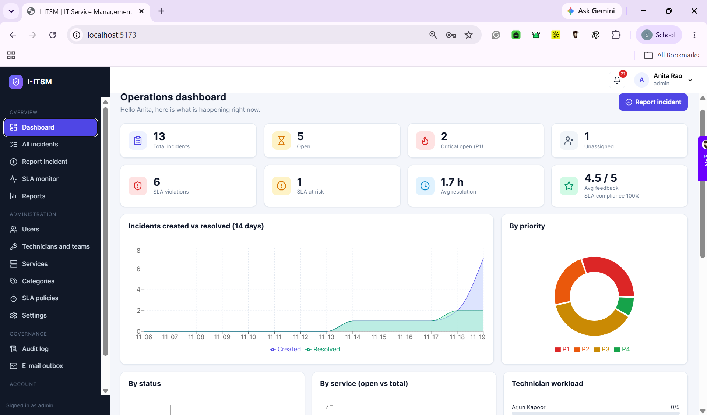{width=95%}

> **SS-02, image not captured:** The employee sees a reduced menu without administration pages, which shows role-based access.

> **SS-03, image not captured:** The technician menu offers the incident queue and profile, but no administration pages.

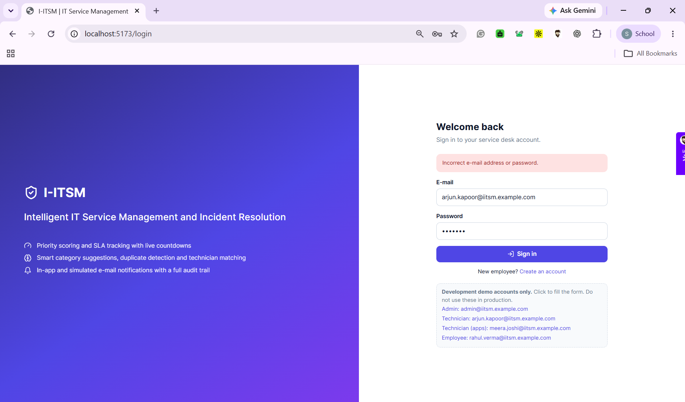{width=95%}

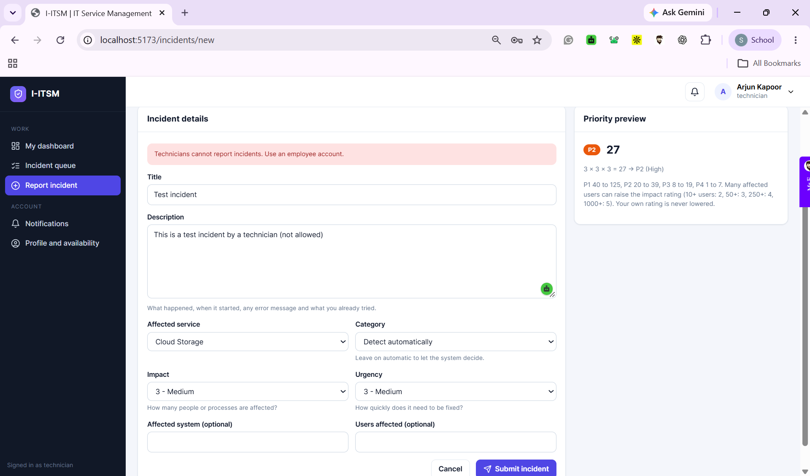{width=95%}

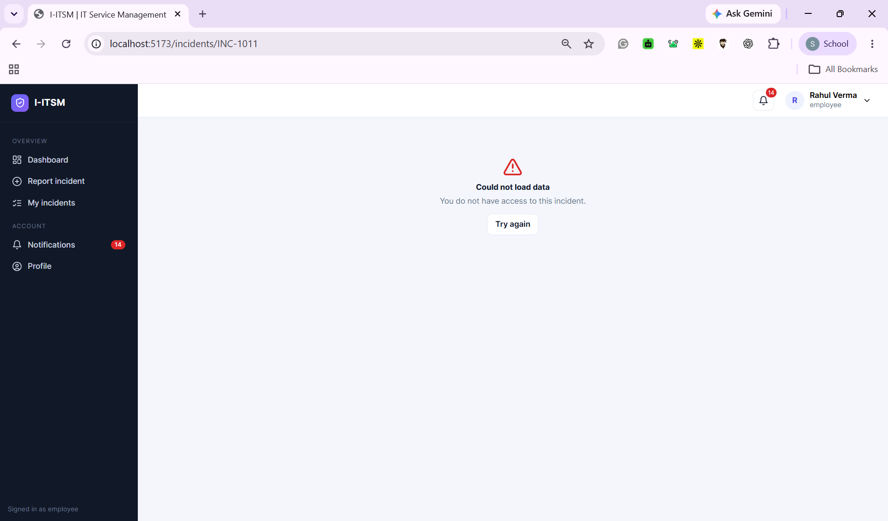{width=95%}

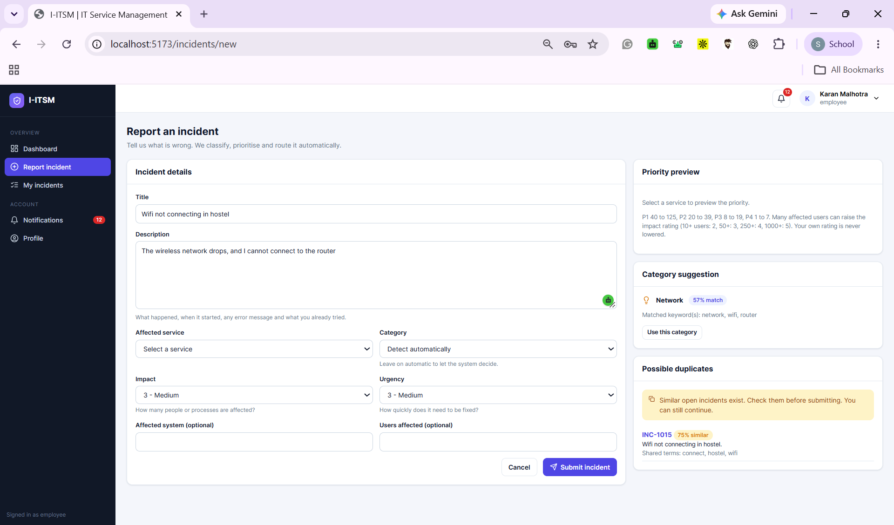{width=95%}

> **SS-08, image not captured:** A large number of affected users raises the impact rating, and the preview explains why.

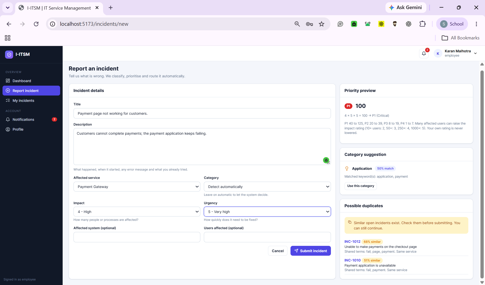{width=95%}

> **SS-10, image not captured:** The incident is created and assigned automatically, and the dialog repeats the duplicate warning without blocking.

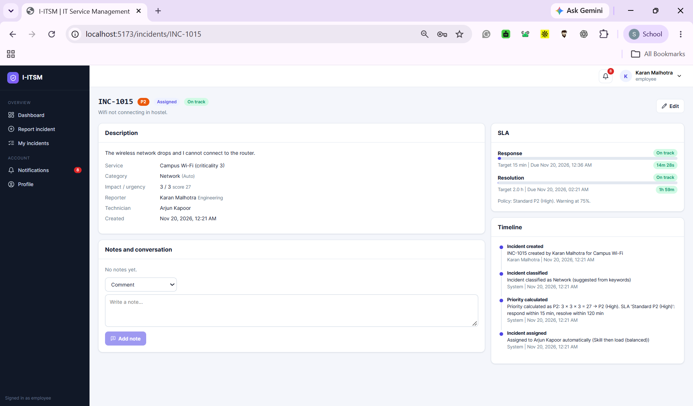{width=95%}

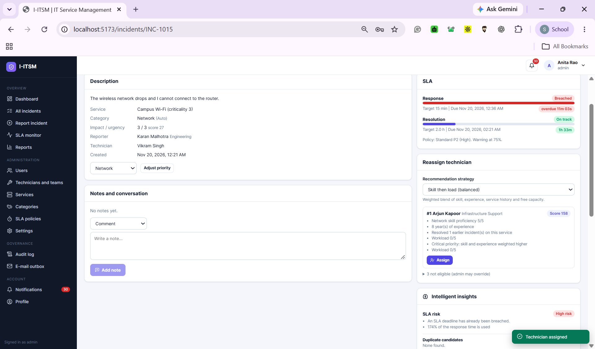{width=95%}

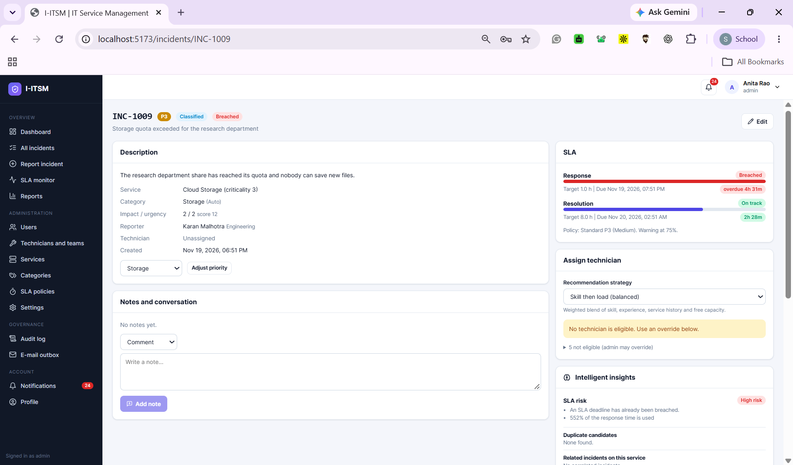{width=95%}

> **SS-14, image not captured:** The assigned technician acknowledges the incident and the status and timeline change.

> **SS-15, image not captured:** The resolve dialog will not accept a resolution without both the summary and the root cause.

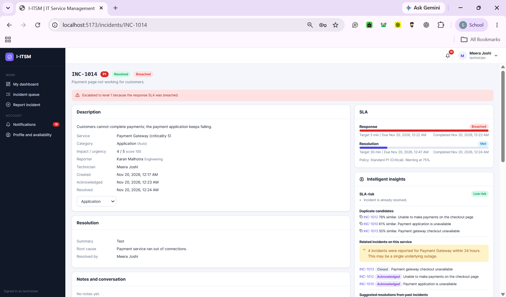{width=95%}

> **SS-17, image not captured:** The employee who reported the incident confirms that the problem is fixed.

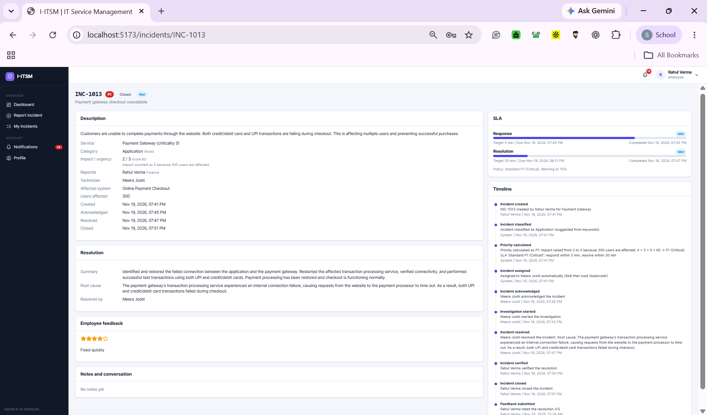{width=95%}

> **SS-19, image not captured:** The SLA monitor lists incidents at risk or breached and keeps the history of recorded violations.

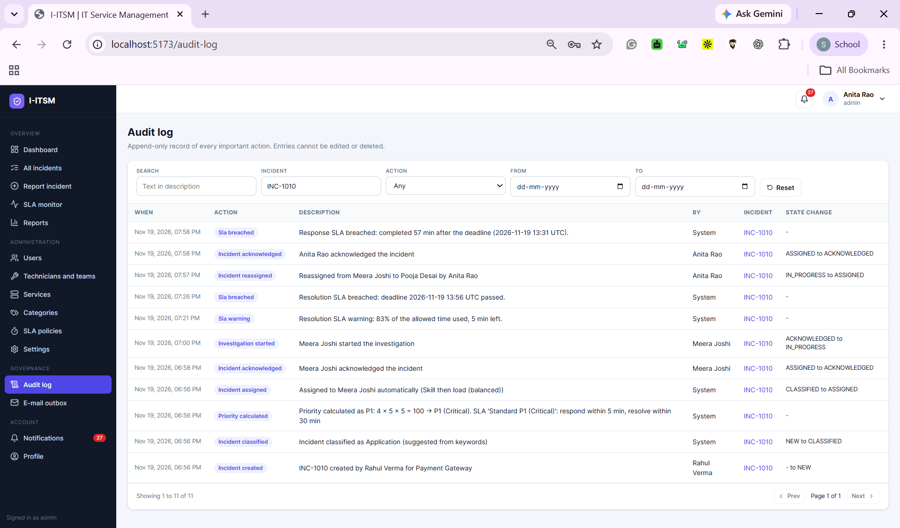{width=95%}

> **SS-21, image not captured:** Every notification also produces a simulated e-mail record, nothing is sent over the network.

> **SS-22, image not captured:** The administrator dashboard summarises open incidents, SLA state and workload from live database data.

> **SS-23, image not captured:** The reports page presents live figures and offers CSV export for the tables.

> **SS-24, image not captured:** The exported CSV file opens as an ordinary spreadsheet with the report rows.

> **SS-25, image not captured:** An administrator switches the assignment and priority strategies without changing code.

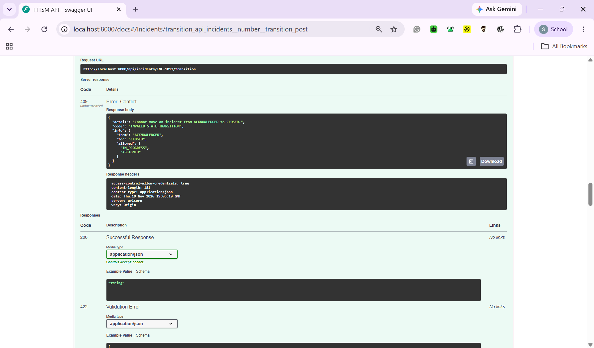{width=95%}

> **SS-27, image not captured:** A request for an incident number that does not exist returns not found with the code INCIDENT_NOT_FOUND.

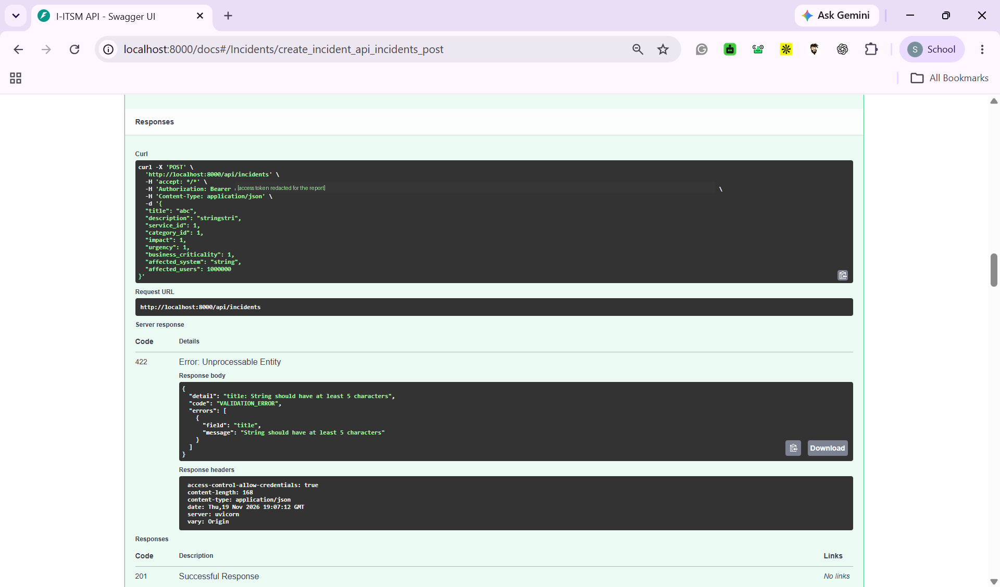{width=95%}

> **SS-29, image not captured:** When the browser cannot reach any server, the application shows a readable message instead of a blank page.

> **SS-30, image not captured:** With only the back end stopped, the development proxy answers with an error and the application shows a short failure message.

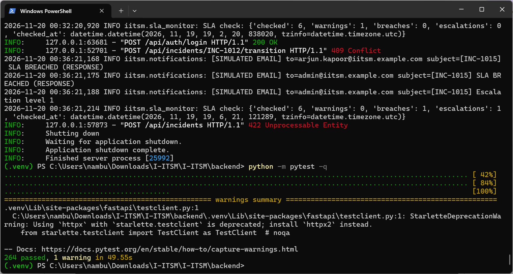{width=95%}

<!-- screenshots:end -->

# Chapter 7: Discussion, Honest Limitations and Conclusion

## 7.1 Where the nine technology questions are answered

**Table 7.1: The questions of the brief and the sections that answer them**

| Question of the brief | Where answered |
|--------------------------------------------|----------------------------------|
| 1. Why this programming language? | Section 2.2 |
| 2. Why this front-end technology? | Section 2.3 |
| 3. Why this back-end technology? | Section 2.4 |
| 4. Why this database? | Section 2.5, Chapter 5 |
| 5. Why this architecture? | Section 2.6 |
| 6. What alternatives were considered? | Sections 2.2 to 2.6, Tables 2.2 and 2.3 |
| 7. Advantages and limitations of the stack | Section 2.8, Table 2.4 |
| 8. How does the technology support object-oriented design? | Section 2.9, Table 2.5 |
| 9. How would the system evolve with many more users? | Section 2.12, Table 2.6 |

## 7.2 Status of the requirements covered by this report

**Table 7.2: Honest status of the areas covered here**

| Area | Status | Evidence | Gap |
|--------------|---------------------|-----------------------------|-----------------------------------------|
| Technology selection report | Complete | Chapter 2 | The comparison scores are team judgement, not measurements |
| Twelve error scenarios | 10 implemented, 1 implemented as a warning by design (duplicate incident), 1 partially implemented (network failure) | Table 3.1, tests TC-09 to TC-21 and TC-26 | Database failure was checked once by a probe, not by a test. Network failure shows "Request failed (500)." when only the back end stops behind the Vite proxy |
| Security mechanisms | Implemented as listed in Table 4.1 | Source, tests TC-10 and TC-18 to TC-21 | No rate limiting, no token revocation, token in `localStorage`, no HTTPS in development (Table 4.2) |
| Persistence and ER design | Complete | Chapter 5, schema, ER diagram, restart test | No migration tool, one writer |
| At least 15 documented test cases in six categories | 30 documented: 27 automated, 2 manual, 1 not executed | Table 6.4 | TC-29 not executed, no front-end tests, no load test |
| Screenshot evidence | Checklist delivered, images to be captured | `docs/SCREENSHOT_CHECKLIST.md` | The images are not part of this report until the team adds them |

## 7.3 Conclusion

The stack was chosen to fit the problem rather than the other way round. Python and FastAPI make the rule-heavy back end short, testable and close to the specification. SQLAlchemy keeps the persistence behind repositories. SQLite removes installation effort while still enforcing integrity. React with a small API client gives role-specific screens whose calculations are done by the server. The object-oriented concepts of the course appear in working code, in six abstractions with concrete subclasses, one exception hierarchy, a composed service container and five named design patterns. The limits of the choice are known and written down: one writer, one process, simulated e-mail, and security features that a production system would add. The scalability path is staged from small changes inside the present design to a change of database, then to a change of architecture, and the existing tests are the safety net for each stage.

# References

1. FastAPI documentation. https://fastapi.tiangolo.com
2. SQLAlchemy 2.0 documentation. https://docs.sqlalchemy.org/en/20/
3. Pydantic documentation. https://docs.pydantic.dev
4. React documentation. https://react.dev
5. Vite documentation. https://vite.dev
6. SQLite documentation, "Appropriate uses for SQLite" and "File locking and concurrency". https://sqlite.org/whentouse.html and https://sqlite.org/lockingv3.html
7. M. Jones, J. Bradley, N. Sakimura, "JSON Web Token (JWT)", RFC 7519. https://datatracker.ietf.org/doc/html/rfc7519
8. N. Provos, D. Mazieres, "A Future-Adaptable Password Scheme", USENIX Annual Technical Conference, 1999 (the bcrypt design).
9. OWASP Top Ten. https://owasp.org/www-project-top-ten/
10. E. Gamma, R. Helm, R. Johnson, J. Vlissides, *Design Patterns: Elements of Reusable Object-Oriented Software*, Addison-Wesley, 1994.
11. pytest documentation. https://docs.pytest.org
12. Course project brief, OOP Semester I 2026-2027, BITS Pilani.

# Appendix A: Reproducing the evidence

Commands for PowerShell on Windows, from the project root. They assume the virtual environment and dependencies from the README are set up.

```
cd backend
python -m pytest -q
python -m pytest --cov=app --cov-report=term-missing
cd ..
python docs\tools\build_tech_report.py
python docs\tools\build_report.py docs\TECHNOLOGY_SELECTION_REPORT.md docs\TECHNOLOGY_SELECTION_REPORT.pdf "I-ITSM technology selection report" "Technology selection report"
```

The last two commands need Pandoc, XeLaTeX and `pip install pillow`. The database, schema and sample data are described in the README, `database\schema.sql` and `database\sample_data.sql`. The architecture, ER and class diagrams are in `docs\diagrams` (sources `.dot` and `.mmd`, regenerated by `docs\tools\generate_diagrams.py`). The request-flow diagram of Figure 2.2 is `docs\diagrams\request_flow.mmd`.
